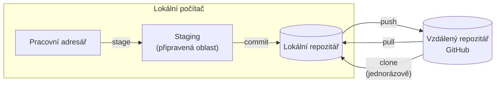
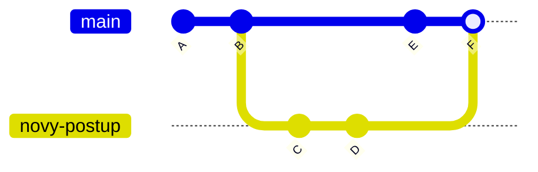

# Práce s gitem a GitHubem

*Výukový materiál — připomenutí verzování kódu pro grafická rozhraní (VS Code, GitHub Desktop, PyCharm)*

Tento text připomíná základy práce s gitem a GitHubem a poskytuje orientaci usnadňující zahájení práce v novém semestru. Popisuje operace a jejich smysl; jednotlivé úkony se provádějí v grafickém rozhraní, jehož konkrétní rozmístění tlačítek se mezi nástroji liší, avšak pojmenování operací je společné.

## 1. Proč verzovat kód

**Verzování** je průběžné ukládání stavů kódu do historie, k níž se lze kdykoli vrátit. Řeší několik opakujících se potíží:

- **historie a návrat zpět** — každý uložený stav (commit) je dohledatelný; při chybné úpravě se lze vrátit k dřívější funkční verzi,
- **spolupráce** — více lidí může pracovat na témž projektu, aniž si navzájem přepisují soubory,
- **konec ručního zálohování** — odpadá vytváření, pojmenovávání a zasílání kopií souborů,
- **dohledatelnost změn** — z historie je patrné, co a kdy se změnilo.

## 2. Git versus GitHub

Tyto dva pojmy se často zaměňují, jde však o dvě různé věci:

- **Git** je *nástroj* pro verzování. Běží na lokálním počítači, pracuje s lokálními soubory a funguje i bez připojení k internetu.
- **GitHub** je *hostovací služba* — místo na internetu, kam se ukládá kopie repozitáře, sdílí se s ostatními a spravuje přes webové rozhraní.

Git je samotným nástrojem verzování a je nezbytný; GitHub je jednou z možných služeb, kam lze umístit vzdálenou kopii repozitáře. Toto rozlišení je podstatné pro pochopení operace push, při níž se lokální změny přenášejí na GitHub.

## 3. Uspořádání gitu: čtyři oblasti kódu

Toto uspořádání je jádrem celého tématu. Většina nejasností pramení z toho, že není zřejmé, ve které ze čtyř oblastí se kód právě nachází. Kód postupně prochází těmito oblastmi:

1. **Pracovní adresář** (working directory) — soubory, které uživatel právě upravuje.
2. **Staging** (připravená oblast) — změny vybrané do nejbližšího commitu.
3. **Lokální repozitář** — historie commitů uložená na lokálním počítači.
4. **Vzdálený repozitář** — kopie historie na GitHubu.

Kód mezi nimi přechází čtyřmi operacemi:

- **stage** — přesune vybrané změny z pracovního adresáře do staging,
- **commit** — uloží změny ze staging jako commit do lokálního repozitáře,
- **push** — přenese lokální commity do vzdáleného repozitáře,
- **pull** — přenese commity ze vzdáleného repozitáře do lokálního.



Textový popis schématu:

- Pracovní adresář, staging a lokální repozitář se nacházejí na lokálním počítači; vzdálený repozitář je uložen na GitHubu.
- Operace **stage** přesouvá změny z pracovního adresáře do staging, operace **commit** je uloží do lokálního repozitáře.
- Operace **push** přenáší commity z lokálního repozitáře do vzdáleného, operace **pull** opačným směrem.
- Operace **clone** (kapitola 4) vytvoří lokální repozitář jako kopii vzdáleného; provádí se jednorázově na počátku práce.
- Všechny šipky zachycují postup kódu vpřed. Návrat ke starším stavům doplňuje stejně uspořádané schéma v materiálu [Historie, návraty a konflikty](historie-navraty-konflikty.md), kapitola 4.

> **Grafické rozhraní toto rozdělení zobrazuje přímo.** V panelu správy verzí (ve VS Code „Source Control", v GitHub Desktopu „Changes", v PyCharmu „Commit") jsou upravené soubory zpravidla rozděleny do dvou seznamů: změny mimo staging (pracovní adresář) a změny ve staging. Přesun mezi nimi odpovídá operaci stage. Sledování těchto dvou seznamů je nejrychlejší způsob, jak zjistit, kde se kód nachází.

## 4. Získání repozitáře: clone

Prací se zpravidla začíná operací **clone** — vytvořením lokální kopie vzdáleného repozitáře na počítači. V grafickém rozhraní se zadá adresa (URL) repozitáře z GitHubu a cílová složka; nástroj stáhne obsah i celou historii.

Ve VS Code se úkon vyvolá příkazem „Git: Clone", v GitHub Desktopu volbou „File → Clone repository", v PyCharmu volbou „Get from VCS". Po provedení operace clone je repozitář připraven k práci a je již propojen se svou vzdálenou kopií, čímž je určen cíl pozdějších operací push a pull.

## 5. Každodenní cyklus

Běžná práce probíhá v opakujícím se cyklu. Na jejím počátku je vhodné provést operaci **pull**, aby lokální kopie obsahovala případné změny ze vzdáleného repozitáře. Poté následuje vlastní práce a vytvoření commitu:

1. **pull** — na začátku práce se přenesou aktuální změny ze vzdáleného repozitáře.
2. Úprava souborů v pracovním adresáři.
3. **stage** — v panelu změn se vyberou soubory, které mají být součástí commitu.
4. **commit** — změny ve staging se s doprovodným sdělením uloží do lokálního repozitáře.
5. **push** — commity se přenesou do vzdáleného repozitáře.

V grafickém rozhraní odpovídá krok 3 označení souborů (tlačítko „+" či zaškrtnutí), krok 4 vyplnění pole se sdělením a stisku tlačítka „Commit" a krok 5 tlačítku „Push" (případně „Sync").

## 6. Táž práce v příkazové řádce

Ačkoli se v praxi pracuje převážně v grafickém rozhraní, tytéž úkony lze provést v příkazové řádce, kde je logika a posloupnost jednotlivých akcí zřetelnější — každý krok je samostatný pojmenovaný příkaz. Terminál je dostupný i uvnitř vývojových prostředí (PyCharm i VS Code jej mají zabudovaný).

Základní příkazy odpovídají operacím z předchozích kapitol:

```bash
git clone <adresa>          # clone: získání repozitáře
git status                  # výpis stavu — ve které oblasti se soubory nacházejí
git add <soubor>            # stage: přidání souboru do staging
git commit -m "sdělení"     # commit: uložení změn ze staging
git push                    # push: přenos commitů do vzdáleného repozitáře
git pull                    # pull: přenos commitů ze vzdáleného repozitáře
```

Každodenní cyklus z kapitoly 5 pak v terminálu tvoří zřetelnou posloupnost:

```bash
git pull                    # 1. pull aktuálního stavu
# ... úprava souborů ...
git status                  # 2. přehled změn a jejich stavu
git add soubor.py           # 3. stage vybraných změn
git commit -m "Popis změny" # 4. commit
git push                    # 5. push
```

Pro práci s větvemi slouží příkazy `git branch <jméno>` (založení větve), `git switch <jméno>` (přepnutí na větev) a `git merge <větev>` (merge uvedené větve do aktuální).

> **Doporučení:** Příkaz `git status` je vhodné používat často. Vypisuje, které soubory jsou upravené, které jsou ve staging a které dosud nejsou součástí žádného commitu, čímž přímo ukazuje rozdělení na čtyři oblasti z kapitoly 3.

## 7. Commity

**Commit** je uložený snímek změn ze staging spolu s **doprovodným sdělením**, které popisuje obsah commitu. Sdělení je určeno především pro pozdější orientaci v historii, proto má být stručné a výstižné (například „Oprava výpočtu vzdálenosti", nikoli „změny").

Doporučuje se **vytvářet commity často a po malých krocích**. Menší, tematicky ucelené commity se snáze čtou, snáze se k nim vrací a v případě potíží přesněji ukážou, kde nastala změna.

## 8. Větve (branches)

**Větev** je samostatná linie vývoje. Umožňuje pracovat na určité změně odděleně, aniž by se zasahovalo do hlavní, funkční verze projektu. Hlavní větev se obvykle nazývá `main`.

Odbočení do vlastní větve je vhodné například při zkoušení nového postupu: dokud změna není hotová, hlavní větev zůstává nedotčená. V grafickém rozhraní se aktuální větev zobrazuje zpravidla ve stavovém řádku a přepíná či zakládá se z jeho nabídky.

## 9. Merge

Operace **merge** (sloučení) spojí změny z jedné větve do druhé — typicky se dokončená práce z vedlejší větve začlení zpět do větve `main`. Nedotýkají-li se změny týchž míst, proběhne merge samočinně. Dotýkají-li se, vzniká konflikt (viz kapitola 10).



Textový popis schématu:

- Na větvi `main` vzniknou commity A a B.
- Z bodu B odbočí větev `novy-postup`, na níž vzniknou commity C a D; hlavní větev mezitím pokračuje commitem E.
- Operací merge vznikne commit F, který spojuje obě linie vývoje. Dotýkají-li se commity D a E téhož místa v souboru, nastane při operaci merge konflikt.

V grafickém rozhraní se merge vyvolá z nabídky větví (volba typu „Merge into current branch").

## 10. Konflikty

Konflikt vzniká, když se na témže místě souboru setkají dvě různé změny a nástroj nedokáže sám rozhodnout, která platí. **Konflikt není chyba ani selhání** — je to dotaz nástroje, který ponechává rozhodnutí na člověku.

Místo konfliktu je v souboru vyznačeno značkami:

```text
<<<<<<< HEAD
aktuální (lokální) verze řádku
=======
příchozí verze řádku
>>>>>>> nazev_vetve
```

Část mezi `<<<<<<< HEAD` a `=======` je verze aktuální (lokální), část mezi `=======` a `>>>>>>>` je verze příchozí. Řešení spočívá ve výběru správné podoby, odstranění všech značek a uložení výsledku do commitu.

Grafické rozhraní tento úkon usnadňuje: nabízí volby typu „Accept Current" (ponechat aktuální verzi), „Accept Incoming" (ponechat příchozí) a „Accept Both" (ponechat obě), případně samostatný slučovací editor se dvěma verzemi vedle sebe. Po vyřešení je nutné soubor přidat do staging (stage) a merge dokončit commitem.

Další způsoby řešení konfliktů, jejich ověření a prevenci popisuje materiál [Historie, návraty a konflikty](historie-navraty-konflikty.md), kapitoly 9 a 10.

## 11. Řešení častých obtíží

Následují nejčastější situace, které začátečníka znejistí, a jejich řešení. Zastřešující zásada zní: **před nevratným zásahem je vhodné se poradit; kód uložený v commitu se v gitu jen málokdy skutečně ztratí.** Úplný přehled návratů ke starším stavům podává materiál [Historie, návraty a konflikty](historie-navraty-konflikty.md).

- **Push selhává, protože vzdálený repozitář obsahuje novější změny.** Někdo — nebo tentýž uživatel z jiného počítače — mezitím provedl push. Řešením je nejprve provést pull, vyřešit případný konflikt a poté push zopakovat.
- **Nechtěná úprava souboru, dosud nezahrnutá do commitu.** Změny v pracovním adresáři lze zahodit volbou „Discard changes" a vrátit soubor do stavu posledního commitu.
- **Překlep ve sdělení nebo zapomenutý soubor v posledním commitu.** Poslední commit lze upravit volbou „Amend", a to pouze před provedením push.
- **Nejistota, kde se kód nachází.** Postačí otevřít panel změn a podle rozdělení na změny mimo staging a ve staging (kapitola 3) zjistit aktuální stav.

## 12. Co nepatří do repozitáře

Do verzování patří zdrojový kód, nikoli vše ostatní. K vyloučení vybraných souborů slouží soubor `.gitignore`, který obsahuje vzory názvů, jež git ignoruje. Do repozitáře zásadně **nepatří**:

- **citlivé údaje** — hesla, přístupové klíče, tokeny (viz [materiál o konfiguraci](../03-projekt-a-prostredi/konfiguracni-soubory.md), kapitola 4),
- **rozsáhlá data** — datové sady, obrázky, natrénované modely; git je určen pro text a kód, velké soubory repozitář zbytečně zvětšují,
- **odvozené a dočasné soubory** — virtuální prostředí, `__pycache__`, logy; jde o obsah, který lze kdykoli znovu vytvořit.

## 13. Shrnutí a odkazy

Git je nástroj pro verzování běžící lokálně, GitHub je hostovací služba pro vzdálené kopie. Kód prochází čtyřmi oblastmi — pracovní adresář, staging, lokální a vzdálený repozitář — a mezi nimi jej posouvají operace stage, commit, push a pull; grafické rozhraní tyto oblasti zobrazuje přímo. Běžná práce je opakující se smyčkou zakončenou operací push. Větve oddělují rozdělanou práci, operace merge ji vrací zpět a konflikt je dotazem, který řeší člověk. Kód uložený v commitu se jen málokdy ztratí; před nevratným zásahem je vhodné se poradit.

> **Další čtení:** navazující materiály [Historie, návraty a konflikty](historie-navraty-konflikty.md) (návraty ke starším stavům, konflikty, merge a rebase) a [Git v týmu a průběžná integrace](git-v-tymu-ci.md) (pull requesty, GitHub Actions); oficiální dokumentace gitu a volně dostupná kniha [Pro Git](https://git-scm.com/book), dokumentace GitHubu na [docs.github.com](https://docs.github.com).
