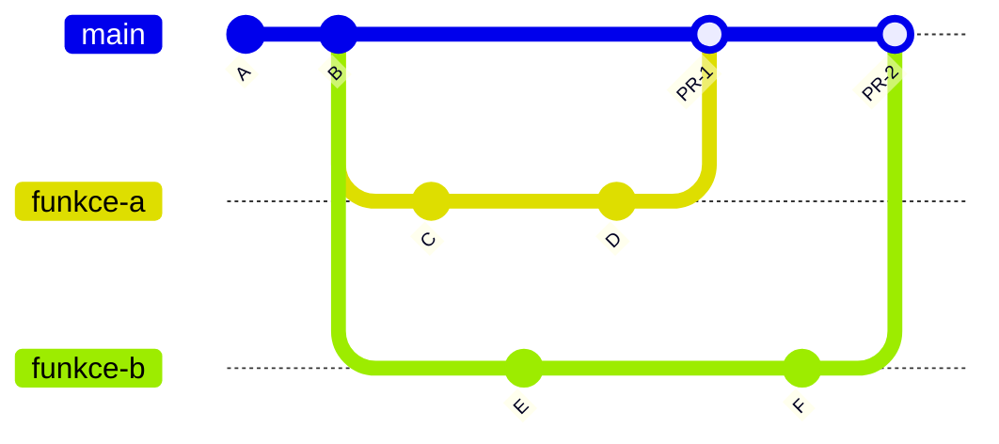
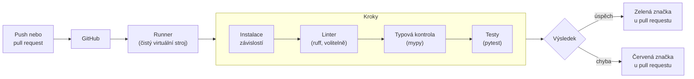
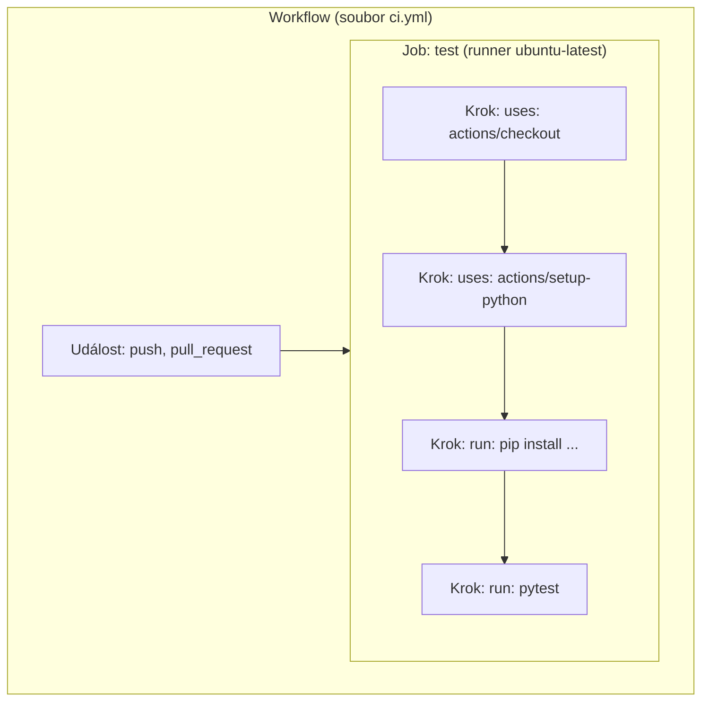

# Git v týmu a průběžná integrace (CI)

*Výukový materiál — pull requesty, posouzení změn a automatické testování pomocí GitHub Actions v týmovém projektu*

Tento text navazuje na materiál o základech práce s gitem a GitHubem a popisuje organizaci práce více lidí na jednom repozitáři. Představuje **pull requesty** jako místo, kde se změny projednávají a kontrolují před zařazením do hlavní větve, a **průběžnou integraci** (CI), která tuto kontrolu částečně automatizuje. Postupy jsou míněny jako praktické doporučení pro týmový projekt, nikoli jako povinnost; tým může zvolit i jednodušší způsob spolupráce. Podrobnosti o historii, o vracení změn a o řešení konfliktů obsahuje materiál [Historie, návraty a konflikty](historie-navraty-konflikty.md).

## 1. Účel automatické kontroly

Při práci několika lidí na jednom repozitáři se opakují dvě situace:

- **Závislost na prostředí autora.** Kód funguje na počítači autora, na jiném počítači však selže, protože tam chybí knihovna či soubor nebo je nainstalována jiná verze Pythonu. Příčina spočívá v rozdílech mezi prostředími, nikoli v samotném kódu.
- **Nefunkční hlavní větev.** Do větve `main` je zařazena změna, kterou nelze spustit nebo která způsobí selhání existujících testů. Ostatní členové týmu pak pracují s vadnou verzí a hledají chybu, kterou sami nezpůsobili.

Obě situace řeší stejný princip: změna se do hlavní větve nezařazuje bez kontroly. Kontrolu mohou provést ostatní členové týmu (**posouzení kódu**, review) a rovněž automatizovaný systém, který testy spouští vždy stejným způsobem v čistém prostředí. Rozdíly mezi počítači jednotlivých členů týmu se tím přestávají uplatňovat a výsledek kontroly je všem dostupný na jednom místě.

## 2. Týmový pracovní postup s větvemi a pull requesty

**Pull request** (PR, žádost o začlenění) je žádost o merge jedné větve do jiné, zpravidla do větve `main`. Na GitHubu je současně místem, kde se k dané změně soustřeďuje diskuse, posouzení kódu i výsledky automatických kontrol. Podstatou postupu je zásada: **každá změna vzniká na samostatné větvi a do `main` se dostává pouze prostřednictvím pull requestu**.



Textový popis schématu:

- Na větvi `main` jsou commity A a B; z bodu B vzniknou dvě větve, `funkce-a` (první člen týmu) a `funkce-b` (druhý člen týmu).
- Oba členové týmu pracují souběžně: první vytváří commity C a D, druhý commit E.
- Pull request č. 1 provede merge větve `funkce-a` do `main` (merge commit PR-1). Větev `funkce-b` je od té chvíle vůči `main` zpožděna (viz část o změnách v `main` níže).
- Druhý člen týmu vytvoří commit F a pull request č. 2 provede merge větve `funkce-b` do `main` (merge commit PR-2).
- Do `main` se nezapisuje přímo, všechny změny procházejí pull requestem.

> **Poznámka:** Postup vyžaduje, aby měli všichni členové týmu právo zápisu do repozitáře. Vlastník repozitáře je přidá v nastavení repozitáře v části věnované spolupracovníkům (Settings → Collaborators).

### Postup v grafickém rozhraní

1. **Založení větve** z aktuální `main` a vytvoření commitů v grafickém rozhraní, stejně jako v běžném cyklu. Větev se pojmenuje podle obsahu práce (například `pridat-normalizaci`).
2. **Push větve.** Ve VS Code a v GitHub Desktopu se první push nové větve provádí volbou „Publish Branch", v PyCharmu běžnou volbou „Push". Web GitHubu poté nabídne vytvoření pull requestu. GitHub Desktop k tomu nabízí tlačítko „Create Pull Request", které otevře příslušnou stránku na webu; ve VS Code (s rozšířením GitHub Pull Requests) a v PyCharmu lze pull request vytvořit přímo v aplikaci.
3. **Vytvoření pull requestu** na GitHubu: zadá se cílová větev (`main`), název a **popis**. Kvalitní popis uvádí obsah změny, její důvod a způsob, jak ji ověřit.
4. **Určení posuzovatele** (reviewer): v postranním panelu pull requestu se vybere člen týmu, který změnu posoudí.
5. **Posouzení kódu:** posuzovatel v záložce se změnami souborů (zpravidla „Files changed") připojí komentáře k jednotlivým řádkům a nakonec zvolí, zda změnu **schvaluje** (approve), nebo **požaduje úpravy** (request changes). Autor nemůže schválit vlastní pull request. Požadované úpravy autor uloží novými commity do téže větve; pull request se aktualizuje samočinně.
6. **Merge:** po schválení a po úspěšných kontrolách (kapitoly 3 a 7) autor nebo posuzovatel provede merge pull requestu tlačítkem na stránce pull requestu. GitHub nabízí několik způsobů merge (například „Create a merge commit", „Squash and merge", „Rebase and merge"); v běžném týmovém projektu postačuje výchozí způsob.
7. **Úklid:** větev, na níž proběhl merge, se na GitHubu smaže tlačítkem „Delete branch", které se zobrazí po provedení merge. V lokálním repozitáři se poté provede přepnutí na `main` a operace pull; lokální `main` tím získá i změnu z pull requestu.

> **Doporučení:** Pull request má být malý a tematicky ucelený. Změnu o několika desítkách řádků lze posoudit pečlivě, změna o několika stech řádků bývá schválena povrchně.

### Táž práce v příkazové řádce

```bash
git switch main
git pull                          # aktuální stav hlavní větve
git switch -c pridat-normalizaci  # založení větve a přepnutí na ni

# ... úprava souborů ...
git add src/projekt/preprocessing.py
git commit -m "Přidání normalizace vstupních dat"

git push -u origin pridat-normalizaci   # první push větve, nastaví sledování
```

Přepínač `-u` (zkratka `--set-upstream`) propojí lokální větev se stejnojmennou větví na GitHubu, takže při další operaci push postačí příkaz `git push`. Po provedení merge pull requestu se lokální stav aktualizuje a nepotřebná větev smaže:

```bash
git switch main
git pull
git branch -d pridat-normalizaci  # smazání lokální větve
```

Proběhl-li merge pull requestu způsobem „Squash and merge" nebo „Rebase and merge", git nepovažuje větev za začleněnou a příkaz `git branch -d` ji odmítne smazat. Po ověření, že merge pull requestu skutečně proběhl, se v takovém případě použije `git branch -D pridat-normalizaci`.

> **Poznámka:** Pull request lze vytvořit i z příkazové řádky pomocí nástroje **GitHub CLI** (`gh`), například příkazem `gh pr create`. Jde o volitelný nástroj; vše potřebné je dostupné i na webu GitHubu. Dokumentace je na [cli.github.com](https://cli.github.com/).

### Změny v `main` v průběhu práce

V průběhu práce na větvi mohou být do `main` zařazeny změny ostatních členů týmu (v diagramu větev `funkce-b` po merge PR-1). Větev je pak vůči `main` zpožděna; dotýkají-li se změny týchž míst, GitHub na stránce pull requestu ohlásí konflikt. Tlačítko pro aktualizaci větve („Update branch") nabízí GitHub jen při určitém nastavení repozitáře, a obvyklá je proto aktualizace v lokálním repozitáři. Oba způsoby aktualizace, tedy merge `main` do vlastní větve a rebase vlastní větve, popisuje materiál [Historie, návraty a konflikty](historie-navraty-konflikty.md), kapitola 11.2; řešení konfliktů popisuje kapitola 9 téhož materiálu.

## 3. Průběžná integrace

**Průběžná integrace** (CI, continuous integration) je postup, při němž se po každé změně kódu automaticky spustí předem určené kontroly. Na GitHubu ji zajišťuje služba **GitHub Actions**: při operaci push nebo při vytvoření či aktualizaci pull requestu GitHub automaticky připraví čistý virtuální stroj, který obsahuje standardní předinstalované nástroje, ale žádné soubory ani nastavení z předchozích běhů nebo z počítače autora. Na tento stroj stáhne kód, nainstaluje závislosti a spustí kontroly. Výsledek se zobrazí u příslušného commitu a v pull requestu.



Textový popis schématu:

- Spouštěčem je operace push nebo práce s pull requestem.
- GitHub přidělí **runner**, tedy čistý virtuální stroj bez souborů z předchozích běhů.
- Na runneru proběhnou kroky v pevném pořadí: instalace závislostí, volitelný linter, typová kontrola, testy. Selhání volitelného linteru výsledek úlohy neovlivní (kapitola 6).
- Výsledek se zobrazí u pull requestu a u commitů jako zelená značka (úspěch) nebo červená značka (chyba).

Přínos spočívá především v **čistém prostředí**. Na runneru, kam se z projektu dostane pouze obsah repozitáře a závislosti v něm uvedené, nezávisí kód na ničem, co má autor nainstalováno jen na svém počítači.

## 4. Pojmy GitHub Actions

Konfigurace CI se zapisuje do textového souboru ve formátu YAML, který je uložen přímo v repozitáři ve složce `.github/workflows/`. Používá následující pojmy:

- **workflow** — celý automatizovaný postup popsaný jedním souborem YAML,
- **událost** (event, trigger) — okolnost, která workflow spouští (například `push` nebo `pull_request`),
- **úloha** (job) — skupina kroků, která proběhne na jednom runneru; workflow může obsahovat více úloh,
- **krok** (step) — jednotlivá operace uvnitř úlohy; kroky se provádějí postupně,
- **runner** — stroj, na němž úloha běží (například `ubuntu-latest`),
- **akce** (action, klíč `uses:`) — hotový, opakovaně použitelný krok připravený třetí stranou, například stažení kódu,
- **příkaz** (klíč `run:`) — vlastní příkaz shellu, například `pytest`.



Textový popis schématu:

- Vnější blok představuje workflow, které je spuštěno událostí.
- Uvnitř je úloha `test` běžící na runneru `ubuntu-latest`.
- Úloha obsahuje čtyři kroky v pořadí shora dolů; první dva využívají hotové akce (`uses:`), další dva spouštějí příkazy (`run:`).

Odpovídající zápis v YAML (zkrácený, úplný příklad je v kapitole 5):

```yaml
name: CI                              # workflow
on: [push, pull_request]              # události
jobs:
  test:                               # úloha
    runs-on: ubuntu-latest            # runner
    steps:                            # kroky
      - uses: actions/checkout@v4     # akce
      # … příprava Pythonu a instalace závislostí vynechány
      - run: pytest                   # příkaz
```

## 5. První workflow a jeho rozbor

### Základy syntaxe YAML

- **Odsazení** určuje strukturu a provádí se **mezerami**, nikdy tabulátory; běžně dvěma mezerami na úroveň. Chybné odsazení je nejčastější příčinou nefunkčního workflow.
- **Klíč a hodnota** se zapisují jako `klíč: hodnota` (za dvojtečkou následuje mezera).
- **Seznam** se zapisuje buď po řádcích s pomlčkou (`- položka`), nebo v hranatých závorkách (`[a, b]`).
- **Komentář** začíná znakem `#`.
- Hodnoty, které by mohly být vyloženy jako číslo (verze Pythonu), se uvádějí v uvozovkách.

> **Upozornění:** Chyba ve formátu souboru se projeví tím, že se workflow nespustí, případně se v záložce Actions zobrazí chybové hlášení o neplatném souboru. Při potížích je vhodné nejprve zkontrolovat odsazení.

### Založení souboru

V grafickém rozhraní GitHubu se otevře záložka **Actions** repozitáře a zvolí se vytvoření nového workflow („New workflow"). GitHub nabízí šablony (například „Python application") a možnost sestavit workflow bez šablony („set up a workflow yourself"). V obou případech se otevře webový editor souboru ve složce `.github/workflows/`, obsah se upraví a uloží commitem. Soubor lze rovněž vytvořit lokálně ve vývojovém prostředí, uložit commitem a přenést operací push jako kterýkoli jiný soubor. Název souboru je libovolný, přípona `.yml` nebo `.yaml`.

### Minimální workflow

Následující příklad, uložený například jako `.github/workflows/ci.yml`, stáhne kód, připraví Python, nainstaluje závislosti ze souboru `requirements.txt` a spustí testy:

```yaml
name: CI

on:
  push:
    branches: [main]
  pull_request:
    branches: [main]

jobs:
  test:
    runs-on: ubuntu-latest
    steps:
      - name: Stažení kódu
        uses: actions/checkout@v4

      - name: Příprava Pythonu
        uses: actions/setup-python@v5
        with:
          python-version: "3.12"

      - name: Instalace závislostí
        run: |
          python -m pip install --upgrade pip
          pip install -r requirements.txt
          pip install pytest

      - name: Testy
        run: python -m pytest
```

Význam jednotlivých částí:

- **`name: CI`** — název workflow, zobrazuje se v záložce Actions a u výsledků kontrol.
- **`on:`** — události spouštějící workflow. Uvedený zápis znamená spuštění při operaci push do větve `main` a při pull requestech mířících do `main`. Pull request z vedlejší větve je tak zkontrolován ještě před provedením merge. Bez omezení `branches` se workflow spustí při každé operaci push do kterékoli větve.
- **`jobs:`** — seznam úloh; zde jediná, pojmenovaná `test`.
- **`runs-on: ubuntu-latest`** — typ runneru; GitHub poskytuje stroje s Linuxem, Windows a macOS. Pro výukové projekty postačuje Linux.
- **`steps:`** — seznam kroků.
- **`uses: actions/checkout@v4`** — hotová akce, která stáhne obsah repozitáře na runner. Bez ní by runner neobsahoval žádný kód. Část `@v4` určuje verzi akce.
- **`uses: actions/setup-python@v5`** s parametrem **`with:`** — nainstaluje zadanou verzi Pythonu. Číslo verze se uvádí jako řetězec v uvozovkách, jinak by se `3.10` vyložilo jako číslo `3.1`.
- **`run:`** — příkaz shellu. Zápis `|` umožňuje uvést více příkazů, každý na samostatném řádku. Příkaz `pip install -r requirements.txt` selže, pokud soubor `requirements.txt` v repozitáři chybí.
- **`python -m pytest`** — spustí `pytest` týmž interpretem, který připravila akce `setup-python`, a navíc přidá aktuální složku do cesty pro import (`sys.path`). U rozvržení `src/` to nestačí; balíček je třeba nainstalovat (viz následující část „Varianta pro rozvržení `src/`").

### Varianta pro rozvržení `src/`

U projektu s rozvržením `src/` a souborem `pyproject.toml` se závislosti i vlastní balíček instalují společně; krok instalace má pak tuto podobu:

```yaml
      - name: Instalace projektu
        run: |
          python -m pip install --upgrade pip
          pip install -e ".[dev]"
```

Skupina `dev` předpokládá, že `pyproject.toml` v oddílu `[project.optional-dependencies]` uvádí nástroje pro vývoj (pytest, mypy). Tato skupina je popsána v kapitole 9 [materiálu o struktuře projektu](../03-projekt-a-prostredi/struktura-projektu.md), která přesahuje rozsah kurzu; o nutnosti `pip install -e .` u rozvržení `src/` pojednává kapitola 6 téhož materiálu. Nepoužívá-li projekt skupinu `dev`, postačí `pip install -e .` a nástroje se doinstalují zvlášť (`pip install pytest mypy`).

## 6. Doporučené kontroly

Pro projekty v tomto kurzu jsou užitečné tři druhy kontrol, seřazené podle významu:

- **testy** (`pytest`) — ověřují chování kódu (viz [materiál o testování](../02-overovani-a-ladeni/testovani.md)),
- **typová kontrola** (`mypy`) — odhaluje nesoulad typů bez spuštění kódu (viz [materiál o typových anotacích](../01-psani-kodu/typovani-promennych.md), kapitola 5),
- **linter a formátovač** (`ruff`) — volitelný nástroj. Příkaz `ruff check` upozorňuje na stylové a drobné logické nedostatky, příkaz `ruff format --check` ověřuje jednotný formát kódu. Pro tým je přínosný zejména tím, že sjednocuje formát kódu a předchází sporům o něj.

Rozšířený příklad pro projekt s rozvržením `src/`, s oddělenými kroky:

```yaml
name: CI

on:
  push:
    branches: [main]
  pull_request:
    branches: [main]

jobs:
  checks:
    runs-on: ubuntu-latest
    steps:
      - uses: actions/checkout@v4

      - uses: actions/setup-python@v5
        with:
          python-version: "3.12"
          cache: pip
          cache-dependency-path: pyproject.toml

      - name: Instalace projektu
        run: |
          python -m pip install --upgrade pip
          pip install -e ".[dev]"
          pip install ruff

      - name: Linter a formát (volitelné)
        continue-on-error: true
        run: |
          python -m ruff check .
          python -m ruff format --check .

      - name: Typová kontrola
        run: python -m mypy src

      - name: Testy
        run: python -m pytest
```

Kroky se provádějí **v uvedeném pořadí** a **první selhání úlohu zastaví**: nezdaří-li se typová kontrola, testy se již nespustí. Pořadí je proto vhodné volit od nejméně náročných kontrol k nejnáročnějším. Aby selhání volitelného kroku nezastavilo ostatní kontroly, je u kroku s nástrojem `ruff` uvedeno `continue-on-error: true`; selhání tohoto kroku se pak nepovažuje za selhání úlohy a je patrné pouze v záznamu běhu. Mají-li být výsledky všech kontrol viditelné nezávisle a závazně, lze je rozdělit do samostatných úloh (`jobs`), které běží souběžně.

Parametr `cache: pip` ukládá stažené balíčky mezi běhy (podrobněji kapitola 10).

> **Doporučení:** Do CI patří pouze kontroly, které lze stejným příkazem spustit i lokálně. Autor pak může před provedením push ověřit totéž, co ověří GitHub, a nemusí čekat na výsledek ze serveru.

> **Poznámka:** Nástroj `mypy` se spouští nad složkou se zdrojovým kódem (zde `src`). U projektu bez složky `src/` se uvede odpovídající složka nebo soubor, instalace probíhá jako v minimálním příkladu z kapitoly 5 a parametr `cache-dependency-path` se změní na `requirements.txt` (případně se vynechá).

## 7. Výsledky kontrol

Výsledek je dostupný na několika místech:

- v záložce **Actions** repozitáře — seznam všech běhů workflow s výsledkem, větví a časem,
- u pull requestu — oddíl s kontrolami (checks) uvádí stav každé úlohy a odkaz na podrobnosti,
- u commitů v historii repozitáře — zelená značka (úspěch), červená značka (chyba), případně symbol probíhajícího běhu.

**Čtení záznamu neúspěšného běhu.** Po otevření běhu se zobrazí úlohy a jejich kroky; neúspěšný krok je označen červeně. Za neúspěšný se považuje krok, jehož příkaz skončil nenulovým návratovým kódem (viz [materiál o výjimkách](../01-psani-kodu/vyjimky.md), kapitola 10). Rozbalením kroku se zobrazí jeho výstup, tedy tentýž text, který by vypsala příkazová řádka. Postup je následující:

1. Najít první červeně označený krok (následující kroky se kvůli zastavení úlohy neprovedly).
2. V jeho výstupu vyhledat první chybové hlášení, nikoli poslední; následné chyby bývají jeho důsledkem.
3. Pokusit se chybu zopakovat lokálně stejným příkazem.

Nejčastější příčiny, kdy kód lokálně funguje, avšak v CI selhává:

| Příčina | Příznak v záznamu | Řešení |
|---|---|---|
| Chybějící závislost v `requirements.txt` | `ModuleNotFoundError: No module named '...'` | doplnit knihovnu do `requirements.txt` (nebo do `pyproject.toml`) |
| Rozvržení `src/` bez instalace balíčku | `ModuleNotFoundError` pro vlastní balíček v testech | v kroku instalace použít `pip install -e .` (viz [materiál o struktuře projektu](../03-projekt-a-prostredi/struktura-projektu.md), kapitola 6) |
| Absolutní cesta k souboru na počítači autora | `FileNotFoundError: ... C:\Users\...` | cesty skládat relativně ke kořeni projektu pomocí `pathlib` (viz tentýž materiál, kapitola 8) |
| Soubor existuje jen lokálně, protože je uveden v `.gitignore` | `FileNotFoundError` pro datový nebo konfigurační soubor | testy nesmějí záviset na ignorovaných souborech; potřebná data se vytvoří v testu (kapitola 10) |
| Odlišná verze Pythonu nebo knihovny | odlišné chování, `SyntaxError`, varování o zastaralé funkci | sjednotit verzi v `setup-python` a zafixovat verze knihoven (viz [materiál o kontejnerizaci](../03-projekt-a-prostredi/kontejnerizace.md), kapitola 7) |
| Rozdíl operačního systému | selhání při práci s cestami nebo konci řádků | používat `pathlib`; případně v CI zvolit stejný systém, jaký tým používá |
| Nenastavený seed | test občas projde a občas selže | nastavit seedy (viz [materiál o reprodukovatelnosti](../03-projekt-a-prostredi/reprodukovatelnost-seedy.md), kapitoly 4 a 5) |
| Žádné nalezené testy | `no tests ran`, návratový kód 5 | dodržet konvenci pojmenování `test_*.py` a `test_*` (viz [materiál o testování](../02-overovani-a-ladeni/testovani.md), kapitola 8) |

## 8. Ochrana větve main

Samotné CI výsledek pouze zobrazuje; nebrání tomu, aby proběhl merge vadné změny. K vynucení pravidel slouží **ochrana větve** (branch protection), případně novější **sady pravidel** (rulesets). Nastavují se v nastavení repozitáře (Settings), v části věnované větvím (Branches) nebo pravidlům (Rules, Rulesets); přesné pojmenování voleb se mezi verzemi webového rozhraní liší. Nastavení vyžaduje oprávnění správce repozitáře.

Pro tým jsou užitečná zejména tato pravidla pro větev `main`:

- **zákaz přímého zápisu** — změny jsou možné pouze prostřednictvím pull requestu,
- **povinná kontrola CI** — merge je možný až po úspěšném proběhnutí vybraných kontrol,
- **povinné schválení** — merge vyžaduje alespoň jedno schválení od jiného člena týmu.

> **Upozornění:** Kontrolu CI lze vybrat jako povinnou teprve poté, co proběhla alespoň jednou; do té doby ji nastavení repozitáře nenabízí.

> **Poznámka:** Ochrana větve je volitelná a v malém týmu nemusí být nutná. Je přínosná zejména tehdy, jsou-li do `main` opakovaně zařazovány nefunkční změny nebo má-li být kontrola nepominutelným krokem. Podle dokumentace GitHubu jsou tato pravidla u soukromých repozitářů dostupná až v placených tarifech; studenti je mohou získat prostřednictvím programu GitHub Education. Aktuální podmínky uvádí [dokumentace GitHubu k chráněným větvím](https://docs.github.com/repositories/configuring-branches-and-merges-in-your-repository/managing-protected-branches).

## 9. Tajné údaje v CI

Workflow někdy potřebuje přístupový klíč (například k API nebo ke službě pro sledování experimentů). Takový údaj se **nikdy nezapisuje do souboru YAML ani jinam do repozitáře**: repozitář je viditelný všem členům týmu, u veřejného repozitáře komukoli, a údaj, který byl jednou přenesen operací push, je nutné považovat za kompromitovaný (viz [materiál o konfiguraci](../03-projekt-a-prostredi/konfiguracni-soubory.md), kapitola 4).

K ukládání slouží **GitHub Secrets**: hodnota se zadá v nastavení repozitáře (Settings → Secrets and variables → Actions) a ve workflow se na ni odkazuje zápisem `${{ secrets.NAZEV }}`. GitHub hodnotu ve výpisech maskuje. Údaj se obvykle předává programu jako proměnná prostředí:

```yaml
      - name: Testy s přístupem k API
        env:
          API_KEY: ${{ secrets.API_KEY }}
        run: python -m pytest
```

Kód pak hodnotu čte stejným způsobem jako lokálně z proměnné prostředí (`os.environ["API_KEY"]`), takže se lokální a serverový běh liší pouze zdrojem hodnoty.

> **Upozornění:** Tajné údaje se zpravidla nepředávají workflow spuštěným z pull requestů z cizích kopií repozitáře (forků). Testy by proto bez těchto údajů neměly zbytečně selhávat; testy vyžadující externí službu je vhodné opatřit náhradním objektem (mock), nebo je přeskočit.

## 10. Specifika projektů strojového učení

U projektů strojového učení je třeba počítat s několika omezeními:

- **V CI se modely netrénují.** Runner je určen ke krátkým kontrolám, nikoli k výpočtům trvajícím hodiny. CI má ověřovat, že kód funguje, nikoli že model dosahuje dobré kvality.
- **Testy používají malá syntetická data.** Několik řádků vygenerovaných v samotném testu postačí k ověření, že funkce pro předzpracování, model i vyhodnocení proběhnou a vracejí výsledky správných tvarů. Testy tak nezávisejí na souborech, které v repozitáři nejsou.
- **Seedy se nastavují** i v testech, aby výsledek nezávisel na náhodě (viz [materiál o reprodukovatelnosti](../03-projekt-a-prostredi/reprodukovatelnost-seedy.md), kapitoly 4 a 5).
- **Mezipaměť závislostí.** Instalace knihoven, zejména knihovny PyTorch, trvá dlouho. Parametr `cache: pip` u akce `setup-python` uloží stažené balíčky mezi běhy a instalaci urychlí.
- **Bez GPU.** Standardní runnery nemají grafickou kartu. Kód proto musí být spustitelný na procesoru; výpočetní zařízení se nezadává pevně, nýbrž se volí podle dostupnosti: `device = "cuda" if torch.cuda.is_available() else "cpu"`. Na runneru je výhodné instalovat verzi knihovny PyTorch pouze pro procesor, která je podstatně menší: `pip install torch --index-url https://download.pytorch.org/whl/cpu`. Aktuální postup uvádí dokumentace PyTorch.
- **Časové a kapacitní limity.** Běh úlohy má časový limit a využívání runnerů je u soukromých repozitářů omezeno měsíčním limitem minut zahrnutým v tarifu; u veřejných repozitářů jsou standardní runnery bezplatné. Aktuální podmínky uvádí dokumentace GitHubu.
- **Velká data a modely do repozitáře nepatří** (viz kapitola 12 materiálu [Práce s gitem a GitHubem](git-github-pripomenuti.md)). Jejich zařazení by repozitář zbytečně zvětšilo a testy v CI na nich nemají záviset.

> **Upozornění:** Nenalezne-li akce `setup-python` při zapnuté mezipaměti (`cache: pip`) soubor se závislostmi, krok skončí chybou. Výchozím hledaným souborem je `requirements.txt`; u projektu, který závislosti uvádí v `pyproject.toml`, je spolehlivější uvést cestu výslovně: `cache-dependency-path: pyproject.toml`.

Příklad testu nezávislého na vnějších souborech:

```python
import numpy as np


def normalizuj(x):
    # v projektu by se funkce importovala z balíčku, např. from projekt.preprocessing import normalizuj
    return (x - x.mean(axis=0)) / x.std(axis=0)


def test_normalizace_ma_nulovy_prumer():
    rng = np.random.default_rng(42)          # pevný seed
    x = rng.normal(loc=5.0, scale=2.0, size=(100, 3))   # syntetická data

    y = normalizuj(x)

    assert np.allclose(y.mean(axis=0), 0.0)
    assert y.shape == x.shape
```

## 11. Shrnutí a odkazy

Ve vícečlenném týmu je účelné zařazovat změny do `main` pouze prostřednictvím pull requestu: každá změna vzniká na samostatné větvi, je posouzena jiným členem týmu a teprve poté začleněna operací merge. Průběžná integrace (GitHub Actions) k tomu přidává automatickou kontrolu na čistém virtuálním stroji, která odhalí závislost kódu na prostředí autora. Workflow se zapisuje v YAML do složky `.github/workflows/` a skládá se z událostí, úloh a kroků; minimální podoba instaluje závislosti a spouští `pytest`, rozšířená podoba pro rozvržení `src/` přidává typovou kontrolu nástrojem `mypy` a volitelně nástroj `ruff`. Při selhání se čte výstup prvního neúspěšného kroku. Ochrana větve `main` umožňuje vynutit povinný pull request a úspěšné kontroly, tajné údaje se ukládají do GitHub Secrets. U projektů strojového učení se v CI netrénuje, testuje se na malých syntetických datech a počítá se s nedostupností GPU a s limity runnerů.

> **Další čtení:** dokumentace [GitHub Actions](https://docs.github.com/actions), dokumentace GitHubu k [pull requestům](https://docs.github.com/pull-requests) a k [ochraně větví](https://docs.github.com/repositories/configuring-branches-and-merges-in-your-repository/managing-protected-branches). Souvisejícím materiálem o řešení konfliktů a vracení změn je [Historie, návraty a konflikty](historie-navraty-konflikty.md).
