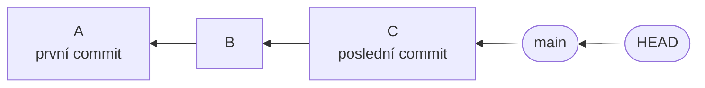
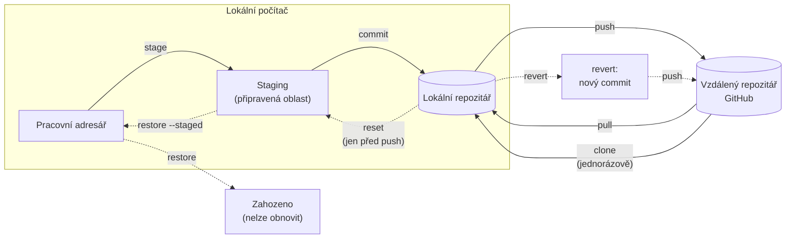
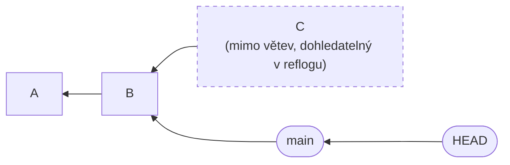
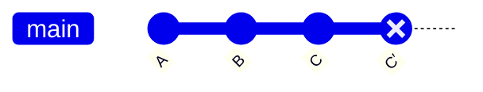
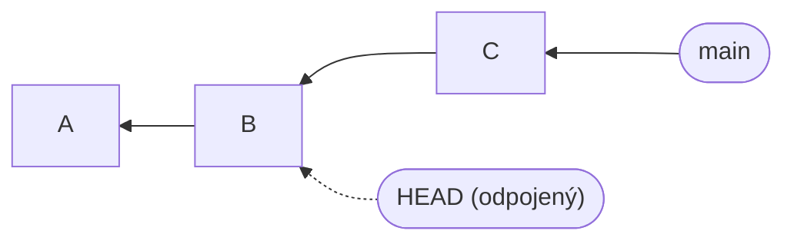
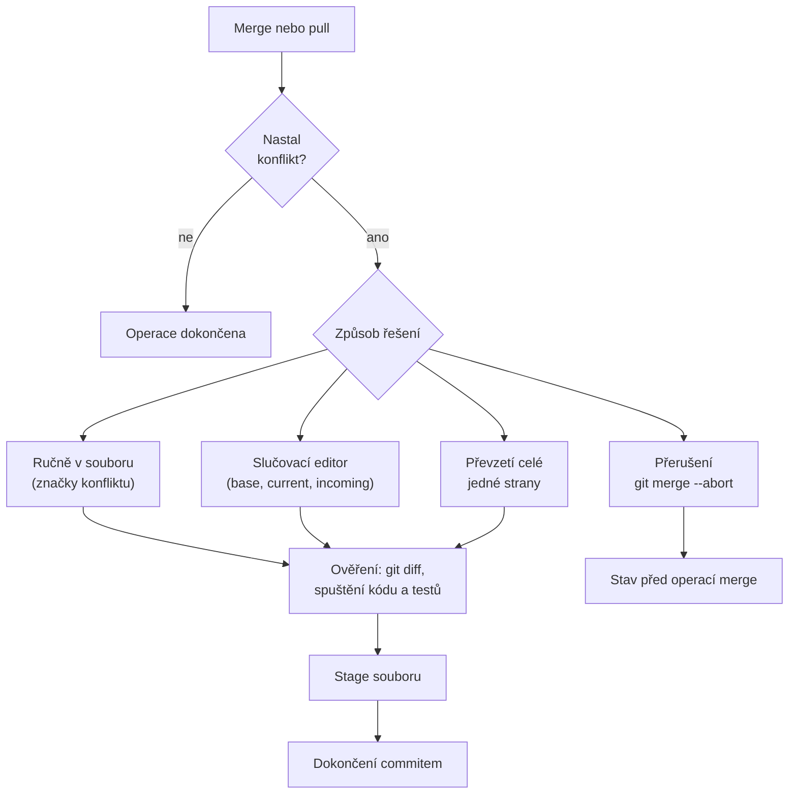
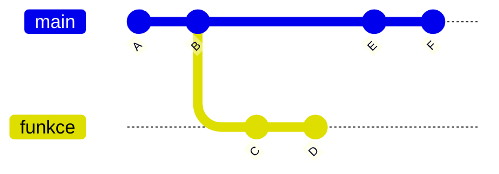
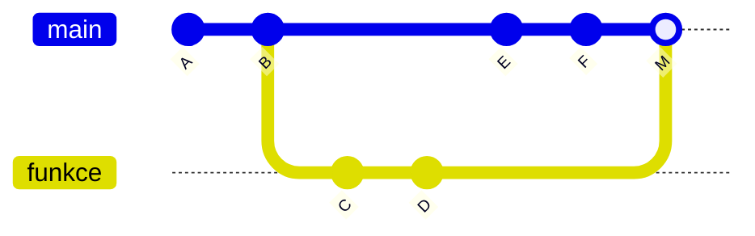
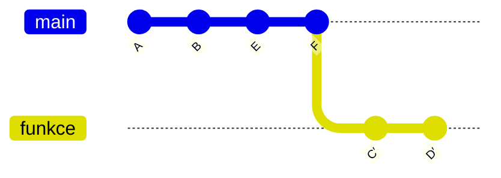

# Historie, návraty a konflikty

*Výukový materiál — prohlížení historie, vracení změn, řešení konfliktů a rozdíl mezi operacemi merge a rebase v gitu*

Tento text navazuje na materiál [Práce s gitem a GitHubem](git-github-pripomenuti.md) a převádí v něm uvedenou zásadu, že kód uložený v commitu se jen málokdy ztratí, do konkrétních postupů. Popisuje orientaci v historii, vracení změn podle oblasti, v níž se nacházejí, důvody, proč nelze přepisovat historii již přenesenou do vzdáleného repozitáře, podrobný postup při konfliktech a situace, kdy je namísto operace merge vhodná operace rebase. Každý postup je uveden nejprve v grafickém rozhraní (VS Code, GitHub Desktop, PyCharm) a poté v příkazové řádce. Pracovní postup v týmu včetně pull requestů a automatizovaných kontrol je předmětem materiálu [Git v týmu a průběžná integrace](git-v-tymu-ci.md).

## 1. Úvod a návaznost

Materiál rozvíjí především čtyři kapitoly úvodního textu:

- kapitola 3 (čtyři oblasti kódu) určuje, kterým způsobem se změna vrací; tato klasifikace je osou kapitoly 4 tohoto materiálu,
- kapitola 7 (commity) zdůrazňuje malé a tematicky ucelené commity, které se snáze vracejí a slučují,
- kapitola 10 (konflikty) vysvětluje značky konfliktu a jejich ruční řešení; kapitola 9 tohoto materiálu je doplňuje o další způsoby řešení a o ověření výsledku,
- kapitola 11 (řešení častých obtíží) uvádí zásadu, že kód uložený v commitu se téměř neztrácí; kapitoly 4 až 8 tohoto materiálu ukazují, jak se k němu vrátit.

Celým textem prochází jedno pravidlo: **volba postupu závisí na tom, zda již byl commit operací push přenesen do sdíleného repozitáře.** Commit, který existuje pouze lokálně, lze upravovat volně; commit již přenesený operací push je třeba vracet způsobem, který historii nepřepisuje.

## 2. Commit, HEAD a větev jako ukazatele

Výklad v následujících kapitolách vychází z modelu tří pojmů:

- **commit** (kapitola 7 úvodního materiálu) je snímek celého projektu v určitém okamžiku. Každý commit uchovává odkaz na svého předchůdce (rodiče), čímž vzniká řetězec commitů. Commit je identifikován **hashem** (kontrolním součtem), například `a1b2c3d`.
- **větev** (branch) je pouze pojmenovaný ukazatel na jeden commit. Při vytvoření nového commitu se ukazatel posune na něj.
- **HEAD** je ukazatel určující aktuální polohu v historii. Zpravidla ukazuje na větev, a tím nepřímo na její poslední commit.



Textový popis schématu:

- Commity A, B a C tvoří řetězec; šipky vedou od každého commitu k jeho rodiči (C k B, B k A).
- Větev `main` ukazuje na commit C.
- HEAD ukazuje na větev `main`, a tedy nepřímo na commit C. Nový commit se přidá za C a ukazatel `main` se na něj přesune.

Většina operací v dalších kapitolách spočívá v přesunu některého z těchto ukazatelů nebo ve vytvoření nového commitu. Existující commity se nemění; proto je jejich ztráta vzácná (kapitola 8).

## 3. Prohlížení historie

Před jakýmkoli návratem je nutné určit, ke kterému stavu se vracet. Prohlížení historie repozitář nijak nemění, a je proto bezpečné.

**V grafickém rozhraní:**

- ve VS Code zobrazuje historii vybraného souboru panel „Timeline" v postranním panelu Průzkumníka; výběr položky otevře porovnání s předchozí verzí. Přehledný graf větví nabízí rozšíření „Git Graph",
- v GitHub Desktopu slouží záložka „History", která vypisuje commity aktuální větve; po výběru commitu se zobrazí změněné soubory a jejich rozdíly,
- v PyCharmu slouží okno „Git" se záložkou „Log" (graf větví a commitů) a u souboru volba typu „Show History" či „Annotate" (obdoba `git blame`, zobrazí autora každého řádku).

Porovnání dvou verzí téhož souboru nabízejí všechny tři nástroje: ve VS Code volbami typu „Select for Compare" a „Compare with Selected" v panelu Timeline, v PyCharmu volbou typu „Compare with…", v GitHub Desktopu se rozdíly zobrazují přímo po výběru commitu.

**V příkazové řádce:**

```bash
git log --oneline --graph --all   # stručný přehled historie včetně větví
git log -p -- soubor.py           # historie jednoho souboru s rozdíly
git show a1b2c3d                  # obsah a rozdíly jednoho commitu
git diff a1b2c3d e4f5a6b          # rozdíl mezi dvěma commity
git diff a1b2c3d e4f5a6b -- soubor.py  # totéž omezené na jeden soubor
git blame soubor.py               # u každého řádku commit a autor poslední změny
```

Commit se označuje hashem; postačuje jeho úvodní část (zpravidla sedm znaků), je-li jednoznačná. K označení commitu vzhledem k aktuální poloze slouží **relativní odkazy**:

- `HEAD` je aktuální commit,
- `HEAD~1` je jeho rodič (o jeden commit zpět), `HEAD~2` o dva commity zpět atd.

Například `git diff HEAD~1 HEAD` zobrazí změny provedené posledním commitem.

> **Doporučení:** Příkaz `git blame` neslouží k určení odpovědné osoby, nýbrž k dohledání commitu, který řádek změnil. Sdělení tohoto commitu (kapitola 7 úvodního materiálu) pak vysvětluje důvod změny.

## 4. Mapa návratů podle umístění změny

Volba příkazu pro návrat závisí na tom, ve které ze čtyř oblastí (kapitola 3 úvodního materiálu) se změna nachází. Čím vzdálenější je oblast od pracovního adresáře, tím opatrnější postup je nutný.

Následující schéma má stejné uspořádání jako schéma v kapitole 3 úvodního materiálu; je doplněno o přerušované šipky návratů.



Textový popis schématu:

- Plné šipky zachycují postup kódu vpřed (stage, commit, push, pull, clone) shodně se schématem z úvodního materiálu.
- Přerušované šipky zachycují, kam se změna při návratu přesouvá.
- Příkaz `restore` zahazuje úpravy v pracovním adresáři; soubor dostane podobu ze staging, a není-li v něm, z posledního commitu. Zahozené úpravy nelze obnovit.
- Příkaz `restore --staged` vrací změnu ze staging zpět do pracovního adresáře.
- Příkaz `reset` vrací změny commitů, které dosud nebyly přeneseny operací push: v režimu `--soft` do staging, v režimu `--mixed` do pracovního adresáře, v režimu `--hard` je zahazuje.
- Příkaz `revert` vytváří nový commit s opačným účinkem; ten se přenese běžnou operací push, takže se vzdálená historie pouze rozšiřuje.

### 4.1 Zahození úpravy mimo commit

Situace: soubor v pracovním adresáři byl upraven nechtěně a úprava dosud není součástí žádného commitu.

- **Grafické rozhraní:** v panelu změn volba typu „Discard changes" u příslušného souboru (ve VS Code „Discard Changes", v GitHub Desktopu „Discard changes", v PyCharmu „Rollback").
- **Příkazová řádka:**

```bash
git restore soubor.py       # soubor se vrátí do stavu ze staging, jinak z posledního commitu
git restore .               # totéž pro všechny upravené soubory
```

Starší návody uvádějí `git checkout -- soubor.py`.

> **Upozornění:** Zahozené úpravy, které nebyly součástí žádného commitu, nelze obnovit. Jde o jeden z mála případů skutečné ztráty práce (kapitola 8). Před zahozením je vhodné zkontrolovat obsah příkazem `git diff`. Volba „Discard Changes" ve VS Code u dosud nesledovaného (nového) souboru tento soubor po potvrzení smaže.

### 4.2 Odebrání ze staging

Situace: do staging byl přidán soubor, který nemá být součástí nejbližšího commitu. Úprava souboru se zachovává.

- **Grafické rozhraní:** volba typu „Unstage" (ve VS Code znaménko „−" u souboru, v GitHub Desktopu odznačení zaškrtávacího políčka, v PyCharmu odznačení souboru v seznamu commitu).
- **Příkazová řádka:**

```bash
git restore --staged soubor.py   # soubor zpět ze staging do pracovního adresáře
```

Starší návody uvádějí `git reset HEAD soubor.py`; výsledek je shodný.

### 4.3 Oprava posledního commitu

Situace: v posledním commitu je překlep ve sdělení nebo chybí soubor.

- **Grafické rozhraní:** volba typu „Amend" (v GitHub Desktopu „Amend Commit…" v kontextové nabídce posledního commitu v záložce History, ve VS Code „Commit (Amend)" v nabídce u tlačítka Commit, v PyCharmu zaškrtávací políčko „Amend").
- **Příkazová řádka:**

```bash
git add zapomenuty_soubor.py
git commit --amend --no-edit          # doplnění souboru, sdělení zůstává
git commit --amend -m "Nové sdělení"  # změna sdělení
```

Operace amend nahrazuje poslední commit novým commitem s jiným hashem. Původní commit přestává být součástí větve.

> **Upozornění:** Operace amend je určena pouze pro commit, který **dosud nebyl přenesen operací push**. Po provedení push by se přepsala historie, kterou mohli ostatní členové týmu již získat operací pull (kapitola 6).

### 4.4 Zrušení commitů před provedením push

Situace: bylo vytvořeno několik commitů, které nemají být zachovány, a žádný z nich dosud nebyl přenesen operací push. Větev se posune zpět na dřívější commit.

- **Grafické rozhraní:** v PyCharmu v záložce „Log" volba typu „Reset Current Branch to Here" s výběrem režimu; v GitHub Desktopu volba „Undo" u posledního commitu (změny se vrátí do seznamu změn); ve VS Code volba „Undo Last Commit" (odpovídá režimu `--soft`). Režim `--hard` grafická rozhraní nabízejí jen zřídka.
- **Příkazová řádka:**

```bash
git reset --soft  HEAD~1   # zruší commit, změny zůstanou ve staging
git reset --mixed HEAD~1   # zruší commit, změny zůstanou v pracovním adresáři (výchozí režim)
git reset --hard  HEAD~1   # zruší commit i změny
```

Režimy se liší vlivem na staging a na pracovní adresář; větev se ve všech třech přesouvá shodně.

| Režim | Posun větve | Staging | Pracovní adresář |
|---|---|---|---|
| `--soft` | ano | zůstává (změny zrušeného commitu jsou ve staging) | beze změny |
| `--mixed` | ano | vyprázdní se | beze změny (změny jsou mimo staging) |
| `--hard` | ano | vyprázdní se | **přepíše se, změny se zahodí** |

Režim `--soft` je vhodný při spojení několika malých commitů do jednoho, režim `--mixed` při rozdělení příliš velkého commitu na několik menších.

> **Upozornění:** Režim `--hard` zahazuje úpravy v pracovním adresáři, které nejsou součástí žádného commitu, bez možnosti jejich obnovy. Commity zůstávají dohledatelné (kapitola 8), úpravy mimo commit nikoli. Před použitím je vhodné ověřit stav příkazem `git status` a případné úpravy uložit operací stash (kapitola 8.1).

**Commit vytvořený na nesprávné větvi.** Častým případem je commit vytvořený na `main`, ačkoli měl vzniknout na samostatné větvi (za předpokladu, že dosud neproběhl push). Postup spočívá v založení nové větve na aktuálním commitu a ve vrácení původní větve o commit zpět:

```bash
git branch spravna        # nová větev ukazuje na aktuální commit
git reset --hard HEAD~1   # původní větev o commit zpět (pracovní adresář musí být čistý)
git switch spravna        # pokračování na správné větvi
```

Commit tak zůstává zachován na větvi `spravna`; původní větev se posunula o commit zpět a na tento commit již neukazuje. V grafickém rozhraní lze postup provést v PyCharmu (založení větve z vybraného commitu a volba „Reset Current Branch to Here"); v ostatních nástrojích se použije příkazová řádka.

### 4.5 Zrušení commitu po provedení push

Situace: chybný commit je již ve vzdáleném repozitáři a ostatní členové týmu jej mohli získat operací pull. Historie se nesmí přepsat (kapitola 6); namísto toho se vytvoří nový commit s opačným účinkem.

- **Grafické rozhraní:** volba typu „Revert" (v GitHub Desktopu „Revert Changes in Commit" v nabídce commitu v záložce History, v PyCharmu „Revert Commit" v záložce Log, ve VS Code prostřednictvím rozšíření Git Graph, jinak v příkazové řádce). Na GitHubu tlačítko „Revert" u pull requestu, na němž již proběhl merge, vytvoří nový pull request s vracejícím commitem.
- **Příkazová řádka:**

```bash
git revert a1b2c3d         # vytvoří nový commit rušící účinek commitu a1b2c3d
git push                   # běžný push
```

Má-li být vrácen merge commit, je nutné určit, která větev se považuje za hlavní: `git revert -m 1 <commit>`.

> **Upozornění:** Po vrácení merge commitu nepřinese opakovaný merge téže větve vrácené změny znovu, protože jsou v historii již obsaženy (a následně vráceny). K jejich obnovení je třeba vrátit samotný vracející commit.

## 5. Příkazy reset a revert

Oba příkazy slouží k návratu, avšak s opačným vlivem na historii.

Výchozí stav: na větvi `main` leží commity A, B a C (schéma v kapitole 2).

Příkaz **reset** (`git reset --hard HEAD~1`) posune větev zpět na B. Commit C již není součástí větve:



Textový popis schématu:

- Větev `main` (a s ní HEAD) se přesunula z C na B.
- Commit C nadále existuje v lokálním repozitáři, ale žádná větev na něj neukazuje (přerušovaný okraj); dohledat jej lze prostřednictvím reflogu (kapitola 8).

Příkaz **revert** (`git revert <hash commitu C>`) historii zachová a přidá nový commit C′, jehož změny jsou opakem změn commitu C:



Textový popis schématu:

- Commity A, B a C zůstávají beze změny.
- Commit C′ (zvýrazněný jako vracející) je nový commit vytvořený za C, který ruší jeho účinek. Obsah projektu je po něm shodný se stavem po B, historie však obsahuje záznam, že C vzniklo a bylo vráceno.

Příkaz revert je pro sdílenou historii bezpečný, protože **pouze přidává** další commit. Člen týmu, který již commit C získal, obdrží při příští operaci pull commit C′ a jeho lokální historie zůstává slučitelná se vzdálenou. Příkaz reset by naopak vytvořil rozpor mezi lokální a vzdálenou historií (kapitola 6).

## 6. Základní pravidlo: nepřepisovat historii po provedení push

Příkazy `git reset`, `git commit --amend` i `git rebase` (kapitola 11) **přepisují historii**: nahrazují existující commity novými commity s jinými hashi. U commitů, které existují pouze v jednom lokálním repozitáři, to nepředstavuje problém. U commitů již přenesených operací push je důsledek následující:

1. Jiný člen týmu získal operací pull commity A, B, C a pokračuje v práci od C.
2. Autor commitu C přesune příkazem `git reset` svou větev na B, vytvoří jiný commit D a pokusí se provést push.
3. Vzdálený repozitář obsahuje C, lokální historie nikoli; historie se rozešly a **push je odmítnut**.
4. Je-li push vynucen (`--force`), vzdálená historie se přepíše. Druhý člen týmu má pak ve své kopii commit C, který ve vzdáleném repozitáři neexistuje; při další operaci pull vzniknou konflikty a jeho práce se může zdvojit, případně se odstraněné změny vrátí zpět do repozitáře.

Odmítnutý push je tedy ochranný mechanismus, nikoli porucha, a řešením není jeho vynucení:

> **Upozornění:** Příkaz `git push --force` nahrazuje vzdálenou historii bez ohledu na její obsah a může odstranit práci ostatních členů týmu. Pro commity již přenesené operací push se používá `git revert` (kapitola 4.5). Je-li přepsání vlastní větve nevyhnutelné (například po operaci rebase, kapitola 11), je vhodné použít `git push --force-with-lease`: push proběhne pouze tehdy, ukazuje-li vzdálená větev stále na commit, který lokální kopie naposledy získala operací fetch. Proběhne-li mezitím fetch (i automaticky v editoru), ochrana se neuplatní; je proto vhodné před provedením push zkontrolovat historii. Na společných větvích (`main`) se vynucený push nepoužívá vůbec.

## 7. Prohlédnutí staršího stavu a převzetí souboru

Návrat ke staršímu stavu nevyžaduje přepsání historie. Starší stav lze pouze prohlédnout, nebo z něj převzít jednotlivý soubor.

### 7.1 Prohlédnutí staršího stavu (detached HEAD)

- **Grafické rozhraní:** v seznamu commitů (History, Log) volba typu „Checkout" u zvoleného commitu (v PyCharmu „Checkout Revision", ve VS Code prostřednictvím rozšíření Git Graph).
- **Příkazová řádka:**

```bash
git switch --detach a1b2c3d   # pracovní adresář odpovídá commitu a1b2c3d
# ... prohlížení, spuštění kódu ...
git switch main               # návrat na aktuální stav větve
```

Starší návody uvádějí k témuž účelu `git checkout a1b2c3d`.

Stav, v němž HEAD neukazuje na větev, ale přímo na commit, se nazývá **detached HEAD** (odpojený HEAD). Git na něj upozorní varovným hlášením.



Textový popis schématu:

- Větev `main` ukazuje na commit C, HEAD však není vázán na větev a ukazuje na starší commit B.
- Pracovní adresář obsahuje stav B. Commity vytvořené v tomto stavu nepatří žádné větvi a po přepnutí na jinou větev se stávají obtížně dohledatelnými.

Má-li práce pokračovat od odpojeného stavu, je třeba nejprve založit větev:

```bash
git switch -c oprava-ze-stareho-stavu   # větev vzniká v aktuálním (starším) commitu
```

### 7.2 Převzetí jednoho souboru ze starší verze

Postačuje-li starší verze jediného souboru, není nutné přepínat celý projekt:

```bash
git restore --source a1b2c3d soubor.py   # soubor v pracovním adresáři dostane podobu z commitu a1b2c3d
```

Starší návody uvádějí `git checkout a1b2c3d -- soubor.py`; tento příkaz soubor zároveň přidá do staging. Výsledek příkazu `git restore --source` se zobrazí jako běžná úprava mimo commit, kterou lze zkontrolovat, přidat do staging a uložit novým commitem, nebo zahodit (kapitola 4.1). V PyCharmu tuto možnost nabízí okno historie souboru (Show History) volbou typu „Get"; ve VS Code a v GitHub Desktopu se použije příkazová řádka.

## 8. Stash a reflog

### 8.1 Stash: dočasné uložení rozpracované práce

Operace **stash** dočasně uloží úpravy, které nejsou součástí žádného commitu, a vyčistí pracovní adresář. Využívá se v situaci, kdy je nutné přepnout větev nebo provést pull, avšak z rozpracovaných úprav ještě nemá vzniknout commit.

- **Grafické rozhraní:** ve VS Code volba „Stash" v nabídce panelu Source Control, v GitHub Desktopu volba typu „Stash changes" při přepínání větve, v PyCharmu „Stash Changes" v nabídce Git (vlastní obdobou je samostatný mechanismus „Shelve Changes").
- **Příkazová řádka:**

```bash
git stash push -m "rozpracovaná úprava"  # uloží úpravy do stash, pracovní adresář je čistý
git stash list                            # přehled uložených úprav
git pull                                  # nebo git switch jina-vetev
git stash pop                             # obnovení úprav a jejich odstranění ze stash
```

Nové (dosud nesledované) soubory se do stash uloží pouze s přepínačem `-u` (`git stash push -u`). Obnovení úprav příkazem `git stash pop` může vyvolat konflikt (kapitola 9.1); v takovém případě zůstávají úpravy ve stash zachovány.

### 8.2 Reflog: dohledání ztracených commitů

Git zaznamenává každý přesun ukazatele HEAD do takzvaného **reflogu** (záznamu přesunů referencí). I commit, který po příkazu `git reset` již není součástí žádné větve, je tak po určitou dobu (ve výchozím nastavení řádově týdny až měsíce) dohledatelný.

```bash
git reflog                                # seznam posledních poloh HEAD
# a1b2c3d HEAD@{0}: reset: moving to HEAD~2
# 9f8e7d6 HEAD@{1}: commit: Přidání vyhodnocení
git reset --hard 9f8e7d6                  # návrat na stav před nechtěným příkazem reset
# alternativně: git switch -c zachrana 9f8e7d6
```

Tímto způsobem lze obnovit i commit odstraněný z větve příkazem `git reset --hard`. Bezpečnější je druhá varianta, tedy založení nové větve, která stávající stav nepřepisuje.

### 8.3 Co lze skutečně ztratit

- **Commity** lze po operacích reset, amend či rebase zpravidla dohledat v reflogu.
- **Úpravy mimo commit** (a neuložené operací stash) po příkazu `git restore` nebo `git reset --hard` **obnovit nelze**. Totéž platí pro nesledované soubory odstraněné příkazem `git clean`.

Zásada tedy zní: před operací, která může zahodit úpravy, je vhodné je uložit do commitu (i dočasného) nebo operací stash.

## 9. Konflikty podrobněji

Kapitola 10 úvodního materiálu vysvětluje podstatu konfliktu a podobu jeho značek. Tato kapitola doplňuje, kdy konflikty vznikají, jakými způsoby je lze řešit a jak ověřit výsledek.

### 9.1 Kdy konflikty vznikají

Konflikt může nastat při každé operaci, která spojuje dvě různé podoby téhož místa:

- **merge** větví,
- **pull** — nejčastější případ v týmu. Operace pull je kombinací operací fetch a merge; změnil-li jiný člen týmu tytéž řádky, konflikt nastává ve druhé fázi, při operaci merge stavu získaného operací fetch s lokálním,
- **revert** — vracený commit se dotýká míst, která byla mezitím změněna,
- **stash pop** — úpravy uložené ve stash se dotýkají míst změněných po jejich uložení,
- **rebase** (kapitola 11) — konflikt může nastat u kteréhokoli přenášeného commitu.

### 9.2 Postup řešení



Textový popis schématu:

- Po operaci merge nebo pull se zjišťuje, zda nastal konflikt; pokud ne, operace je dokončena.
- Při konfliktu existují čtyři možnosti: ruční úprava značek, slučovací editor, převzetí celé jedné strany souboru a přerušení.
- První tři možnosti vedou ke společnému postupu: ověření výsledku, stage souboru a dokončení commitem.
- Přerušení vrací repozitář do stavu před zahájením operace merge; konflikt je možné řešit později.

### 9.3 Možnosti řešení

**Ruční úprava ve značkách.** Postup je popsán v kapitole 10 úvodního materiálu (výběr správné podoby, odstranění značek `<<<<<<<`, `=======`, `>>>>>>>`, stage a commit).

**Slučovací editor (3-way merge).** VS Code i PyCharm nabízejí editor, který zobrazuje verze **current** (aktuální, lokální) a **incoming** (příchozí) a výsledek; společného předka (**base**), tedy verzi, z níž obě změny vycházely, lze zobrazit (ve VS Code volbou v nabídce editoru, v PyCharmu je výchozím obsahem prostředního panelu). Výsledek se skládá v samostatném panelu a lze do něj přebírat jednotlivé změny z obou stran. Společný předek ukazuje, která strana co skutečně změnila, což značky v textu neukazují. Ve VS Code se editor otevírá volbou typu „Resolve in Merge Editor", v PyCharmu tlačítkem „Merge" v dialogu konfliktních souborů.

**Převzetí celého souboru jedné strany.** Je-li zřejmé, že platí celá jedna verze souboru, není nutné upravovat jednotlivé značky:

```bash
git restore --ours   soubor.py   # ponechá verzi z aktuální větve (lokální)
git restore --theirs soubor.py   # převezme verzi z příchozí větve
git add soubor.py                # soubor je označen za vyřešený
```

Starší návody uvádějí `git checkout --ours soubor.py`, resp. `--theirs`. V grafickém rozhraní tomu ve VS Code odpovídají volby „Accept Current Change" / „Accept Incoming Change" nad každým konfliktním místem a pro celý soubor příkazy palety „Merge Conflict: Accept All Current" / „Merge Conflict: Accept All Incoming"; v PyCharmu volby „Accept Yours" / „Accept Theirs".

**Přerušení.** Není-li situace jasná nebo ukáže-li se, že byla zvolena nesprávná větev, lze operaci zrušit:

```bash
git merge --abort          # návrat do stavu před operací merge
git rebase --abort         # obdoba pro rebase
```

Po přerušení operace pull, která skončila konfliktem, je repozitář opět ve stavu před jejím spuštěním a žádná práce se neztrácí.

> **Doporučení:** Před zahájením operace merge je vhodné mít čistý pracovní adresář (úpravy uložené v commitu nebo operací stash). Přerušení pak vrací přesně původní stav.

### 9.4 Ověření po vyřešení

Odstranění značek konfliktu neznamená, že výsledek je správný. Kód může být syntakticky platný, a přitom chybně spojit obě změny, například ponechat volání funkce, jejíž podpis druhá strana změnila. Před dokončením commitu je proto vhodné:

1. zkontrolovat výsledek příkazem `git diff` (u operace merge zobrazuje rozdíly vůči oběma rodičům) a ujistit se, že v souborech nezůstala žádná ze značek; k tomu slouží `git diff --check` či `git grep "<<<<<<<"`,
2. spustit kód a automatizované testy podle [materiálu o testování](../02-overovani-a-ladeni/testovani.md), kapitola 8 (pytest),
3. teprve poté provést stage souboru a dokončit merge commitem.

```bash
git diff                         # kontrola výsledku
git diff --check                 # zbylé značky konfliktu a nadbytečné mezery
python -m pytest                 # spuštění testů
git add soubor.py
git commit                       # dokončení operace merge (sdělení je předvyplněno)
```

### 9.5 Soubory, které nelze smysluplně slučovat

Řešení konfliktů pracuje po řádcích textu. U některých formátů tento předpoklad neplatí.

- **Jupyter notebooky (`.ipynb`).** Notebook je textový soubor ve formátu JSON, který kromě kódu obsahuje i výstupy buněk, jejich pořadová čísla a metadata. Prosté otevření a opětovné spuštění notebooku mění velké části souboru, takže konflikty vznikají i bez skutečných rozporů a jsou obtížně čitelné. Doporučuje se:
  - **mazat výstupy před vytvořením commitu** (v JupyterLabu „Clear Outputs of All Cells", ve VS Code „Clear All Outputs"); nástroj `nbstripout` je může odstraňovat automaticky jako filtr gitu při operaci stage,
  - používat nástroj `nbdime`, který notebooky porovnává a slučuje po buňkách (`nbdime config-git --enable` jej nastaví jako výchozí pro git).
- **Binární soubory a modely** (obrázky, natrénované modely, datové soubory). Nelze je slučovat po řádcích; při konfliktu lze pouze zvolit jednu z verzí (`git restore --ours` / `--theirs`). Takové soubory do repozitáře obvykle nepatří (kapitola 12 úvodního materiálu); je-li jejich verzování nezbytné, slouží k tomu rozšíření Git LFS.

> **Doporučení:** Dva členové týmu by neměli současně upravovat tentýž notebook. Dohoda o rozdělení práce (kapitola 10) je u notebooků účinnější než jakýkoli nástroj.

## 10. Prevence konfliktů v týmovém projektu

Konfliktům se zcela vyhnout nelze, jejich četnost a obtížnost však lze výrazně snížit:

- **Častý pull.** Čím dříve se zjistí, že jiný člen týmu změnil totéž místo, tím menší je rozdíl, který je třeba sloučit. Operaci pull je vhodné provádět na začátku práce a před operací push.
- **Malé a časté commity** (kapitola 7 úvodního materiálu). Konflikt v malé změně se řeší snadno.
- **Krátkodobé větve.** Větev, která se od `main` odlišuje po dobu několika týdnů, hromadí rozdíly. Je vhodné na ní co nejdříve provést merge do `main`, nebo ji alespoň aktualizovat o změny z `main` (kapitola 11.2).
- **Rozdělení práce podle souborů a modulů.** Odpovídá-li každý člen týmu za jiné soubory, vznikají konflikty jen výjimečně. Soubory, které upravují všichni (konfigurace, společné pomocné moduly, notebooky), jsou nejčastějším zdrojem potíží.
- **Dohoda o rozdělení odpovědnosti.** U týmového projektu v rámci kurzu je vhodné před zahájením práce určit odpovědnost za jednotlivé části a před rozsáhlou úpravou sdíleného souboru informovat ostatní.
- **Jednotný způsob formátování.** Hromadná změna formátování (odsazení, pořadí importů) mění mnoho řádků a vyvolává zbytečné konflikty; provádí se samostatným commitem a po dohodě v týmu.

Pracovní postup založený na větvích a pull requestech, který četnost konfliktů dále snižuje, popisuje materiál [Git v týmu a průběžná integrace](git-v-tymu-ci.md).

## 11. Merge a rebase

### 11.1 Dva způsoby spojení rozdělené historie

Pokud se vedlejší větev a `main` rozešly (každá obsahuje commity, které druhá nemá), lze je spojit dvěma způsoby. Výchozí stav: na `main` leží A, B, E, F; z B odbočila větev `funkce` s commity C a D.



Textový popis schématu:

- Commity A a B jsou společným základem.
- Větev `funkce` obsahuje commity C a D, větev `main` po rozdělení commity E a F. Žádná z větví neobsahuje práci druhé.

Operace **merge** spojí obě linie novým merge commitem M. Původní commity zůstávají nezměněny:



Textový popis schématu:

- Historie obsahuje všechny původní commity A až F beze změny.
- Nový merge commit M spojuje konec větve `funkce` (D) s koncem `main` (F). Historie zůstává rozvětvená.

Operace **rebase** přenese commity větve `funkce` na konec `main`, jako by práce začala až po F. Commity se při tom vytvářejí znovu, a proto mají nové hashe; zde jsou označeny C′ a D′:



Textový popis schématu:

- Výsledek je zachycen jako samostatný stav, protože diagram typu gitGraph nedokáže přesun commitů znázornit jako proces.
- Na `main` leží A, B, E, F. Větev `funkce` odbočuje až z F a obsahuje commity C′ a D′. Commit C′ je nová kopie commitu C a D′ nová kopie commitu D; obsah změn je shodný, hashe jsou nové.
- Historie je lineární; nevzniká merge commit.

Operace rebase tedy **přepisuje commity** (původní C a D jsou nahrazeny novými), což je důvodem omezení uvedeného v kapitole 11.5.

### 11.2 Využití rebase a aktualizace vlastní větve

**Pull s rebase.** Je-li operace pull nastavena na merge (`pull.rebase false`, ve starších verzích gitu výchozí chování) a vznikly lokální i vzdálené commity, vytvoří se merge commit typu „Merge branch 'main' of github.com/…". Takové commity zaplňují historii bez věcného obsahu. Příkaz

```bash
git pull --rebase          # lokální commity se přenesou za commity získané operací pull
```

přenese lokální commity za nově získané a historie zůstane lineární. Chování lze nastavit trvale:

```bash
git config --global pull.rebase true
```

V grafickém rozhraní tomu ve VS Code odpovídá nastavení `git.rebaseWhenSync` (týká se tlačítka Sync; samostatně je k dispozici příkaz „Git: Pull (Rebase)"), v PyCharmu volba „Rebase" jako způsobu aktualizace větve. GitHub Desktop se řídí nastavením `pull.rebase` v gitu.

Není-li způsob nastaven, novější verze gitu při rozdělené historii hlásí „You have divergent branches and need to specify how to reconcile them" a operaci pull odmítnou provést. Řešením je zvolit způsob jednorázově (`git pull --rebase`, popř. `git pull --no-rebase`) nebo trvale pomocí `git config`.

**Aktualizace vlastní větve o změny z `main`.** Vlastní větev, která zaostala za `main`, lze aktualizovat dvěma způsoby.

Prvním způsobem je **merge aktuální `main` do vlastní větve**. Historie se nepřepisuje, a postup je proto bezpečný i pro větev, na níž již proběhl push:

```bash
git switch funkce
git fetch origin
git merge origin/main      # změny z main se zapojí do větve merge commitem
git push                   # běžný push, vynucení není třeba
```

V grafickém rozhraní se po operaci pull na větvi `main` zvolí v nabídce větví merge větve `main` (případně `origin/main`) do aktuální větve, obdobně jako v kapitole 9 úvodního materiálu.

Druhým způsobem je **rebase vlastní větve** na aktuální konec `main`, po němž zůstává historie lineární:

```bash
git switch funkce
git fetch origin
git rebase origin/main     # commity větve se přenesou za aktuální main
```

Proběhl-li na větvi již push, je po operaci rebase nutné použít `git push --force-with-lease` (kapitola 6) a předem ověřit, že na větvi nepracuje nikdo jiný. Pro větev, na níž již proběhl push, je proto v týmovém projektu bezpečnější volbou merge.

### 11.3 Konflikty při rebase

Při operaci rebase se commity přenášejí **postupně jeden po druhém**, a konflikt tak může nastat u kteréhokoli z nich. Řešení probíhá po jednotlivých commitech:

```bash
git rebase origin/main
# konflikt: vyřešit soubor, poté
git add soubor.py
git rebase --continue      # pokračuje dalším commitem
git rebase --skip          # přeskočí aktuální commit (jeho změny se zahodí)
git rebase --abort         # zruší celou operaci rebase, návrat do původního stavu
```

Na rozdíl od operace merge se po vyřešení konfliktu nespouští `git commit`; commit vytvoří příkaz `git rebase --continue`.

> **Upozornění:** Při operaci rebase mají označení „ours" a „theirs" **opačný význam než při operaci merge**. Rebase přenáší commity na nový základ, takže „ours" označuje větev, na kterou se commity přenášejí (například `main`), a „theirs" vlastní commit, který se právě přenáší. Příkazy `git restore --ours` a `--theirs` je proto při operaci rebase nutné používat s rozmyslem. Totéž platí pro popisky ve slučovacím editoru: „Current" označuje větev, na kterou se commity přenášejí, „Incoming" vlastní přenášený commit. Před převzetím celé strany je vhodné ověřit, ze kterého commitu změna pochází (popisek s hashem či sdělením).

### 11.4 Úprava vlastních commitů před sdílením

Interaktivní rebase (`git rebase -i`) umožňuje upravit vlastní commity, na nichž dosud neproběhl push, například spojit několik drobných commitů typu „oprava překlepu" do jednoho:

```bash
git rebase -i HEAD~4       # otevře seznam posledních čtyř commitů
# u commitů určených ke spojení se místo pick uvede squash (nebo s)
```

Pro orientaci postačuje vědět, že tato možnost existuje. Grafická rozhraní ji nabízejí přehledněji než textový editor: v PyCharmu volba typu „Squash Commits" nebo „Interactively Rebase from Here" v záložce Log, v GitHub Desktopu volba „Squash Commits" v nabídce commitů a změna pořadí přetažením myší. Na GitHubu lze commity spojit i při operaci merge pull requestu (volba „Squash and merge").

### 11.5 Pravidlo a srovnání

**Operace rebase se používá pouze u vlastních větví, jejichž commity dosud nikdo jiný nezískal.** Pro společné větve a sdílené commity platí zásada z kapitoly 6.

| Hledisko | Merge | Rebase |
|---|---|---|
| Vliv na historii | zachová ji, přidá merge commit | přepíše commity (nové hashe), historie je lineární |
| Bezpečnost | bezpečný i pro sdílené větve | bezpečný jen pro commity, které nikdo jiný nemá (vlastní větev); po provedení push nutné `--force-with-lease` |
| Vhodné použití | zapojení hotové funkce do `main`, aktualizace vlastní větve po provedení push, sdílené větve | aktualizace vlastní větve před provedením push, `git pull --rebase`, úprava commitů před pull requestem |
| Řešení konfliktů | jednou pro celou operaci | postupně po jednotlivých commitech, význam `ours`/`theirs` je obrácený |
| Návrat při potížích | `git merge --abort` | `git rebase --abort`, případně reflog |

## 12. Shrnutí: situace a řešení

| Situace | Řešení v grafickém rozhraní | Příkaz | Kapitola |
|---|---|---|---|
| Soubor byl nechtěně upraven, úprava není v žádném commitu | „Discard changes" | `git restore soubor` | 4.1 |
| Do staging byl přidán nechtěný soubor | „Unstage" | `git restore --staged soubor` | 4.2 |
| Překlep ve sdělení posledního commitu (před push) | „Amend" | `git commit --amend -m "…"` | 4.3 |
| Poslední commit (před push) má být zrušen, úpravy zachovány | „Undo" / „Undo Last Commit" | `git reset --soft HEAD~1` (popř. `--mixed`) | 4.4 |
| Chybný commit je již v `main` na GitHubu | „Revert" | `git revert <commit>`, `git push` | 4.5, 5 |
| Commit vznikl na nesprávné větvi (před push) | v PyCharmu založení větve z commitu a „Reset Current Branch to Here", jinak příkazová řádka | `git branch spravna`, `git reset --hard HEAD~1`, `git switch spravna` | 4.4 |
| Je třeba zobrazit nebo spustit kód v dřívějším stavu | „Checkout" commitu | `git switch --detach <commit>`, návrat `git switch main` | 7.1 |
| Je zapotřebí starší verze jednoho souboru | v PyCharmu volba typu „Get" v historii souboru, jinak příkazová řádka | `git restore --source <commit> soubor` | 7.2 |
| Pull skončil konfliktem | slučovací editor | vyřešení, `git add`, `git commit`, nebo `git merge --abort`; při pull s rebase `git add`, `git rebase --continue`, nebo `git rebase --abort` | 9, 11.3 |
| Vlastní větev zaostala za `main` | merge `main` do aktuální větve | `git merge origin/main` (popř. `git rebase origin/main`) | 11.2 |
| Rozpracované úpravy brání přepnutí větve nebo operaci pull | „Stash" | `git stash push`, `git stash pop` | 8.1 |
| Omylem byl proveden `git reset --hard` | zpravidla nedostupné, příkazová řádka | `git reflog`, `git reset --hard <hash>` | 8.2 |
| Push je odmítnut kvůli rozdělené historii | pull a vyřešení konfliktu | `git pull` (popř. `--rebase`), poté `git push` | 6, 11.2 |

Pro řešení omylů platí opakující se zásady. Nejprve je třeba určit, ve které oblasti se změna nachází (kapitola 4). Commity, na nichž dosud neproběhl push, lze volně upravovat příkazy `git reset`, `git commit --amend` či `git rebase`; commity již přenesené operací push se vracejí příkazem `git revert`, který historii pouze doplňuje (kapitoly 5 a 6). Kód uložený v commitu zůstává dohledatelný prostřednictvím reflogu, skutečně ztratit lze pouze úpravy mimo commit (kapitola 8). Konflikty jsou běžnou součástí týmové práce: jejich četnost snižuje častý pull a rozdělení práce, správnost jejich řešení potvrzuje až spuštění kódu a testů (kapitoly 9 a 10). Merge historii zachovává, rebase ji zpřehledňuje, ale přepisuje, a proto je vyhrazen pro vlastní větve (kapitola 11).

> **Další čtení:** kniha [Pro Git](https://git-scm.com/book): vracení změn popisuje kapitola „Git Basics" (podkapitola 2.4 Undoing Things); kapitola „Git Tools" obsahuje podkapitoly „Reset Demystified", „Stashing and Cleaning", „Rewriting History" a „Advanced Merging"; operaci rebase popisuje podkapitola „Rebasing" v kapitole „Git Branching". Dále dokumentace nástroje [nbdime](https://nbdime.readthedocs.io).
