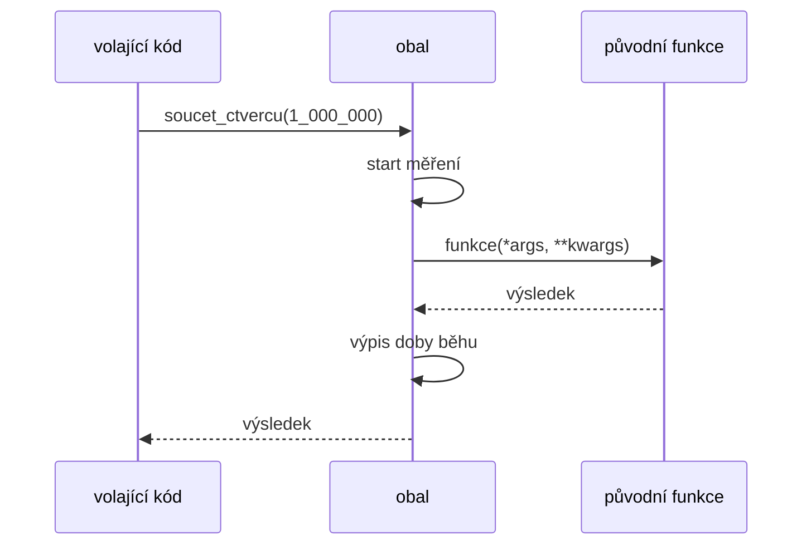
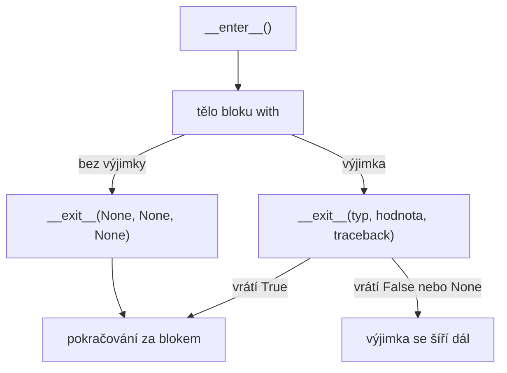

# Dekorátory a kontextové manažery

*Výukový materiál — funkce jako objekty, dekorátory a příkaz `with` v jazyce Python*

Zápisy se znakem `@` nad definicí funkce či třídy a příkaz `with` se v pythonním kódu vyskytují velmi často: `@property`, `@dataclass`, `@pytest.fixture`, `@torch.no_grad()`, `with open(...)`. Tento materiál vykládá mechanismus, z něhož oba prostředky vycházejí, a ukazuje, jak napsat vlastní dekorátor i vlastní kontextový manažer. Výklad postupuje od funkcí jako objektů přes uzávěry k dekorátorům a končí kontextovými manažery, které řeší příbuznou úlohu: provést určitý kód před a po bloku příkazů.

## 1. Motivace

Některé činnosti se opakují u mnoha funkcí, ačkoli s jejich vlastním účelem nesouvisejí: měření doby běhu, záznam volání do logu, opakování při přechodném selhání, ukládání již spočtených výsledků. Vložení takového kódu do každé funkce zvlášť vede k opakování a zatemňuje vlastní logiku funkce.

**Dekorátor** (decorator) tuto činnost odděluje: je to funkce, která přijme jinou funkci a vrátí její upravenou podobu, aniž by se měnil kód původní funkce. **Kontextový manažer** (context manager) řeší příbuznou úlohu pro blok kódu: zajistí, že se před blokem provede příprava a po něm úklid, a to i tehdy, nastane-li v bloku výjimka.

Oba prostředky vycházejí z toho, že funkce je v jazyce Python objekt jako každý jiný (kapitola 2) a že vnitřní funkce má přístup k proměnným funkce vnější (kapitola 3).

## 2. Funkce jako objekt

Funkci lze přiřadit do proměnné, předat jako argument jiné funkci i vrátit jako výsledek. Rozhodující je rozdíl mezi zápisem `pozdrav` (funkce jako objekt) a `pozdrav(...)` (volání funkce a jeho výsledek):

```python
def pozdrav(jmeno):
    return f"Ahoj, {jmeno}"

f = pozdrav                         # přiřazení funkce, nikoli její volání
print(f("Eva"))                     # Ahoj, Eva
print(f.__name__)                   # pozdrav

def proved_dvakrat(funkce, argument):   # funkce jako argument
    return [funkce(argument), funkce(argument)]

print(proved_dvakrat(pozdrav, "Jan"))   # ['Ahoj, Jan', 'Ahoj, Jan']
```

Předání funkce jako argumentu je běžné i ve standardní knihovně, například parametr `key` funkce `sorted`:

```python
slova = ["hruška", "jablko", "kiwi"]
print(sorted(slova, key=len))       # ['kiwi', 'hruška', 'jablko']
```

## 3. Vnořené funkce a uzávěry

Funkci lze definovat uvnitř jiné funkce a vrátit ji jako výsledek. Vnitřní funkce přitom má přístup k proměnným vnější funkce, a to i poté, co vnější funkce skončila:

```python
def vytvor_nasobic(faktor):
    def nasob(x):
        return x * faktor           # faktor pochází z vnější funkce
    return nasob                    # vrací se funkce, nikoli výsledek jejího volání

dvojnasobek = vytvor_nasobic(2)
trojnasobek = vytvor_nasobic(3)
print(dvojnasobek(10), trojnasobek(10))   # 20 30
```

Funkce spolu s hodnotami proměnných vnějšího rozsahu, které využívá, se nazývá **uzávěr** (closure). Každé volání `vytvor_nasobic` vytvoří nový uzávěr s vlastní hodnotou `faktor`. Tutéž úlohu lze řešit i třídou s metodou `__call__` (viz [materiál o základech objektově orientovaného programování](zaklady-oop.md), kapitola 4); uzávěr je stručnější, třída je vhodnější, má-li objekt více údajů nebo metod.

Má-li vnitřní funkce hodnotu proměnné vnější funkce **měnit**, musí ji označit klíčovým slovem `nonlocal`. Bez něj by přiřazení vytvořilo novou lokální proměnnou vnitřní funkce:

```python
def vytvor_pocitadlo():
    pocet = 0
    def zvys():
        nonlocal pocet              # přiřazení se týká proměnné vnější funkce
        pocet += 1
        return pocet
    return zvys

pocitadlo = vytvor_pocitadlo()
pocitadlo()
pocitadlo()
print(pocitadlo())                  # 3
```

> **Upozornění:** Uzávěr neuchovává hodnotu proměnné z okamžiku vytvoření, nýbrž proměnnou samotnou; její hodnota se zjišťuje až při volání (tzv. **pozdní vazba**, late binding). Vznikají-li uzávěry ve smyčce, odkazují všechny na tutéž proměnnou smyčky:
> ```python
> nasobice = [lambda x: x * i for i in range(3)]
> print([f(10) for f in nasobice])        # [20, 20, 20], nikoli [0, 10, 20]
>
> nasobice = [lambda x, i=i: x * i for i in range(3)]   # hodnota zachycena výchozím argumentem
> print([f(10) for f in nasobice])        # [0, 10, 20]
> ```

## 4. Proměnný počet argumentů: `*args` a `**kwargs`

Dekorátor má fungovat pro funkce s libovolnými parametry. K tomu slouží zápis `*args`, který shromáždí všechny poziční argumenty do n-tice, a `**kwargs`, který shromáždí všechny pojmenované argumenty do slovníku:

```python
def vypis(*args, **kwargs):
    print("poziční:", args)
    print("pojmenované:", kwargs)

vypis(1, 2, rychlost=50)
# poziční: (1, 2)
# pojmenované: {'rychlost': 50}
```

Tytéž znaky při **volání** funkce naopak rozbalí n-tici či seznam na poziční argumenty a slovník na pojmenované argumenty:

```python
def objem(delka, sirka, vyska):
    return delka * sirka * vyska

rozmery = [2, 3, 4]
parametry = {"delka": 2, "sirka": 3, "vyska": 4}
print(objem(*rozmery))              # 24
print(objem(**parametry))           # 24
```

Spojením obou způsobů lze argumenty přijmout a beze změny předat jiné funkci, což odpovídá úloze dekorátoru:

```python
def zaznamenej_a_zavolej(funkce, *args, **kwargs):
    print(f"volání {funkce.__name__} s {args} a {kwargs}")
    return funkce(*args, **kwargs)

print(zaznamenej_a_zavolej(objem, 2, 3, vyska=4))
# volání objem s (2, 3) a {'vyska': 4}
# 24
```

Tentýž zápis se používá při předávání argumentů konstruktoru předka, `super().__init__(*args, **kwargs)` (viz [materiál o základech objektově orientovaného programování](zaklady-oop.md), kapitola 7).

## 5. Dekorátor: funkce, která obaluje funkci

**Dekorátor** je funkce, která přijme funkci a vrátí novou funkci, takzvaný **obal** (wrapper). Obal při volání provede doplňující činnost a zavolá původní funkci. Následující dekorátor měří dobu běhu:

```python
import time

def mereni_casu(funkce):
    def obal(*args, **kwargs):
        start = time.perf_counter()
        vysledek = funkce(*args, **kwargs)          # volání původní funkce
        trvani = time.perf_counter() - start
        print(f"{funkce.__name__}: {trvani:.4f} s")
        return vysledek                             # výsledek původní funkce se vrací dál
    return obal

def soucet_ctvercu(n):
    return sum(i * i for i in range(n))

soucet_ctvercu = mereni_casu(soucet_ctvercu)        # ruční obalení
print(soucet_ctvercu(1_000_000))
# soucet_ctvercu: … s   (doba závisí na stroji)
# 333332833333500000
```

Po přiřazení na posledním řádku definice odkazuje jméno `soucet_ctvercu` na obal; původní funkce je dostupná pouze uvnitř obalu prostřednictvím proměnné `funkce` (uzávěr z kapitoly 3). Totéž zapisuje zkráceně syntaxe se znakem `@`:

```python
@mereni_casu
def soucet_ctvercu(n):
    return sum(i * i for i in range(n))
```

Zápis `@mereni_casu` nad definicí znamená přesně `soucet_ctvercu = mereni_casu(soucet_ctvercu)`, provedené ihned po definici funkce.



Textový popis schématu:

- Volající kód volá jméno `soucet_ctvercu`, které po dekorování odkazuje na obal.
- Obal provede činnost před voláním (start měření), zavolá původní funkci se všemi argumenty a převezme její výsledek.
- Po návratu provede obal činnost po volání (výpis doby běhu) a vrátí výsledek původní funkce volajícímu kódu.

**Dva okamžiky provedení.** Kód dekorátoru se provede jednou, při definici funkce; kód obalu se provede při každém volání. Rozdíl ukazuje dekorátor, který funkci neobaluje, pouze oznámí, že byl použit:

```python
def oznam(funkce):
    print(f"dekorování funkce {funkce.__name__}")
    return funkce

@oznam
def f():
    print("volání f")

print("definice skončila")
f()
# dekorování funkce f
# definice skončila
# volání f
```

**Záznam volání do logu.** Druhým typickým příkladem je dekorátor, který zaznamenává argumenty a výsledek volání (k nastavení logování viz [materiál o logování](../02-overovani-a-ladeni/logovani.md)):

```python
import logging

logging.basicConfig(level=logging.INFO, format="%(levelname)s | %(message)s")
logger = logging.getLogger(__name__)

def zaznamenej_volani(funkce):
    def obal(*args, **kwargs):
        logger.info("volání %s, args=%s, kwargs=%s", funkce.__name__, args, kwargs)
        vysledek = funkce(*args, **kwargs)
        logger.info("%s vrátila %r", funkce.__name__, vysledek)
        return vysledek
    return obal

@zaznamenej_volani
def objem(delka, sirka, vyska):
    return delka * sirka * vyska

objem(2, 3, vyska=4)
# INFO | volání objem, args=(2, 3), kwargs={'vyska': 4}
# INFO | objem vrátila 24
```

## 6. Zachování údajů o funkci: `functools.wraps`

Obal z kapitoly 5 nahradil původní funkci, a s ní i její jméno a dokumentační řetězec:

```python
@mereni_casu
def soucet_ctvercu(n):
    """Vrátí součet druhých mocnin čísel 0 až n - 1."""
    return sum(i * i for i in range(n))

print(soucet_ctvercu.__name__)      # obal
print(soucet_ctvercu.__doc__)       # None
```

Ztráta těchto údajů se projeví v záznamech logu, ve výpisech chyb, v nápovědě (`help`), v nástrojích pro generování dokumentace i při ladění. Nápravu zajišťuje dekorátor `functools.wraps`, kterým se opatří obal:

```python
import functools
import time

def mereni_casu(funkce):
    @functools.wraps(funkce)        # přenese jméno, docstring a další údaje původní funkce
    def obal(*args, **kwargs):
        start = time.perf_counter()
        vysledek = funkce(*args, **kwargs)
        print(f"{funkce.__name__}: {time.perf_counter() - start:.4f} s")
        return vysledek
    return obal

@mereni_casu
def soucet_ctvercu(n):
    """Vrátí součet druhých mocnin čísel 0 až n - 1."""
    return sum(i * i for i in range(n))

print(soucet_ctvercu.__name__)      # soucet_ctvercu
print(soucet_ctvercu.__doc__)       # Vrátí součet druhých mocnin čísel 0 až n - 1.
print(soucet_ctvercu.__wrapped__)   # původní, neobalená funkce
```

> **Doporučení:** Každý obal je vhodné opatřit dekorátorem `@functools.wraps(funkce)`. Jediný řádek kódu zabrání obtížně vysvětlitelným výpisům při ladění a v logu.

## 7. Dekorátory s parametry

Má-li dekorátor přijímat vlastní parametry, například počet opakování, přibude třetí úroveň vnoření. Vnější funkce přijme parametry a vrátí vlastní dekorátor:

```python
import functools

def opakuj(pokusu):                         # 1. úroveň: parametry dekorátoru
    def dekorator(funkce):                  # 2. úroveň: dekorovaná funkce
        @functools.wraps(funkce)
        def obal(*args, **kwargs):          # 3. úroveň: provedení volání
            for pokus in range(1, pokusu + 1):
                try:
                    return funkce(*args, **kwargs)
                except ConnectionError as chyba:
                    print(f"pokus {pokus} z {pokusu} selhal: {chyba}")
                    if pokus == pokusu:
                        raise               # po posledním pokusu se výjimka propustí dál
        return obal
    return dekorator

odpovedi = [ConnectionError("server neodpovídá"), ConnectionError("server neodpovídá"), "data"]

@opakuj(pokusu=3)
def stahni():
    odpoved = odpovedi.pop(0)               # simulace: dvě selhání, poté úspěch
    if isinstance(odpoved, Exception):
        raise odpoved
    return odpoved

print(stahni())
# pokus 1 z 3 selhal: server neodpovídá
# pokus 2 z 3 selhal: server neodpovídá
# data
```

Zápis `@opakuj(pokusu=3)` se vyhodnotí ve dvou krocích: nejprve volání `opakuj(pokusu=3)` vrátí funkci `dekorator`, která se poté použije jako obyčejný dekorátor. Odpovídá tedy přiřazení `stahni = opakuj(pokusu=3)(stahni)`. Stejně fungují i dekorátory s parametry z knihoven, například `@pytest.mark.parametrize(...)` nebo `@functools.wraps(funkce)`.

> **Upozornění:** Dekorátor `opakuj` zachytává pouze výjimku `ConnectionError`, tedy přechodné selhání, u něhož je opakování opodstatněné. Opakování volání při chybě v datech nebo v kódu (`ValueError`, `TypeError`) opodstatněné není, neboť každý další pokus skončí stejně. K volbě zachytávaných výjimek viz [materiál o výjimkách](vyjimky.md), kapitola 4.3.

## 8. Více dekorátorů nad jednou funkcí

Dekorátory lze řetězit. Uplatňují se **zdola nahoru**: dekorátor nejblíže definici obalí funkci jako první. Při volání se proto obaly provádějí **zvenčí dovnitř**:

```python
import functools

def obal_a(funkce):
    @functools.wraps(funkce)
    def obal(*args, **kwargs):
        print("A před")
        vysledek = funkce(*args, **kwargs)
        print("A po")
        return vysledek
    return obal

def obal_b(funkce):
    @functools.wraps(funkce)
    def obal(*args, **kwargs):
        print("B před")
        vysledek = funkce(*args, **kwargs)
        print("B po")
        return vysledek
    return obal

@obal_a
@obal_b
def f():
    print("tělo f")

f()
# A před
# B před
# tělo f
# B po
# A po
```

Zápis odpovídá přiřazení `f = obal_a(obal_b(f))`. Na pořadí záleží: je-li `@mereni_casu` nad `@opakuj(pokusu=3)`, měří se doba všech pokusů dohromady; je-li pod ním, měří se každý pokus zvlášť.

## 9. Dekorátory v knihovnách

Dekorátor nemusí funkci obalovat. Může ji pouze zaznamenat, označit nebo upravit a vrátit tutéž funkci. Na tomto principu je založen například **registr** (registry), s nímž pracují knihovny, které umožňují vybírat modely či transformace podle jména:

```python
MODELY = {}

def registruj(funkce):
    MODELY[funkce.__name__] = funkce
    return funkce                   # vrací tutéž funkci, pouze ji zaznamená

@registruj
def linearni():
    return "lineární model"

@registruj
def stromovy():
    return "stromový model"

print(list(MODELY))                 # ['linearni', 'stromovy']
print(MODELY["stromovy"]())         # stromový model
```

Dekorátory, s nimiž se lze setkat v ostatních materiálech této řady:

| Zápis | Původ | Činnost | Materiál |
|---|---|---|---|
| `@property` | vestavěný | metodu zpřístupní jako atribut | [OOP](zaklady-oop.md), kapitola 5 |
| `@staticmethod`, `@classmethod` | vestavěné | změní způsob volání metody | [OOP](zaklady-oop.md), kapitola 6 |
| `@abstractmethod` | modul `abc` | označí metodu, kterou musí potomek implementovat | [OOP](zaklady-oop.md), kapitola 9 |
| `@dataclass` | modul `dataclasses` | doplní třídě `__init__`, `__repr__` a `__eq__` | [OOP](zaklady-oop.md), kapitola 10 |
| `@functools.cache` | modul `functools` | uloží výsledky volání a při opakování je vrátí | [profilování](../02-overovani-a-ladeni/profilovani-vykon.md), kapitola 8 |
| `@profile` | `line_profiler` | změří dobu jednotlivých řádků | [profilování](../02-overovani-a-ladeni/profilovani-vykon.md), kapitola 4 |
| `@pytest.fixture` | `pytest` | zaregistruje funkci připravující data pro testy | [testování](../02-overovani-a-ladeni/testovani.md), kapitola 8 |
| `@pytest.mark.parametrize(...)` | `pytest` | spustí test opakovaně s různými vstupy | [testování](../02-overovani-a-ladeni/testovani.md), kapitola 8 |
| `@torch.no_grad()` | PyTorch | vypne sledování gradientů po dobu volání | [PyTorch](../04-strojove-uceni/pytorch-infrastruktura.md), kapitola 3.3 |

Dekorátory `@abstractmethod` a `@pytest.fixture` jsou příklady dekorátorů, které funkci neobalují, nýbrž ji označí či zaregistruje; `@functools.cache` a `@torch.no_grad()` naopak obal vytvářejí.

## 10. Třída jako dekorátor a dekorátor třídy

**Třída jako dekorátor.** Dekorátorem může být i třída: její konstruktor přijme funkci a metoda `__call__` (viz [materiál o základech objektově orientovaného programování](zaklady-oop.md), kapitola 4) provede volání. Výhodou je, že stav dekorátoru je dostupný jako atribut:

```python
import functools

class PocitejVolani:
    def __init__(self, funkce):
        functools.update_wrapper(self, funkce)   # obdoba functools.wraps pro třídu
        self.funkce = funkce
        self.pocet = 0

    def __call__(self, *args, **kwargs):
        self.pocet += 1
        return self.funkce(*args, **kwargs)

@PocitejVolani
def pozdrav(jmeno):
    return f"Ahoj, {jmeno}"

pozdrav("Eva")
pozdrav("Jan")
print(pozdrav.pocet)                # 2
```

> **Upozornění:** Dekorátor ve tvaru třídy v uvedené podobě nefunguje správně nad metodami tříd, neboť instance dekorátoru nepředá metodě parametr `self`. Pro dekorování metod je vhodnější dekorátor ve tvaru funkce.

**Dekorátor třídy.** Dekorátor může přijmout i třídu a vrátit ji upravenou. Tak pracuje `@dataclass`, který třídě doplní metody podle deklarovaných polí. Jednoduchý vlastní příklad doplní třídě metodu:

```python
def s_popisem(trida):
    def popis(self):
        return f"{type(self).__name__}: {vars(self)}"
    trida.popis = popis             # doplnění metody do třídy
    return trida

@s_popisem
class Auto:
    def __init__(self, znacka):
        self.znacka = znacka

print(Auto("Škoda").popis())        # Auto: {'znacka': 'Škoda'}
```

## 11. Kontextové manažery

### 11.1 Úloha příkazu `with`

Řada činností vyžaduje přípravu a následný úklid: otevřený soubor je třeba zavřít, získaný zámek uvolnit, dočasně změněné nastavení vrátit. Úklid se musí provést i tehdy, nastane-li mezitím výjimka. Bez příkazu `with` to zajišťuje konstrukce `try`/`finally`:

```python
f = open("data.txt", "w", encoding="utf-8")
try:
    f.write("text")
finally:
    f.close()                       # provede se i při výjimce v bloku try
```

Příkaz `with` zapisuje totéž stručněji a úklid nelze opomenout:

```python
with open("data.txt", "w", encoding="utf-8") as f:
    f.write("text")
# zde je soubor již zavřen
```

Objekt, který lze použít v příkazu `with`, se nazývá **kontextový manažer**.

### 11.2 Protokol kontextového manažeru

Kontextový manažer je objekt se dvěma speciálními metodami:

- `__enter__` se zavolá při vstupu do bloku `with`; její návratová hodnota se přiřadí proměnné za klíčovým slovem `as`,
- `__exit__` se zavolá při opuštění bloku, a to vždy, i při výjimce. Přijímá tři argumenty popisující případnou výjimku (při běhu bez výjimky mají hodnotu `None`). Vrátí-li `True`, výjimka se potlačí; vrátí-li `False` nebo `None`, výjimka se šíří dál.

```python
import time

class Casovac:
    def __enter__(self):
        self.start = time.perf_counter()
        return self                         # hodnota přiřazená proměnné za as

    def __exit__(self, typ, hodnota, traceback):
        self.trvani = time.perf_counter() - self.start
        print(f"blok trval {self.trvani:.4f} s")
        return False                        # případná výjimka se šíří dál

with Casovac() as c:
    soucet = sum(i * i for i in range(1_000_000))
# blok trval … s   (doba závisí na stroji)

try:
    with Casovac():
        1 / 0
except ZeroDivisionError:
    print("výjimka prošla blokem with")
# blok trval … s
# výjimka prošla blokem with
```



Textový popis schématu:

- Při vstupu do bloku se zavolá `__enter__`, poté se provede tělo bloku.
- Skončí-li tělo bez výjimky, zavolá se `__exit__` s argumenty `None` a program pokračuje za blokem.
- Nastane-li v těle výjimka, zavolá se `__exit__` s údaji o výjimce. Vrátí-li `True`, výjimka se potlačí a program pokračuje za blokem; jinak se výjimka šíří dál.
- Metoda `__exit__` se tedy zavolá v obou případech; právě to zaručuje provedení úklidu.

> **Upozornění:** Potlačení výjimky vrácením `True` z metody `__exit__` je vhodné jen výjimečně a pouze pro předem známý druh výjimky. Potlačená výjimka se jinak nikde neprojeví a chyba zůstane skryta.

### 11.3 Kontextový manažer z funkce: `contextlib.contextmanager`

Psaní třídy se dvěma metodami lze zkrátit dekorátorem `contextlib.contextmanager`. Ten z funkce obsahující příkaz `yield` vytvoří kontextový manažer: kód **před** `yield` se provede při vstupu do bloku `with`, kód **za** `yield` při jeho opuštění. Hodnota uvedená za `yield` se přiřadí proměnné za `as`.

```python
import time
from contextlib import contextmanager

@contextmanager
def casovac(nazev):
    start = time.perf_counter()             # odpovídá __enter__
    try:
        yield                               # zde se provede tělo bloku with
    finally:
        print(f"{nazev}: {time.perf_counter() - start:.4f} s")   # odpovídá __exit__

with casovac("výpočet"):
    soucet = sum(i * i for i in range(1_000_000))
# výpočet: … s   (doba závisí na stroji)
```

Konstrukce `try`/`finally` kolem `yield` je nutná: nastane-li v bloku `with` výjimka, vyvolá se v místě `yield`, a bez `finally` by se kód za `yield` neprovedl. Tentýž vzor (příprava, `yield`, úklid) používají fixtury nástroje `pytest` (viz [materiál o testování](../02-overovani-a-ladeni/testovani.md), kapitola 8).

### 11.4 Kontextové manažery ve standardní knihovně a v knihovnách

| Zápis | Činnost před blokem | Činnost po bloku |
|---|---|---|
| `open(...)` | otevře soubor | zavře soubor |
| `tempfile.TemporaryDirectory()` | vytvoří dočasnou složku | složku i s obsahem smaže |
| `contextlib.chdir(cesta)` (Python 3.11+) | změní pracovní složku | vrátí původní pracovní složku |
| `contextlib.suppress(Vyjimka)` | — | potlačí uvedený druh výjimky |
| `np.printoptions(precision=3)` | změní formát výpisu polí NumPy | vrátí původní formát |
| `torch.no_grad()` | vypne sledování gradientů | obnoví původní nastavení sledování gradientů |

Příklad potlačení předem známé výjimky:

```python
import os
from contextlib import suppress

with suppress(FileNotFoundError):
    os.remove("docasny_soubor.tmp")         # neexistuje-li soubor, výjimka se potlačí
print("pokračování programu")               # pokračování programu
```

**Kontextový manažer i dekorátor zároveň.** Objekt `torch.no_grad()` lze použít oběma způsoby: jako `with torch.no_grad():` pro blok kódu i jako `@torch.no_grad()` pro celou funkci (viz [materiál o infrastruktuře PyTorche](../04-strojove-uceni/pytorch-infrastruktura.md), kapitola 3.3). Stejnou schopnost získá vlastní kontextový manažer poděděním třídy `contextlib.ContextDecorator`; i kontextový manažer vytvořený dekorátorem `@contextmanager` lze použít jako dekorátor:

```python
import time
from contextlib import contextmanager

@contextmanager
def casovac(nazev):
    start = time.perf_counter()
    try:
        yield
    finally:
        print(f"{nazev}: {time.perf_counter() - start:.4f} s")

@casovac("trénink")                         # tentýž manažer použitý jako dekorátor
def trenuj():
    return sum(i * i for i in range(1_000_000))

trenuj()
# trénink: … s   (doba závisí na stroji)
```

## 12. Kdy dekorátor použít a časté nástrahy

Dekorátor je vhodný pro **průřezové činnosti** (cross-cutting concerns), které se uplatní u mnoha funkcí a s jejich vlastní logikou nesouvisejí: měření, záznam do logu, opakování, ukládání výsledků, kontrola vstupů. Pro logiku, která se týká jediné funkce, dekorátor vhodný není; kód funkce je pak přehlednější bez něj, neboť chování skryté v dekorátoru není z těla funkce patrné.

**Obal nevrací výsledek.** Nejčastější chybou je opomenutí příkazu `return` v obalu. Dekorovaná funkce pak vždy vrací `None`:

```python
def chybny_dekorator(funkce):
    def obal(*args, **kwargs):
        funkce(*args, **kwargs)             # chybí return
    return obal

@chybny_dekorator
def secti(a, b):
    return a + b

print(secti(2, 3))                          # None
```

**Dekorátor s parametry použitý bez závorek.** Zápis `@opakuj` namísto `@opakuj(pokusu=3)` předá funkci na místo parametru `pokusu`. Chyba se projeví až při volání, a to nesrozumitelným hlášením:

```python
@opakuj                                     # chybně: chybí (pokusu=3)
def stahni():
    return "data"

stahni()
# TypeError: opakuj.<locals>.dekorator() missing 1 required positional argument: 'funkce'
```

**Další nástrahy:**

- **Chybějící `functools.wraps`.** Funkce se ve výpisech a v logu jeví pod jménem `obal` (kapitola 6).
- **Sdílený stav.** Stav uložený v uzávěru dekorátoru (například počitadlo) je společný všem voláním dekorované funkce, a to i napříč testy.
- **Delší výpis chyby a krokování.** Výpis chyby (traceback) obsahuje kromě původní funkce i řádky obalu a při krokování debuggerem se vstupuje nejprve do obalu (viz [materiál o ladění debuggerem](../02-overovani-a-ladeni/ladeni-debugger.md), kapitoly 4 a 6).
- **Pozdní vazba v uzávěrech** vytvářených ve smyčce (kapitola 3).

> **Přesah:** Má-li nástroj statické analýzy (viz [materiál o typových anotacích](typovani-promennych.md)) ověřovat volání dekorované funkce, musí typové anotace dekorátoru vyjadřovat, že obal přijímá tytéž parametry a vrací týž typ jako původní funkce. K tomu slouží `ParamSpec` (Python 3.10+) a `TypeVar` z modulu `typing`:
> ```python
> import functools
> from typing import Callable, ParamSpec, TypeVar
>
> P = ParamSpec("P")
> R = TypeVar("R")
>
> def mereni_casu(funkce: Callable[P, R]) -> Callable[P, R]:
>     @functools.wraps(funkce)
>     def obal(*args: P.args, **kwargs: P.kwargs) -> R:
>         return funkce(*args, **kwargs)
>     return obal
> ```

## 13. Shrnutí

Funkce je v jazyce Python objekt: lze ji přiřadit, předat i vrátit. Vnitřní funkce s přístupem k proměnným vnější funkce tvoří uzávěr. Dekorátor je funkce, která přijme funkci a vrátí její upravenou podobu, zpravidla obal; zápis `@dekorator` nad definicí je zkratkou za `f = dekorator(f)`. Obal přijímá libovolné argumenty pomocí `*args` a `**kwargs`, předává je původní funkci, vrací její výsledek a je opatřen `@functools.wraps`. Dekorátor s parametry přidává třetí úroveň vnoření, více dekorátorů se uplatňuje zdola nahoru. Dekorátor nemusí funkci obalovat; může ji pouze zaregistrovat či označit. Kontextový manažer zajišťuje přípravu před blokem `with` a úklid po něm, i při výjimce; implementuje metody `__enter__` a `__exit__`, nebo vzniká z funkce s příkazem `yield` pomocí `@contextmanager`. Dekorátory se uplatňují u průřezových činností, které se týkají mnoha funkcí.

> **Další čtení:** oficiální dokumentace, [`functools.wraps`](https://docs.python.org/3/library/functools.html#functools.wraps), modul [`contextlib`](https://docs.python.org/3/library/contextlib.html), [příkaz `with`](https://docs.python.org/3/reference/compound_stmts.html#the-with-statement); [PEP 318 — Decorators for Functions and Methods](https://peps.python.org/pep-0318/); [PEP 343 — The "with" Statement](https://peps.python.org/pep-0343/).
