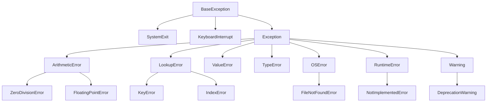
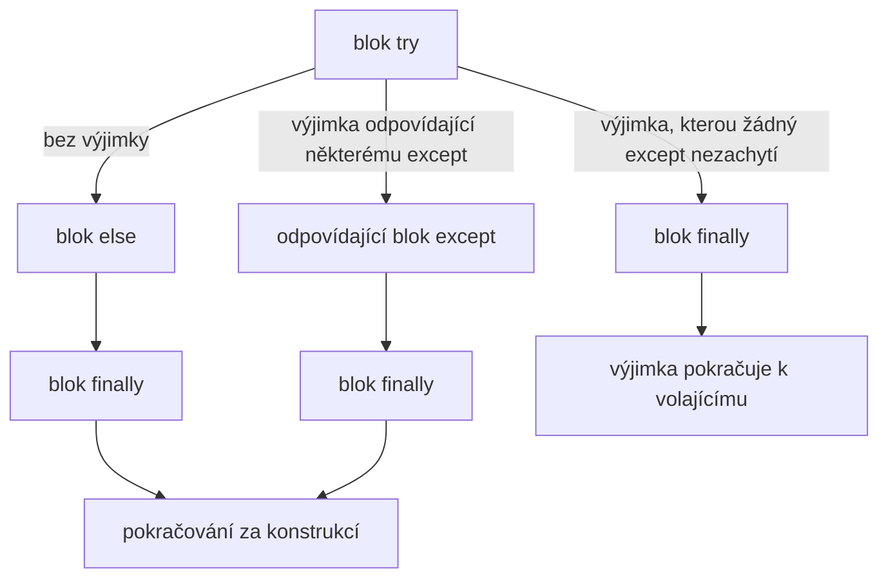

# Výjimky a práce s chybami

*Výukový materiál — vyvolání, zachycení a zpracování výjimek v jazyce Python*

Tento materiál vykládá, jak v jazyce Python s chybami zacházet tak, aby nezůstaly skryty: jak výjimku vyvolat s výstižnou zprávou, kdy a jak ji zachytit, co s ní po zachycení udělat a jak ji na hranici programu převést na srozumitelné hlášení a návratový kód. U každého postupu je uveden příklad i s výstupem, který se objeví v konzoli nebo v logu. Výstupy odpovídají jazyku Python 3.11; starší verze vypisují tracebacky bez značek `^^^`.

## 1. Motivace

Chyba, na kterou program neupozorní, je nebezpečnější než chyba, která program zastaví. Typickým zdrojem takových chyb jsou **magické hodnoty** (*magic values*), jimiž funkce namísto výjimky ohlašuje neúspěch (viz [kontrolní seznam pro psaní funkcí](jak-psat-funkce.md), kapitola 5):

```python
def najdi_index(seznam, hodnota):
    for i, prvek in enumerate(seznam):
        if prvek == hodnota:
            return i
    return -1                       # nevhodně: magická hodnota místo výjimky

teploty = [21.5, 22.0, 23.4]
i = najdi_index(teploty, 25.0)
print(teploty[i])                   # 23.4 — chybná hodnota bez upozornění
```

Index `-1` je v jazyce Python platný (označuje poslední prvek), takže program pokračuje s chybnou hodnotou. Vestavěná metoda `list.index` naopak při neúspěchu vyvolá výjimku a program se zastaví v místě chyby:

```python
teploty = [21.5, 22.0, 23.4]
print(teploty.index(25.0))
```

```text
Traceback (most recent call last):
  File "priklad.py", line 2, in <module>
    print(teploty.index(25.0))
          ^^^^^^^^^^^^^^^^^^^
ValueError: 25.0 is not in list
```

**Výjimka** (*exception*) je objekt, který ohlašuje, že operaci nelze provést. Přeruší běžný průběh programu a šíří se k volajícímu kódu, dokud ji některá část programu nezpracuje; nezpracuje-li ji žádná, program skončí a vypíše traceback.

## 2. Co je výjimka

### 2.1 Hierarchie výjimek

Výjimky jsou třídy uspořádané do hierarchie dědičnosti (viz [materiál o základech objektově orientovaného programování](zaklady-oop.md), kapitola 7). Zachycení předka zachytí i všechny jeho potomky; `except LookupError` tedy zachytí `KeyError` i `IndexError`.



Textový popis schématu:

- Kořenem hierarchie je `BaseException`. Jejími přímými potomky jsou `SystemExit` (vyvolá ji `sys.exit`), `KeyboardInterrupt` (stisk Ctrl+C) a `Exception`.
- Všechny běžné výjimky, včetně vlastních výjimek projektu (kapitola 7), jsou potomky třídy `Exception`.
- `ArithmeticError` sdružuje chyby výpočtu (`ZeroDivisionError`, `FloatingPointError`), `LookupError` chyby vyhledání (`KeyError`, `IndexError`), `OSError` chyby operačního systému (`FileNotFoundError`).
- `NotImplementedError` je potomkem `RuntimeError`; varování (`Warning`, kapitola 11) jsou rovněž potomky `Exception`.

Protože `KeyboardInterrupt` a `SystemExit` nejsou potomky třídy `Exception`, konstrukce `except Exception` je nezachytí. Program tak lze přerušit klávesami Ctrl+C i tehdy, obsahuje-li zachycení `except Exception`.

### 2.2 Šíření výjimky zásobníkem volání

Nastane-li výjimka uvnitř funkce, která ji nezpracuje, předá se funkci volající, poté funkci, která volala tu, a tak dále až na nejvyšší úroveň programu. Vypsaný traceback zachycuje celou tuto cestu:

```python
def nacti_teplotu(radek):
    return float(radek.split(";")[1])

def prumerna_teplota(radky):
    hodnoty = [nacti_teplotu(r) for r in radky]
    return sum(hodnoty) / len(hodnoty)

radky = ["pondělí;21.5", "úterý;22,0", "středa;23.4"]
print(prumerna_teplota(radky))
```

```text
Traceback (most recent call last):
  File "priklad.py", line 9, in <module>
    print(prumerna_teplota(radky))
          ^^^^^^^^^^^^^^^^^^^^^^^
  File "priklad.py", line 5, in prumerna_teplota
    hodnoty = [nacti_teplotu(r) for r in radky]
              ^^^^^^^^^^^^^^^^^^^^^^^^^^^^^^^^^
  File "priklad.py", line 5, in <listcomp>
    hodnoty = [nacti_teplotu(r) for r in radky]
               ^^^^^^^^^^^^^^^^
  File "priklad.py", line 2, in nacti_teplotu
    return float(radek.split(";")[1])
           ^^^^^^^^^^^^^^^^^^^^^^^^^^
ValueError: could not convert string to float: '22,0'
```

Traceback se čte odspoda: poslední řádek uvádí druh a popis chyby, nad ním je místo vzniku (`nacti_teplotu`, řádek 2) a výše cesta volání, která k němu vedla. Značky `^^^` vyznačují výraz, v němž výjimka nastala. Podrobný postup čtení tracebacku uvádí [materiál o ladění debuggerem](../02-overovani-a-ladeni/ladeni-debugger.md), kapitola 4.

## 3. Vyvolání výjimky

Výjimka se vyvolá příkazem `raise`, za nímž následuje instance třídy výjimky se zprávou. Volba třídy sděluje **druh** chyby, zpráva její **okolnosti**.

| Situace | Výjimka |
|---|---|
| argument má nesprávný typ | `TypeError` |
| argument má správný typ, avšak nepřípustnou hodnotu | `ValueError` |
| požadovaný klíč nebo index neexistuje | `KeyError`, `IndexError` |
| soubor neexistuje | `FileNotFoundError` |
| operaci nelze provést v aktuálním stavu objektu (například predikce nenatrénovaného modelu) | `RuntimeError` nebo vlastní výjimka |
| metodu má implementovat potomek | `NotImplementedError` |

K volbě mezi `TypeError` a `ValueError` při ověřování vstupů viz [kontrolní seznam pro psaní funkcí](jak-psat-funkce.md), kapitola 4.

**Zpráva výjimky** má uvést, co se stalo, s jakou hodnotou a co se očekávalo. Srovnání nevhodné a vhodné zprávy:

```python
def nastav_ucici_krok(lr):
    if not 0 < lr < 1:
        raise ValueError("Neplatná hodnota")        # nevhodně: chybí kontext
    return lr

nastav_ucici_krok(10)
```

```text
Traceback (most recent call last):
  File "priklad.py", line 6, in <module>
    nastav_ucici_krok(10)
  File "priklad.py", line 3, in nastav_ucici_krok
    raise ValueError("Neplatná hodnota")        # nevhodně: chybí kontext
    ^^^^^^^^^^^^^^^^^^^^^^^^^^^^^^^^^^^^
ValueError: Neplatná hodnota
```

```python
def nastav_ucici_krok(lr):
    if not 0 < lr < 1:
        raise ValueError(f"Učicí krok musí ležet v intervalu (0, 1), zadáno lr={lr!r}")
    return lr

nastav_ucici_krok(10)
```

```text
Traceback (most recent call last):
  File "priklad.py", line 6, in <module>
    nastav_ucici_krok(10)
  File "priklad.py", line 3, in nastav_ucici_krok
    raise ValueError(f"Učicí krok musí ležet v intervalu (0, 1), zadáno lr={lr!r}")
ValueError: Učicí krok musí ležet v intervalu (0, 1), zadáno lr=10
```

Z druhé zprávy je bez čtení kódu zřejmé, jaká hodnota byla předána a jaké hodnoty jsou přípustné. Zápis `{lr!r}` vloží reprezentaci hodnoty (u řetězce i s uvozovkami), takže je patrný i její typ.

## 4. Zachycení výjimky: `try`, `except`, `else`, `finally`

### 4.1 Čtyři části konstrukce

- `try` — blok, v němž může výjimka nastat,
- `except` — zpracování výjimky uvedeného druhu,
- `else` — provede se pouze tehdy, nenastala-li v bloku `try` výjimka,
- `finally` — provede se vždy, s výjimkou i bez ní, a to i při opuštění funkce příkazem `return`.

```python
def precti_cislo(text):
    try:
        cislo = float(text)
    except ValueError:
        print(f"{text!r} není číslo")
        return None
    else:
        print(f"převod proběhl: {cislo}")
        return cislo
    finally:
        print("finally: provede se vždy")

precti_cislo("3.14")
precti_cislo("tři")
```

```text
převod proběhl: 3.14
finally: provede se vždy
'tři' není číslo
finally: provede se vždy
```

Kód v bloku `else` by bylo možné umístit i na konec bloku `try`. Oddělení je však účelné: výjimka vzniklá v bloku `else` se nezachytí blokem `except`, který je určen jen pro chyby převodu. Blok `try` tak obsahuje pouze operaci, jejíž selhání se očekává.



Textový popis schématu:

- Nenastane-li výjimka, provede se blok `else`, poté `finally` a program pokračuje za konstrukcí.
- Nastane-li výjimka, kterou zachytí některý blok `except`, provede se tento blok, poté `finally` a program pokračuje za konstrukcí.
- Nastane-li výjimka, kterou žádný blok `except` nezachytí, provede se pouze `finally` a výjimka se šíří dál k volajícímu kódu.
- Blok `finally` se tedy provede ve všech třech případech.

### 4.2 Více bloků `except`

Různé druhy výjimek lze zpracovat různě. Bloky `except` se procházejí shora a použije se první, jehož třída výjimce odpovídá. Více druhů lze uvést v n-tici a zápis `as chyba` zpřístupní objekt výjimky:

```python
def nacti_hodnotu(konfigurace, klic):
    try:
        return float(konfigurace[klic])
    except KeyError:
        print(f"chybí klíč {klic!r}")
    except (ValueError, TypeError) as chyba:
        print(f"hodnota klíče {klic!r} není číslo: {chyba}")

konfigurace = {"lr": "0.01", "epochy": "deset", "dropout": None}
print(nacti_hodnotu(konfigurace, "lr"))
nacti_hodnotu(konfigurace, "momentum")
nacti_hodnotu(konfigurace, "epochy")
nacti_hodnotu(konfigurace, "dropout")
```

```text
0.01
chybí klíč 'momentum'
hodnota klíče 'epochy' není číslo: could not convert string to float: 'deset'
hodnota klíče 'dropout' není číslo: float() argument must be a string or a real number, not 'NoneType'
```

### 4.3 Zásady zachytávání

- **Zachytávat konkrétní druh výjimky.** `except ValueError` vyjadřuje, které selhání se očekává. Zachycení `except Exception` zachytí i chyby, s nimiž se nepočítalo (překlep v názvu proměnné, chybu v knihovně), a skryje je.
- **Nepoužívat holé `except:`.** Zachytí i `KeyboardInterrupt` a `SystemExit`, takže program nelze přerušit ani ukončit obvyklým způsobem.
- **Řadit bloky od konkrétních k obecným.** Je-li `except Exception` uveden před `except ValueError`, druhý blok se nikdy neuplatní.
- **Udržovat blok `try` krátký.** Obsahuje-li blok `try` více operací, může stejný druh výjimky pocházet z jiné operace, než se předpokládá. Například `KeyError` z volání funkce uvnitř bloku se pak chybně vyloží jako chybějící klíč konfigurace.

## 5. Co s výjimkou po zachycení

Zachycení výjimky je opodstatněné jen tehdy, lze-li s ní účelně naložit. Přípustné jsou čtyři možnosti.

**1. Vyřešit ji.** Existuje-li přiměřená náhradní hodnota nebo postup, použije se a situace se zaznamená do logu, aby nezůstala skryta:

```python
import logging

logging.basicConfig(level=logging.INFO, format="%(levelname)s | %(message)s")
logger = logging.getLogger(__name__)

def nacti_pocet_vlaken(text):
    try:
        return int(text)
    except ValueError:
        logger.warning("Neplatný počet vláken %r, použita výchozí hodnota 4", text)
        return 4

print(nacti_pocet_vlaken("osm"))
```

```text
WARNING | Neplatný počet vláken 'osm', použita výchozí hodnota 4
4
```

**2. Přeložit ji** na výjimku, která lépe odpovídá úrovni volajícího kódu, a původní výjimku připojit jako příčinu (`raise ... from`, kapitola 6).

**3. Zaznamenat ji a propustit dál.** Metoda `logger.exception` zaznamená zprávu na úrovni `ERROR` spolu s tracebackem a holý příkaz `raise` vyvolá tutéž výjimku znovu. O dalším postupu pak rozhodne volající kód (k logování viz [materiál o logování](../02-overovani-a-ladeni/logovani.md), kapitola 2):

```python
import logging

logging.basicConfig(level=logging.INFO, format="%(levelname)s | %(message)s")
logger = logging.getLogger(__name__)

def nacti_model(cesta):
    try:
        with open(cesta, "rb") as f:
            return f.read()
    except FileNotFoundError:
        logger.exception("Model se nepodařilo načíst z %s", cesta)
        raise

def main():
    try:
        nacti_model("model.pt")
    except FileNotFoundError:
        print("Trénink nelze zahájit bez modelu.")

main()
```

```text
ERROR | Model se nepodařilo načíst z model.pt
Traceback (most recent call last):
  File "priklad.py", line 8, in nacti_model
    with open(cesta, "rb") as f:
         ^^^^^^^^^^^^^^^^^
FileNotFoundError: [Errno 2] No such file or directory: 'model.pt'
Trénink nelze zahájit bez modelu.
```

**4. Ukončit program** se srozumitelnou zprávou a nenulovým návratovým kódem. Tato možnost náleží hranici programu (kapitola 10).

> **Upozornění:** Zachycení výjimky bez jakéhokoli zpracování, tzv. **spolknutí výjimky** (*swallowing an exception*), je nejzávažnějším chybným vzorem práce s výjimkami. Chyba nezmizí, pouze se projeví později a jinde, kde je obtížné ji spojit s příčinou:
> ```python
> try:
>     hodnoty = [float(x) for x in ["1.5", "2,5", "3.5"]]
> except Exception:
>     pass                            # nevhodně: chyba se nijak neohlásí
>
> print(sum(hodnoty))
> ```
> ```text
> Traceback (most recent call last):
>   File "priklad.py", line 6, in <module>
>     print(sum(hodnoty))
>               ^^^^^^^
> NameError: name 'hodnoty' is not defined
> ```
> Výpis ukazuje na nedefinovanou proměnnou, nikoli na skutečnou příčinu, kterou je desetinná čárka v řetězci `"2,5"`.

## 6. Zřetězené výjimky

**Výslovné zřetězení** (*explicit exception chaining*, `raise ... from`). Při překladu výjimky na jinou (kapitola 5, možnost 2) se původní výjimka připojí jako příčina. Traceback pak obsahuje obě výjimky:

```python
import json

def nacti_konfiguraci(text):
    try:
        return json.loads(text)
    except json.JSONDecodeError as chyba:
        raise ValueError("Konfigurace není platný JSON") from chyba

nacti_konfiguraci('{"lr": 0.01,}')
```

```text
Traceback (most recent call last):
  File "priklad.py", line 5, in nacti_konfiguraci
    return json.loads(text)
           ^^^^^^^^^^^^^^^^
  ... (tři úrovně uvnitř modulu json vynechány) ...
json.decoder.JSONDecodeError: Expecting property name enclosed in double quotes: line 1 column 13 (char 12)

The above exception was the direct cause of the following exception:

Traceback (most recent call last):
  File "priklad.py", line 9, in <module>
    nacti_konfiguraci('{"lr": 0.01,}')
  File "priklad.py", line 7, in nacti_konfiguraci
    raise ValueError("Konfigurace není platný JSON") from chyba
ValueError: Konfigurace není platný JSON
```

Spodní výjimka sděluje, co se stalo z pohledu volajícího kódu (konfigurace je neplatná), horní uvádí přesnou příčinu (za nadbytečnou čárkou následuje na 13. pozici uzavírací závorka namísto názvu klíče). Bez `from chyba` by Python výjimky zřetězil pouze implicitně (viz níže) a výpis by překlad nesprávně označil za chybu vzniklou při zpracování jiné chyby; mimo blok `except` by se původní výjimka do výpisu nedostala vůbec.

**Implicitní zřetězení.** Nastane-li výjimka během zpracování jiné výjimky, například chybou v bloku `except`, Python zřetězí obě výjimky samočinně a odlišnou větou:

```python
try:
    hodnota = int("deset")
except ValueError:
    print(f"Neplatná hodnota: {hodnot}")    # překlep v názvu proměnné
```

```text
Traceback (most recent call last):
  File "priklad.py", line 2, in <module>
    hodnota = int("deset")
              ^^^^^^^^^^^^
ValueError: invalid literal for int() with base 10: 'deset'

During handling of the above exception, another exception occurred:

Traceback (most recent call last):
  File "priklad.py", line 4, in <module>
    print(f"Neplatná hodnota: {hodnot}")    # překlep v názvu proměnné
                               ^^^^^^
NameError: name 'hodnot' is not defined
```

Věta *The above exception was the direct cause* tedy znamená záměrný překlad, věta *During handling of the above exception* chybu vzniklou při zpracování jiné chyby (k čtení obou druhů viz [materiál o ladění debuggerem](../02-overovani-a-ladeni/ladeni-debugger.md), kapitola 4).

**Potlačení příčiny (`from None`).** Je-li původní výjimka pouze vnitřním detailem, který volajícímu nic nesděluje, lze ji z výpisu vynechat:

```python
NASTAVENI = {"lr": 0.01}

def nastaveni(klic):
    try:
        return NASTAVENI[klic]
    except KeyError:
        raise ValueError(f"Neznámé nastavení {klic!r}, povolené: {list(NASTAVENI)}") from None

nastaveni("momentum")
```

```text
Traceback (most recent call last):
  File "priklad.py", line 9, in <module>
    nastaveni("momentum")
  File "priklad.py", line 7, in nastaveni
    raise ValueError(f"Neznámé nastavení {klic!r}, povolené: {list(NASTAVENI)}") from None
ValueError: Neznámé nastavení 'momentum', povolené: ['lr']
```

**Doplnění poznámky (Python 3.11+).** Postačí-li k původní výjimce doplnit kontext, není nutné vytvářet novou; metoda `add_note` připojí text, který se vypíše pod zprávou výjimky:

```python
radky = ["21.5", "22,0", "23.4"]
for cislo_radku, radek in enumerate(radky, start=1):
    try:
        teplota = float(radek)
    except ValueError as chyba:
        chyba.add_note(f"soubor teploty.csv, řádek {cislo_radku}: desetinná čárka místo tečky?")
        raise
```

```text
Traceback (most recent call last):
  File "priklad.py", line 4, in <module>
    teplota = float(radek)
              ^^^^^^^^^^^^
ValueError: could not convert string to float: '22,0'
soubor teploty.csv, řádek 2: desetinná čárka místo tečky?
```

## 7. Vlastní výjimky

Vlastní třída výjimky se vytváří poděděním třídy `Exception` (nikoli `BaseException`). Je vhodná tehdy, potřebuje-li volající kód rozlišit chyby projektu od ostatních, nebo nese-li výjimka údaje užitečné pro její zpracování. Osvědčeným uspořádáním je společný předek všech výjimek projektu:

```python
class ChybaProjektu(Exception):
    """Společný předek výjimek projektu."""

class ChybaKonfigurace(ChybaProjektu):
    def __init__(self, klic, zprava):
        super().__init__(f"{klic}: {zprava}")
        self.klic = klic                    # údaj dostupný při zpracování výjimky

class ChybaDat(ChybaProjektu):
    pass

def over_konfiguraci(konfigurace):
    if konfigurace.get("epochy", 0) <= 0:
        raise ChybaKonfigurace("epochy", "počet epoch musí být kladný")

try:
    over_konfiguraci({"epochy": 0})
except ChybaProjektu as chyba:              # zachytí kteréhokoli potomka
    print(f"{type(chyba).__name__}: {chyba}")
    print("chybný klíč:", chyba.klic)
```

```text
ChybaKonfigurace: epochy: počet epoch musí být kladný
chybný klíč: epochy
```

Volající kód může zachytit konkrétní výjimku (`ChybaKonfigurace`), nebo všechny výjimky projektu najednou (`ChybaProjektu`), aniž by zachytil chyby, které s projektem nesouvisejí. Ke správě a ověřování konfigurace viz [materiál o konfiguraci](../03-projekt-a-prostredi/konfiguracni-soubory.md), kapitola 5.

> **Doporučení:** Vlastní výjimka se zavádí jen tam, kde ji volající kód skutečně potřebuje rozlišit. Pro běžné situace postačují vestavěné výjimky z kapitoly 3; jejich význam je všeobecně známý.

## 8. Dva přístupy: EAFP a LBYL

Jazyk Python připouští dva přístupy k situacím, které mohou selhat:

- **LBYL** (*look before you leap*, nejprve ověřit): podmínka se ověří předem příkazem `if`,
- **EAFP** (*easier to ask forgiveness than permission*, zkusit a případně ošetřit): operace se provede a případná výjimka se zachytí.

```python
konfigurace = {"lr": 0.01}

# LBYL: nejprve ověřit
if "momentum" in konfigurace:
    momentum = konfigurace["momentum"]
else:
    momentum = 0.9

# EAFP: zkusit a případně ošetřit
try:
    momentum = konfigurace["momentum"]
except KeyError:
    momentum = 0.9

# pro slovník nejstručněji
momentum = konfigurace.get("momentum", 0.9)
print(momentum)                     # 0.9
```

V jazyce Python je obvyklejší přístup EAFP. Přednost má zejména tam, kde se stav může mezi ověřením a provedením změnit: ověření `os.path.exists(cesta)` nezaručuje, že soubor bude existovat i o okamžik později při volání `open(cesta)`, kdežto zachycení `FileNotFoundError` postihne obě situace. Přístup LBYL je naopak vhodný pro ověřování vstupů na rozhraní funkce, kde je cílem vyvolat výstižnou výjimku dříve, než začne výpočet (kapitola 3).

## 9. Úklid prostředků: `finally` a `with`

Prostředek, který byl získán (otevřený soubor, síťové spojení, zámek), musí být uvolněn i tehdy, nastane-li výjimka. Konstrukce `try`/`finally` to zajistí, příkaz `with` totéž zapisuje stručněji a uvolnění nelze opomenout:

```python
f = open("vysledky.txt", "w", encoding="utf-8")
try:
    f.write("přesnost: 0.93\n")
finally:
    f.close()                       # provede se i při výjimce

with open("vysledky.txt", "w", encoding="utf-8") as f:   # totéž
    f.write("přesnost: 0.93\n")
```

Pro prostředky, které podporují příkaz `with`, je vhodné jej používat vždy. Princip kontextových manažerů a tvorbu vlastních vykládá [materiál o dekorátorech a kontextových manažerech](dekoratory.md), kapitola 11.

## 10. Výjimky na hranici programu

**Hranicí programu** se rozumí místo, kde program komunikuje s okolím: vstupní bod spouštěný z příkazové řádky (viz vzor funkce `main()` v [materiálu o struktuře projektu](../03-projekt-a-prostredi/struktura-projektu.md), kapitola 5). Zde se rozhoduje, jak se chyba ohlásí uživateli a jakým **návratovým kódem** (*exit code*) program skončí.

Návratový kód je číslo, které proces předá operačnímu systému: `0` znamená úspěch, nenulová hodnota selhání. Podle něj vyhodnocují úspěch skripty, plánovače úloh i průběžná integrace; neúspěšný krok ve workflow GitHub Actions je právě krok, jehož příkaz skončil nenulovým kódem (viz [materiál o gitu v týmu a průběžné integraci](../00-git/git-v-tymu-ci.md), kapitola 7).

- Skončí-li program **neošetřenou výjimkou**, vypíše traceback a návratový kód je `1`.
- **Ošetřená** očekávaná chyba se ohlásí srozumitelnou zprávou bez tracebacku a program skončí zvoleným nenulovým kódem pomocí `sys.exit`.

```python
import sys

class ChybaKonfigurace(Exception):
    pass

def nacti_konfiguraci(cesta):
    raise ChybaKonfigurace(f"soubor {cesta} neobsahuje klíč 'epochy'")

def main() -> int:
    try:
        konfigurace = nacti_konfiguraci("config.yaml")
    except ChybaKonfigurace as chyba:
        print(f"Chyba konfigurace: {chyba}", file=sys.stderr)   # srozumitelná zpráva
        return 2                                                # nenulový kód = selhání
    # ... trénink ...
    return 0

if __name__ == "__main__":
    sys.exit(main())
```

Spuštění a zjištění návratového kódu posledního příkazu:

```bash
python priklad.py
echo $?                    # bash; v PowerShellu: $LASTEXITCODE
```

```text
Chyba konfigurace: soubor config.yaml neobsahuje klíč 'epochy'
2
```

Zpráva pro uživatele se vypisuje do chybového výstupu (`sys.stderr`), nikoli do standardního výstupu, aby se neprolínala s výsledky programu. Neočekávané chyby se na hranici programu nezachytávají; jejich traceback je pro vývojáře nejpodstatnějším zdrojem informací o příčině.

> **Poznámka:** I nástroje spouštěné v rámci kontrol používají návratové kódy: `pytest` končí kódem `0`, prošly-li všechny testy, kódem `1` při selhání testu a kódem `5`, nebyl-li nalezen žádný test.

## 11. Varování: modul `warnings`

**Varování** (*warning*) upozorňuje na situaci, která ještě není chybou, avšak může k ní vést: zastaralé použití funkce, podezřelou hodnotu, ztrátu přesnosti. Na rozdíl od výjimky běh programu nepřeruší.

```python
import warnings

def normalizuj(x, metoda="minmax"):
    if metoda == "stara":
        warnings.warn(
            "Metoda 'stara' bude odstraněna, použijte 'minmax'",
            DeprecationWarning,
            stacklevel=2,                  # výpis uvede řádek volajícího kódu
        )
    return x

normalizuj([1, 2], metoda="stara")
normalizuj([3, 4], metoda="stara")
```

```text
priklad.py:12: DeprecationWarning: Metoda 'stara' bude odstraněna, použijte 'minmax'
  normalizuj([1, 2], metoda="stara")
priklad.py:13: DeprecationWarning: Metoda 'stara' bude odstraněna, použijte 'minmax'
  normalizuj([3, 4], metoda="stara")
```

Parametr `stacklevel=2` zajistí, že výpis ukazuje na řádek, který funkci volá, tedy na místo, které je třeba upravit. Totéž varování z téhož místa se ve výchozím nastavení vypíše jen jednou.

**Varování, nebo záznam do logu?** Varování je určeno **programátorovi, který kód používá**: upozorňuje na nevhodné použití rozhraní a po úpravě volajícího kódu zmizí. Záznam `logger.warning` je určen **tomu, kdo program provozuje**: upozorňuje na okolnost konkrétního běhu, například na chybějící hodnotu v konfiguraci (viz [materiál o logování](../02-overovani-a-ladeni/logovani.md), kapitola 2).

**Varování jako chyba.** Při vývoji a v testech je užitečné převést varování na výjimky, aby nezůstala přehlédnuta. Slouží k tomu `warnings.simplefilter("error")`, přepínač interpretu `python -W error`, případně přepínač `pytest -W error`:

```python
import warnings

warnings.simplefilter("error")             # každé varování se vyvolá jako výjimka

def normalizuj(x, metoda="minmax"):
    if metoda == "stara":
        warnings.warn("Metoda 'stara' bude odstraněna, použijte 'minmax'", DeprecationWarning, stacklevel=2)
    return x

normalizuj([1, 2], metoda="stara")
```

```text
Traceback (most recent call last):
  File "priklad.py", line 10, in <module>
    normalizuj([1, 2], metoda="stara")
  File "priklad.py", line 7, in normalizuj
    warnings.warn("Metoda 'stara' bude odstraněna, použijte 'minmax'", DeprecationWarning, stacklevel=2)
DeprecationWarning: Metoda 'stara' bude odstraněna, použijte 'minmax'
```

## 12. `assert` není ošetření chyb

Příkaz `assert` slouží k ověřování předpokladů při vývoji a v testech (viz [materiál o testování](../02-overovani-a-ladeni/testovani.md), kapitola 2), nikoli k ověřování vstupů. Spustí-li se interpret s přepínačem `-O` (optimalizace), příkazy `assert` se vůbec neprovedou:

```python
def nastav_ucici_krok(lr):
    assert lr > 0, "učicí krok musí být kladný"   # nevhodně: kontrola vstupu pomocí assert
    return lr

print(nastav_ucici_krok(-0.1))
```

Výstup příkazu `python priklad.py`:

```text
Traceback (most recent call last):
  File "priklad.py", line 5, in <module>
    print(nastav_ucici_krok(-0.1))
          ^^^^^^^^^^^^^^^^^^^^^^^
  File "priklad.py", line 2, in nastav_ucici_krok
    assert lr > 0, "učicí krok musí být kladný"   # nevhodně: kontrola vstupu pomocí assert
           ^^^^^^
AssertionError: učicí krok musí být kladný
```

Výstup příkazu `python -O priklad.py`:

```text
-0.1
```

Kontrola vstupu proto patří do podmínky s příkazem `raise ValueError(...)` (kapitola 3); `assert` je vhodný pro ověření vnitřních předpokladů, jejichž porušení znamená chybu v kódu samotném.

## 13. Dlouhé běhy a trénink modelů

U výpočtů trvajících hodiny má selhání závažnější důsledky, a práce s výjimkami proto vyžaduje zvláštní péči.

**Opakování při přechodném selhání.** Stahování dat či přístup ke vzdálenému úložišti může selhat jen dočasně. Opakování volání při výjimce `ConnectionError` ukazuje dekorátor `@opakuj` v [materiálu o dekorátorech a kontextových manažerech](dekoratory.md), kapitola 7.

**Uložení stavu při přerušení.** Stisk Ctrl+C vyvolá výjimku `KeyboardInterrupt`. Jejím zachycením lze před ukončením uložit checkpoint (viz [materiál o infrastruktuře PyTorche](../04-strojove-uceni/pytorch-infrastruktura.md), kapitola 3.4); výjimka se poté propustí dál, aby program skutečně skončil:

```python
def trenuj_epochu(epocha):
    if epocha == 2:
        raise KeyboardInterrupt            # simulace stisku Ctrl+C během třetí epochy
    print(f"epocha {epocha} dokončena")

def uloz_checkpoint(epocha):
    print(f"checkpoint uložen po epoše {epocha}")

def trenuj(pocet_epoch):
    posledni = None
    try:
        for epocha in range(pocet_epoch):
            trenuj_epochu(epocha)
            posledni = epocha
    except KeyboardInterrupt:
        if posledni is not None:
            uloz_checkpoint(posledni)
        raise                              # přerušení se propustí dál, program skončí

trenuj(5)
```

```text
epocha 0 dokončena
epocha 1 dokončena
checkpoint uložen po epoše 1
Traceback (most recent call last):
  File "priklad.py", line 20, in <module>
    trenuj(5)
  File "priklad.py", line 13, in trenuj
    trenuj_epochu(epocha)
  File "priklad.py", line 3, in trenuj_epochu
    raise KeyboardInterrupt            # simulace stisku Ctrl+C během třetí epochy
    ^^^^^^^^^^^^^^^^^^^^^^^
KeyboardInterrupt
```

**Neplatné číselné hodnoty.** Hodnota `NaN` ve ztrátě se šíří dalšími výpočty, aniž by vyvolala výjimku; trénink pak pokračuje bez užitku. Výslovná kontrola zastaví běh v okamžiku vzniku problému:

```python
import math

def over_ztratu(ztrata, epocha):
    if math.isnan(ztrata) or math.isinf(ztrata):
        raise FloatingPointError(f"ztráta v epoše {epocha} má hodnotu {ztrata}")

for epocha, ztrata in enumerate([0.71, 0.52, float("nan")]):
    over_ztratu(ztrata, epocha)
    print(f"epocha {epocha}: ztráta {ztrata}")
```

```text
epocha 0: ztráta 0.71
epocha 1: ztráta 0.52
Traceback (most recent call last):
  File "priklad.py", line 8, in <module>
    over_ztratu(ztrata, epocha)
  File "priklad.py", line 5, in over_ztratu
    raise FloatingPointError(f"ztráta v epoše {epocha} má hodnotu {ztrata}")
FloatingPointError: ztráta v epoše 2 má hodnotu nan
```

Knihovna NumPy numerické chyby (dělení nulou, neplatnou operaci) ve výchozím nastavení pouze ohlásí varováním a vrátí `inf` či `nan`. Kontextový manažer `np.errstate` je v rámci bloku převede na výjimky:

```python
import numpy as np

x = np.array([1.0, 0.0])
print(np.log(x))                           # výchozí chování: varování a výsledek -inf

with np.errstate(divide="raise"):          # v bloku se dělení nulou stane výjimkou
    np.log(x)
```

```text
priklad.py:4: RuntimeWarning: divide by zero encountered in log
  print(np.log(x))                           # výchozí chování: varování a výsledek -inf
[  0. -inf]
Traceback (most recent call last):
  File "priklad.py", line 7, in <module>
    np.log(x)
FloatingPointError: divide by zero encountered in log
```

> **Přesah (PyTorch):** Nevejde-li se výpočet do paměti grafické karty, vyvolá PyTorch výjimku `torch.cuda.OutOfMemoryError`. Jejím zachycením lze například zmenšit velikost dávky a pokus zopakovat. Po zachycení je vhodné uvolnit nepotřebné tenzory a volat `torch.cuda.empty_cache()`; samotné zachycení paměť neuvolní.

## 14. Testování výjimek

Vyvolání správné výjimky je součástí chování funkce a ověřuje se testem. Konstrukce `pytest.raises` test označí za úspěšný jen tehdy, nastane-li v jejím bloku očekávaná výjimka; parametr `match` navíc ověří zprávu (jde o regulární výraz hledaný ve zprávě). Konstrukce `pytest.warns` obdobně ověřuje varování. Základní použití `pytest.raises` a práci s nástrojem pytest popisuje [materiál o testování](../02-overovani-a-ladeni/testovani.md), kapitoly 7 a 8.

```python
import pytest

def nastav_ucici_krok(lr):
    if not 0 < lr < 1:
        raise ValueError(f"Učicí krok musí ležet v intervalu (0, 1), zadáno lr={lr!r}")
    return lr

def test_zaporny_krok_vyvola_chybu():
    with pytest.raises(ValueError, match="intervalu"):
        nastav_ucici_krok(-0.1)

def test_zprava_obsahuje_hodnotu():
    with pytest.raises(ValueError) as informace:
        nastav_ucici_krok(10)
    assert "lr=10" in str(informace.value)

def test_varovani():
    import warnings
    with pytest.warns(DeprecationWarning, match="odstraněna"):
        warnings.warn("Metoda 'stara' bude odstraněna", DeprecationWarning)
```

```text
...                                                                      [100%]
3 passed in 0.01s
```

## 15. Časté chyby a nástrahy

- **Spolknutí výjimky** (`except: pass`, `except Exception: pass`). Chyba se projeví později a jinde (kapitola 5).
- **Příliš obecné zachycení.** `except Exception` zachytí i chyby v kódu samotném, například překlep v názvu proměnné (kapitola 4.3).
- **Ztráta příčiny.** Překlad výjimky bez `from chyba` zastírá, že jde o záměrný překlad, a výjimka vyvolaná mimo blok `except` původní výjimku vůbec nenese (kapitola 6).
- **Zpráva bez kontextu.** Zpráva „Neplatná hodnota“ neuvádí, která hodnota a proč (kapitola 3).
- **Magické hodnoty místo výjimek.** Návratová hodnota `-1` či `None` jako ohlášení chyby se snadno přehlédne (kapitola 1).
- **`assert` pro kontrolu vstupů.** Při spuštění s přepínačem `-O` se neprovede (kapitola 12).
- **Zaznamenání výjimky na více místech.** Zaznamená-li výjimku do logu každá úroveň, kterou prochází, objeví se v logu několikrát. Výjimka se zaznamenává tam, kde se zpracuje, nebo jednou na hranici programu.
- **Traceback místo srozumitelné zprávy.** Očekávaná chyba (chybějící soubor, neplatná konfigurace) se uživateli ohlásí srozumitelnou zprávou; neočekávaná chyba se nezachytává a její traceback se ponechá (kapitola 10).

## 16. Shrnutí

Výjimka ohlašuje, že operaci nelze provést, a šíří se zásobníkem volání, dokud ji některá část programu nezpracuje. Vyvolává se příkazem `raise` s třídou odpovídající druhu chyby a se zprávou, která uvádí hodnotu i očekávání. Zachycuje se konstrukcí `try`/`except`, a to co nejkonkrétnější třídou a v co nejkratším bloku; `else` odděluje kód závislý na úspěchu, `finally` se provede vždy. Zachycenou výjimku je třeba vyřešit, přeložit s připojením příčiny (`raise ... from`), zaznamenat a propustit, nebo na hranici programu převést na srozumitelnou zprávu a nenulový návratový kód; ponechat ji bez zpracování je chybou. Vlastní výjimky dědí z třídy `Exception` a jsou přínosné tam, kde je volající kód potřebuje rozlišit. Prostředky se uvolňují příkazem `with`, varování se vydávají modulem `warnings`, `assert` slouží k ověření předpokladů, nikoli vstupů. U dlouhých běhů se při přerušení ukládá stav a neplatné číselné hodnoty se zachycují v okamžiku vzniku.

> **Další čtení:** oficiální dokumentace, kapitola [Errors and Exceptions](https://docs.python.org/3/tutorial/errors.html), [hierarchie vestavěných výjimek](https://docs.python.org/3/library/exceptions.html#exception-hierarchy), modul [`warnings`](https://docs.python.org/3/library/warnings.html); [PEP 3134 — Exception Chaining and Embedded Tracebacks](https://peps.python.org/pep-3134/); [PEP 678 — Enriching Exceptions with Notes](https://peps.python.org/pep-0678/).
