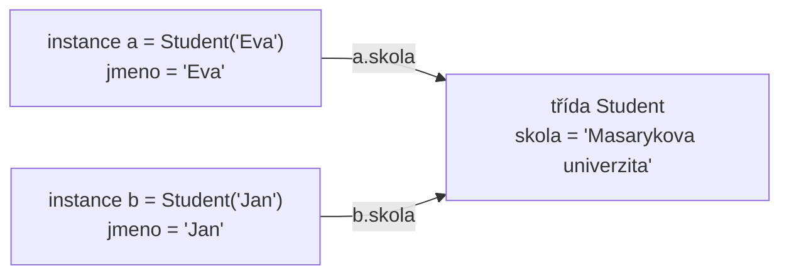

# Základy objektově orientovaného programování

*Výukový materiál — třídy a objekty v jazyce Python*

## 1. Motivace: proč objekty

Roste-li program, přibývá dat, která spolu souvisejí, a operací, které se nad nimi provádějí. Pokud jsou data uložena v samostatných proměnných a operace v samostatných funkcích, musí se stav neustále předávat mezi funkcemi jako argumenty a udržovat jeho vzájemnou souvislost je pracné a chybové.

**Objekt** tuto souvislost sdružuje: spojuje **data** (stav) a **chování** (operace nad tímto stavem) do jednoho celku. Nejnázorněji je to vidět na vzoru, s nímž se student setká v knihovnách strojového učení — objekt, který si pamatuje naučené parametry a umí s nimi pracovat:

```python
class Normalizator:
    def nauc(self, data):
        self.prumer = sum(data) / len(data)      # stav si objekt pamatuje

    def transformuj(self, data):
        return [x - self.prumer for x in data]   # chování využívá uložený stav

n = Normalizator()
n.nauc([10, 20, 30])
print(n.transformuj([10, 20, 30]))               # [-10.0, 0.0, 10.0]
```

Objekt `n` v sobě nese hodnotu `prumer` a zároveň poskytuje operace, které ji používají. To je vzor `fit`/`predict` známý ze scikit-learn: metoda `nauc` odpovídá `fit`, metoda `transformuj` metodě `transform`.

## 2. Třída a instance

**Třída** je předpis (šablona); **instance** je konkrétní objekt podle tohoto předpisu vytvořený. Metoda `__init__` je **konstruktor** — volá se automaticky při vytváření instance a slouží k nastavení počátečního stavu. Parametr `self` označuje samotnou vytvářenou instanci a je vždy prvním parametrem metod.

```python
class Pes:
    def __init__(self, jmeno, vek):   # konstruktor
        self.jmeno = jmeno            # atribut instance
        self.vek = vek

    def stekni(self):                 # metoda
        return f"{self.jmeno} štěká"

rex = Pes("Rex", 3)                   # vytvoření instance
print(rex.jmeno)                      # Rex
print(rex.stekni())                   # Rex štěká
```

Zápis `self.jmeno = jmeno` uloží hodnotu do instance, takže je dostupná i v ostatních metodách. Bez předpony `self.` by šlo pouze o lokální proměnnou, jež po skončení konstruktoru zaniká.

> **Další čtení:** oficiální dokumentace, kapitola [Classes](https://docs.python.org/3/tutorial/classes.html).

## 3. Atributy třídy versus atributy instance

Atribut definovaný v těle třídy (mimo metody) je **atribut třídy** — sdílený všemi instancemi. Atribut nastavený přes `self` v konstruktoru je **atribut instance** — vlastní každé instanci zvlášť.

```python
class Student:
    skola = "Masarykova univerzita"   # atribut třídy — společný všem

    def __init__(self, jmeno):
        self.jmeno = jmeno            # atribut instance — vlastní každému
```



Textový popis schématu:

- Atribut `jmeno` je uložen v každé instanci zvlášť; instance `a` a `b` mají každá vlastní hodnotu.
- Atribut `skola` je uložen jednou, ve třídě. Zápis `a.skola` i `b.skola` vede k téže hodnotě uložené ve třídě.
- Je-li touto hodnotou měnitelný objekt, projeví se jeho změna provedená přes kteroukoli instanci u všech instancí (viz upozornění níže).

> **Upozornění:** Měnitelný atribut třídy (například seznam) je sdílen mezi všemi instancemi, což vede k nečekanému chování — jde o obdobu měnitelného výchozího argumentu funkce (viz [materiál o psaní funkcí](jak-psat-funkce.md), kapitola 2).
> ```python
> class Kosik:
>     polozky = []                    # CHYBA: sdílený seznam
>     def pridej(self, x):
>         self.polozky.append(x)
>
> a = Kosik(); b = Kosik()
> a.pridej("jablko")
> print(b.polozky)                    # ['jablko'] — ovlivněno i u b!
> ```
> Správně se měnitelný stav zakládá v konstruktoru, kde vzniká pro každou instanci samostatně:
> ```python
> class Kosik:
>     def __init__(self):
>         self.polozky = []           # vlastní seznam každé instance
> ```

## 4. Běžné speciální (dunder) metody

Speciální metody, poznatelné podle dvojice podtržítek na obou stranách názvu (odtud „dunder", *double underscore*), umožňují napojit objekt na vestavěnou syntaxi jazyka. Díky nim lze nad vlastním objektem používat `len(x)`, `x[0]` či `print(x)` stejně jako nad zabudovanými typy.

```python
class Vektor:
    def __init__(self, slozky):
        self.slozky = slozky

    def __repr__(self):                   # jak se objekt vypíše
        return f"Vektor({self.slozky})"

    def __len__(self):                    # umožní len(v)
        return len(self.slozky)

    def __getitem__(self, i):             # umožní v[i]
        return self.slozky[i]

v = Vektor([1, 2, 3])
print(v)          # Vektor([1, 2, 3])    -> __repr__
print(len(v))     # 3                    -> __len__
print(v[0])       # 1                    -> __getitem__
```

Metoda `__call__` umožní volat instanci jako funkci:

```python
class Nasobic:
    def __init__(self, faktor):
        self.faktor = faktor

    def __call__(self, x):
        return x * self.faktor

dvojnasobek = Nasobic(2)
print(dvojnasobek(10))                    # 20 — instance volaná jako funkce
```

> **Rozdíl mezi `__repr__` a `__str__`:** `__str__` je určena pro člověka (čitelný výstup, například v uživatelském rozhraní), `__repr__` pro vývojáře (jednoznačný, ladicí výstup). Není-li `__str__` definována, použije se `__repr__`. Právě `__repr__` je zásadní při ladění a zaznamenávání objektů do logu (viz [materiál o logování](../02-overovani-a-ladeni/logovani.md)).

> **Další čtení:** oficiální dokumentace, [Special method names](https://docs.python.org/3/reference/datamodel.html#special-method-names).

## 5. Atributy a vlastnosti (property)

Prostý atribut je pouze uložená hodnota. **Vlastnost** (property) se navenek jeví jako atribut, avšak přístup k ní je řízen metodou — hodnota se může počítat nebo ověřovat. Slouží tam, kde má „atribut" ve skutečnosti vykonat nějakou operaci.

```python
class Teplota:
    def __init__(self, celsius):
        self.celsius = celsius            # projde ověřením v setteru níže

    @property
    def celsius(self):                    # čtení
        return self._celsius

    @celsius.setter
    def celsius(self, hodnota):           # zápis s ověřením
        if hodnota < -273.15:
            raise ValueError("Teplota nemůže být pod absolutní nulou")
        self._celsius = hodnota

    @property
    def fahrenheit(self):                 # počítaná vlastnost, jen pro čtení
        return self._celsius * 9 / 5 + 32

t = Teplota(25)
print(t.fahrenheit)                       # 77.0 — počítá se při každém přístupu
```

Zápis se znakem `@` (například `@property`) je tzv. **dekorátor** — mechanismus, jímž se upravuje chování metody. Zde postačí vědět, že `@property` mění způsob přístupu k metodě tak, aby se používala jako atribut.

> **Další čtení:** oficiální dokumentace, funkce [`property`](https://docs.python.org/3/library/functions.html#property).

## 6. Zapouzdření a druhy metod

**Zapouzdření** je zásada oddělit vnitřní stav objektu od jeho vnějšího rozhraní. Na rozdíl od jazyků jako Java či C++ **Python soukromí nevynucuje** — spoléhá na konvenci:

- jedno podtržítko (`_atribut`) je konvence označující „interní, není součástí veřejného rozhraní"; jazyk přístupu nijak nebrání,
- dvě podtržítka (`__atribut`) spouštějí tzv. *name mangling* (přejmenování), které přístup zkomplikuje, avšak neznemožní.

```python
class Ucet:
    def __init__(self, zustatek):
        self._zustatek = zustatek         # konvence: interní

ucet = Ucet(100)
print(ucet._zustatek)                     # 100 — funguje! Python nebrání, jde jen o konvenci
```

> **Upozornění:** Podtržítko je *dohoda mezi programátory*, nikoli technická ochrana. Očekávání vynuceného soukromí známé z jiných jazyků je v Pythonu mylné.

Podle vztahu k instanci se rozlišují tři druhy metod:

```python
class Prevodnik:
    def preved(self, castka):             # instanční — pracuje s konkrétní instancí (self)
        ...

    @staticmethod
    def zaokrouhli(x):                    # statická — nezávislá na instanci i třídě
        return round(x, 2)

    @classmethod
    def vychozi(cls):                     # třídní — pracuje s třídou (cls), typicky tovární metoda
        return cls()
```

Zápisy `@staticmethod` a `@classmethod` jsou opět dekorátory.

## 7. Dědičnost

**Dědičnost** umožňuje odvodit novou třídu (potomka) z existující (předka) a převzít její chování, případně je upravit. Vyjadřuje vztah „je typem": potomek je specializací předka. Funkce `super()` zpřístupní metody předka, což se využívá zejména v konstruktoru.

```python
class Zvire:
    def __init__(self, jmeno):
        self.jmeno = jmeno

    def zvuk(self):
        return "..."

class Pes(Zvire):                         # Pes dědí ze Zvire
    def zvuk(self):                       # přepsání metody předka
        return "Haf"

class Stene(Pes):
    def __init__(self, jmeno, vek):
        super().__init__(jmeno)           # zavolá konstruktor předka
        self.vek = vek

s = Stene("Punťa", 1)
print(s.jmeno, s.zvuk())                  # Punťa Haf
```

Při obecném předávání argumentů předkovi se používá zápis `super().__init__(*args, **kwargs)`, v němž `*args`/`**kwargs` zastupuje proměnný počet argumentů.

> **Upozornění:** Dědičnost svádí k budování hlubokých hierarchií, což je častý antivzor — kód se stává nepřehledným a změna v předkovi má nečekané důsledky u potomků. Hierarchie je vhodné držet mělké. Základnějším důvodem pro použití třídy ostatně není dědičnost, nýbrž sdružení stavu a chování (kapitola 1); dědičnost je až prostředek pro sdílení a specializaci.

## 8. Abstraktní bázové třídy

Někdy je žádoucí předepsat, které metody **musí** potomek doplnit, a toto pravidlo nechat vynutit jazykem. K tomu slouží **abstraktní bázová třída** (ABC): předek dědící z `ABC`, jehož vybrané metody jsou označeny dekorátorem `@abstractmethod` a ponechány prázdné. Taková třída tvoří **kontrakt** — instanci lze vytvořit jen z potomka, který všechny abstraktní metody implementuje.

```python
from abc import ABC, abstractmethod

class Model(ABC):
    @abstractmethod
    def nauc(self, data): ...             # potomek MUSÍ doplnit

    @abstractmethod
    def predikuj(self, data): ...

class PrumerovyModel(Model):
    def nauc(self, data):
        self.prumer = sum(data) / len(data)

    def predikuj(self, data):
        return [self.prumer for _ in data]

m = PrumerovyModel()                      # v pořádku, obě metody doplněny
```

Zapomene-li potomek některou abstraktní metodu implementovat, pokus o vytvoření instance selže **ihned**, nikoli až při jejím volání:

```python
class Nedokonceny(Model):
    def nauc(self, data): ...
    # chybí predikuj

Nedokonceny()   # TypeError: nelze vytvořit instanci — není implementována metoda predikuj
```

> **Poznámka:** Alternativou bývá prázdná metoda s `raise NotImplementedError`. Rozdíl je v okamžiku selhání: `raise NotImplementedError` se projeví teprve *při zavolání* metody (tedy pozdě, za běhu), kdežto `@abstractmethod` zabrání již *vytvoření instance* (tedy dříve a bezpečněji). Proto je pro vynucený kontrakt vhodnější abstraktní metoda.

> **Další čtení:** oficiální dokumentace, modul [`abc`](https://docs.python.org/3/library/abc.html).

## 9. Datové třídy (`@dataclass`)

Slouží-li třída především ke **sdružení dat**, je ruční psaní konstruktoru, výpisu a porovnání zdlouhavé. Dekorátor `@dataclass` tyto metody vygeneruje automaticky z deklarace typovaných polí.

```python
from dataclasses import dataclass

@dataclass
class Bod:
    x: float
    y: float

b = Bod(1.0, 2.0)
print(b)                       # Bod(x=1.0, y=2.0)   — __repr__ vygenerováno
print(b == Bod(1.0, 2.0))      # True                — __eq__ vygenerováno
```

Bez dekorátoru by bylo nutné ručně napsat `__init__`, `__repr__` i `__eq__` (viz kapitoly 2 a 4). Zápis polí využívá typové anotace (viz [materiál o typování](typovani-promennych.md)) a `@dataclass` je opět dekorátor. Datové třídy jsou zároveň hlavním moderním argumentem pro volbu třídy tam, kde jde o seskupení souvisejících dat.

> **Další čtení:** oficiální dokumentace, modul [`dataclasses`](https://docs.python.org/3/library/dataclasses.html).

## 10. Shrnutí

Objekt sdružuje stav a chování do jednoho celku; toto sdružení je základnějším důvodem pro použití třídy než dědičnost. Instance se vytváří podle třídy, počáteční stav nastavuje konstruktor `__init__` a odkazuje se na něj přes `self`. Speciální (dunder) metody napojují objekt na syntaxi jazyka, vlastnosti (property) řídí přístup k „atributům", zapouzdření je v Pythonu věcí konvence, nikoli vynucení. Dědičnost umožňuje sdílení a specializaci, avšak hierarchie je vhodné držet mělké; abstraktní bázové třídy předepisují potomkům závazný kontrakt. Cílem materiálu není úplný objektový model jazyka, nýbrž schopnost číst a psát běžné třídy a rozumět tomu, co se vyskytuje v knihovnách.
