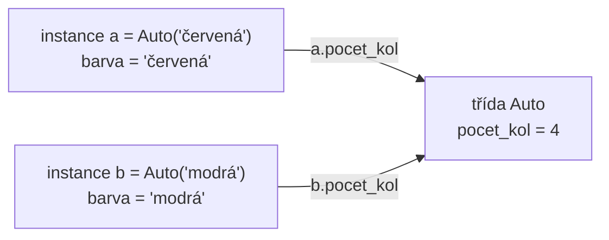
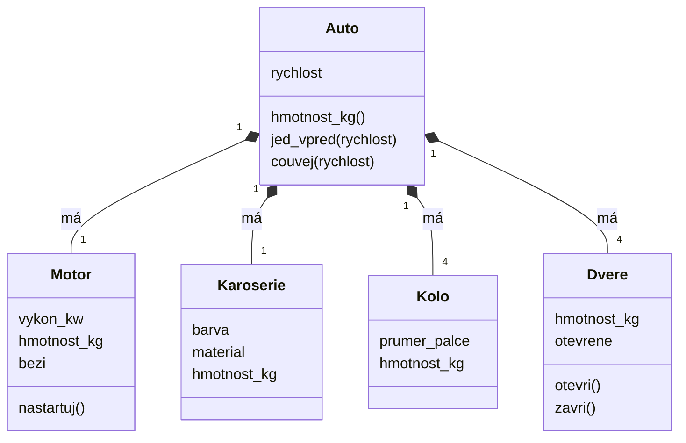

# Základy objektově orientovaného programování

*Výukový materiál — třídy a objekty v jazyce Python*

Všechny příklady v tomto materiálu vycházejí z jediného tématu, automobilu. Automobil se skládá z dílčích objektů (motor, karoserie, kola, dveře), z nichž každý má vlastní vlastnosti (barva, materiál, hmotnost, rozměry) a vlastní operace (otevření a zavření dveří, nastartování motoru); celek pak tyto součásti spojuje a poskytuje operace vlastní, například jízdu vpřed a couvání. Na tomto tématu materiál postupně vykládá třídy a instance, speciální metody, vlastnosti, zapouzdření, dědičnost, kompozici, abstraktní bázové třídy, datové třídy a zásady návrhu tříd SOLID.

## 1. Motivace: proč objekty

Roste-li program, přibývá dat, která spolu souvisejí, a operací, které se nad nimi provádějí. Pokud jsou data uložena v samostatných proměnných a operace v samostatných funkcích, musí se stav neustále předávat mezi funkcemi jako argumenty a udržovat jeho vzájemnou souvislost je pracné a chybové.

**Objekt** tuto souvislost sdružuje: spojuje **data** (stav) a **chování** (operace nad tímto stavem) do jednoho celku. Stavem automobilu je například jeho aktuální rychlost a ujetá vzdálenost, chováním zrychlení a jízda. Operace stav využívají a mění (konstruktor `__init__` vykládá kapitola 2):

```python
class Auto:
    def __init__(self):
        self.rychlost = 0                        # stav: rychlost v km/h
        self.najeto = 0.0                        # stav: ujetá vzdálenost v km

    def zrychli(self, o_kolik):
        self.rychlost += o_kolik                 # chování mění stav

    def jed(self, hodin):
        self.najeto += self.rychlost * hodin     # chování využívá uložený stav

auto = Auto()
auto.zrychli(50)
auto.jed(2)
print(auto.najeto)                               # 100.0
```

Objekt `auto` v sobě nese svůj stav a zároveň poskytuje operace, které s ním pracují; stav se proto nemusí předávat jako argument. Tentýž vzor se objevuje v knihovnách strojového učení: metoda `fit` uloží do objektu naučené parametry a metody `transform` či `predict` je následně využívají (vzor `fit`/`predict` známý ze scikit-learn).

## 2. Třída a instance

**Třída** je předpis (šablona); **instance** je konkrétní objekt podle tohoto předpisu vytvořený. Metoda `__init__` je **konstruktor** — volá se automaticky při vytváření instance a slouží k nastavení počátečního stavu. Parametr `self` označuje samotnou vytvářenou instanci a je vždy prvním parametrem metod.

```python
class Auto:
    def __init__(self, znacka, barva):    # konstruktor
        self.znacka = znacka              # atribut instance
        self.barva = barva

    def popis(self):                      # metoda
        return f"{self.znacka}, barva {self.barva}"

moje = Auto("Škoda", "červená")           # vytvoření instance
tvoje = Auto("Tatra", "černá")            # druhá instance téže třídy
print(moje.znacka)                        # Škoda
print(tvoje.popis())                      # Tatra, barva černá
```

Zápis `self.barva = barva` uloží hodnotu do instance, takže je dostupná i v ostatních metodách. Bez předpony `self.` by šlo pouze o lokální proměnnou, jež po skončení konstruktoru zaniká. Z jedné třídy lze vytvořit libovolný počet instancí; každá má vlastní hodnoty atributů.

> **Další čtení:** oficiální dokumentace, kapitola [Classes](https://docs.python.org/3/tutorial/classes.html).

## 3. Atributy třídy versus atributy instance

Atribut definovaný v těle třídy (mimo metody) je **atribut třídy** — sdílený všemi instancemi. Atribut nastavený přes `self` v konstruktoru je **atribut instance** — vlastní každé instanci zvlášť.

```python
class Auto:
    pocet_kol = 4                     # atribut třídy — společný všem

    def __init__(self, barva):
        self.barva = barva            # atribut instance — vlastní každé instanci
```



Textový popis schématu:

- Atribut `barva` je uložen v každé instanci zvlášť; instance `a` a `b` mají každá vlastní hodnotu.
- Atribut `pocet_kol` je uložen jednou, ve třídě. Zápis `a.pocet_kol` i `b.pocet_kol` vede k téže hodnotě uložené ve třídě.
- Je-li touto hodnotou měnitelný objekt, projeví se jeho změna provedená přes kteroukoli instanci u všech instancí (viz upozornění níže).

> **Upozornění:** Měnitelný atribut třídy (například seznam) je sdílen mezi všemi instancemi, což vede k nečekanému chování — jde o obdobu měnitelného výchozího argumentu funkce (viz [materiál o psaní funkcí](jak-psat-funkce.md), kapitola 2).
> ```python
> class Auto:
>     vybava = []                       # chybně: seznam sdílený všemi instancemi
>     def pridej_vybavu(self, polozka):
>         self.vybava.append(polozka)
>
> a = Auto(); b = Auto()
> a.pridej_vybavu("tažné zařízení")
> print(b.vybava)                       # ['tažné zařízení'] — změna se projevila i u b
> ```
> Správně se měnitelný stav zakládá v konstruktoru, kde vzniká pro každou instanci samostatně:
> ```python
> class Auto:
>     def __init__(self):
>         self.vybava = []              # vlastní seznam každé instance
> ```

## 4. Běžné speciální (dunder) metody

Speciální metody, poznatelné podle dvojice podtržítek na obou stranách názvu (odtud „dunder", *double underscore*), umožňují napojit objekt na vestavěnou syntaxi jazyka. Díky nim lze nad vlastním objektem používat `len(x)`, `x[0]` či `print(x)` stejně jako nad zabudovanými typy.

```python
class Garaz:
    def __init__(self, auta):
        self.auta = auta

    def __repr__(self):                   # jak se objekt vypíše
        return f"Garaz({self.auta})"

    def __len__(self):                    # umožní len(g)
        return len(self.auta)

    def __getitem__(self, i):             # umožní g[i]
        return self.auta[i]

g = Garaz(["Škoda", "Tatra", "Praga"])
print(g)          # Garaz(['Škoda', 'Tatra', 'Praga'])   -> __repr__
print(len(g))     # 3                                    -> __len__
print(g[0])       # Škoda                                -> __getitem__
```

Metoda `__call__` umožní volat instanci jako funkci:

```python
class Spotreba:
    def __init__(self, litru_na_100km):
        self.litru_na_100km = litru_na_100km

    def __call__(self, km):
        return km * self.litru_na_100km / 100

spotreba = Spotreba(6.0)
print(spotreba(250))                      # 15.0 — instance volaná jako funkce
```

> **Rozdíl mezi `__repr__` a `__str__`:** `__str__` je určena pro člověka (čitelný výstup, například v uživatelském rozhraní), `__repr__` pro vývojáře (jednoznačný, ladicí výstup). Není-li `__str__` definována, použije se `__repr__`. Právě `__repr__` je zásadní při ladění a zaznamenávání objektů do logu (viz [materiál o logování](../02-overovani-a-ladeni/logovani.md)).

> **Další čtení:** oficiální dokumentace, [Special method names](https://docs.python.org/3/reference/datamodel.html#special-method-names).

## 5. Atributy a vlastnosti (property)

Prostý atribut je pouze uložená hodnota. **Vlastnost** (property) se navenek jeví jako atribut, avšak přístup k ní je řízen metodou — hodnota se může počítat nebo ověřovat. Slouží tam, kde má „atribut" ve skutečnosti vykonat nějakou operaci.

```python
class Nadrz:
    def __init__(self, kapacita, objem):
        self.kapacita = kapacita          # v litrech
        self.objem = objem                # projde ověřením v setteru níže

    @property
    def objem(self):                      # čtení
        return self._objem

    @objem.setter
    def objem(self, hodnota):             # zápis s ověřením
        if not 0 <= hodnota <= self.kapacita:
            raise ValueError("Objem paliva musí ležet mezi nulou a kapacitou nádrže")
        self._objem = hodnota

    @property
    def procent(self):                    # počítaná vlastnost, jen pro čtení
        return 100 * self._objem / self.kapacita

n = Nadrz(kapacita=50, objem=20)
print(n.procent)                          # 40.0 — počítá se při každém přístupu
n.objem = 35                              # zápis projde ověřením
print(n.procent)                          # 70.0
```

Pokus o zápis `n.objem = 60` vyvolá výjimku `ValueError`, neboť hodnota překračuje kapacitu nádrže.

Zápis se znakem `@` (například `@property`) je tzv. **dekorátor** — mechanismus, jímž se upravuje chování metody; jeho fungování vykládá [materiál o dekorátorech a kontextových manažerech](dekoratory.md). Zde postačí vědět, že `@property` mění způsob přístupu k metodě tak, aby se používala jako atribut.

> **Další čtení:** oficiální dokumentace, funkce [`property`](https://docs.python.org/3/library/functions.html#property).

## 6. Zapouzdření a druhy metod

**Zapouzdření** je zásada oddělit vnitřní stav objektu od jeho vnějšího rozhraní. Na rozdíl od jazyků jako Java či C++ **Python soukromí nevynucuje** — spoléhá na konvenci:

- jedno podtržítko (`_atribut`) je konvence označující „interní, není součástí veřejného rozhraní"; jazyk přístupu nijak nebrání,
- dvě podtržítka (`__atribut`) spouštějí tzv. *name mangling* (přejmenování), které přístup zkomplikuje, avšak neznemožní.

Typickým příkladem je tachometr: ujetá vzdálenost se má měnit pouze jízdou, nikoli přímým přepsáním.

```python
class Tachometr:
    def __init__(self):
        self._najeto = 0.0                # konvence: interní, mění se pouze metodou pricti

    def pricti(self, km):
        if km < 0:
            raise ValueError("Ujetá vzdálenost nemůže být záporná")
        self._najeto += km

    @property
    def najeto(self):                     # veřejné rozhraní, jen pro čtení
        return self._najeto

t = Tachometr()
t.pricti(120)
print(t.najeto)                           # 120.0
print(t._najeto)                          # 120.0 — přístup je možný, podtržítko je jen konvence
```

> **Upozornění:** Podtržítko je *dohoda mezi programátory*, nikoli technická ochrana. Očekávání vynuceného soukromí známé z jiných jazyků je v Pythonu mylné.

Podle vztahu k instanci se rozlišují tři druhy metod:

```python
class Auto:
    def __init__(self, znacka, vykon_kw):
        self.znacka = znacka
        self.vykon_kw = vykon_kw

    def popis(self):                      # instanční — pracuje s konkrétní instancí (self)
        return f"{self.znacka}, {self.vykon_kw} kW"

    @staticmethod
    def kw_na_hp(kw):                     # statická — nezávislá na instanci i třídě
        return round(kw * 1.341, 1)

    @classmethod
    def ze_slovniku(cls, data):           # třídní — pracuje s třídou (cls), typicky tovární metoda
        return cls(data["znacka"], data["vykon_kw"])

a = Auto.ze_slovniku({"znacka": "Škoda", "vykon_kw": 110})
print(a.popis())                          # Škoda, 110 kW
print(Auto.kw_na_hp(110))                 # 147.5
```

Zápisy `@staticmethod` a `@classmethod` jsou opět dekorátory (viz [materiál o dekorátorech a kontextových manažerech](dekoratory.md), kapitola 9).

## 7. Dědičnost

**Dědičnost** umožňuje odvodit novou třídu (potomka) z existující (předka) a převzít její chování, případně je upravit. Vyjadřuje vztah „je typem": potomek je specializací předka. Funkce `super()` zpřístupní metody předka, což se využívá zejména v konstruktoru.

```python
class Vozidlo:
    def __init__(self, znacka):
        self.znacka = znacka

    def pohon(self):
        return "neurčený"

class Auto(Vozidlo):                      # Auto dědí z Vozidlo
    def pohon(self):                      # přepsání metody předka
        return "spalovací motor"

class ElektrickeAuto(Auto):
    def __init__(self, znacka, kapacita_kwh):
        super().__init__(znacka)          # zavolá konstruktor předka
        self.kapacita_kwh = kapacita_kwh

    def pohon(self):                      # opětovné přepsání
        return "elektromotor"

e = ElektrickeAuto("Škoda", 77)
print(e.znacka, e.pohon())                # Škoda elektromotor
```

Při obecném předávání argumentů předkovi se používá zápis `super().__init__(*args, **kwargs)`, v němž `*args`/`**kwargs` zastupuje proměnný počet argumentů (podrobněji viz [materiál o dekorátorech a kontextových manažerech](dekoratory.md), kapitola 4).

Příklad zároveň ukazuje slabinu dědičnosti: třída `Auto` předpokládá spalovací motor a potomek `ElektrickeAuto` musí tento předpoklad přepisovat. Pohon však není druhem auta, nýbrž jeho součástí; vhodnějším řešením je proto kompozice (kapitola 8).

> **Upozornění:** Dědičnost svádí k budování hlubokých hierarchií, což je častý antivzor — kód se stává nepřehledným a změna v předkovi má nečekané důsledky u potomků. Hierarchie je vhodné držet mělké. Základnějším důvodem pro použití třídy ostatně není dědičnost, nýbrž sdružení stavu a chování (kapitola 1); dědičnost je až prostředek pro sdílení a specializaci.

## 8. Kompozice: objekt složený z objektů

Dědičnost vyjadřuje vztah „je typem" (elektrické auto je auto). Častější je však vztah „má" neboli „skládá se z": auto má motor, karoserii, čtyři kola a čtvery dveře. Tento vztah vyjadřuje **kompozice**: objekt uchovává jiné objekty jako své atributy a část své práce přenechává jim (tzv. delegování). Každá součást má vlastní vlastnosti a metody; celek je spojuje.

```python
class Motor:
    def __init__(self, vykon_kw, hmotnost_kg):
        self.vykon_kw = vykon_kw
        self.hmotnost_kg = hmotnost_kg
        self.bezi = False

    def nastartuj(self):
        self.bezi = True

class Karoserie:
    def __init__(self, barva, material, hmotnost_kg):
        self.barva = barva
        self.material = material
        self.hmotnost_kg = hmotnost_kg

class Kolo:
    def __init__(self, prumer_palce, hmotnost_kg):
        self.prumer_palce = prumer_palce
        self.hmotnost_kg = hmotnost_kg

class Dvere:
    def __init__(self, hmotnost_kg):
        self.hmotnost_kg = hmotnost_kg
        self.otevrene = False

    def otevri(self):
        self.otevrene = True

    def zavri(self):
        self.otevrene = False

class Auto:
    def __init__(self, motor, karoserie):
        self.motor = motor                              # auto má motor
        self.karoserie = karoserie                      # auto má karoserii
        self.kola = [Kolo(16, 9.5) for _ in range(4)]   # auto má čtyři kola
        self.dvere = [Dvere(25.0) for _ in range(4)]    # auto má čtvery dveře
        self.rychlost = 0

    @property
    def hmotnost_kg(self):                              # vlastnost celku odvozená ze součástí
        soucasti = [self.motor, self.karoserie, *self.kola, *self.dvere]
        return sum(s.hmotnost_kg for s in soucasti)

    def jed_vpred(self, rychlost):
        self._rozjed(rychlost)

    def couvej(self, rychlost):
        self._rozjed(-rychlost)                         # záporná rychlost značí jízdu vzad

    def _rozjed(self, rychlost):                        # interní metoda, ověří stav součástí
        if not self.motor.bezi:
            raise RuntimeError("Motor není nastartován")
        if any(d.otevrene for d in self.dvere):
            raise RuntimeError("Některé dveře jsou otevřené")
        self.rychlost = rychlost

auto = Auto(Motor(110, 150.0), Karoserie("červená", "ocel", 400.0))
print(auto.hmotnost_kg)                                 # 688.0
auto.motor.nastartuj()
auto.dvere[0].otevri()
auto.dvere[0].zavri()
auto.jed_vpred(50)
print(auto.rychlost)                                    # 50
auto.couvej(5)
print(auto.rychlost)                                    # -5
```

Celek přenechává práci součástem: hmotnost auta se počítá ze hmotností součástí a metoda `_rozjed` ověřuje stav motoru a dveří prostřednictvím jejich atributů. K součásti se přistupuje řetězením atributů, například `auto.dvere[0].otevri()`. Tím vznikají tři úrovně: celek (`auto`), součást (`dvere[0]`) a vlastnost či metoda součásti (`otevrene`, `otevri()`).



Textový popis schématu:

- Třída `Auto` obsahuje jeden motor, jednu karoserii, čtyři kola a čtvery dveře; plný kosočtverec u třídy `Auto` označuje kompozici.
- Každá součást má vlastní atributy (například `barva` a `material` karoserie, `otevrene` u dveří) a vlastní metody (`nastartuj()` u motoru, `otevri()` a `zavri()` u dveří).
- Třída `Auto` přidává vlastnosti a metody celku: hmotnost odvozenou ze součástí a jízdu vpřed a vzad.

> **Doporučení:** Je-li vztah mezi třídami „má", volte kompozici; dědičnost vyhraďte vztahu „je typem". Kompozice umožňuje součást vyměnit bez zásahu do hierarchie tříd: elektrické auto z kapitoly 7 nevyžaduje vlastního potomka, postačí mu jiný druh pohonu (kapitola 9).

## 9. Abstraktní bázové třídy

Někdy je žádoucí předepsat, které metody potomek **musí** doplnit, a toto pravidlo nechat vynutit jazykem. K tomu slouží **abstraktní bázová třída** (ABC): předek dědící z `ABC`, jehož vybrané metody jsou označeny dekorátorem `@abstractmethod` a ponechány prázdné. Taková třída tvoří **kontrakt** — instanci lze vytvořit jen z potomka, který všechny abstraktní metody implementuje.

Třída `Motor` z kapitoly 8 představuje jediný druh pohonu. Má-li auto přijímat různé druhy pohonu, předepíše abstraktní třída `Pohon`, které metody musí každý pohon poskytovat:

```python
from abc import ABC, abstractmethod

class Pohon(ABC):
    @abstractmethod
    def nastartuj(self): ...              # potomek musí doplnit

    @abstractmethod
    def dojezd_km(self): ...

class SpalovaciMotor(Pohon):
    def __init__(self, palivo_l, spotreba_l_100km):
        self.palivo_l = palivo_l
        self.spotreba_l_100km = spotreba_l_100km

    def nastartuj(self):
        return "zapalování"

    def dojezd_km(self):
        return self.palivo_l / self.spotreba_l_100km * 100

class Elektromotor(Pohon):
    def __init__(self, energie_kwh, spotreba_kwh_100km):
        self.energie_kwh = energie_kwh
        self.spotreba_kwh_100km = spotreba_kwh_100km

    def nastartuj(self):
        return "připojení baterie"

    def dojezd_km(self):
        return self.energie_kwh / self.spotreba_kwh_100km * 100

for pohon in [SpalovaciMotor(40, 6.0), Elektromotor(60, 15.0)]:
    print(f"{pohon.nastartuj()}: dojezd {pohon.dojezd_km():.0f} km")
# zapalování: dojezd 667 km
# připojení baterie: dojezd 400 km
```

Kód, který s pohonem pracuje (například auto z kapitoly 8), volá pouze metody předepsané třídou `Pohon` a nezávisí na tom, o jaký druh pohonu jde.

Zapomene-li potomek některou abstraktní metodu implementovat, pokus o vytvoření instance selže **ihned**, nikoli až při jejím volání:

```python
class VodikovyPohon(Pohon):
    def nastartuj(self):
        return "otevření ventilu"
    # chybí dojezd_km

VodikovyPohon()   # TypeError: nelze vytvořit instanci — není implementována metoda dojezd_km
```

> **Poznámka:** Alternativou bývá prázdná metoda s `raise NotImplementedError`. Rozdíl je v okamžiku selhání: `raise NotImplementedError` se projeví teprve *při zavolání* metody (tedy pozdě, za běhu), kdežto `@abstractmethod` zabrání již *vytvoření instance* (tedy dříve a bezpečněji). Proto je pro vynucený kontrakt vhodnější abstraktní metoda.

> **Další čtení:** oficiální dokumentace, modul [`abc`](https://docs.python.org/3/library/abc.html).

## 10. Datové třídy (`@dataclass`)

Slouží-li třída především ke **sdružení dat**, je ruční psaní konstruktoru, výpisu a porovnání zdlouhavé. Dekorátor `@dataclass` tyto metody vygeneruje automaticky z deklarace typovaných polí.

```python
from dataclasses import dataclass

@dataclass
class Rozmery:
    delka_mm: int
    sirka_mm: int
    vyska_mm: int

r = Rozmery(4690, 1830, 1460)
print(r)                                  # Rozmery(delka_mm=4690, sirka_mm=1830, vyska_mm=1460)
print(r == Rozmery(4690, 1830, 1460))     # True — __eq__ vygenerováno
```

Bez dekorátoru by bylo nutné ručně napsat `__init__`, `__repr__` i `__eq__` (viz kapitoly 2 a 4). Karoserie z kapitoly 8 by mohla své rozměry uchovávat právě v takovém objektu. Zápis polí využívá typové anotace (viz [materiál o typování](typovani-promennych.md)) a `@dataclass` je opět dekorátor, tentokrát dekorátor třídy (viz [materiál o dekorátorech a kontextových manažerech](dekoratory.md), kapitola 10). Datové třídy jsou zároveň hlavním moderním argumentem pro volbu třídy tam, kde jde o seskupení souvisejících dat.

> **Další čtení:** oficiální dokumentace, modul [`dataclasses`](https://docs.python.org/3/library/dataclasses.html).

## 11. Principy SOLID

**SOLID** je souhrnné označení pěti zásad návrhu tříd, které formuloval Robert C. Martin; zkratku z jejich počátečních písmen sestavil Michael Feathers. Zásady směřují k jedinému cíli: aby bylo možné kód rozšiřovat a měnit bez zásahů do částí, které již fungují. Každá z nich navazuje na některou z předchozích kapitol.

### 11.1 S — princip jediné odpovědnosti (Single Responsibility)

Třída má mít **jediný důvod ke změně**. Pro funkce tutéž zásadu uvádí [materiál o psaní funkcí](jak-psat-funkce.md), kapitola 6.

```python
class Auto:                                   # nevhodně: dvě odpovědnosti v jedné třídě
    def __init__(self):
        self.jizdy = []

    def jed(self, km):
        self.jizdy.append(km)

    def uloz_do_csv(self, cesta):             # formát souboru s jízdou nesouvisí
        with open(cesta, "w", encoding="utf-8") as f:
            f.write("\n".join(str(km) for km in self.jizdy))
```

Třída `Auto` by se zde měnila ze dvou důvodů: při změně pravidel jízdy i při změně formátu souboru. Rozdělením vzniknou dvě třídy, z nichž každá má jedinou odpovědnost:

```python
class Auto:
    def __init__(self):
        self.jizdy = []

    def jed(self, km):
        self.jizdy.append(km)

class ExportJizd:                             # jediná odpovědnost: uložení záznamu jízd
    def do_csv(self, jizdy, cesta):
        with open(cesta, "w", encoding="utf-8") as f:
            f.write("\n".join(str(km) for km in jizdy))
```

Přechod z formátu CSV na jiný formát se nyní týká pouze třídy `ExportJizd`.

### 11.2 O — otevřenost pro rozšíření, uzavřenost pro změny (Open/Closed)

Nové chování se doplňuje **přidáním kódu**, nikoli úpravou kódu existujícího. Typickým porušením je větvení podle druhu objektu:

```python
class Auto:
    def __init__(self, typ_pohonu):
        self.typ_pohonu = typ_pohonu

    def nastartuj(self):                      # nevhodně: každý nový pohon vyžaduje úpravu této metody
        if self.typ_pohonu == "spalovací":
            return "zapalování"
        elif self.typ_pohonu == "elektrický":
            return "připojení baterie"
        raise ValueError(f"Neznámý pohon: {self.typ_pohonu}")
```

S abstraktní třídou `Pohon` z kapitoly 9 přenechá auto start pohonu a samo se při přidání nového druhu pohonu nemění:

```python
class Auto:
    def __init__(self, pohon):
        self.pohon = pohon                    # libovolný potomek třídy Pohon (kapitola 9)

    def nastartuj(self):
        return self.pohon.nastartuj()

print(Auto(SpalovaciMotor(40, 6.0)).nastartuj())   # zapalování
print(Auto(Elektromotor(60, 15.0)).nastartuj())    # připojení baterie
```

Nový druh pohonu (například vodíkový) vznikne jako nová třída odvozená z `Pohon`; třída `Auto` zůstane beze změny.

### 11.3 L — princip zástupnosti (Liskov Substitution)

Princip formulovala Barbara Liskovová: **instance potomka musí být použitelná všude, kde se očekává instance předka**, aniž by se tím porušila správnost programu.

```python
class Auto:
    def __init__(self):
        self.palivo_l = 0.0

    def natankuj(self, litru):
        self.palivo_l += litru

class ElektrickeAuto(Auto):                   # nevhodně: potomek nedodrží chování předka
    def natankuj(self, litru):
        raise NotImplementedError("Elektrické auto nelze natankovat")

def priprav_na_cestu(auto: Auto):
    auto.natankuj(40)                         # pro ElektrickeAuto selže
```

Funkce `priprav_na_cestu` je napsána pro třídu `Auto`, a s potomkem přesto selže. Porušení principu zástupnosti zpravidla ukazuje na hierarchii, která neodpovídá skutečnosti: tankování není vlastností každého auta, nýbrž určitého druhu pohonu. Řešením je kompozice (kapitola 8) — spalovací pohon se tankuje, elektrický se nabíjí.

> **Upozornění:** Typickou známkou porušení principu zástupnosti je přepsaná metoda, která vyvolá `NotImplementedError`, nebo neprovede nic. Potomek tím nedodržuje chování, které předek definuje.

### 11.4 I — oddělení rozhraní (Interface Segregation)

Třída nemá být nucena implementovat metody, které nepotřebuje. Namísto jedné rozsáhlé abstraktní třídy se proto volí **několik malých**, z nichž každá třída implementuje jen ta, která odpovídají jejím schopnostem.

```python
from abc import ABC, abstractmethod

class Vozidlo(ABC):                           # nevhodně: příliš široké rozhraní
    @abstractmethod
    def natankuj(self, litru): ...

    @abstractmethod
    def nabij(self, kwh): ...
```

Elektrické auto by zde muselo implementovat `natankuj`, spalovací `nabij`, a obě metody by jen vyvolávaly výjimku. Rozdělením rozhraní tento problém odpadá:

```python
from abc import ABC, abstractmethod

class Tankovatelne(ABC):
    @abstractmethod
    def natankuj(self, litru): ...

class Nabijitelne(ABC):
    @abstractmethod
    def nabij(self, kwh): ...

class ElektrickeAuto(Nabijitelne):            # pouze rozhraní, které skutečně potřebuje
    def __init__(self):
        self.energie_kwh = 0.0

    def nabij(self, kwh):
        self.energie_kwh += kwh

class Hybrid(Tankovatelne, Nabijitelne):      # obě rozhraní
    def __init__(self):
        self.palivo_l = 0.0
        self.energie_kwh = 0.0

    def natankuj(self, litru):
        self.palivo_l += litru

    def nabij(self, kwh):
        self.energie_kwh += kwh

h = Hybrid()
h.natankuj(30)
h.nabij(8)
print(h.palivo_l, h.energie_kwh)              # 30.0 8.0
```

Dědění z více malých abstraktních tříd je v Pythonu přípustné; každá z nich zde vyjadřuje jednu schopnost.

### 11.5 D — obrácení závislostí (Dependency Inversion)

Kód vyšší úrovně nemá záviset na konkrétních třídách, nýbrž na **abstrakcích**. Konkrétní součást se mu předá zvenčí, typicky v konstruktoru (tzv. vkládání závislostí, *dependency injection*).

```python
class Auto:
    def __init__(self):
        self.pohon = SpalovaciMotor(40, 6.0)  # nevhodně: auto je pevně svázáno s jedním pohonem
```

Auto z kapitoly 11.2 tuto zásadu již splňuje: pohon přijímá jako argument a využívá pouze rozhraní třídy `Pohon`. Přínos se projeví zejména při testování — namísto skutečného pohonu lze předat jednoduchou náhradní implementaci, tzv. testovacího dvojníka (viz [materiál o testování](../02-overovani-a-ladeni/testovani.md), kapitola 7):

```python
class Auto:                                   # táž třída jako v kapitole 11.2
    def __init__(self, pohon):
        self.pohon = pohon

    def nastartuj(self):
        return self.pohon.nastartuj()

class TestovaciPohon(Pohon):                  # testovací dvojník
    def nastartuj(self):
        return "test"

    def dojezd_km(self):
        return 100.0

auto = Auto(TestovaciPohon())
print(auto.nastartuj())                       # test
```

### 11.6 Přehled a míra uplatnění

| Písmeno | Zásada | Ve zkratce |
|---|---|---|
| S | jediná odpovědnost | třída má jediný důvod ke změně |
| O | otevřenost a uzavřenost | nové chování se přidává novým kódem, ne úpravou starého |
| L | zástupnost | potomek je použitelný všude, kde předek |
| I | oddělení rozhraní | více malých rozhraní namísto jednoho rozsáhlého |
| D | obrácení závislostí | závislost na abstrakci, konkrétní součást se předá zvenčí |

> **Upozornění:** Zásady SOLID jsou vodítka, nikoli zákony. Jejich mechanické uplatňování vede k množství drobných tříd a abstrakcí, jejichž správa převáží přínos; u krátkého skriptu nemají opodstatnění. Míru je vhodné volit podle rozsahu a životnosti projektu, obdobně jako jeho strukturu (viz [materiál o struktuře projektu](../03-projekt-a-prostredi/struktura-projektu.md), kapitola 1).

> **Další čtení:** Robert C. Martin, *Clean Architecture: A Craftsman's Guide to Software Structure and Design* (2017), část III.

## 12. Shrnutí

Objekt sdružuje stav a chování do jednoho celku; toto sdružení je základnějším důvodem pro použití třídy než dědičnost. Instance se vytváří podle třídy, počáteční stav nastavuje konstruktor `__init__` a odkazuje se na něj přes `self`. Speciální (dunder) metody napojují objekt na syntaxi jazyka, vlastnosti (property) řídí přístup k „atributům", zapouzdření je v Pythonu věcí konvence, nikoli vynucení. Dědičnost vyjadřuje vztah „je typem" a hierarchie je vhodné držet mělké; kompozice vyjadřuje vztah „má" a skládá celek ze součástí, z nichž každá má vlastní vlastnosti a metody. Abstraktní bázové třídy předepisují potomkům závazný kontrakt, datové třídy zjednodušují třídy určené především k uchování dat. Zásady SOLID shrnují, jak třídy navrhovat, aby je bylo možné rozšiřovat bez zásahu do fungujícího kódu; uplatňují se úměrně rozsahu projektu. Materiál tak poskytuje základ pro čtení a psaní běžných tříd i pro porozumění třídám, které se vyskytují v knihovnách.
