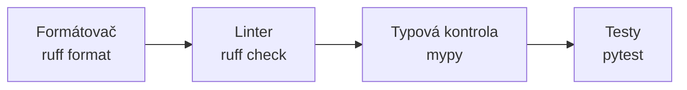
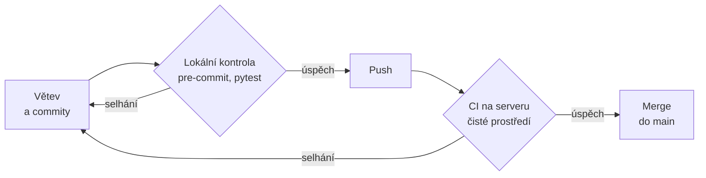

# Automatická kontrola kvality kódu

*Výukový materiál — formátovač, linter a typová kontrola v projektu, git hooks a lokální integrace*

Tento text popisuje nástroje, které kontrolují zdrojový kód automaticky, a způsob, jak je zapojit do každodenní práce. Představuje formátovač a linter `ruff`, typovou kontrolu celého projektu nástrojem `mypy`, jejich společné nastavení v souboru `pyproject.toml` a podporu ve vývojovém prostředí. Dále ukazuje, jak se kontrola spouští automaticky při každém commitu pomocí nástroje `pre-commit` a jak se z kontrol a testů sestaví lokální integrace, tedy ověření změny před jejím zařazením do hlavní větve. Navazuje na [materiál o typových anotacích](../01-psani-kodu/typovani-promennych.md) a [materiál o testování](testovani.md); serverovou kontrolu v GitHub Actions popisuje materiál [Git v týmu a průběžná integrace](../00-git/git-v-tymu-ci.md).

Ukázky předpokládají Python 3.11 nebo novější. Výstupy byly pořízeny s nástroji ruff 0.17.1, mypy 2.4.0, pre-commit 4.7.0 a pytest 9.1.1 na systému Windows; na Linuxu a macOS se v cestách k souborům vypisuje lomítko (`/`) místo zpětného lomítka. Znění hlášení se mezi verzemi nástrojů může mírně lišit.

## 1. Motivace

Kód, na němž pracuje více lidí nebo jeden člověk po delší dobu, se postupně stává nejednotným: různé odsazení a uvozovky, různé pořadí importů, zapomenuté nepoužívané importy. Ruční kontrola těchto drobností je nespolehlivá a odvádí pozornost od podstatného. Automatická kontrola má tři hlavní přínosy:

- **Konzistentní kód bez sporů o styl.** Podobu kódu určuje nastavení nástroje uložené v repozitáři, nikoli zvyklosti jednotlivých autorů. Otázka, zda psát jednoduché, nebo dvojité uvozovky, se rozhodne jednou a dále ji řeší nástroj.
- **Chyby odhalené ještě před spuštěním.** Nedefinované jméno, nepoužitý import nebo předání řetězce tam, kde se očekává číslo, odhalí nástroj během zlomku sekundy, aniž by se program spouštěl. U kódu strojového učení, v němž se chybný řádek může provést například až po hodině tréninku, je takové včasné odhalení zvlášť přínosné.
- **Revize kódu (code review) zaměřená na logiku.** Jsou-li formát a drobné nedostatky zkontrolovány automaticky, posuzovatel změny se nezabývá mezerami a pořadím importů, nýbrž tím, zda je změna správná a srozumitelná.

Podstatnou vlastností je **opakovatelnost**: nástroj provádí tutéž kontrolu při každém spuštění stejně a na každém počítači se stejným nastavením a stejnou verzí nástroje dává stejný výsledek.

## 2. Vrstvy kontroly

Kontrolu kvality tvoří čtyři vrstvy, které se doplňují. Řadí se od nejrychlejší a nejlevnější po nejpomalejší a nejnáročnější:



Textový popis schématu:

- Vrstvy jsou seřazeny zleva doprava: formátovač, linter, typová kontrola, testy.
- Směrem doprava roste doba běhu a náročnost přípravy (testy je třeba napsat, typová kontrola vyžaduje anotace) a zároveň roste šíře ověření: formátovač posuzuje pouze zápis, testy ověřují chování.
- Levnější vrstvy se spouštějí dříve, aby drobné nedostatky neodhalovala až pomalejší vrstva.

| Vrstva | Co odhalí | Co neodhalí |
|---|---|---|
| Formátovač | nejednotné odsazení, mezery, uvozovky, příliš dlouhé řádky | žádnou chybu v logice; formátovač kód pouze přepíše do jednotné podoby |
| Linter | nepoužitý import, nedefinované jméno, měnitelný výchozí argument, zastaralý zápis, porušení konvence pojmenování | nesoulad typů mezi funkcemi, chybný výpočet |
| Typová kontrola | předání hodnoty nesprávného typu, neošetřenou hodnotu `None`, nesoulad mezi moduly | chybu v algoritmu, při níž typy souhlasí (například záměnu `+` a `-` mezi dvěma čísly) |
| Testy | odchylku chování od očekávání u vyzkoušených vstupů | chování u vstupů, které žádný test nezkouší |

Žádná vrstva nenahrazuje ostatní. Test ověřuje jen vstupy, které v něm autor uvedl, kdežto typová kontrola posuzuje všechna místa volání bez ohledu na konkrétní hodnoty; naopak typová kontrola nerozliší správný výpočet od chybného, mají-li oba týž typ. Příklad chyby, kterou odhalí teprve test, uvádí kapitola 9.3.

## 3. Formátovač (ruff format)

### 3.1 Co formátovač mění

**Formátovač** přepíše zdrojový kód do jednotné podoby podle pevných pravidel. Mění pouze zápis: odsazení, mezery kolem operátorů, uvozovky, prázdné řádky mezi definicemi a zalomení dlouhých řádků. Nemění logiku programu, názvy proměnných ani pořadí příkazů. Příkaz `ruff format` vychází ze stylu formátovače `black` a dává téměř shodné výsledky.

Instalace a spuštění nad aktuální složkou:

```bash
pip install ruff
ruff format .            # přeformátuje všechny soubory .py ve složce a podsložkách
```

Soubor `vazeny.py` před formátováním:

```python
def vazeny_prumer(hodnoty: list[float], vahy: list[float], zaokrouhlit_na: int | None = None) -> float:
    soucet = sum( h*v for h,v in zip(hodnoty,vahy) )
    vysledek = soucet/sum(vahy)
    if zaokrouhlit_na is not None: return round(vysledek, zaokrouhlit_na)
    return vysledek
JEDNOTKY = {'delka':'m', 'hmotnost':'kg'}
```

Týž soubor po spuštění `ruff format vazeny.py`:

```python
def vazeny_prumer(
    hodnoty: list[float], vahy: list[float], zaokrouhlit_na: int | None = None
) -> float:
    soucet = sum(h * v for h, v in zip(hodnoty, vahy))
    vysledek = soucet / sum(vahy)
    if zaokrouhlit_na is not None:
        return round(vysledek, zaokrouhlit_na)
    return vysledek


JEDNOTKY = {"delka": "m", "hmotnost": "kg"}
```

Formátovač zalomil signaturu delší než 88 znaků, doplnil mezery kolem operátorů a za čárky, odstranil mezery uvnitř závorek, rozdělil příkaz `if` na dva řádky, sjednotil uvozovky na dvojité a oddělil definici funkce od následujícího kódu dvěma prázdnými řádky podle PEP 8.

Naformátovaný kód není nutně bezchybný. Linter s nastavením z kapitoly 6 u téhož kódu ohlásí nález `B905` (volání `zip()` bez parametru `strict=`): mají-li seznamy `hodnoty` a `vahy` různou délku, funkce `zip` přebývající prvky vynechá a výsledek je chybný bez jakéhokoli upozornění. Takový nedostatek je předmětem další vrstvy kontroly, linteru (kapitola 4).

### 3.2 Koncová čárka a zápis signatury

Výsledná signatura v předchozí ukázce umístila všechny parametry na jeden řádek uvnitř závorek. [Materiál o psaní funkcí](../01-psani-kodu/jak-psat-funkce.md) v kapitole 2 doporučuje u dlouhé signatury jiný tvar: každý parametr na samostatném řádku a uzavírací závorku na začátku řádku. Tento tvar formátovač vytvoří, je-li za posledním parametrem uvedena **koncová čárka** (v dokumentaci nástroje *magic trailing comma*). Koncová čárka vyjadřuje požadavek, aby prvky zůstaly pod sebou, i kdyby se vešly na jeden řádek:

```python
def vazeny_prumer(
    hodnoty: list[float],
    vahy: list[float],
    zaokrouhlit_na: int | None = None,
) -> float:
    soucet = sum(h * v for h, v in zip(hodnoty, vahy, strict=True))
    return soucet / sum(vahy)
```

Formátovač tento zápis ponechá beze změny; doplní-li autor koncovou čárku do kratší signatury, formátovač ji rovněž rozdělí na řádky. Totéž platí pro dlouhé seznamy, slovníky a volání funkcí s mnoha argumenty: koncová čárka zajistí jeden prvek na řádek a přidání dalšího prvku pak v historii změní pouze jeden řádek.

### 3.3 Kontrola bez zápisu

Pro kontrolu, zda je kód naformátován, slouží přepínač `--check`. Soubory se nemění; nástroj pouze vypíše, které soubory by přeformátoval, a skončí nenulovým návratovým kódem:

```bash
ruff format --check .
```

```text
unformatted: File would be reformatted
  --> vazeny.py:1:19
   |
   - def vazeny_prumer(hodnoty: list[float], vahy: list[float], zaokrouhlit_na: int | None = None) -> float:
   -     soucet = sum( h*v for h,v in zip(hodnoty,vahy) )
   -     vysledek = soucet/sum(vahy)
   -     if zaokrouhlit_na is not None: return round(vysledek, zaokrouhlit_na)
1  + def vazeny_prumer(
2  +     hodnoty: list[float], vahy: list[float], zaokrouhlit_na: int | None = None
3  + ) -> float:
4  +     soucet = sum(h * v for h, v in zip(hodnoty, vahy))
5  +     vysledek = soucet / sum(vahy)
6  +     if zaokrouhlit_na is not None:
7  +         return round(vysledek, zaokrouhlit_na)
8  |     return vysledek
   - JEDNOTKY = {'delka':'m', 'hmotnost':'kg'}
9  +
10 +
11 + JEDNOTKY = {"delka": "m", "hmotnost": "kg"}
   |

1 file would be reformatted
```

Řádky označené `-` by formátovač odstranil, řádky označené `+` by doplnil. Po přeformátování vypíše táž kontrola `1 file already formatted` a skončí kódem `0`.

Rozdíl mezi oběma příkazy je podstatný pro automatické kontroly. Příkaz `ruff format` soubory opraví a skončí kódem `0`, i když je změnil; příkaz `ruff format --check` nic nemění a neúspěch ohlásí kódem `1`. V průběžné integraci se proto používá výhradně varianta `--check` (viz [materiál o gitu v týmu a průběžné integraci](../00-git/git-v-tymu-ci.md), kapitola 6).

### 3.4 Délka řádku

Výchozí nejvyšší délka řádku je 88 znaků, stejně jako u formátovače `black`. Změní se v nastavení projektu (kapitola 6):

```toml
[tool.ruff]
line-length = 110
```

Při délce 110 znaků by formátovač signaturu z kapitoly 3.1, dlouhou 103 znaků, nezalomil, protože by se celá vešla na jeden řádek (bez koncové čárky). Volba délky je věcí dohody v týmu; podstatné je, aby byla uvedena v repozitáři a platila pro všechny.

## 4. Linter (ruff check)

### 4.1 Co linter hledá

**Linter** prochází kód a hledá vzory, které obvykle znamenají chybu, zbytečný kód nebo porušení konvence. Na rozdíl od formátovače kód ve výchozím stavu nemění, pouze hlásí nálezy. Každý nález patří k pravidlu označenému kódem, například `F401`; písmena na začátku kódu určují skupinu pravidel. Nástroj `ruff` sdružuje pravidla mnoha dřívějších samostatných nástrojů (pyflakes, pycodestyle, isort, pyupgrade a dalších).

Následující soubor `predzpracovani.py` obsahuje šest nedostatků:

```python
import sys
import json
from typing import Optional


def nacti_zaznamy(cesta: str) -> list[dict]:
    with open(cesta, encoding="utf-8") as soubor:
        return json.load(soubor)


def pridej_zaznam(zaznam: dict, zaznamy: list[dict] = []) -> list[dict]:
    zaznamy.append(zaznam)
    return zaznamy


def Normalizuj(hodnoty: list[float], posun: Optional[float] = None) -> list[float]:
    if posun is None:
        posun = sum(hodnoty) / len(hodnoty)
    return [(h - posun) / rozptyl for h in hodnoty]
```

Soubor lze importovat bez chyby; nedefinované jméno `rozptyl` by se projevilo výjimkou `NameError` teprve při zavolání funkce. Kontrola s výběrem pravidel z kapitoly 4.2, vypsaná ve stručném tvaru (přepínač `--output-format concise`):

```bash
ruff check --output-format concise predzpracovani.py
```

```text
predzpracovani.py:1:1: I001 [*] Import block is un-sorted or un-formatted
predzpracovani.py:1:8: F401 [*] `sys` imported but unused
predzpracovani.py:11:55: B006 Do not use mutable data structures for argument defaults
predzpracovani.py:16:5: N802 Function name `Normalizuj` should be lowercase
predzpracovani.py:16:45: UP045 [*] Use `X | None` for type annotations
predzpracovani.py:19:27: F821 Undefined name `rozptyl`
Found 6 errors.
[*] 3 fixable with `--fix` (1 unsafe fix available with `--fix --unsafe-fixes`).
```

Každý řádek uvádí soubor, řádek a sloupec, kód pravidla a popis. Značka `[*]` označuje nález, který lze opravit automaticky (kapitola 4.3). Nálezy odpovídají těmto skupinám pravidel:

| Předpona | Skupina | Nález v ukázce |
|---|---|---|
| `F` | Pyflakes — logické chyby zjistitelné bez spuštění | `F401` nepoužitý import `sys`, `F821` nedefinované jméno `rozptyl` |
| `I` | isort — pořadí a seskupení importů | `I001` importy nejsou seřazeny |
| `B` | flake8-bugbear — časté zdroje chyb | `B006` měnitelný výchozí argument; důvod, proč je takový argument chybou, vysvětluje [materiál o psaní funkcí](../01-psani-kodu/jak-psat-funkce.md), kapitola 2 |
| `UP` | pyupgrade — zastaralé zápisy | `UP045` zápis `Optional[float]` místo `float \| None`; oba zápisy srovnává [materiál o typových anotacích](../01-psani-kodu/typovani-promennych.md), kapitola 3 |
| `N` | pep8-naming — konvence pojmenování | `N802` název funkce není zapsán malými písmeny (`snake_case`) |
| `E`, `W` | pycodestyle — chyby a varování stylu | v ukázce bez nálezu |

Bez přepínače `--output-format concise` vypisuje nástroj u každého nálezu i úryvek kódu a návod k opravě:

```text
B006 Do not use mutable data structures for argument defaults
  --> predzpracovani.py:11:55
   |
11 | def pridej_zaznam(zaznam: dict, zaznamy: list[dict] = []) -> list[dict]:
   |                                                       ^^
12 |     zaznamy.append(zaznam)
13 |     return zaznamy
   |
help: Replace with `None`; initialize within function
```

Podrobný popis pravidla včetně odůvodnění a příkladu vypíše příkaz `ruff rule B006`.

> **Upozornění:** Od verze 0.16 zapíná ruff bez jakéhokoli nastavení přes 400 pravidel; do té doby jich bylo 59. Bez výslovného výběru pravidel tedy výsledek kontroly závisí na nainstalované verzi nástroje (podrobněji kapitola 10). Výběr pravidel se proto vždy uvádí v nastavení projektu.

### 4.2 Výběr pravidel

Pravidla se vybírají v oddílu `[tool.ruff.lint]` souboru `pyproject.toml` seznamem kódů nebo jejich předpon:

```toml
[tool.ruff.lint]
select = ["E", "F", "I", "B", "UP", "N"]
```

Uvedený výběr odpovídá tabulce v kapitole 4.1 a pro začátek postačuje. Další skupiny se přidávají postupně (kapitola 11); jejich úplný seznam uvádí dokumentace nástroje. Úplné nastavení projektu ukazuje kapitola 6.

### 4.3 Automatické opravy

Přepínač `--fix` provede opravy označené značkou `[*]`:

```bash
ruff check --fix predzpracovani.py
```

Nástroj seřadí importy, odstraní nepoužitý import `sys` i nadále zbytečný import `Optional` a zápis `Optional[float]` nahradí zápisem `float | None`. Výstup končí souhrnem:

```text
Found 6 errors (3 fixed, 3 remaining).
1 unsafe fix available with `--fix --unsafe-fixes`.
```

Tři nálezy zůstaly, protože jejich oprava vyžaduje rozhodnutí autora:

- **`F821` nedefinované jméno** — z kódu nelze určit, co mělo být místo `rozptyl` použito,
- **`N802` název funkce** — přejmenování by vyžadovalo změnu všech míst volání, včetně jiných modulů a projektů,
- **`B006` měnitelný výchozí argument** — oprava existuje, je však označena jako **nebezpečná** (unsafe), protože může změnit chování programu.

Nebezpečné opravy se provedou jen na výslovný pokyn přepínačem `--unsafe-fixes`, a jejich výsledek je proto nutné zkontrolovat. U pravidla `B006` navrhuje nástroj tuto úpravu:

```text
   - def pridej_zaznam(zaznam: dict, zaznamy: list[dict] = []) -> list[dict]:
11 + def pridej_zaznam(zaznam: dict, zaznamy: list[dict] = None) -> list[dict]:
12 +     if zaznamy is None:
13 +         zaznamy = []
```

Tělo funkce je upraveno správně, anotace parametru však zůstala `list[dict]`, ačkoli výchozí hodnotou je nyní `None`. Typová kontrola by takovou signaturu označila za chybnou; správný zápis je `zaznamy: list[dict] | None = None`.

### 4.4 Potlačení pravidla

Některý nález je v konkrétním místě oprávněnou výjimkou. Například v kódu strojového učení se matice příznaků podle ustálené konvence označuje velkým `X`, což pravidlo `N803` (název parametru malými písmeny) hlásí jako porušení. Nález se potlačí komentářem `# noqa:` s kódem pravidla na konci řádku:

```python
import numpy as np


def nauc(X: np.ndarray, y: np.ndarray) -> np.ndarray:  # noqa: N803 -- X je ustálené označení matice příznaků
    return np.linalg.lstsq(X, y, rcond=None)[0]
```

Pro potlačení platí tři zásady:

- **Vždy se uvádí kód pravidla.** Samotné `# noqa` bez kódu potlačí všechna pravidla na řádku, tedy i pozdější nálezy, které s výjimkou nesouvisejí.
- **Vždy se uvádí zdůvodnění** za kódem pravidla. Čtenář kódu i posuzovatel změny tak vidí, proč je výjimka oprávněná.
- **Opakuje-li se táž výjimka v celém souboru nebo složce**, je přehlednější ji uvést v nastavení (oddíl `[tool.ruff.lint.per-file-ignores]`) než na každém řádku.

Pravidlo `RUF100` upozorní na komentář `# noqa`, který nic nepotlačuje, například proto, že původní nález byl mezitím opraven:

```text
noqa.py:12:31: RUF100 [*] Unused `noqa` directive (unused: `N803`)
```

## 5. Typová kontrola v projektu

### 5.1 Kontrola celého projektu

[Materiál o typových anotacích](../01-psani-kodu/typovani-promennych.md) v kapitole 5 ukazuje spuštění nástroje `mypy` nad jedním souborem. V projektu se kontroluje celá složka se zdrojovým kódem najednou. Teprve tak se odhalí nesoulad **mezi moduly**: funkce definovaná v jednom souboru je v jiném souboru volána s nesprávnými argumenty.

Jako příklad slouží projekt s rozvržením `src/` (viz [materiál o struktuře projektu](../03-projekt-a-prostredi/struktura-projektu.md), kapitola 7), nainstalovaný v editovatelném režimu (`pip install -e .`):

```text
statistiky/
├── pyproject.toml
├── src/
│   └── statistiky/
│       ├── __init__.py
│       ├── zakladni.py
│       └── report.py
└── tests/
    └── test_zakladni.py
```

Soubor `src/statistiky/zakladni.py`:

```python
def vazeny_prumer(
    hodnoty: list[float],
    vahy: list[float],
    zaokrouhlit_na: int | None = None,
) -> float:
    if len(hodnoty) != len(vahy):
        raise ValueError("hodnoty a váhy mají různou délku")
    soucet = sum(h * v for h, v in zip(hodnoty, vahy, strict=True))
    vysledek = soucet / sum(vahy)
    if zaokrouhlit_na is not None:
        return round(vysledek, zaokrouhlit_na)
    return vysledek


def nejvyssi(hodnoty: list[float]) -> float | None:
    if not hodnoty:
        return None
    return max(hodnoty)
```

Soubor `src/statistiky/report.py` tyto funkce používá; obsahuje dvě chyby a jednu funkci bez anotací:

```python
from statistiky.zakladni import nejvyssi, vazeny_prumer


def popis(hodnoty: list[float], vahy: list[float]) -> str:
    prumer = vazeny_prumer(hodnoty, vahy, zaokrouhlit_na="2")
    maximum = nejvyssi(hodnoty)
    rozpeti = maximum - min(hodnoty)
    return f"průměr {prumer}, rozpětí {rozpeti}"


def normalizuj(hodnoty):
    podil = 1 / nejvyssi(hodnoty)
    return [h * podil for h in hodnoty]
```

Kontrolovaná složka je uvedena v nastavení (`files = ["src"]`, kapitola 6), takže postačí příkaz bez argumentů:

```bash
python -m mypy
```

```text
src\statistiky\report.py:5: error: Argument "zaokrouhlit_na" to "vazeny_prumer" has incompatible type "str"; expected "int | None"  [arg-type]
src\statistiky\report.py:7: error: Unsupported operand types for - ("None" and "float")  [operator]
src\statistiky\report.py:7: note: Left operand is of type "float | None"
Found 2 errors in 1 file (checked 3 source files)
```

První chybou je předání řetězce místo čísla do funkce z jiného modulu. Druhá chyba vzniká tím, že funkce `nejvyssi` může vrátit `None` a výsledek se přesto použije ve výpočtu; u prázdného seznamu by program skončil výjimkou `TypeError`. Oprava spočívá v ošetření případu `None` před výpočtem:

```python
from statistiky.zakladni import nejvyssi, vazeny_prumer


def popis(hodnoty: list[float], vahy: list[float]) -> str:
    prumer = vazeny_prumer(hodnoty, vahy, zaokrouhlit_na=2)
    maximum = nejvyssi(hodnoty)
    if maximum is None:
        return "prázdná data"
    rozpeti = maximum - min(hodnoty)
    return f"průměr {prumer}, rozpětí {rozpeti}"
```

Za podmínkou `if maximum is None: return ...` zachází nástroj s proměnnou `maximum` jako s typem `float`, protože případ `None` byl vyloučen. Tento postup se nazývá **zúžení typu** (type narrowing).

### 5.2 Postupné zpřísňování

Výchozí nastavení nástroje `mypy` je mírné. Funkce bez anotací (v ukázce `normalizuj`) se považuje za nekontrolovanou: nástroj ji nehlásí a její tělo ve výchozím stavu ani nekontroluje, přestože obsahuje stejnou chybu jako funkce `popis` (dělení hodnotou, která může být `None`). Díky tomu lze nástroj zavést i do projektu, který anotace dosud nepoužívá. Kontrola se poté zpřísňuje volbami, které se přidávají jednotlivě:

| Volba | Účinek |
|---|---|
| `check_untyped_defs = true` | kontroluje i těla funkcí bez anotací |
| `disallow_untyped_defs = true` | hlásí každou funkci bez úplných anotací |
| `warn_unused_ignores = true` | hlásí komentář `# type: ignore`, který nic nepotlačuje |
| `strict = true` | zapne souhrn přísných voleb včetně všech výše uvedených |

Účinek volby lze vyzkoušet jednorázově přepínačem příkazové řádky se stejným názvem (podtržítka se nahradí pomlčkami). Volba `--check-untyped-defs` odhalí chybu v těle funkce `normalizuj`:

```bash
python -m mypy --check-untyped-defs
```

```text
src\statistiky\report.py:5: error: Argument "zaokrouhlit_na" to "vazeny_prumer" has incompatible type "str"; expected "int | None"  [arg-type]
src\statistiky\report.py:7: error: Unsupported operand types for - ("None" and "float")  [operator]
src\statistiky\report.py:7: note: Left operand is of type "float | None"
src\statistiky\report.py:12: error: Unsupported operand types for / ("int" and "None")  [operator]
src\statistiky\report.py:12: note: Right operand is of type "float | None"
Found 3 errors in 1 file (checked 3 source files)
```

Volba `--disallow-untyped-defs` místo chyby v těle funkce ohlásí (vedle obou předchozích chyb) samotnou chybějící anotaci:

```text
src\statistiky\report.py:11: error: Function is missing a type annotation  [no-untyped-def]
```

Doporučené pořadí je nejprve `check_untyped_defs` (odhalí chyby bez nutnosti psát anotace), poté `disallow_untyped_defs` pro nový kód a nakonec `strict`, je-li projekt anotován úplně. Přísnější nastavení lze omezit jen na vybrané moduly oddílem `[[tool.mypy.overrides]]` (kapitola 6).

### 5.3 Knihovny bez typových informací

Typová kontrola potřebuje znát typy i u použitých knihoven. Knihovna je poskytuje buď sama (obsahuje soubor `py.typed`, například NumPy), nebo prostřednictvím samostatného **stub balíčku** s typovými informacemi, nebo vůbec. Soubor `src/statistiky/nacitani.py`:

```python
import yaml
from sklearn.preprocessing import StandardScaler


def nacti_nastaveni(cesta: str) -> dict[str, object]:
    with open(cesta, encoding="utf-8") as soubor:
        return yaml.safe_load(soubor)


def priprav_skaler() -> StandardScaler:
    return StandardScaler()
```

```bash
python -m mypy src/statistiky/nacitani.py
```

```text
src\statistiky\nacitani.py:1: error: Library stubs not installed for "yaml"  [import-untyped]
src\statistiky\nacitani.py:1: note: Hint: "python3 -m pip install types-PyYAML"
src\statistiky\nacitani.py:1: note: (or run "mypy --install-types" to install all missing stub packages)
src\statistiky\nacitani.py:2: error: Skipping analyzing "sklearn.preprocessing": module is installed, but missing library stubs or py.typed marker  [import-untyped]
src\statistiky\nacitani.py:2: note: See https://mypy.readthedocs.io/en/stable/running_mypy.html#missing-imports
Found 2 errors in 1 file (checked 1 source file)
```

Obě hlášení mají odlišné řešení:

- **Knihovna PyYAML** typové informace neobsahuje, existuje však stub balíček `types-PyYAML`, jehož název nástroj sám uvádí. Balíček se přidá do vývojových závislostí projektu (kapitola 6); typová kontrola pak ověřuje i použití knihovny.
- **Knihovna scikit-learn** typové informace neobsahuje a stub balíček v nástroji `mypy` není znám. Hlášení se potlačí v nastavení jen pro tuto knihovnu volbou `ignore_missing_imports = true` v oddílu `[[tool.mypy.overrides]]` (kapitola 6). Hodnoty z takové knihovny mají typ `Any` a jejich použití se nekontroluje.

Volba `ignore_missing_imports` se nenastavuje pro celý projekt, nýbrž jen pro jmenovité knihovny. Globální nastavení by skrylo i chybějící stub balíčky a překlepy v názvech modulů. Místo oddílu v nastavení lze výjimku zapsat i na jednom řádku komentářem s kódem chyby a zdůvodněním:

```python
from sklearn.preprocessing import StandardScaler  # type: ignore[import-untyped]  # knihovna bez typových informací
```

Používá se jen jeden z obou způsobů. Je-li knihovna uvedena i v nastavení, komentář nic nepotlačuje a volba `warn_unused_ignores` (kapitola 5.2) jej ohlásí jako `Unused "type: ignore" comment  [unused-ignore]`.

> **Poznámka:** Vedle nástroje `mypy` se používá nástroj `pyright`, na němž je založeno rozšíření Pylance ve VS Code (kapitola 7). Oba nástroje kontrolují tytéž anotace, liší se však v podrobnostech a nemusejí hlásit totéž. Za závazný se v projektu považuje jeden z nich, ten, který se spouští v kontrolách a v CI; v tomto textu je to `mypy`.

## 6. Nastavení na jednom místě

Nastavení všech nástrojů se uvádí v souboru `pyproject.toml` v kořeni projektu. Strukturu souboru, oddíl `[project]` a skupinu vývojových závislostí `dev` popisuje [materiál o struktuře projektu](../03-projekt-a-prostredi/struktura-projektu.md), kapitola 9.2. Nástroje čtou své oddíly `[tool.<název>]` samy, takže se spouštějí bez dalších argumentů a lokálně i v CI pracují se stejným nastavením. Úplné nastavení projektu z kapitoly 5:

```toml
[build-system]
requires = ["setuptools>=61"]
build-backend = "setuptools.build_meta"

[project]
name = "statistiky"
version = "0.1.0"
requires-python = ">=3.11"
dependencies = [
    "pyyaml>=6.0",
    "scikit-learn>=1.5",
]

[project.optional-dependencies]
dev = [
    "pytest==9.1.1",
    "mypy==2.4.0",
    "ruff==0.17.1",
    "pre-commit==4.7.0",
    "types-PyYAML==6.0.12.20250915",
]

[tool.ruff]
line-length = 88

[tool.ruff.lint]
select = ["E", "F", "I", "B", "UP", "N"]

[tool.mypy]
python_version = "3.11"
files = ["src"]
check_untyped_defs = true
disallow_untyped_defs = true
warn_unused_ignores = true

[[tool.mypy.overrides]]
module = ["sklearn.*"]
ignore_missing_imports = true

[tool.pytest.ini_options]
testpaths = ["tests"]
```

Význam jednotlivých částí:

- **`[project.optional-dependencies]`** — skupina `dev` uvádí nástroje pro vývoj se **zafixovanými verzemi** (`==`), aby měli všichni členové týmu i CI tytéž verze (kapitola 10). Stub balíček `types-PyYAML` patří sem, protože jej potřebuje jen typová kontrola, nikoli běh programu. Celý projekt se pro vývoj nainstaluje příkazem `pip install -e ".[dev]"`.
- **`[tool.ruff]`** — společné nastavení formátovače i linteru. Cílovou verzi Pythonu odvodí ruff z pole `requires-python`; podle ní volí například, zda doporučí zápis `X | None`.
- **`[tool.ruff.lint]`** — výběr pravidel (kapitola 4.2).
- **`[tool.mypy]`** — `python_version` určuje verzi jazyka, vůči níž se kód kontroluje (zde nejnižší podporovaná), `files` kontrolovanou složku a další volby přísnost (kapitola 5.2).
- **`[[tool.mypy.overrides]]`** — odchylné nastavení pro vybrané moduly; dvojité hranaté závorky v TOML označují položku seznamu, oddílů tedy může být více.
- **`[tool.pytest.ini_options]`** — složka s testy pro `pytest`.

Ruff čte nastavení také ze samostatného souboru `ruff.toml`. Obsahuje-li projekt oba soubory, má přednost `ruff.toml`; v projektu se proto používá jen jeden z nich.

## 7. Integrace do editoru

Nástroje lze spouštět i přímo ve vývojovém prostředí. Nálezy se pak zobrazují jako podtržení přímo v kódu a v panelu problémů, a to již během psaní, ještě před uložením souboru nebo commitem.

**VS Code.** Potřebná jsou tato rozšíření:

- **Ruff** (`charliermarsh.ruff`) — nálezy linteru, automatické opravy a formátování,
- **Pylance** (instaluje se s rozšířením Python) — doplňování kódu a typová kontrola nástrojem `pyright`; přísnost určuje nastavení `python.analysis.typeCheckingMode` (`off`, `basic`, `standard`, `strict`),
- **Mypy Type Checker** (`ms-python.mypy-type-checker`) — volitelně, zobrazuje nálezy nástroje `mypy`, tedy téhož nástroje, který se spouští v kontrolách.

Nastavení projektu se uloží do souboru `.vscode/settings.json`, který lze verzovat spolu s kódem:

```json
{
    "[python]": {
        "editor.defaultFormatter": "charliermarsh.ruff",
        "editor.formatOnSave": true,
        "editor.codeActionsOnSave": {
            "source.fixAll": "explicit",
            "source.organizeImports": "explicit"
        }
    },
    "mypy-type-checker.importStrategy": "fromEnvironment"
}
```

Při uložení souboru se kód naformátuje, provedou se bezpečné opravy linteru a seřadí se importy. Poslední řádek zajistí, že rozšíření Mypy použije verzi nástroje z virtuálního prostředí projektu; ve výchozím stavu (`useBundled`) by použilo verzi dodanou s rozšířením, která se od verze v projektu může lišit (kapitola 10). Rozšíření Ruff používá ve výchozím stavu ruff z prostředí projektu a jen v případě, že tam chybí, verzi dodanou s rozšířením.

**PyCharm.** Od verze 2025.3 obsahuje PyCharm vestavěnou podporu nástroje ruff; zapíná se v nastavení (Settings) v části Python → Tools, kde se zvolí i použití ruff jako formátovače. Umístění voleb se mezi verzemi liší. Formátování při uložení se zapíná v části Tools → Actions on Save. PyCharm má vlastní typovou kontrolu (inspekce), která se od nástroje `mypy` může lišit; nálezy nástroje `mypy` zobrazí zásuvný modul Mypy z nabídky Settings → Plugins.

> **Poznámka:** Kontrola v editoru je pomůckou autora, nikoli závaznou kontrolou. Editor může používat jinou verzi nástroje nebo jiné nastavení a nic nebrání uložení souboru s nálezy. Závazná je kontrola spouštěná příkazem (kapitola 9) a v CI.

## 8. Git hooks a pre-commit

### 8.1 Co je git hook

**Git hook** je skript, který git spouští automaticky při určité události, například před vytvořením commitu (`pre-commit`) nebo před operací push (`pre-push`). Skripty jsou uloženy ve složce `.git/hooks/` lokálního repozitáře. Skončí-li skript nenulovým návratovým kódem (viz [materiál o výjimkách](../01-psani-kodu/vyjimky.md), kapitola 10), git operaci přeruší: commit se nevytvoří, operace push se neprovede. Hook tak zajistí, že kontrola proběhne při každém commitu bez ohledu na to, zda ji autor spustí ručně.

Složka `.git/hooks/` není součástí verzovaného obsahu repozitáře, a proto se skripty v ní nepřenášejí operacemi push a clone. Tento nedostatek řeší nástroj **pre-commit**: hooky popisuje verzovaný soubor `.pre-commit-config.yaml` v kořeni repozitáře a každý člen týmu je jedním příkazem nainstaluje do svého lokálního repozitáře. Nástroj zároveň pro každý hook připraví samostatné prostředí se zafixovanou verzí nástroje.

### 8.2 Soubor .pre-commit-config.yaml

Soubor ve formátu YAML (základy syntaxe uvádí [materiál o gitu v týmu a průběžné integraci](../00-git/git-v-tymu-ci.md), kapitola 5) se pro projekt z kapitoly 5 zapíše takto:

```yaml
repos:
  - repo: https://github.com/astral-sh/ruff-pre-commit
    rev: v0.17.1
    hooks:
      - id: ruff-check
        args: [--fix]
      - id: ruff-format

  - repo: https://github.com/pre-commit/mirrors-mypy
    rev: v2.4.0
    hooks:
      - id: mypy
        files: ^src/
        args: []
        additional_dependencies: ["types-PyYAML==6.0.12.20250915"]
```

Význam jednotlivých částí:

- **`repo`** a **`rev`** — repozitář s definicí hooků a jeho verze (značka v gitu). Hodnota `rev` určuje verzi nástroje; `v0.17.1` odpovídá ruff 0.17.1.
- **`ruff-check`** s argumentem `--fix` — linter s automatickými opravami. Ve starších návodech se uvádí pod identifikátorem `ruff`, který zůstal zachován jako zastaralý alias.
- **`ruff-format`** — formátovač. Uvádí se za linterem, protože opravy linteru mohou změnit formát.
- **`mypy`** — typová kontrola. Vyžaduje tři úpravy výchozího chování:
  - `files: ^src/` — nástroj pre-commit předává hookům seznam souborů, a volba `files` z `pyproject.toml` se proto neuplatní; bez omezení by se kontrolovaly i testy a v tomto projektu by kontrola selhala na chybějících anotacích testovacích funkcí,
  - `args: []` — hook ve výchozím stavu přidává přepínač `--ignore-missing-imports`, který by globálně skryl chybějící stub balíčky (kapitola 5.3); prázdný seznam jej odstraní a platí nastavení z `pyproject.toml`,
  - `additional_dependencies` — hook běží v samostatném prostředí, v němž nejsou nainstalovány závislosti projektu; stub balíčky a knihovny s vlastními typovými informacemi je nutné uvést zde.

> **Upozornění:** Samostatné prostředí hooku `mypy` neobsahuje knihovny projektu. Používá-li projekt například NumPy, který typové informace obsahuje, hook ohlásí `Cannot find implementation or library stub for module named "numpy"  [import-not-found]`, ačkoli příkaz `python -m mypy` ve virtuálním prostředí projektu projde. Řešením je uvést knihovnu v `additional_dependencies`, nebo místo hooku z repozitáře `mirrors-mypy` použít lokální hook, který spouští `mypy` z prostředí projektu:
>
> ```yaml
>   - repo: local
>     hooks:
>       - id: mypy
>         name: mypy
>         entry: python -m mypy
>         language: system
>         types: [python]
>         pass_filenames: false
> ```
>
> Lokální hook používá verzi nástroje ze skupiny `dev` a díky `pass_filenames: false` kontroluje složky podle volby `files` z `pyproject.toml`, tedy přesně totéž co příkaz `python -m mypy`. Předpokladem je aktivní virtuální prostředí projektu při vytváření commitu.

### 8.3 Instalace a běh

Hooky se do lokálního repozitáře nainstalují příkazem, který se spouští jednou po každém provedení operace clone:

```bash
pre-commit install
```

```text
pre-commit installed at .git\hooks\pre-commit
```

Od této chvíle proběhnou hooky při každém příkazu `git commit` i při commitu z grafického rozhraní, a to pouze nad soubory zařazenými do staging (viz [materiál o práci s gitem a GitHubem](../00-git/git-github-pripomenuti.md), kapitola 3). První běh trvá déle, protože nástroj stahuje a připravuje prostředí hooků; další běhy je používají znovu. Úspěšný commit:

```text
ruff check...............................................................Passed
ruff format..............................................................Passed
mypy.....................................................................Passed
[main 908a5df] Přidání funkce rozpeti
 1 file changed, 4 insertions(+)
```

Hook, jehož soubory nejsou mezi změnami (například `mypy` při změně pouze v testech), se vypíše jako `(no files to check)Skipped`.

**Neúspěšný commit.** Obsahuje-li změna typovou chybu, hook `mypy` selže a commit se nevytvoří:

```text
ruff check...............................................................Passed
ruff format..............................................................Passed
mypy.....................................................................Failed
- hook id: mypy
- exit code: 1

src\statistiky\report.py:14: error: Unsupported operand types for + ("str" and "float")  [operator]
src\statistiky\report.py:14: error: Unsupported operand types for + ("str" and "None")  [operator]
src\statistiky\report.py:14: note: Right operand is of type "float | None"
Found 2 errors in 1 file (checked 1 source file)
```

Změny zůstávají v pracovním adresáři i ve staging beze změny. Po opravě chyby se soubor znovu zařadí do staging (příkaz `git add`) a commit se zopakuje.

### 8.4 Hook, který soubory opraví

Hooky `ruff-check --fix` a `ruff-format` soubory samy opraví. I v takovém případě se commit nevytvoří, protože opravený obsah dosud není ve staging:

```text
ruff check...............................................................Failed
- hook id: ruff-check
- files were modified by this hook

Found 1 error (1 fixed, 0 remaining).

ruff format..............................................................Failed
- hook id: ruff-format
- files were modified by this hook

1 file reformatted

mypy.....................................................................Passed
```

Příkaz `git status --short` nyní u souboru ukazuje dvě značky `M`:

```text
MM src/statistiky/zakladni.py
```

První značka znamená, že ve staging je změna určená pro commit (původní, neopravená verze), druhá značka, že pracovní adresář obsahuje další změnu (opravy provedené hooky). Opravy se zkontrolují (`git diff`), zařadí do staging a commit se zopakuje:

```bash
git diff                      # kontrola oprav provedených hooky
git add src/statistiky/zakladni.py
git commit -m "Přidání funkce rozpeti"
```

Tentokrát hooky projdou a commit vznikne. V grafickém rozhraní se postupuje obdobně: opravený soubor se znovu přidá do staging a commit se zopakuje se stejným sdělením. Oblasti, v nichž se změny nacházejí, popisuje [materiál o práci s gitem a GitHubem](../00-git/git-github-pripomenuti.md) v kapitole 3, každodenní cyklus v kapitole 5.

### 8.5 Spuštění nad celým projektem

Při commitu se kontrolují jen soubory ve staging. Kontrolu všech souborů v repozitáři provede příkaz:

```bash
pre-commit run --all-files
```

Spouští se po prvním zavedení hooků, po změně nastavení nástrojů a jako součást celé kontroly před operací merge (kapitola 9).

### 8.6 Obejití hooků

Přepínač `--no-verify` hooky vynechá (`git commit --no-verify`, obdobně `git push --no-verify`). Nástroj pre-commit dále umožňuje vynechat jednotlivý hook proměnnou prostředí `SKIP` (například `SKIP=mypy git commit ...` v shellu bash).

Obejití hooků se nepoužívá k tomu, aby se nález nemusel opravovat. Commit s nálezem se tak dostane do repozitáře a chyba se projeví později, v CI nebo u jiného člena týmu. Je-li nález neoprávněný, upraví se nastavení nástroje nebo se nález v daném místě potlačí se zdůvodněním (kapitoly 4.4 a 5.3). Přípustným použitím je dočasný commit rozpracované práce na vlastní větvi, který se před operací merge opraví.

## 9. Lokální integrace

### 9.1 Průběžná integrace jako praxe

Pojem **průběžná integrace** (continuous integration) označuje v první řadě způsob práce, nikoli službu na serveru. Spočívá ve třech zásadách:

- **malé změny** — každá větev obsahuje jednu tematicky ucelenou změnu, kterou lze snadno ověřit a posoudit,
- **častá integrace** — změny se zařazují do hlavní větve průběžně, nejlépe během několika dní, aby se větve od sebe příliš neodchýlily a nevznikaly rozsáhlé konflikty,
- **ověření před každou operací merge** — do hlavní větve se dostane jen změna, která prošla celou kontrolou.

Služba jako GitHub Actions (viz [materiál o gitu v týmu a průběžné integraci](../00-git/git-v-tymu-ci.md), kapitola 3) třetí zásadu automatizuje na serveru. Celou kontrolu však lze a je vhodné provést nejprve lokálně: výsledek je k dispozici okamžitě a chyba se neodhalí až po operaci push.

### 9.2 Postup

Práce na jedné změně probíhá v těchto krocích (větve a merge viz [materiál o práci s gitem a GitHubem](../00-git/git-github-pripomenuti.md), kapitoly 8 a 9):

```bash
git switch main
git pull
git switch -c median                  # 1. větev pro jednu změnu

# ... úprava souborů ...
git add src/statistiky/zakladni.py tests/test_zakladni.py
git commit -m "Přidání mediánu"        # 2. commity; hooky kontrolují každý z nich

pre-commit run --all-files            # 3. celá kontrola
python -m pytest

git switch main                       # 4. merge do main
git pull
git merge median
```

V týmovém projektu se krok 4 nahrazuje pull requestem (viz [materiál o gitu v týmu a průběžné integraci](../00-git/git-v-tymu-ci.md), kapitola 2). Byla-li mezitím do `main` zařazena jiná změna, aktualizuje se vlastní větev operací merge nebo rebase (viz [materiál Historie, návraty a konflikty](../00-git/historie-navraty-konflikty.md), kapitola 11.2) a celá kontrola se zopakuje: každá ze dvou změn může samostatně kontrolou projít, a jejich spojení přesto selhat.

### 9.3 Celá kontrola

Celou kontrolu tvoří dva příkazy: všechny hooky nad celým projektem a všechny testy.

```bash
pre-commit run --all-files
python -m pytest
```

Úspěšný výsledek (záhlaví výstupu nástroje pytest je zkráceno):

```text
ruff check...............................................................Passed
ruff format..............................................................Passed
mypy.....................................................................Passed
```

```text
collected 5 items

tests\test_zakladni.py .....                                             [100%]

============================== 5 passed in 0.02s ==============================
```

Kontrola je úspěšná, pokud oba příkazy skončí kódem `0`. Testy se spouštějí zvlášť, protože jejich běh trvá déle, než je pro kontrolu každého commitu přijatelné.

**Kontrola před operací push.** Spouštění testů lze svěřit hooku `pre-push`, který proběhne při každé operaci push a při neúspěšných testech ji zastaví. Do souboru `.pre-commit-config.yaml` se doplní dva řádky na začátek a lokální hook na konec:

```yaml
default_install_hook_types: [pre-commit, pre-push]
default_stages: [pre-commit]

repos:
  # ... hooky ruff-check, ruff-format a mypy z kapitoly 8.2 ...

  - repo: local
    hooks:
      - id: pytest
        name: pytest
        entry: python -m pytest
        language: system
        pass_filenames: false
        always_run: true
        stages: [pre-push]
```

Volba `default_install_hook_types` zajistí, že příkaz `pre-commit install` nainstaluje oba druhy hooků; volba `default_stages` omezí ostatní hooky na commit, aby se při operaci push neopakovaly. Hook `pytest` je lokální (`repo: local`) a spouští testy z virtuálního prostředí projektu (`language: system`), `pass_filenames: false` zajistí spuštění všech testů a `always_run: true` jeho spuštění i bez změněných souborů Pythonu. Po doplnění volby `default_install_hook_types` se příkaz `pre-commit install` spustí znovu, aby se nainstaloval i hook `pre-push`:

```text
pre-commit installed at .git\hooks\pre-commit
pre-commit installed at .git\hooks\pre-push
```

Následující funkce projde formátovačem, linterem i typovou kontrolou, výsledek je však u sudého počtu hodnot chybný:

```python
def median(hodnoty: list[float]) -> float:
    serazene = sorted(hodnoty)
    return serazene[len(serazene) // 2]
```

Chybu odhalí teprve test a hook `pre-push` zastaví operaci push (záhlaví výstupu nástroje pytest je zkráceno):

```bash
git push -u origin median
```

```text
pytest...................................................................Failed
- hook id: pytest
- exit code: 1

collected 6 items

tests\test_zakladni.py .....F                                            [100%]

================================== FAILURES ===================================
__________________________ test_median_sudeho_poctu ___________________________

    def test_median_sudeho_poctu():
>       assert median([1.0, 2.0, 3.0, 4.0]) == 2.5
E       assert 3.0 == 2.5
E        +  where 3.0 = median([1.0, 2.0, 3.0, 4.0])

tests\test_zakladni.py:28: AssertionError
=========================== short test summary info ===========================
FAILED tests/test_zakladni.py::test_median_sudeho_poctu - assert 3.0 == 2.5
========================= 1 failed, 5 passed in 0.12s =========================

error: failed to push some refs to '...'
```

Ručně lze hook `pre-push` spustit příkazem `pre-commit run --hook-stage pre-push --all-files`.

### 9.4 Co lokální kontrola nezachytí

Lokální kontrola probíhá v prostředí autora, a proto nezachytí rozdíly mezi tímto prostředím a prostředím ostatních:

- **Závislost nainstalovanou jen u autora.** Knihovna, kterou autor nainstaloval ručně a neuvedl v `pyproject.toml`, je v jeho prostředí dostupná a testy projdou; na jiném počítači selžou s `ModuleNotFoundError`.
- **Jinou verzi Pythonu.** Kód napsaný a vyzkoušený v Pythonu 3.12 může používat prostředky, které Python 3.11 uvedený v `requires-python` nemá.
- **Soubory mimo repozitář.** Test může záviset na datovém souboru, který existuje jen lokálně, například proto, že je uveden v `.gitignore`.
- **Zapomenuté spuštění.** Hooky chybí u člena týmu, který po provedení operace clone nespustil `pre-commit install`, a lze je obejít přepínačem `--no-verify`.

Proto se lokální kontrola doplňuje **serverovou CI**, která tytéž příkazy spouští v čistém prostředí obsahujícím pouze obsah repozitáře (viz [materiál o gitu v týmu a průběžné integraci](../00-git/git-v-tymu-ci.md), kapitoly 3 a 6). Lokální kontrola odhalí většinu chyb rychle, serverová CI zaručí, že kontrola proběhla, a odhalí závislost na prostředí autora.



Textový popis schématu:

- Práce probíhá na vlastní větvi; každý commit kontrolují hooky.
- Před operací push proběhne lokální kontrola (celá kontrola z kapitoly 9.3, případně hook `pre-push`). Při selhání se změna opraví na větvi.
- Po operaci push spustí server tytéž kontroly v čistém prostředí. Při selhání se změna opět opraví na větvi.
- Teprve po úspěchu obou kontrol se provede merge změny do `main`.

> **Přesah:** Nástroj **nox** spouští kontroly v nově vytvořeném virtuálním prostředí, do něhož se nainstaluje pouze to, co uvádí `pyproject.toml`. Lokálně tak odhalí chybějící závislost i bez serverové CI, a lze jím vyzkoušet i více verzí Pythonu. Postup se popisuje souborem `noxfile.py` v kořeni projektu:
>
> ```python
> import nox
>
>
> @nox.session(python="3.11")
> def kontrola(session: nox.Session) -> None:
>     session.install("-e", ".[dev]")
>     session.run("ruff", "check")
>     session.run("ruff", "format", "--check")
>     session.run("mypy")
>     session.run("pytest")
> ```
>
> Spuštění příkazem `python -m nox` (po instalaci `pip install nox`) vytvoří prostředí ve složce `.nox/`, kterou je vhodné uvést v `.gitignore`. Každé spuštění instaluje závislosti znovu, a proto trvá řádově desítky sekund; nox se používá před odevzdáním nebo před operací merge, nikoli u každého commitu.

## 10. Stejné verze nástrojů lokálně i v CI

Výsledek kontroly závisí na verzi nástroje. Nová verze přidává pravidla, mění výchozí nastavení a upravuje styl formátovače. Má-li autor lokálně jinou verzi než CI, kontrola lokálně projde a v CI selže, nebo naopak. Výrazným příkladem je změna výchozích pravidel nástroje ruff ve verzi 0.16. Týž soubor `predzpracovani.py` z kapitoly 4.1 a týž příkaz bez nastavení dávají ve dvou verzích odlišný výsledek:

```bash
ruff check --isolated --output-format concise predzpracovani.py
```

ruff 0.15.22:

```text
predzpracovani.py:1:8: F401 [*] `sys` imported but unused
predzpracovani.py:19:27: F821 Undefined name `rozptyl`
Found 2 errors.
[*] 1 fixable with the `--fix` option.
```

ruff 0.17.1:

```text
predzpracovani.py:1:1: I001 [*] Import block is un-sorted or un-formatted
predzpracovani.py:1:8: F401 [*] `sys` imported but unused
predzpracovani.py:11:55: B006 Do not use mutable data structures for argument defaults
predzpracovani.py:16:45: UP045 [*] Use `X | None` for type annotations
predzpracovani.py:19:27: F821 Undefined name `rozptyl`
Found 5 errors.
[*] 3 fixable with `--fix` (1 unsafe fix available with `--fix --unsafe-fixes`).
```

(Přepínač `--isolated` vynechá nastavení z `pyproject.toml`.) V projektu bez zafixované verze tak může kontrola v CI po vydání nové verze nástroje selhat, ačkoli se v kódu nezměnil jediný řádek.

Verze se proto fixují na všech místech, kde se nástroj instaluje:

- **`.pre-commit-config.yaml`** — hodnota `rev` u každého repozitáře hooků (`v0.17.1`, `v2.4.0`),
- **skupina `dev` v `pyproject.toml`** — přesné verze (`ruff==0.17.1`, `mypy==2.4.0`); z ní se nástroje instalují lokálně i v CI příkazem `pip install -e ".[dev]"`, nikoli samostatným příkazem bez verze,
- **editor** — rozšíření, která používají nástroj z virtuálního prostředí projektu (kapitola 7).

Hodnoty `rev` a verze ve skupině `dev` musejí souhlasit; při jejich rozdílu by hook a příkaz `python -m mypy` dávaly odlišné výsledky. Nové verze se zavádějí vědomě, samostatným commitem: příkaz `pre-commit autoupdate` aktualizuje hodnoty `rev` na nejnovější verze, skupina `dev` se upraví ručně a příkazem `pre-commit run --all-files` se zjistí, jaké nové nálezy nová verze přinesla. Zafixování verzí z hlediska reprodukovatelnosti prostředí obecně popisuje [materiál o kontejnerizaci](../03-projekt-a-prostredi/kontejnerizace.md), kapitola 7. Obdobně je vhodné sjednotit verzi Pythonu: nejnižší verze uvedená v `requires-python` a `python_version` se použije i v CI.

## 11. Zavedení do existujícího projektu

V projektu, který automatickou kontrolu dosud nepoužíval, ohlásí nástroje při prvním spuštění stovky nálezů. Zavádějí se proto postupně, po jednotlivých vrstvách:

1. **Formátovač.** Nastaví se délka řádku a celý projekt se jednorázově přeformátuje příkazem `ruff format .`. Formátovač nemění logiku, a tento krok je proto bezpečný.
2. **Linter s malou sadou pravidel.** Začíná se skupinou `F` (skutečné chyby) a `I` (pořadí importů), a protože ruff od verze 0.16 zapíná bez nastavení mnohem širší sadu, uvede se výběr výslovně: `select = ["F", "I"]`. Nálezy se opraví, z velké části přepínačem `--fix`. Další skupiny (`E`, `B`, `UP`, `N`) se přidávají po jedné, každá v samostatném commitu.
3. **Typová kontrola.** Začíná se výchozím nastavením nástroje `mypy`, poté se přidá `check_untyped_defs` a teprve po doplnění anotací přísnější volby (kapitola 5.2).
4. **Hooky a CI.** Po dosažení bezchybného stavu se zavedou hooky pre-commit a kontrola v CI, které tento stav udrží.

**Přeformátování v samostatném commitu.** Jednorázové přeformátování změní velkou část řádků projektu. Kdyby bylo součástí commitu s věcnou změnou, věcná změna by mezi stovkami formálních změn byla pro posuzovatele obtížně dohledatelná. Přeformátování se proto provede v samostatném commitu bez jakékoli jiné úpravy, se sdělením, které tuto skutečnost uvádí (například „Přeformátování projektu nástrojem ruff format“). V týmu se termín tohoto commitu dohodne předem, protože rozpracované větve ostatních by s ním byly v konfliktu téměř na každém řádku; je vhodné jej provést v okamžiku, kdy je rozpracovaných větví co nejméně.

Formátovací commit zároveň zkresluje výstup příkazu `git blame`, který u každého řádku uvádí commit poslední změny (viz [materiál Historie, návraty a konflikty](../00-git/historie-navraty-konflikty.md), kapitola 3): u většiny řádků by uváděl právě formátovací commit. Git umožňuje takové commity při zjišťování původu řádků přeskočit. Hash commitu se zapíše do souboru `.git-blame-ignore-revs` v kořeni repozitáře:

```text
# Přeformátování projektu nástrojem ruff format
908a5dfd2b22e79f6ad6b2ea0f89f01b144be13d
```

Uvádí se úplný hash (zde jako příklad), který vypíše například `git log -1 --format=%H` bezprostředně po vytvoření formátovacího commitu. Soubor se uloží commitem a lokálně se nastaví jeho použití:

```bash
git config blame.ignoreRevsFile .git-blame-ignore-revs
```

GitHub tento soubor ve zobrazení původu řádků (Blame) používá automaticky.

## 12. Časté chyby a nástrahy

- **Příliš přísná pravidla na začátku.** Zapnutí mnoha skupin pravidel nebo volby `strict` v neupraveném projektu vede ke stovkám nálezů. Výsledkem bývá hromadné potlačování nebo vypnutí kontroly. Pravidla se přidávají postupně (kapitola 11).
- **Potlačení bez zdůvodnění.** Komentáře `# noqa` a `# type: ignore` bez kódu pravidla a bez zdůvodnění skrývají i budoucí chyby a neuvádějí, proč je výjimka oprávněná. Vždy se uvádí kód (`# noqa: N803`, `# type: ignore[import-untyped]`) i důvod; nepotřebné komentáře hlásí pravidlo `RUF100` a volba `warn_unused_ignores`.
- **Dva formátovače nad stejným kódem.** Používá-li část týmu `black` a část `ruff format`, případně má-li editor nastaven jiný formátovač než hooky, mohou se oba nástroje v drobnostech lišit a každý commit pak mění formát řádků po předchozím. V projektu se používá jediný formátovač, uvedený v nastavení editoru i v hooku.
- **Rozdílné verze nástrojů.** Nezafixovaná verze, rozdíl mezi hodnotou `rev` a skupinou `dev` nebo rozšíření editoru s vlastní verzí nástroje vedou k odlišným výsledkům lokálně a v CI (kapitola 10).
- **Hook mypy bez závislostí projektu.** Hook z repozitáře `mirrors-mypy` běží v samostatném prostředí a jeho výchozí přepínač `--ignore-missing-imports` chyby v importech skrývá; bez úprav z kapitoly 8.2 se jeho výsledek liší od příkazu `python -m mypy`.
- **Notebooky.** Nástroj ruff kontroluje i formátuje soubory `.ipynb` (nálezy uvádí s číslem buňky, například ``pruzkum.ipynb:cell 1:4:18: F821 Undefined name `pocet` ``). Nástroj `mypy` notebooky nepodporuje: spuštěn nad souborem `.ipynb` jej čte jako kód Pythonu a vypíše zavádějící hlášení, například `Name "null" is not defined`. Kód, který má procházet typovou kontrolou, patří do modulů ve složce `src/`, z nichž jej notebook importuje (viz [materiál o struktuře projektu](../03-projekt-a-prostredi/struktura-projektu.md), kapitola 10).
- **Obcházení hooků.** Přepínač `--no-verify` použitý k vyhnutí se opravě přesune chybu do CI a k ostatním členům týmu (kapitola 8.6).
- **Nenainstalované hooky.** Soubor `.pre-commit-config.yaml` sám nic nespouští; každý člen týmu musí po provedení operace clone spustit `pre-commit install`. Tuto skutečnost je vhodné uvést v souboru README projektu.

## 13. Shrnutí

Automatická kontrola kvality se skládá ze čtyř vrstev seřazených od nejrychlejší: formátovač (`ruff format`) sjednocuje zápis kódu bez změny jeho významu, linter (`ruff check`) hledá chybné a zastaralé vzory a část z nich opraví sám, typová kontrola (`mypy`) ověřuje soulad typů v celém projektu včetně vazeb mezi moduly a testy (`pytest`) ověřují chování. Nastavení všech nástrojů se uvádí v souboru `pyproject.toml`, včetně výslovného výběru pravidel linteru a postupně zpřísňované typové kontroly. Editor zobrazuje nálezy již během psaní, závazná je však kontrola spouštěná příkazem. Nástroj pre-commit spouští kontroly jako git hooks při každém commitu a hook, který skončí nenulovým kódem, commit zastaví; opravy provedené hooky je nutné znovu zařadit do staging. Lokální integrace ověří každou změnu na vlastní větvi příkazy `pre-commit run --all-files` a `python -m pytest` před operací merge do `main`; serverová CI ji doplňuje kontrolou v čistém prostředí. Verze nástrojů se fixují v `.pre-commit-config.yaml` i ve skupině `dev`, aby lokální kontrola i CI dávaly stejný výsledek. Do existujícího projektu se kontrola zavádí postupně a jednorázové přeformátování se provádí v samostatném commitu.

> **Další čtení:** dokumentace nástroje ruff, [formátovač](https://docs.astral.sh/ruff/formatter/), [linter](https://docs.astral.sh/ruff/linter/), [seznam pravidel](https://docs.astral.sh/ruff/rules/) a [nastavení editorů](https://docs.astral.sh/ruff/editors/setup/); dokumentace nástroje mypy, [konfigurační soubor](https://mypy.readthedocs.io/en/stable/config_file.html) a [chybějící importy](https://mypy.readthedocs.io/en/stable/running_mypy.html#missing-imports); dokumentace nástroje [pre-commit](https://pre-commit.com/) a [nox](https://nox.thea.codes/); kapitola o git hooks v knize [Pro Git](https://git-scm.com/book/en/v2/Customizing-Git-Git-Hooks).
