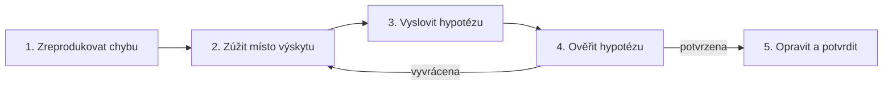
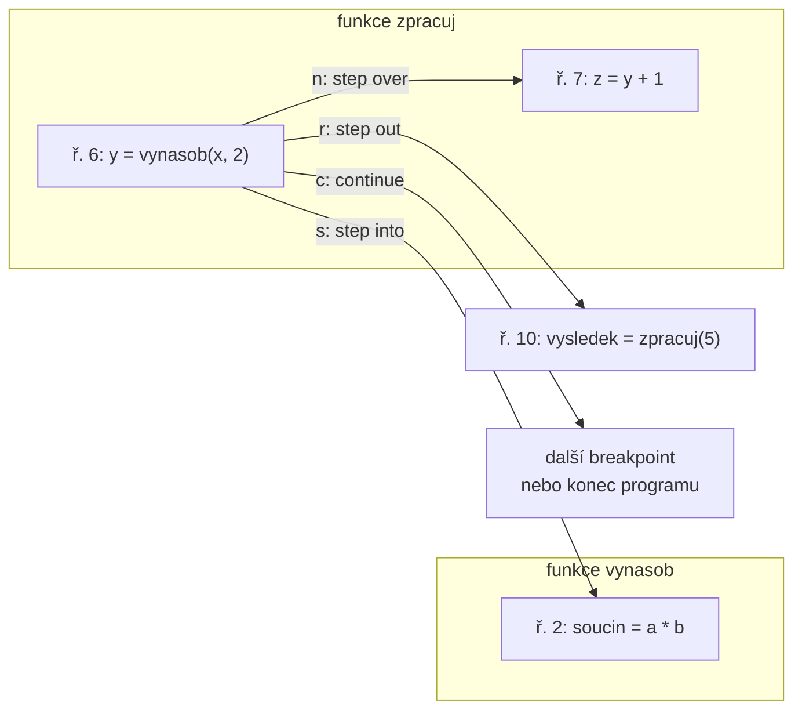

# Ladění kódu debuggerem

*Výukový materiál — hledání chyb pomocí debuggeru (PyCharm, VS Code, `pdb`)*

Ladění pomocí příkazu `print` je běžné, avšak u složitějších chyb pomalé a omezené. **Debugger** umožňuje běh programu pozastavit, prohlédnout si jeho skutečný stav, krok za krokem sledovat, jak se mění, a u chyby jej interaktivně prozkoumat. Tento materiál vysvětluje debugger po jednotlivých částech, s důrazem na názorné příklady.

## 1. Dva způsoby ovládání: grafické rozhraní a konzole

Debugger se ovládá dvěma způsoby, které dělají totéž, avšak liší se prostředím:

- **Grafické rozhraní** (PyCharm, VS Code) — breakpointy se nastavují kliknutím, stav se zobrazuje v panelech a krokuje se tlačítky. Toto je **výchozí a doporučený způsob pro každodenní práci**; je rychlejší a přehlednější.
- **Konzole** (vestavěná funkce `breakpoint()` a modul `pdb`) — tytéž úkony se zadávají textovými příkazy. Tento způsob je nezbytný tam, kde grafické rozhraní není k dispozici.

> **Klíčové sdělení tohoto materiálu:** Ve vývojovém prostředí laďte v grafickém rozhraní. Je však nutné znát i konzolové příkazy, neboť **na vzdáleném stroji grafické rozhraní k dispozici není**. Trénuje-li se model na vzdáleném serveru přes SSH, v clusterové úloze či v kontejneru, je konzolový debugger (`breakpoint()`, `pdb`) často jediným dostupným nástrojem. Znalost obou způsobů je proto praktickou nutností, nikoli formalitou. Pro pochopení, co grafická tlačítka ve skutečnosti provádějí, je navíc konzolová podoba názornější, a proto ji tento materiál uvádí souběžně.

Následující kapitoly proto u každého úkonu uvádějí obě podoby.

## 2. Proč debugger vedle příkazu print

Pro rychlé ověření jediné hodnoty je `print` naprosto dostačující. Debugger se uplatní ve třech situacích:

- **Chyba je v neočekávaném stavu.** Příkaz `print` zobrazí pouze to, co bylo předem zvoleno k vypsání; debugger zpřístupní **veškerý** stav v daném okamžiku, tedy i hodnoty, jež nebyly předmětem výpisu.
- **Opakované spuštění je nákladné.** Trvá-li výpočet minuty (typicky trénink modelu), je přidávání dalších příkazů `print` a opětovné spouštění zdlouhavé. Debugger umožní stav prozkoumat bez restartu.
- **Je třeba interaktivně zkoumat.** U zastaveného programu lze vyhodnocovat libovolné výrazy a ověřovat domněnky přímo na místě.

Rozdíl oproti přístupu s příkazem `print` lze shrnout takto: příkaz `print` představuje opakovaný cyklus (vložení řádku, opětovné spuštění, přečtení výstupu), kdežto debugger vyžaduje jediné zastavení, u něhož je dostupný celý stav. Ve vztahu k záznamu do logu (viz [materiál o logování](logovani.md), kapitola 2) platí dělba: **logování je pasivní záznam běhu, který se nesleduje; debugger je aktivní zkoumání běhu, který se sleduje.**

## 3. Metodický postup ladění

Debugger je nástroj; jeho účinnost však závisí na tom, zda je použit metodicky. Neuspořádané umísťování breakpointů zřídka vede k cíli. Osvědčený postup má pět kroků a odpovídá vědeckému přístupu k problému:

1. **Spolehlivě zreprodukovat chybu.** Dříve, než lze chybu hledat, je nutné umět ji vyvolat na povel. Projevuje-li se jen občas, bývá příčinou náhoda; ustálení zárodku (viz [materiál o reprodukovatelnosti](../03-projekt-a-prostredi/reprodukovatelnost-seedy.md), kapitola 4) chybu ustálí. Vhodné je též sestavit **minimální příklad**, který chybu vyvolá co nejmenším kódem.
2. **Zúžit místo výskytu.** Namísto zkoumání celého programu se postupuje **půlením**: zjistí se místo, kde je stav ještě správný, a místo, kde je již chybný; hledá se mezi nimi. Každý krok zhruba polovinu prostoru vyloučí. Vznikla-li chyba nedávnou změnou kódu, umožňuje totéž nad historií nástroj `git bisect`.
3. **Vyslovit konkrétní hypotézu.** Hypotéza musí být ověřitelná — například „proměnná `x` je v tomto bodě `None`, protože předchozí funkce při prázdném vstupu nevrací hodnotu". Neurčité „něco je špatně" hypotézou není.
4. **Ověřit hypotézu.** Na příslušné místo se umístí breakpoint a stav se prověří (kapitoly 5–7). Hypotéza se buď potvrdí, nebo vyvrátí; v obou případech se prostor hledání zúžil.
5. **Opravit a potvrdit.** Po opravě je nutné ověřit nejen to, že chyba zmizela, nýbrž i to, že se nic jiného neporušilo. K tomu slouží test pokrývající daný případ (viz [materiál o testování](testovani.md)), který zároveň zabrání opětovnému výskytu.



Textový popis schématu:

- Kroky 1 až 4 probíhají v pevném pořadí.
- Je-li hypotéza vyvrácena, prostor hledání se zúžil a postup se vrací ke kroku 2.
- Je-li hypotéza potvrzena, následuje oprava a její potvrzení testem (krok 5).

> **Zásada:** Při ověřování se mění **jediná věc najednou**. Současná změna více míst znemožňuje určit, které z nich mělo účinek. Užitečné je též zaznamenávat, co již bylo vyloučeno.

## 4. Čtení tracebacku

Ladění obvykle začíná pádem programu a výpisem chyby (tzv. tracebackem). Jeho správné čtení je první dovednost. Uvažme program:

```python
def prumer(hodnoty):
    return sum(hodnoty) / len(hodnoty)

def zpracuj(radky):
    return [prumer(r) for r in radky]

data = [[1, 2, 3], [4, 5, 6], []]     # třetí řádek je prázdný
zpracuj(data)
```

Výpis chyby:

```text
Traceback (most recent call last):
  File "priklad.py", line 8, in <module>
    zpracuj(data)
  File "priklad.py", line 5, in zpracuj
    return [prumer(r) for r in radky]
  File "priklad.py", line 2, in prumer
    return sum(hodnoty) / len(hodnoty)
ZeroDivisionError: division by zero
```

> **Zásada čtení:** Traceback se čte **odspoda nahoru**. Úplně dole je **druh a popis chyby** (`ZeroDivisionError: division by zero`) — to je nejdůležitější řádek. Nad ním je posloupnost volání od nejnovějšího (dole) k nejstaršímu (nahoře). Nejspodnější uvedený soubor a řádek (`line 2, in prumer`) ukazuje **místo, kde chyba vznikla**; řádky výše ukazují posloupnost volání, která k němu vedla.

Rozlišení „kde chyba vznikla" a „odkud volání přišlo" je zásadní: chyba se projevila v `prumer`, avšak její příčina (prázdný řádek v datech) pochází z volajícího kódu. Traceback ukazuje obojí.

**Zřetězené výjimky.** Nastane-li výjimka během zpracování jiné výjimky, výpis obsahuje **dva tracebacky** oddělené větou:

```text
The above exception was the direct cause of the following exception:
```

(nebo `During handling of the above exception, another exception occurred:`). Čte se opět odspoda: **spodní** traceback je konečná výjimka, **horní** je její původní příčina. Obě části je třeba přečíst, neboť skutečná příčina bývá v té horní. Vznik obou druhů zřetězení s ukázkami výpisů popisuje [materiál o výjimkách](../01-psani-kodu/vyjimky.md), kapitola 6.

## 5. Zastavení běhu: breakpoint

**Breakpoint** (bod přerušení) je místo, na němž se běh pozastaví.

**V grafickém rozhraní** (doporučený způsob) se breakpoint nastaví kliknutím do levého okraje vedle čísla řádku; v PyCharmu i VS Code se objeví červený bod. Program se poté spustí v **ladicím režimu** (tlačítko s ikonou brouka, nikoli obyčejné spuštění) a u breakpointu se zastaví. Breakpoint není součástí zdrojového kódu, takže jej není nutné odstraňovat.

**V konzoli** (na vzdáleném stroji) se na požadovaný řádek vloží vestavěná funkce `breakpoint()`:

```python
def prumer(hodnoty):
    breakpoint()                  # zde se běh pozastaví
    return sum(hodnoty) / len(hodnoty)
```

Po spuštění se program zastaví na tomto řádku a otevře se interaktivní ladicí konzole (`pdb`), v níž lze zkoumat stav (kapitola 7). Chování funkce `breakpoint()` lze řídit proměnnou prostředí `PYTHONBREAKPOINT`; její nastavení na `0` všechny breakpointy vypne, aniž by bylo nutné je z kódu odstraňovat.

### Základní orientace v konzoli pdb

Bez editoru, který zvýrazňuje aktuální řádek, je nutné se v konzoli zorientovat příkazy. Po zastavení jsou nejdůležitější:

| Příkaz | Význam |
|---|---|
| `l` (list) | vypíše okolní zdrojový kód kolem aktuálního řádku |
| `ll` (longlist) | vypíše celou aktuální funkci |
| `w` (where) | vypíše zásobník volání (kudy se běh k tomuto bodu dostal) |
| `h` (help) | vypíše nápovědu; `h <příkaz>` vysvětlí konkrétní příkaz |
| `q` (quit) | ukončí ladění |

Bez příkazu `l` není na serveru vidět, u kterého řádku běh stojí; jde proto o první příkaz, který se po zastavení zadává.

> **Praktická poznámka:** Pohodlnější variantou konzolového debuggeru je `ipdb` (instaluje se příkazem `pip install ipdb`), který doplňuje zvýraznění syntaxe a doplňování názvů. Použít jej lze buď přímo (`import ipdb; ipdb.set_trace()`), nebo nastavením `PYTHONBREAKPOINT=ipdb.set_trace`, po němž i vestavěná funkce `breakpoint()` otevře `ipdb`.

> **Upozornění:** Vestavěná funkce `breakpoint()` je součástí zdrojového kódu, a proto se snadno zapomene a odešle do systému správy verzí (viz [materiál o gitu](../00-git/git-github-pripomenuti.md)). Ponechaná v kódu zastaví běh i na cizím stroji či v automatizovaném prostředí. Před odevzdáním je nutné ji odstranit. Grafické breakpointy tímto nedostatkem netrpí.

### Logpoint: breakpoint bez zastavení

**Logpoint** je zvláštní druh breakpointu, který běh **nezastaví**, nýbrž na daném místě vypíše zadanou zprávu (včetně hodnot výrazů) a pokračuje dál. Představuje mezistupeň mezi příkazem `print` a obyčejným breakpointem: podobně jako `print` poskytuje průběžný záznam, aniž by běh přerušil, avšak na rozdíl od něj **není součástí zdrojového kódu** — není tedy nutné jej vkládat do souboru, a nehrozí, že se zapomene a odešle do repozitáře.

V grafickém rozhraní se nastaví jako breakpoint s volbou pro výpis namísto zastavení: ve VS Code přímo jako „Logpoint", v PyCharmu jako breakpoint s vypnutou volbou „Suspend" a zapnutou „Evaluate and log". Do zprávy se zapíše výraz, například `epocha={epocha}, ztrata={ztrata}`.

> **Vztah k logování:** Logpoint slouží k **dočasnému** sledování během laděného běhu, který je pozorován, a po nalezení chyby se odstraní. Má-li být záznam **trvalý** — součástí programu pro pozdější, nesledované běhy —, náleží tato úloha modulu `logging` (viz [materiál o logování](logovani.md)), nikoli logpointu. Rozdíl je týž jako mezi debuggerem a logováním obecně: logpoint je pomůcka pro pozorované ladění, logování je trvalý záznam.

V konzoli `pdb` obdobnou funkci plní příkaz `commands`, jímž lze k breakpointu připojit akce (například výpis proměnné) zakončené příkazem `continue`; na vzdáleném stroji se však pro průběžný záznam obvykle použije rovnou modul `logging`.

## 6. Čtyři pohyby: krokování

Po zastavení se běh ovládá čtyřmi základními příkazy. Rozdíl mezi nimi je nejlépe patrný na konkrétním příkladu; řádky jsou očíslovány kvůli odkazům:

```python
1  def vynasob(a, b):
2      soucin = a * b
3      return soucin
4
5  def zpracuj(x):
6      y = vynasob(x, 2)      # ← běh je pozastaven zde, před provedením tohoto řádku
7      z = y + 1
8      return z
9
10 vysledek = zpracuj(5)
```

Předpokládejme, že běh je pozastaven na **řádku 6**, tedy těsně před provedením volání `vynasob(x, 2)`. Následující tabulka ukazuje, kam se běh přesune po každém z příkazů:

| Příkaz | Zkratka v `pdb` | Kam se běh přesune z řádku 6 |
|---|---|---|
| **Step over** (překročit) | `n` (next) | Volání `vynasob` se celé provede a běh se zastaví na **řádku 7**. Do funkce `vynasob` se nevstoupí. |
| **Step into** (vstoupit) | `s` (step) | Běh **vstoupí** do funkce `vynasob` a zastaví se na **řádku 2**, jejím prvním výkonném řádku. |
| **Step out** (vystoupit) | `r` (return) | Dokončí aktuální funkci `zpracuj` a zastaví se u jejího volajícího (zde na řádku 10, po dokončení volání). |
| **Continue** (pokračovat) | `c` (continue) | Pokračuje až k dalšímu breakpointu, nebo do konce programu. |



Textový popis schématu: ze zastavení na řádku 6 vede příkaz `n` na řádek 7 téže funkce, příkaz `s` na řádek 2 uvnitř volané funkce `vynasob`, příkaz `r` na řádek 10 ve volajícím kódu a příkaz `c` k dalšímu breakpointu, případně na konec programu.

Volba mezi **step over** a **step into** je nejčastějším rozhodnutím při ladění: *step over* se použije, je-li volaná funkce považována za správnou (není třeba ji zkoumat), *step into* tehdy, je-li chyba předpokládána uvnitř ní.

**Ukázka v konzoli.** Táž posloupnost v `pdb` — nejprve varianta se *step into* (`s`), která vstoupí do funkce `vynasob`:

```text
> priklad.py(6)zpracuj()
-> y = vynasob(x, 2)
(Pdb) s
--Call--
> priklad.py(1)vynasob()
-> def vynasob(a, b):
(Pdb) n
> priklad.py(2)vynasob()
-> soucin = a * b
(Pdb) p a, b
(5, 2)
```

Pro srovnání varianta se *step over* (`n`) na témže místě — funkce `vynasob` se provede vcelku a běh přejde rovnou na řádek 7, bez vstupu dovnitř:

```text
> priklad.py(6)zpracuj()
-> y = vynasob(x, 2)
(Pdb) n
> priklad.py(7)zpracuj()
-> z = y + 1
(Pdb) p y
10
```

**V grafickém rozhraní** týmž příkazům odpovídají tlačítka na ladicí liště (šipka přeskakující řádek = step over, šipka mířící dolů = step into, šipka mířící ven = step out, trojúhelník = continue); aktuální řádek je zvýrazněn přímo v editoru.

> **Upozornění (step into a cizí kód):** Použití *step into* na řádku, který volá funkci z knihovny (například NumPy či PyTorch), vede k zanoření do vnitřního kódu této knihovny, který zpravidla není předmětem ladění. Grafická rozhraní proto nabízejí režim „step into my code" (v PyCharmu), respektive volbu `justMyCode` (ve VS Code, ve výchozím stavu zapnutou), který krokuje pouze vlastní kód a volání knihoven překračuje. V konzoli `pdb` obdobný režim není; cizí volání se překročí příkazem `n`.

> **Upozornění (kolize názvu s příkazem):** Má-li proměnná stejný název jako příkaz `pdb` (například `n`, `s`, `c`, `l`), zadání samotného písmene spustí **příkaz**, nikoli výpis proměnné. Hodnota se v takovém případě vypíše příkazem `p n`, nebo se výraz uvede prefixem `!` (`!n`), který jej vynutí jako kód jazyka Python.

## 7. Inspekce stavu

Hlavní přínos debuggeru je pohled na skutečný stav. U zastaveného programu jsou k dispozici tři možnosti; u každé je uvedena podoba v grafickém rozhraní i v konzoli.

**Hodnoty proměnných.** V grafickém rozhraní je zobrazuje samostatný panel proměnných (obvykle „Variables"), který se aktualizuje při každém kroku. V konzoli slouží k výpisu příkaz `p` (například `p hodnoty`), případně přehlednější `pp`.

**Zásobník volání (call stack).** Ukazuje posloupnost volání, která k aktuálnímu bodu vedla, tedy jakým způsobem byl tento bod dosažen. V grafickém rozhraní jej zobrazuje panel „Call Stack" a kliknutím na kteroukoli úroveň se lze přepnout do jejího stavu; v konzoli slouží k témuž příkazy `w` (where, výpis zásobníku), `u` (up) a `d` (down) pro pohyb mezi úrovněmi.

**Evaluace výrazu.** Jde o nejúčinnější a zároveň nejméně využívanou možnost: u zastaveného programu lze zadat **libovolný výraz** a debugger jej vyhodnotí v aktuálním stavu. To umožňuje klást otázky postupně, aniž by bylo nutné předem určit, co vypsat.

```python
import numpy as np

def zpracuj(matice):
    breakpoint()
    return matice.mean(axis=0)

zpracuj(np.array([[1.0, 2.0], [3.0, 4.0]]))
```

U zastavení na breakpointu lze zadávat postupné dotazy; následující výpis je z konzole, avšak **tytéž hodnoty zobrazuje grafické rozhraní v panelu proměnných** a tentýž výraz lze zadat i do jeho pole „Evaluate expression":

```text
(Pdb) p matice.shape
(2, 2)
(Pdb) p matice.dtype
dtype('float64')
(Pdb) p matice.mean(axis=0)
array([2., 3.])
(Pdb) p matice[:, 0]
array([1., 3.])
```

Konzolový výpis a grafický panel tedy nesou tutéž informaci; liší se pouze způsobem zadání. Do panelu sledovaných výrazů (watch) v grafickém rozhraní se výraz zapíše jednou a jeho hodnota se aktualizuje při každém kroku.

## 8. Podmíněný breakpoint

Obyčejný breakpoint uvnitř smyčky přes velké množství prvků je nepoužitelný — vyžadoval by neúměrný počet zastavení. **Podmíněný breakpoint** se zastaví pouze tehdy, je-li splněna zadaná podmínka.

```python
def zpracuj(vzorky):
    for i, vzorek in enumerate(vzorky):
        vysledek = naroc_na_vypocet(vzorek)   # u i == 4237 vrací chybný výsledek
        uloz(vysledek)
```

**V grafickém rozhraní** se klikne pravým tlačítkem na breakpoint a zadá se podmínka, například `i == 4237`. Program pak proběhne všechny předchozí iterace bez zastavení a zastaví se přesně u té problematické.

**V konzoli** téhož dosáhne příkaz `condition` zadaný k číslu breakpointu, případně dočasné vložení podmíněného volání přímo do kódu:

```python
for i, vzorek in enumerate(vzorky):
    if i == 4237:
        breakpoint()          # zastaví se jen u hledané iterace
    ...
```

Podmínka se neomezuje na index. Užitečné je zastavení podle hodnoty — například jakmile výsledek překročí očekávaný rozsah:

```python
for i, vzorek in enumerate(vzorky):
    vysledek = naroc_na_vypocet(vzorek)
    if vysledek < 0:          # zastaví se u prvního záporného výsledku
        breakpoint()
```

> **Upozornění:** Podmíněný breakpoint je hlavním nástrojem pro ladění smyček a dávkového zpracování. Bez něj se ladění cyklu přes velká data stává neúnosným.

## 9. Ladění po pádu (post-mortem)

Nezřídka je nejužitečnější prohlédnout si stav **přesně v okamžiku pádu**, aniž by se program spouštěl znovu. Tomu se říká post-mortem ladění.

**V grafickém rozhraní** se nastaví zastavení na výjimce („break on exception" / „Python Exception Breakpoint"): program se automaticky pozastaví v okamžiku, kdy nastane neošetřená výjimka, a zpřístupní celý stav včetně zásobníku volání.

**V konzoli** (na vzdáleném stroji) lze skript spustit rovnou pod dohledem `pdb`; po pádu zůstane konzole ve stavu chyby a lze zkoumat proměnné:

```bash
python -m pdb priklad.py
```

Alternativně lze v kódu po zachycení výjimky vyvolat post-mortem debugger:

```python
import pdb

try:
    rizikovy_vypocet()
except Exception:
    pdb.post_mortem()         # otevře debugger ve stavu okamžiku pádu
```

**V prostředí Jupyter** slouží témuž účelu magický příkaz `%debug`, zadaný do nové buňky ihned po pádu — otevře debugger ve stavu, v němž výjimka nastala.

## 10. Ladění testů

Selže-li test (viz [materiál o testování](testovani.md), kapitola 8), je vhodné prozkoumat stav přesně v místě selhání, nikoli chybu dohledávat opakovaným spouštěním. Nástroj `pytest` to umožňuje přímo.

**Zastavení v místě selhání.** Přepínač `--pdb` otevře konzolový debugger v okamžiku, kdy test selže (ve stavu odpovídajícím post-mortem ladění):

```bash
pytest --pdb
```

V kombinaci s přepínačem `-x`, který zastaví po prvním neúspěšném testu, vznikne obvyklý postup pro ladění testů:

```bash
pytest -x --pdb          # zastav u prvního selhání a otevři debugger
```

**Zastavení na začátku testu.** Přepínač `--trace` otevře debugger na prvním řádku každého spouštěného testu, což umožní jej celý projít krokováním:

```bash
pytest --trace
```

**V grafickém rozhraní** se test spustí v ladicím režimu (v PyCharmu i VS Code volbou „Debug" u konkrétního testu); breakpointy a inspekce fungují stejně jako u běžného programu.

## 11. Ladění v kontextu strojového učení a PyTorche

Ladění kódu strojového učení má svá specifika, která obecné návody pomíjejí. Zde je konzolový přístup obzvláště významný, neboť trénink často probíhá právě na vzdálených strojích bez grafického rozhraní.

**Krokování milionů iterací nemá smysl.** Tréninková smyčka proběhne mnohokrát; krokovat ji řádek po řádku je nemožné. Namísto toho se breakpoint umístí na jedno místo a zkontroluje se **tvar, typ a zařízení** tenzoru — v tom je většina chyb:

```python
def forward(self, x):
    breakpoint()              # jedno zastavení stačí
    x = self.vrstva1(x)
    return self.vrstva2(x)
```

U zastavení se ověří (v konzoli textově, v grafickém rozhraní v panelu proměnných):

```text
(Pdb) p x.shape
torch.Size([32, 128])
(Pdb) p x.dtype
torch.float32
(Pdb) p x.device
device(type='cuda', index=0)
```

Nesoulad tvaru (například očekáváno `[32, 64]`), nesprávný typ nebo rozdílné zařízení modelu a dat (viz [materiál o infrastruktuře PyTorche](../04-strojove-uceni/pytorch-infrastruktura.md), kapitola 2.4) jsou nejčastější příčiny pádů; jediné zastavení je odhalí.

**Hledání `NaN`.** Objeví-li se v tréninku `NaN`, je vhodné zastavit se, jakmile se poprvé vyskytne. Podmíněný breakpoint (kapitola 8) to umožňuje přímo:

```python
ztrata = kriterium(vystup, cil)
if torch.isnan(ztrata).any():
    breakpoint()              # zastaví se v okamžiku vzniku NaN
```

> **Upozornění:** Při paralelním načítání dat (`num_workers > 0` u `DataLoaderu`) běží načítání v samostatných procesech a breakpoint umístěný do metody `__getitem__` datové sady se v nich obtížně zachytává. Pro ladění načítání dat je vhodné dočasně nastavit `num_workers = 0`, čímž se vše provádí v hlavním procesu.

## 12. Časté nástrahy

- **Zapomenutý `breakpoint()` v kódu.** Ponechaný a odeslaný do repozitáře zastaví běh i na cizím stroji či v automatizovaném prostředí. Před odevzdáním je nutné jej odstranit; grafické breakpointy tento problém nemají.
- **Obyčejný breakpoint ve smyčce.** Vede k neúměrnému počtu zastavení; řešením je podmíněný breakpoint (kapitola 8).
- **Nereprodukovatelná chyba.** Projevuje-li se chyba jen občas, může být příčinou náhoda; ustálení zárodku (viz [materiál o reprodukovatelnosti](../03-projekt-a-prostredi/reprodukovatelnost-seedy.md), kapitola 4) umožní chybu spolehlivě vyvolat, a tedy odladit.
- **Vektorizovaný kód nelze krokovat.** Operace nad celým polem (viz [vektorizace v materiálu o profilování](profilovani-vykon.md), kapitola 9) proběhne jediným příkazem, takže uvnitř není co krokovat. Zkoumá se místo toho vstup a výstup operace u breakpointu.
- **Zanoření do knihovního kódu.** Neopatrné *step into* zavede běh do vnitřního kódu knihovny; řešením je režim „step into my code" (kapitola 6).

## 13. Shrnutí

Debugger umožňuje běh pozastavit a prohlédnout si skutečný stav; oproti příkazu `print` zpřístupní veškerý stav naráz, nevyžaduje opakované spouštění a dovoluje interaktivní zkoumání. Ovládá se dvěma způsoby: v grafickém rozhraní (výchozí pro každodenní práci) a v konzoli pomocí `breakpoint()` a `pdb` (nezbytné na vzdáleném stroji bez grafického rozhraní). Ladění je nejúčinnější, postupuje-li se metodicky — zreprodukovat, zúžit místo, vyslovit a ověřit hypotézu, opravit a potvrdit. Obvykle začíná čtením tracebacku (odspoda nahoru). Běh se pozastaví breakpointem a ovládá čtyřmi pohyby (step over, into, out, continue); u zastavení se zkoumají proměnné, zásobník volání a libovolné výrazy. Podmíněný breakpoint zpřístupňuje ladění smyček, post-mortem ladění a `pytest --pdb` zpřístupňují stav v okamžiku pádu. V kontextu strojového učení je klíčová kontrola tvaru, typu a zařízení tenzoru u jediného zastavení, namísto krokování mnoha iterací.

> **Další čtení:** dokumentace modulu [`pdb`](https://docs.python.org/3/library/pdb.html); dokumentace debuggeru v prostředí, v němž student pracuje (PyCharm, VS Code).
