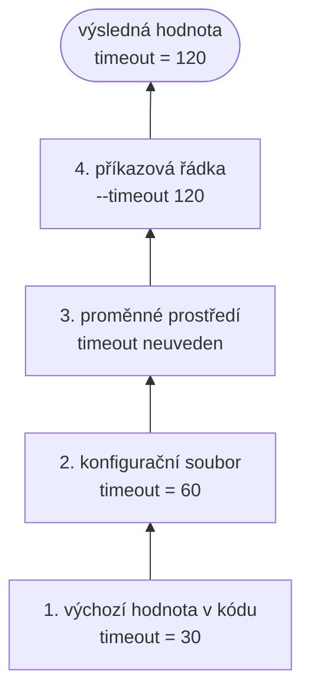

# Konfigurační soubory a správa konfigurace

*Výukový materiál — konfigurace aplikací v jazyce Python*

## 1. Účel konfigurace

S rostoucí velikostí projektu přibývá nastavitelných parametrů — cesty, časové limity, přihlašovací údaje, přepínače chování. Pokud jsou tyto hodnoty rozptýleny přímo v kódu (tzv. „magické konstanty"), je jejich úprava pracná a chybová. **Konfigurace** řeší tento problém oddělením *nastavení* od *kódu*: parametry se soustředí na jedno místo, odkud je program načte při spuštění.

Hlavní přínosy:

- **přehlednost** — veškeré nastavení je na jednom, snadno dohledatelném místě,
- **změna bez zásahu do kódu** — chování se upraví editací konfiguračního souboru,
- **přenositelnost mezi prostředími** — vývoj, testování a provoz se liší pouze konfigurací, nikoli kódem,
- **bezpečnost** — citlivé údaje lze oddělit od zdrojového kódu (viz kapitola 4).

## 2. Formáty a kdy který použít

Konfiguraci lze zapsat ve více formátech. Volba závisí na složitosti nastavení a na tom, kdo soubor čte.

| Formát | Vhodné použití | Poznámka |
|---|---|---|
| **TOML** | konfigurace pythonních projektů | doporučený standard (`pyproject.toml`), čtení ve standardní knihovně (`tomllib`, 3.11+) |
| **YAML** | rozsáhlá, hierarchická nastavení | čitelný, ale viz nástrahy v kapitole 8 |
| **.env** | citlivé údaje a hodnoty závislé na prostředí | prosté dvojice `KLÍČ=hodnota`, mimo verzování |
| **JSON** | výměna dat se systémy mimo Python | strojově přívětivý, hůře čitelný člověkem (bez komentářů) |
| **INI** | jednoduchá plochá nastavení | čtení ve standardní knihovně (`configparser`) |

Příklad téhož nastavení ve třech formátech:

```toml
# config.toml
[database]
host = "localhost"
port = 5432
```

```yaml
# config.yaml
database:
  host: localhost
  port: 5432
```

```dotenv
# .env
DATABASE_HOST=localhost
DATABASE_PORT=5432
```

> **Doporučení:** Pro samotnou konfiguraci pythonní aplikace volte TOML nebo YAML; pro citlivé údaje a hodnoty závislé na prostředí použijte `.env`. Tyto přístupy se nevylučují — běžně se kombinují (viz kapitola 4).

## 3. Jak se konfigurace načítá a chová

Konfigurace se zpravidla **načítá jednou při spuštění** programu do datové struktury (nejčastěji slovníku nebo objektu) a po zbytek běhu se z ní pouze čte. Načtení TOML souboru standardní knihovnou:

```python
import tomllib

with open("config.toml", "rb") as f:   # TOML se otevírá v binárním režimu
    config = tomllib.load(f)

print(config["database"]["host"])      # "localhost"
```

> **Upozornění:** Modul `tomllib` umožňuje TOML pouze **číst**, nikoli zapisovat. Pro zápis slouží samostatné knihovny (`tomli-w`, `tomlkit`).

**Doporučená zásada:** konfiguraci načítejte na **jediném místě** (např. v samostatném modulu) a tento načtený objekt předávejte tam, kde je potřeba. Opakované načítání téhož souboru na různých místech kódu vede k nepřehlednosti a k obtížně dohledatelným nesrovnalostem.

## 4. Vrstvení a priorita konfigurace

Jde o koncept, který bývá opomíjen, ačkoli tvoří jádro správy konfigurace. Nastavení obvykle nepochází z jediného zdroje, nýbrž z několika **vrstev**, jež se vzájemně překrývají podle pevně daného pořadí priority (od nejnižší po nejvyšší):

1. **zabudované výchozí hodnoty** v kódu,
2. **konfigurační soubor** (TOML/YAML),
3. **proměnné prostředí** (typicky z `.env`),
4. **parametry z příkazové řádky** (viz vzor vstupního bodu v [materiálu o struktuře projektu](struktura-projektu.md), kapitola 5).

Vyšší vrstva přepisuje nižší. Tento mechanismus umožňuje mít rozumné výchozí hodnoty, jež lze pro konkrétní prostředí (vývoj, testování, provoz) cíleně přepsat, aniž by bylo nutné upravovat výchozí soubor.



Textový popis schématu:

- Vrstvy jsou seřazeny zdola nahoru podle rostoucí priority; každá vyšší vrstva přepisuje hodnotu z nižší.
- Výchozí hodnotu `30` přepíše konfigurační soubor na `60`. Proměnné prostředí hodnotu neuvádějí, platí tedy dosavadní `60`.
- Parametr příkazové řádky přepíše hodnotu na `120`, která je výsledná.

Citlivé údaje (hesla, přístupové klíče) patří do proměnných prostředí, **nikoli do verzovaného konfiguračního souboru**. Soubor `.env` se proto vždy uvádí do `.gitignore` (viz [materiál o gitu](../00-git/git-github-pripomenuti.md), kapitola 12). Načtení pomocí knihovny `python-dotenv`:

```python
from dotenv import load_dotenv
import os

load_dotenv()                          # načte hodnoty z .env do prostředí
secret = os.environ["SECRET_KEY"]
```

> **Upozornění:** Vložení souboru s tajnými údaji do systému správy verzí je častou a závažnou bezpečnostní chybou. Údaj jednou odeslaný do repozitáře je nutné považovat za kompromitovaný.

## 5. Validace a typování konfigurace

Podobně jako u typování proměnných i konfigurace získává na spolehlivosti, je-li opatřena typovou strukturou. Načteme-li konfiguraci do prostého slovníku, přistupujeme k hodnotám pomocí textových klíčů (`config["databse"]["host"]`); překlep v klíči se neprojeví jako chyba, nýbrž může vést k použití nesprávné nebo výchozí hodnoty.

Řešením je popsat očekávanou strukturu typovaným modelem, který hodnoty zároveň **ověří** (validuje) a zpřístupní jako atributy. Knihovna `pydantic-settings`:

```python
from pydantic_settings import BaseSettings

class Settings(BaseSettings):
    database_host: str
    database_port: int = 5432          # výchozí hodnota
    debug: bool = False

settings = Settings()                  # načte a ověří hodnoty z prostředí / .env
print(settings.database_port)          # přístup přes atribut, ne přes textový klíč
```

Tento přístup má dvě výhody: chybějící povinná hodnota nebo hodnota nesprávného typu je ohlášena ihned při načtení (nikoli až při použití), a přístup přes atribut `settings.database_port` lze ověřit nástrojem statické analýzy stejně jako kterýkoli jiný typovaný kód — překlep zde odhalí již editor.

## 6. Skládání a řetězení konfigurace

Jakmile nastavení naroste, je nežádoucí udržovat vše v jediném souboru. Cílem je rozdělit konfiguraci do menších, tematicky soudržných celků a z hlavního souboru se na ně odkazovat.

**Opakované použití v rámci jednoho souboru** umožňuje YAML pomocí kotev (`&`), odkazů (`*`) a slučovacího klíče (`<<`):

```yaml
vychozi: &vychozi
  timeout: 30
  retries: 3

vyvoj:
  <<: *vychozi          # převezme timeout a retries
  debug: true

provoz:
  <<: *vychozi
  debug: false
```

**Rozdělení do více souborů a jejich sloučení** lze řešit knihovnou `OmegaConf`, která navíc podporuje **interpolaci** — odkazy na jiné hodnoty uvnitř konfigurace:

```yaml
# base.yaml
paths:
  root: /data
  raw: ${paths.root}/raw          # odkaz na jinou hodnotu
  processed: ${paths.root}/processed
```

```python
from omegaconf import OmegaConf

base = OmegaConf.load("base.yaml")
prostredi = OmegaConf.load("provoz.yaml")
config = OmegaConf.merge(base, prostredi)   # vyšší soubor přepíše nižší
print(config.paths.raw)                     # "/data/raw"
```

Tímto způsobem lze udržovat hlavní soubor s odkazy na dílčí konfigurace a předejít vzniku jednoho nepřehledného celku.

## 7. Nástroje a knihovny

| Nástroj | Účel |
|---|---|
| `tomllib`, `configparser`, `json` | čtení formátů ve standardní knihovně |
| `python-dotenv` | načtení hodnot ze souboru `.env` |
| `pydantic-settings` | typovaná a validovaná konfigurace (viz kapitola 5) |
| `dynaconf` | správa konfigurace s vrstvením, prostředími a tajnými údaji |
| `OmegaConf` | hierarchická konfigurace, slučování, interpolace |

Nad knihovnou `OmegaConf` je vystavěn nástroj **Hydra**, určený pro rozsáhlou kompozici konfigurací (zejména ve výzkumu a strojovém učení). Jeho podrobný výklad přesahuje rozsah tohoto materiálu.

## 8. Časté chyby a nástrahy

1. **Nečekaná interpretace hodnot v YAML.** YAML převádí některé neuvozené řetězce na jiné typy — například `no` na `False` nebo `1.0` na číslo. Hrozí-li nejednoznačnost, uzavřete hodnotu do uvozovek (`"no"`).
2. **Tajné údaje ve správě verzí.** Hesla a klíče nikdy nepatří do verzovaného souboru (viz kapitola 4).
3. **Globální měnitelná konfigurace.** Sdílený objekt, který kterákoli část programu mění za běhu, vede k obtížně dohledatelným chybám. Po načtení považujte konfiguraci za neměnnou.
4. **Nadměrné zanoření.** Příliš hluboká hierarchie zhoršuje čitelnost; udržujte strukturu plochou, nakolik to dává smysl.
5. **Znovuvynalézání hotových nástrojů.** Vlastnoručně psaný správce konfigurace se s rostoucími požadavky (vrstvení, prostředí, validace) rychle stává obtížně udržitelným. Dříve než jej budete rozšiřovat, zvažte hotové řešení (`pydantic-settings`, `dynaconf`).

## 9. Doporučený postup

Pro **menší projekt** zpravidla postačí jeden soubor TOML doplněný o `.env` pro citlivé údaje, načtený a ověřený knihovnou `pydantic-settings`. Pro **rozsáhlejší projekt** s mnoha variantami nastavení je vhodné sáhnout po nástroji s podporou skládání konfigurace (`OmegaConf`, případně Hydra). V každém případě platí: konfiguraci načítejte na jediném místě, citlivé údaje držte mimo verzování a očekávanou strukturu popište typovaným modelem.
