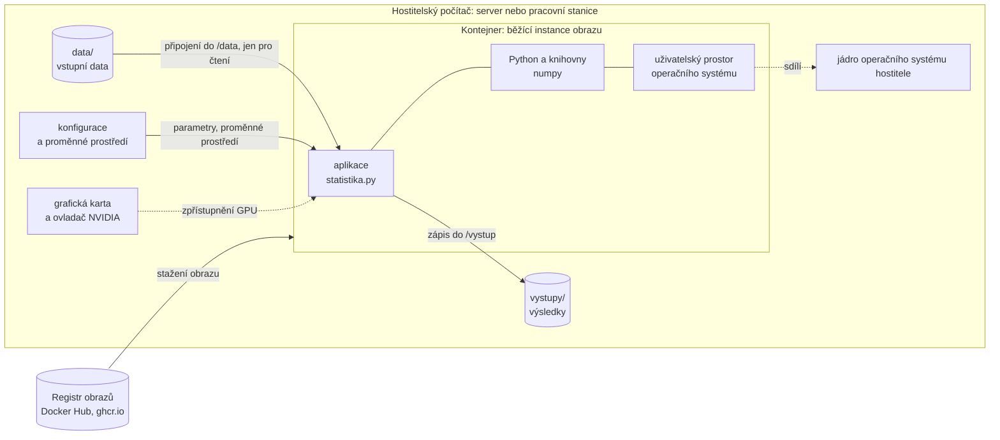

# Kontejnerizace

*Výukový materiál — kontejnery Docker a Apptainer pro přenositelné a reprodukovatelné spouštění kódu*

Tento materiál vysvětluje, co je kontejner, jaký problém řeší a čím se liší od virtuálního prostředí a virtuálního stroje. Na jednoduché aplikaci pro výpočet popisných statistik ukazuje celý postup na dvou platformách: v nástroji **Docker**, který je standardem pro vývoj na pracovní stanici, a v nástroji **Apptainer**, který se používá na sdílených výpočetních clusterech. Pozornost je věnována i připojení dat, grafické karty a spuštění na vzdáleném serveru.

## 1. Problém, který kontejnery řeší

Program, který spolehlivě funguje na jednom počítači, na jiném často selže. Příčinou bývají rozdíly v prostředí:

- jiná verze interpretu Pythonu nebo knihoven,
- chybějící či odlišné **systémové knihovny** (například knihovny pro práci s obrazem či zvukem, na nichž závisí balíčky Pythonu),
- jiná verze knihoven CUDA a cuDNN pro výpočty na grafické kartě,
- jiný operační systém.

Virtuální prostředí (`venv`) řeší pouze první bod: izoluje balíčky Pythonu, avšak používá interpret a systémové knihovny hostitelského počítače. **Kontejner** zabalí aplikaci spolu s celým uživatelským prostorem operačního systému — interpretem, systémovými knihovnami i balíčky. Na každém počítači, na němž lze kontejner spustit, tak běží v témže prostředí.

## 2. Kontejner, virtuální prostředí a virtuální stroj

Tři technologie se liší tím, co izolují a co sdílejí s hostitelským počítačem:

| | Virtuální prostředí | Kontejner | Virtuální stroj |
|---|---|---|---|
| Izoluje | balíčky Pythonu | uživatelský prostor OS, systémové knihovny, interpret, balíčky | celý operační systém včetně jádra |
| Sdílí s hostitelem | interpret, systémové knihovny, OS | jádro operačního systému | pouze hardware (prostřednictvím hypervizoru) |
| Režie | zanedbatelná | nízká (procesy běží přímo na jádře hostitele) | vyšší (vlastní jádro, vyhrazená paměť, pomalejší start) |
| Typické použití | závislosti jednoho projektu | přenositelné spuštění aplikace se vším, co potřebuje | jiný operační systém, silná izolace |

Kontejner tedy není virtuální stroj: neobsahuje vlastní jádro operačního systému, nýbrž využívá jádro hostitele. Proto se spouští během zlomku sekundy a jeho výkon je prakticky shodný s během programu přímo na hostiteli.

> **Poznámka:** Kontejnery v podobě popsané v tomto materiálu vyžadují jádro systému Linux. Na systémech Windows a macOS proto Docker spouští kontejnery uvnitř skrytého virtuálního stroje s Linuxem (na Windows prostřednictvím WSL 2). Pro uživatele je tento mezikrok téměř neviditelný, projevuje se však nižší rychlostí přístupu k souborům sdíleným mezi hostitelem a kontejnerem.

## 3. Základní pojmy

- **Obraz (image)** je neměnná šablona obsahující souborový systém kontejneru: základ operačního systému, interpret, knihovny a aplikaci. Obraz se skládá z **vrstev**; každý krok předpisu pro sestavení vytvoří jednu vrstvu.
- **Kontejner** je běžící instance obrazu. Z jednoho obrazu lze spustit libovolný počet kontejnerů. Kontejner získá nad obrazem vlastní zapisovatelnou vrstvu, která se **odstraněním kontejneru ztrácí**.
- **Předpis pro sestavení** popisuje, jak obraz vytvořit: v Dockeru soubor `Dockerfile`, v Apptaineru definiční soubor (`.def`).
- **Registr** je úložiště obrazů, z něhož se obrazy stahují a do něhož se nahrávají (například Docker Hub nebo GitHub Container Registry, `ghcr.io`).
- **Značka (tag)** pojmenovává verzi obrazu, například `python:3.12-slim`. Značka se však může v čase přesunout na novější obsah. Jednoznačně a neměnně obraz určuje až jeho **otisk (digest)**, tj. kontrolní součet ve tvaru `sha256:…`.

### Schéma: kontejner na serveru

Následující schéma ukazuje kontejner běžící na hostitelském počítači (serveru či pracovní stanici). Uvnitř kontejneru je aplikace se vším, co potřebuje; vstupní data, konfigurace a grafická karta zůstávají vně kontejneru a jsou mu při spuštění zpřístupněny; výsledky se zapisují zpět na hostitele.



Textový popis schématu:

- **Registr** dodá obraz, z něhož se kontejner spustí.
- **Uvnitř kontejneru** je aplikace, interpret Pythonu s knihovnami a uživatelský prostor operačního systému. Tyto části jsou pevnou součástí obrazu.
- **Vně kontejneru**, na hostiteli, zůstávají vstupní data, konfigurace, grafická karta s ovladačem a složka pro výsledky.
- Data se do kontejneru **připojují** (nekopírují se do obrazu), výsledky se zapisují do připojené složky, a proto po skončení kontejneru zůstávají na hostiteli.
- Kontejner **sdílí jádro** operačního systému hostitele.

## 4. Výhody a nevýhody

**Výhody:**

- **Reprodukovatelnost** — prostředí je popsáno předpisem a zafixováno v obrazu; tentýž obraz poskytne totéž prostředí i za několik let.
- **Přenositelnost** — tentýž obraz lze spustit na pracovní stanici, na serveru i na výpočetním clusteru.
- **Snadné předání** — výsledek práce (například bakalářské práce) lze předat spolu s prostředím, v němž byl vytvořen; odpadá popis ruční instalace.
- **Izolace** — projekty s navzájem neslučitelnými závislostmi (například různými verzemi CUDA) mohou běžet na jednom stroji.

**Nevýhody a omezení:**

- **Velikost obrazů** — obraz s knihovnami pro výpočty na grafické kartě dosahuje řádově jednotek gigabajtů.
- **Další vrstva složitosti** — předpis, sestavení, připojení dat a práva k souborům vyžadují osvojení nových pojmů.
- **Výkon na Windows a macOS** — kontejner běží ve virtuálním stroji a přístup ke sdíleným souborům je pomalejší (kapitola 2).
- **Ovladač grafické karty zůstává na hostiteli** — kontejner obsahuje knihovny CUDA, nikoli ovladač; ten musí být nainstalován na hostiteli a musí být dostatečně nový pro verzi CUDA v obrazu.
- **Bezpečnost** — služba Docker na Linuxu běží s oprávněním správce; přístup k ní je fakticky přístupem k oprávnění správce celého stroje. Proto se Docker na sdílených clusterech zpravidla nepovoluje (kapitola 8).
- **Reprodukovatelnost není automatická** — obraz sestavený z nezafixovaných verzí (značka `latest`, instalace balíčků bez uvedení verze) se při dalším sestavení může lišit (kapitola 7).

## 5. Ukázková aplikace

Celý postup je předveden na jednoduché aplikaci, která načte soubor CSV a pro každý sloupec spočítá popisné statistiky. Projekt má následující strukturu:

```text
statistika/
├── Dockerfile            # předpis pro Docker (kapitola 6)
├── .dockerignore         # soubory vyřazené ze sestavení (kapitola 6)
├── statistika.def        # předpis pro Apptainer (kapitola 8)
├── requirements.txt      # závislosti se zafixovanými verzemi
├── statistika.py         # aplikace
├── data/
│   └── mereni.csv        # vstupní data (nejsou součástí obrazu)
└── vystupy/              # výsledky (nejsou součástí obrazu)
```

Soubor `statistika.py`:

```python
"""Výpočet popisných statistik sloupců souboru CSV."""
import argparse
import json
from pathlib import Path

import numpy as np


def spocitej_statistiky(hodnoty: np.ndarray) -> dict[str, float]:
    """Vrátí popisné statistiky jednoho sloupce."""
    return {
        "pocet": int(hodnoty.size),
        "prumer": float(np.mean(hodnoty)),
        "smerodatna_odchylka": float(np.std(hodnoty, ddof=1)),
        "minimum": float(np.min(hodnoty)),
        "median": float(np.median(hodnoty)),
        "maximum": float(np.max(hodnoty)),
    }


def main() -> None:
    parser = argparse.ArgumentParser(description="Popisné statistiky sloupců CSV.")
    parser.add_argument("--vstup", type=Path, required=True, help="vstupní soubor CSV")
    parser.add_argument("--vystup", type=Path, required=True, help="složka pro výsledky")
    args = parser.parse_args()

    tabulka = np.genfromtxt(args.vstup, delimiter=",", names=True)
    vysledky = {nazev: spocitej_statistiky(tabulka[nazev]) for nazev in tabulka.dtype.names}

    args.vystup.mkdir(parents=True, exist_ok=True)
    cil = args.vystup / "statistiky.json"
    cil.write_text(json.dumps(vysledky, indent=2, ensure_ascii=False), encoding="utf-8")

    for nazev, s in vysledky.items():
        print(f"{nazev:>6}: průměr {s['prumer']:.2f}, medián {s['median']:.2f}, n = {s['pocet']}")
    print(f"Výsledky uloženy do {cil}")


if __name__ == "__main__":
    main()
```

Soubor `requirements.txt` uvádí přesnou verzi knihovny:

```text
numpy==2.1.3
```

Soubor `data/mereni.csv`:

```text
tep,tlak
72,120
80,135
65,118
90,142
77,125
```

Aplikace přijímá cesty ke vstupu a výstupu jako parametry příkazové řádky, nikoli jako pevně zapsané cesty v kódu. Díky tomu ji lze beze změny spustit na hostiteli i v kontejneru, kde jsou data připojena do jiné složky (k cestám v projektu viz materiál o struktuře projektu). Spuštění bez kontejneru:

```bash
python statistika.py --vstup data/mereni.csv --vystup vystupy
```

Výstup:

```text
   tep: průměr 76.80, medián 77.00, n = 5
  tlak: průměr 128.00, medián 125.00, n = 5
Výsledky uloženy do vystupy/statistiky.json
```

## 6. Docker v praxi

### 6.1 Instalace a ověření

Na systémech Windows a macOS se instaluje aplikace **Docker Desktop**, na Linuxu balíček **Docker Engine**; postup uvádí oficiální dokumentace (viz Další čtení). Funkčnost instalace se ověří spuštěním zkušebního obrazu:

```bash
docker run hello-world
```

Příkaz stáhne obraz `hello-world` z registru, spustí z něj kontejner a vypíše uvítací zprávu.

### 6.2 Předpis Dockerfile

Soubor `Dockerfile` v kořeni projektu:

```dockerfile
# Základní obraz: Debian s předinstalovaným Pythonem 3.12 v úsporné variantě
FROM python:3.12-slim

# Pracovní složka uvnitř obrazu
WORKDIR /app

# Nejprve závislosti: tato vrstva se při změně kódu nesestavuje znovu
COPY requirements.txt .
RUN pip install --no-cache-dir -r requirements.txt

# Poté samotná aplikace
COPY statistika.py .

# Aplikace neběží s oprávněním správce
RUN useradd --create-home uzivatel
USER uzivatel

# Příkaz spouštěný při startu kontejneru a jeho výchozí parametry
ENTRYPOINT ["python", "statistika.py"]
CMD ["--vstup", "/data/mereni.csv", "--vystup", "/vystup"]
```

Význam jednotlivých pokynů:

| Pokyn | Význam |
|---|---|
| `FROM` | základní obraz, na němž se staví |
| `WORKDIR` | pracovní složka pro následující pokyny i pro běžící kontejner |
| `COPY` | zkopíruje soubory z projektu do obrazu |
| `RUN` | provede příkaz při sestavení obrazu (vznikne nová vrstva) |
| `USER` | uživatel, pod nímž poběží následující pokyny i kontejner |
| `ENTRYPOINT` | program spouštěný při startu kontejneru |
| `CMD` | výchozí parametry, které lze při spuštění nahradit |

### 6.3 Soubor .dockerignore

Při sestavení se obsah složky projektu (tzv. kontext sestavení) předává službě Docker. Soubor `.dockerignore` z něj vyřadí, co do obrazu nepatří — data, výsledky, tajné údaje a mezivýsledky:

```text
data/
vystupy/
.env
.git/
__pycache__/
*.pyc
.venv/
```

### 6.4 Sestavení obrazu

```bash
docker build -t statistika:1.0 .
```

Parametr `-t` přidělí obrazu název a značku, tečka na konci určuje složku s kontextem sestavení. Sestavené obrazy vypíše příkaz:

```bash
docker image ls
```

### 6.5 Spuštění kontejneru

Kontejner se spustí s připojenou složkou dat (jen pro čtení) a složkou výsledků. Složka výsledků se vytvoří předem:

```bash
mkdir -p vystupy
docker run --rm \
    --user "$(id -u):$(id -g)" \
    -v "$(pwd)/data:/data:ro" \
    -v "$(pwd)/vystupy:/vystup" \
    statistika:1.0
```

Výstup:

```text
   tep: průměr 76.80, medián 77.00, n = 5
  tlak: průměr 128.00, medián 125.00, n = 5
Výsledky uloženy do /vystup/statistiky.json
```

Soubor `statistiky.json` se objeví ve složce `vystupy/` na hostiteli. Význam parametrů:

| Parametr | Význam |
|---|---|
| `--rm` | po skončení kontejner odstraní; obraz zůstává |
| `--user "$(id -u):$(id -g)"` | kontejner běží pod identitou aktuálního uživatele hostitele, takže výsledky patří tomuto uživateli (na Linuxu) |
| `-v hostitel:kontejner` | připojí složku hostitele do kontejneru; přípona `:ro` zakazuje zápis |

V prostředí PowerShell na Windows se aktuální složka zapisuje jako `${PWD}` a parametr `--user` se vynechává:

```powershell
docker run --rm -v "${PWD}/data:/data:ro" -v "${PWD}/vystupy:/vystup" statistika:1.0
```

**Změna parametrů.** Parametry uvedené za názvem obrazu nahradí výchozí hodnoty z pokynu `CMD`:

```bash
docker run --rm -v "$(pwd)/data:/data:ro" -v "$(pwd)/vystupy:/vystup" \
    statistika:1.0 --vstup /data/jina_mereni.csv --vystup /vystup/beh_02
```

### 6.6 Práce s kontejnery

Interaktivní příkazový řádek uvnitř kontejneru (vhodný pro průzkum prostředí):

```bash
docker run -it --rm --entrypoint bash statistika:1.0
```

Další běžné příkazy:

```bash
docker ps                 # běžící kontejnery
docker ps -a              # všechny kontejnery včetně ukončených
docker logs <kontejner>   # výstup kontejneru
docker stop <kontejner>   # zastavení kontejneru
docker container prune    # odstranění ukončených kontejnerů
docker image prune        # odstranění nepoužívaných obrazů
```

### 6.7 Grafická karta

Pro přístup ke grafické kartě NVIDIA musí být na hostiteli nainstalován **ovladač grafické karty** a **NVIDIA Container Toolkit**. Karta se kontejneru zpřístupní parametrem `--gpus`. Funkčnost se ověří příkazem z oficiální dokumentace:

```bash
docker run -it --rm --gpus all ubuntu nvidia-smi
```

Konkrétní kartu lze vybrat jejím indexem (`--gpus device=0`), více karet výčtem v uvozovkách (`--gpus '"device=0,2"'`). Pro trénink modelů se jako základní obraz v pokynu `FROM` obvykle volí obraz s předinstalovanou knihovnou a CUDA (například obrazy `pytorch/pytorch` na Docker Hub či obrazy z katalogu NVIDIA NGC); konkrétní značku je vhodné vybrat tak, aby verze CUDA odpovídala ovladači na hostiteli.

### 6.8 Předání obrazu

Obraz lze nahrát do registru, odkud jej kdokoli stáhne příkazem `docker pull`:

```bash
docker tag statistika:1.0 uzivatel/statistika:1.0
docker push uzivatel/statistika:1.0
```

Bez registru lze obraz uložit do souboru a přenést jej:

```bash
docker save -o statistika.tar statistika:1.0      # na zdrojovém počítači
docker load -i statistika.tar                      # na cílovém počítači
```

## 7. Psaní dobrého Dockerfile

**Pořadí pokynů a mezipaměť vrstev.** Docker každou vrstvu ukládá do mezipaměti a při dalším sestavení ji znovu použije, pokud se nezměnil pokyn ani soubory, z nichž vrstva vzniká. Jakmile se jedna vrstva změní, sestavují se znovu i všechny následující. Pokyny se proto řadí od nejméně měněných po nejčastěji měněné: nejprve instalace závislostí, poté kód aplikace (jak ukazuje předpis v kapitole 6). Při opačném pořadí by každá změna kódu vyvolala novou instalaci všech knihoven.

**Zafixované verze.** Reprodukovatelnost vyžaduje zafixovat verzi základního obrazu i knihoven. Knihovny se uvádějí s přesnou verzí (`numpy==2.1.3`, viz materiál o reprodukovatelnosti). Základní obraz se nejpřesněji zafixuje otiskem:

```dockerfile
FROM python:3.12-slim@sha256:<otisk>
```

Otisk staženého obrazu vypíše příkaz `docker image ls --digests`.

**Menší obrazy.** Úsporné základní obrazy (`-slim`) a instalace bez mezipaměti (`pip install --no-cache-dir`) zmenšují obraz. Instaluje-li se systémový balíček, odstraní se mezipaměť správce balíčků v témže pokynu `RUN`, jinak zůstane uložena v předchozí vrstvě:

```dockerfile
RUN apt-get update \
    && apt-get install -y --no-install-recommends libgomp1 \
    && rm -rf /var/lib/apt/lists/*
```

**Uživatel bez oprávnění správce.** Pokyn `USER` zajistí, že aplikace neběží s oprávněním správce; případná chyba v aplikaci pak nemá oprávnění měnit systém kontejneru.

**Data a tajné údaje do obrazu nepatří.** Data se připojují při spuštění (kapitola 9). Tajný údaj zkopírovaný do kterékoli vrstvy zůstane v obrazu uložen, i když jej pozdější pokyn smaže, a je dostupný každému, kdo obraz získá.

**Jedna úloha na kontejner.** Kontejner má plnit jednu úlohu (zde výpočet statistik). Složitější systémy se skládají z více kontejnerů (kapitola 12).

## 8. Apptainer v praxi

### 8.1 Proč Apptainer

Na sdílených výpočetních clusterech se Docker zpravidla nepovoluje, protože jeho služba běží s oprávněním správce. Pro tato prostředí vznikl **Apptainer** (dříve Singularity), který se od Dockeru liší v několika podstatných ohledech:

| | Docker | Apptainer |
|---|---|---|
| Oprávnění | služba s oprávněním správce | běží pod identitou uživatele, bez služby |
| Formát obrazu | vrstvy spravované službou Docker | jediný soubor `.sif` |
| Zápis do obrazu | zapisovatelná vrstva kontejneru | obraz je pouze pro čtení |
| Výchozí připojení složek | žádné | domovská složka, aktuální složka, `/tmp` |
| Typické prostředí | pracovní stanice, servery, cloud | výpočetní clustery (HPC) |

Apptainer dokáže spouštět i obrazy vytvořené v Dockeru, takže oba nástroje se doplňují: obraz se vyvíjí a ladí v Dockeru na pracovní stanici a na clusteru se spouští prostřednictvím Apptaineru.

> **Poznámka:** Apptainer vznikl přejmenováním projektu Singularity; souběžně existuje odnož SingularityCE. Příkazy jsou z velké části shodné a Apptainer poskytuje i příkaz `singularity`. Na národní infrastruktuře MetaCentrum se používá příkaz `singularity`; přímé spouštění obrazů Dockeru tam možné není.

### 8.2 Definiční soubor

Soubor `statistika.def` popisuje tentýž obraz jako `Dockerfile` v kapitole 6:

```text
Bootstrap: docker
From: python:3.12-slim

%files
    requirements.txt /app/requirements.txt
    statistika.py /app/statistika.py

%post
    pip install --no-cache-dir -r /app/requirements.txt

%runscript
    exec python /app/statistika.py "$@"
```

| Oddíl | Význam |
|---|---|
| `Bootstrap`, `From` | základní obraz; `docker` znamená obraz z registru Dockeru |
| `%files` | soubory zkopírované do obrazu (zdroj, cíl) |
| `%post` | příkazy provedené uvnitř obrazu při sestavení |
| `%runscript` | příkaz spouštěný příkazem `apptainer run`; `"$@"` předá parametry z příkazové řádky |

### 8.3 Sestavení obrazu

Z definičního souboru (příkaz se spouští ve složce projektu):

```bash
apptainer build statistika.sif statistika.def
```

Nemá-li uživatel oprávnění správce, lze použít parametr `--fakeroot`, je-li na daném stroji povolen:

```bash
apptainer build --fakeroot statistika.sif statistika.def
```

Obraz lze převzít i z Dockeru — z lokální služby Docker, nebo z registru:

```bash
apptainer build statistika.sif docker-daemon:statistika:1.0    # lokální obraz Dockeru
apptainer build statistika.sif docker://uzivatel/statistika:1.0 # obraz z registru
```

### 8.4 Spuštění

```bash
mkdir -p vystupy
apptainer run \
    --bind "$PWD/data:/data:ro,$PWD/vystupy:/vystup" \
    statistika.sif \
    --vstup /data/mereni.csv --vystup /vystup
```

Parametr `--bind` přijímá čárkami oddělený seznam připojení ve tvaru `zdroj:cíl:volby`. Výstup aplikace je shodný s během v Dockeru. Další způsoby práce s obrazem:

```bash
apptainer exec statistika.sif python --version   # libovolný příkaz uvnitř obrazu
apptainer shell statistika.sif                   # interaktivní příkazový řádek
```

**Grafická karta** se zpřístupní parametrem `--nv`; na hostiteli musí být nainstalován ovladač NVIDIA:

```bash
apptainer run --nv --bind "$PWD/data:/data:ro,$PWD/vystupy:/vystup" trenink.sif
```

> **Upozornění (výchozí připojení domovské složky):** Apptainer ve výchozím nastavení připojuje domovskou složku uživatele. Balíčky nainstalované do ní mimo kontejner (příkazem `pip install --user`, ve složce `~/.local`) se tak mohou uplatnit i uvnitř kontejneru a nahradit verze z obrazu. Parametr `--containall` domovskou složku hostitele nepřipojí a izoluje kontejner důsledněji.

### 8.5 Hypotetické spuštění na výpočetním clusteru

Na clusteru se výpočty nespouštějí přímo, nýbrž jako úlohy plánovače. Následující postup ilustruje spuštění na infrastruktuře MetaCentrum, která používá plánovač PBS; přesné názvy front, požadavky na prostředky a cesty k úložištím uvádí její dokumentace.

1. Obraz sestavený v Dockeru se nahraje do registru (kapitola 6.8).
2. Na čelním uzlu clusteru se z něj vytvoří soubor `.sif`:

   ```bash
   singularity pull docker://uzivatel/statistika:1.0      # vznikne statistika_1.0.sif
   ```

3. Vytvoří se skript úlohy `uloha.sh`:

   ```bash
   #!/bin/bash
   #PBS -N statistika
   #PBS -l select=1:ncpus=1:mem=2gb
   #PBS -l walltime=0:30:00

   cd "$PBS_O_WORKDIR"
   mkdir -p vystupy
   singularity run \
       --bind "$PWD/data:/data:ro,$PWD/vystupy:/vystup" \
       statistika_1.0.sif \
       --vstup /data/mereni.csv --vystup /vystup
   ```

4. Úloha se odešle plánovači:

   ```bash
   qsub uloha.sh
   ```

Proměnná `PBS_O_WORKDIR` obsahuje složku, z níž byla úloha odeslána; výsledky se tak zapíší vedle dat. Sestavení obrazu přímo na MetaCentru vyžaduje zvláštní oprávnění, proto je cesta přes registr nejjednodušší.

## 9. Data, výstupy a konfigurace

**Připojené složky.** Data a výsledky se do kontejneru připojují ze složek hostitele (parametr `-v` v Dockeru, `--bind` v Apptaineru). Vstupní data je vhodné připojit jen pro čtení (`:ro`), čímž je vyloučeno jejich nechtěné přepsání.

**Pojmenované svazky.** Docker umožňuje kromě složek hostitele používat i **pojmenované svazky** spravované službou Docker (`-v nazev_svazku:/cesta`). Hodí se pro data, která sdílí více kontejnerů a s nimiž se na hostiteli přímo nepracuje.

**Konfigurace a proměnné prostředí.** Nastavení se kontejneru předává parametry příkazové řádky, připojeným konfiguračním souborem nebo proměnnými prostředí:

```bash
docker run --rm -e LOG_LEVEL=DEBUG statistika:1.0        # jedna proměnná
docker run --rm --env-file .env statistika:1.0            # proměnné ze souboru
```

Soubor `.env` s tajnými údaji se tak kontejneru zpřístupní při spuštění, aniž by se stal součástí obrazu (ke správě konfigurace a tajných údajů viz materiál o konfiguraci).

**Pevné cesty uvnitř kontejneru.** Uvnitř kontejneru je výhodné používat ustálené cesty (zde `/data` a `/vystup`) a skutečné umístění dat určit až připojením při spuštění. Tentýž obraz pak funguje na libovolném stroji bez úprav.

## 10. Vývoj uvnitř kontejneru

Kontejner lze použít nejen ke spuštění hotové aplikace, nýbrž i jako vývojové prostředí, v němž editor spouští a ladí kód.

**VS Code** k tomu nabízí rozšíření **Dev Containers**. Konfigurace se uloží do souboru `.devcontainer/devcontainer.json`; cesty v ní se vztahují ke složce tohoto souboru:

```json
{
  "name": "statistika",
  "build": {
    "dockerfile": "../Dockerfile",
    "context": ".."
  }
}
```

Příkazem „Reopen in Container" editor sestaví obraz, spustí kontejner a otevře v něm projekt; terminál, interpret i ladění pak běží uvnitř kontejneru.

**PyCharm** umožňuje nastavit jako interpret projektu Python uvnitř obrazu Dockeru; spuštění i ladění pak probíhá v kontejneru.

## 11. Časté nástrahy

- **Výsledky zapsané dovnitř kontejneru se ztratí.** Co se nezapíše do připojené složky, zanikne s kontejnerem (zvláště s parametrem `--rm`).
- **Výsledky vlastněné správcem.** Běží-li kontejner pod uživatelem `root`, patří soubory zapsané do připojené složky na Linuxu správci a běžný uživatel je nemůže upravit. Řešením je parametr `--user "$(id -u):$(id -g)"` (kapitola 6.5).
- **Neexistující složka hostitele.** Docker při připojení neexistující složky hostitele tuto složku vytvoří s oprávněním správce; Apptainer připojení odmítne. Složky pro výsledky je proto vhodné vytvořit předem.
- **Značka `latest`.** Obraz se značkou `latest` se v čase mění a sestavení z něj není reprodukovatelné; vhodná je konkrétní značka, případně otisk (kapitola 7).
- **Tajné údaje a data v obrazu.** Bez souboru `.dockerignore` se do obrazu snadno dostanou data, soubor `.env` či celý repozitář.
- **Pomalé opakované sestavení.** Kopírování kódu před instalací závislostí vede k nové instalaci všech knihoven při každé změně kódu (kapitola 7).
- **Nesoulad CUDA a ovladače.** Obraz s novější verzí CUDA vyžaduje dostatečně nový ovladač na hostiteli; jinak výpočet na grafické kartě selže.
- **Sdílená paměť a `DataLoader`.** Docker přiděluje kontejneru ve výchozím nastavení malou sdílenou paměť (`/dev/shm`). `DataLoader` s více pracovními procesy (`num_workers > 0`, viz materiál o infrastruktuře PyTorche) ji využívá k předávání dávek a při jejím nedostatku selže. Řešením je parametr `--shm-size` (například `--shm-size=8g`), případně `--ipc=host`.
- **Balíčky z domovské složky v Apptaineru.** Balíčky z `~/.local` se mohou uplatnit uvnitř kontejneru (kapitola 8.4).
- **Ladění v kontejneru.** Na vzdáleném stroji bez grafického rozhraní se kód uvnitř kontejneru ladí konzolovým debuggerem (viz materiál o ladění debuggerem).

## 12. Kam dál

- **Docker Compose** popisuje v jednom souboru `compose.yaml` aplikaci složenou z více kontejnerů (například výpočetní služba, databáze a webové rozhraní) a spouští je společně.
- **Orchestrace** (například Kubernetes) řídí běh mnoha kontejnerů na více strojích, jejich restart a škálování. Infrastruktura MetaCentrum nabízí i službu Kubernetes.
- **Automatické sestavení** obrazu při každé změně kódu zajišťují služby průběžné integrace, které obraz po sestavení nahrají do registru.

## 13. Shrnutí

Kontejner zabalí aplikaci spolu s uživatelským prostorem operačního systému, interpretem a knihovnami, a zajistí tak, že běží všude ve stejném prostředí; na rozdíl od virtuálního stroje sdílí jádro hostitele, a má proto nízkou režii. Obraz je neměnná šablona sestavená podle předpisu, kontejner je jeho běžící instance, jejíž vlastní změny při odstranění zanikají. Data, konfigurace a grafická karta zůstávají vně kontejneru a zpřístupňují se mu při spuštění; výsledky se zapisují do připojené složky. Docker slouží k vývoji a spouštění na pracovní stanici a serveru, Apptainer ke spouštění na výpočetních clusterech bez oprávnění správce; obrazy z Dockeru lze v Apptaineru převzít. Reprodukovatelnost vyžaduje zafixovat verze základního obrazu i knihoven a nevkládat do obrazu data ani tajné údaje.

> **Další čtení:** [dokumentace Dockeru](https://docs.docker.com/), zvláště [přístup ke grafické kartě](https://docs.docker.com/engine/containers/gpu/); [dokumentace Apptaineru](https://apptainer.org/docs/user/latest/), zvláště [definiční soubory](https://apptainer.org/docs/user/latest/definition_files.html) a [připojování složek](https://apptainer.org/docs/user/latest/bind_paths_and_mounts.html); [kontejnery na infrastruktuře MetaCentrum](https://docs.metacentrum.cz/en/docs/software/containers); [specifikace Dev Containers](https://containers.dev/implementors/json_reference/).
