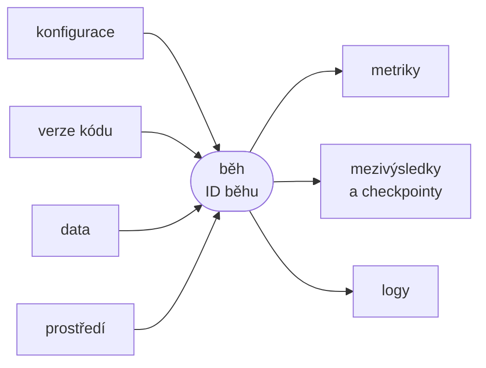
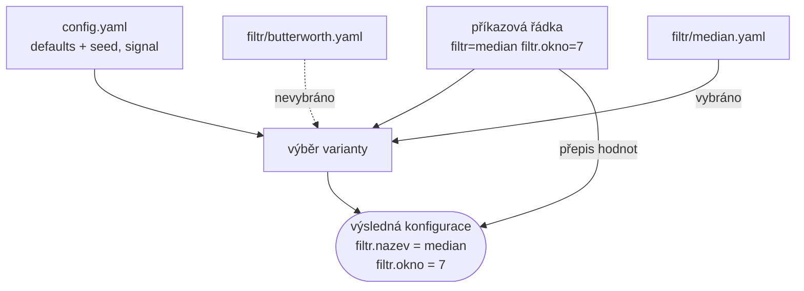
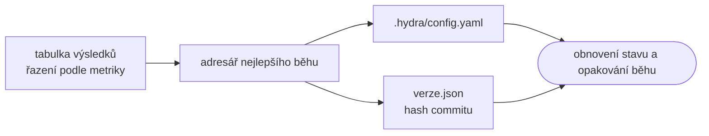

# Správa experimentů

*Výukový materiál — konfigurace, záznam a porovnávání parametrizovaných běhů programu (Hydra, TensorBoard, MLflow)*

Tento materiál popisuje, jak vést evidenci experimentů tak, aby bylo možné kdykoli určit, který běh dosáhl nejlepšího výsledku, s jakou konfigurací, nad jakými daty a s jakou verzí kódu. **Experimentem** se rozumí parametrizovaný běh programu: stejný kód spuštěný s různým nastavením. Může jít o předzpracování signálu (ladění parametrů filtru), o analýzu dat i o trénink modelu. Postup je proto popsán obecně a ukázky vycházejí z předzpracování signálu; rozšíření na trénink je naznačeno v kapitole 4.3. Materiál zahrnuje konfiguraci běhů nástrojem Hydra, uspořádání výstupů na disku, prohledávání parametrů, záznam verze kódu a prostředí, sledování metrik nástroji TensorBoard a MLflow a dohledání nejlepší konfigurace.

## 1. Úvod: experiment jako parametrizovaný běh programu

Při vývoji se tentýž program spouští opakovaně s různými hodnotami parametrů: jiná mezní frekvence filtru, jiné okno, jiný model, jiný seed. Každé takové spuštění je jedním experimentem. Dokud je běhů několik, postačuje pamatovat si výsledky; s jejich růstem začíná být nezbytná evidence.

Typická neuspořádaná podoba vypadá takto:

```python
# zpracuj.py — počáteční verze s pevně zapsanými parametry
import numpy as np
from scipy.signal import butter, sosfiltfilt


def vytvor_signal(seed, delka=2500, fs=250, sum_=0.5):
    """Syntetický signál (sinusovka 5 Hz) se šumem a čistá reference."""
    rng = np.random.default_rng(seed)          # lokální generátor
    t = np.arange(delka) / fs
    reference = np.sin(2 * np.pi * 5 * t)
    return reference + sum_ * rng.standard_normal(delka), reference


def snr_db(reference, odhad):
    """Poměr signálu a šumu v decibelech vůči referenčnímu signálu."""
    return 10 * np.log10(np.sum(reference**2) / np.sum((reference - odhad) ** 2))


def filtruj_butterworth(x, fs, mezni_frekvence, rad):
    sos = butter(rad, mezni_frekvence, btype="low", fs=fs, output="sos")
    return sosfiltfilt(sos, x)                 # nulový fázový posun


zasumeny, reference = vytvor_signal(seed=0)
vysledek = filtruj_butterworth(zasumeny, fs=250, mezni_frekvence=40, rad=4)
snr = snr_db(reference, vysledek)
np.save(f"vysledek_butter_40_4_snr{snr:.1f}.npy", vysledek)   # parametry v názvu souboru
```

Přístup má několik trvalých nedostatků:

- **parametry jsou zapsány v kódu**, takže každá změna znamená úpravu zdrojového souboru,
- **výsledky jsou zakódovány v názvech souborů** (`vysledek_butter_40_4_snr8.4.npy`), které se rychle stávají nepřehlednými a neuchovávají všechny parametry,
- **evidence je ruční** (tabulka, poznámky), a tedy neúplná a náchylná k chybám,
- **chybí spolehlivá odpověď** na otázku, který běh byl nejlepší, s jakým nastavením a s jakou verzí kódu.

Řešení spočívá v tom, že se každému běhu přiřadí vlastní adresář, do kterého se automaticky uloží vše podstatné, a že se parametry předávají zvenčí, nikoli úpravou kódu. Následující kapitoly postupně doplňují jednotlivé součásti.

## 2. Anatomie běhu

Aby bylo možné běh později zopakovat nebo vysvětlit jeho výsledek, zaznamenává se pro každý běh:

| Složka | Co se zaznamená | Poznámka |
|---|---|---|
| **konfigurace** | úplná vyhodnocená konfigurace včetně přepsaných hodnot | nikoli jen výchozí soubor, ale hodnoty, které skutečně platily |
| **verze kódu** | hash commitu a příznak úprav mimo commit | viz kapitola 6 |
| **seed** | použitý seed | patří do konfigurace (viz [materiál o reprodukovatelnosti](reprodukovatelnost-seedy.md), kapitola 8) |
| **prostředí** | verze knihoven, verze Pythonu, hardware | viz kapitola 6 a [materiál o kontejnerizaci](kontejnerizace.md), kapitola 7 |
| **data** | hash nebo verze datové sady | viz kapitola 9 |
| **výstupy** | metriky, mezivýsledky a checkpointy, logy | viz kapitoly 3 a 7 |



Textový popis schématu:

- Vlevo jsou čtyři vstupy běhu: konfigurace, verze kódu, data a prostředí.
- Uprostřed je samotný běh, který nese identifikátor (například časovou značku nebo číslo úlohy); tímto identifikátorem jsou vstupy a výstupy téhož běhu spojeny.
- Vpravo jsou tři druhy výstupů: metriky, mezivýsledky a checkpointy a logy.
- Změna kteréhokoli vstupu může změnit výstup; proto je třeba zaznamenat všechny čtyři.

> **Poznámka:** Identifikátor běhu je nejčastěji název adresáře, v němž je vše uloženo (kapitola 3). Ostatní nástroje (TensorBoard, MLflow) pak tento identifikátor přebírají.

## 3. Organizace výstupů na disku

Základní zásadou je **jeden adresář na jeden běh** (**adresář běhu**, run directory; v nástroji Hydra output directory), do kterého se ukládá vše, co k běhu patří, a ve kterém se nic nepřepisuje. Uspořádání navazuje na rozvržení projektu popsané v [materiálu o struktuře projektu](struktura-projektu.md), kapitola 7 (složky `configs/`, `outputs/`, `artifacts/`, `logs/`).

```text
projekt/
├── configs/                    # konfigurace (verzováno)
├── zpracuj.py
└── outputs/                    # výstupy běhů, mimo verzování
    └── 2026-10-21/
        └── 14-03-12/           # jeden běh
            ├── .hydra/         # použitá konfigurace (kapitola 4.4)
            │   ├── config.yaml
            │   ├── hydra.yaml
            │   └── overrides.yaml
            ├── zpracuj.log     # log běhu
            ├── metriky.json    # výsledné metriky
            ├── verze.json      # hash commitu, příznak úprav mimo commit (kapitola 6)
            ├── hparams/        # zápis add_hparams (kapitola 7.1)
            ├── pip-freeze.txt  # verze knihoven (kapitola 6)
            ├── vysledek.npy    # výstupní data
            └── events.out.tfevents.*   # záznam pro TensorBoard (kapitola 7)
```

Z uspořádání plynou tyto zásady:

- **Nic se nepřepisuje.** Nový běh vždy vytvoří nový adresář; výsledek staršího běhu zůstává zachován.
- **Název adresáře je jednoznačný a řaditelný.** Časová značka ve tvaru rok-měsíc-den a hodina-minuta-sekunda se řadí abecedně shodně s časem. Časová značka s přesností na sekundu nezaručuje jedinečnost při souběžném spouštění více běhů; tuto situaci řeší prohledávání parametrů s číslem úlohy (kapitola 5).
- **Obsah běhu je soběstačný.** Adresář obsahuje konfiguraci, verzi kódu i výsledky, takže jej lze přesunout nebo sdílet bez dalšího kontextu.
- **Adresář `outputs/` je mimo verzování.** Patří do `.gitignore`, protože obsahuje odvozená data a případně rozsáhlé soubory (viz [materiál o gitu](../00-git/git-github-pripomenuti.md), kapitola 12).

Adresář běhu se vytváří ručně pouze u nejjednodušších skriptů. Nástroj Hydra (kapitola 4) jej vytvoří automaticky ve výše uvedeném tvaru. Při použití nástroje Hydra se log a mezivýsledky běhu ukládají přímo do adresáře běhu; samostatné složky `logs/` a `artifacts/` (struktura projektu, kapitola 7) pak slouží pro výstupy mimo jednotlivé běhy (například výsledný model).

## 4. Hydra: konfigurace experimentů

**Hydra** je knihovna pro konfiguraci aplikací, vystavěná nad knihovnou OmegaConf popsanou v [materiálu o konfiguračních souborech](konfiguracni-soubory.md), kapitola 6 (slučování a interpolace). Doplňuje ji o tři vlastnosti, které jsou pro správu experimentů zásadní: přepisování hodnot z příkazové řádky, skládání konfigurace z variant (skupin) a automatické vytvoření adresáře běhu s uloženou konfigurací. Tento materiál navazuje na kapitolu 7 materiálu o konfiguračních souborech, kde je nástroj Hydra pouze zmíněn.

Instalace: `pip install hydra-core`. Uvedené ukázky odpovídají verzi 1.3.

### 4.1 Minimální aplikace

Konfigurace se uloží do souboru `configs/config.yaml`:

```yaml
# configs/config.yaml
seed: 0
signal:
  delka: 2500
  fs: 250          # vzorkovací frekvence v Hz
  sum: 0.5         # směrodatná odchylka šumu
filtr:
  nazev: butterworth
  mezni_frekvence: 40
  rad: 4
```

Funkce `main` ve skriptu `zpracuj.py` (pomocné funkce `vytvor_signal`, `snr_db` a `filtruj_butterworth` zůstávají beze změny z kapitoly 1) je opatřena dekorátorem `@hydra.main`:

```python
# zpracuj.py — hlavní část
import json
import logging
from pathlib import Path

import hydra
import numpy as np
from hydra.core.hydra_config import HydraConfig
from omegaconf import DictConfig

log = logging.getLogger(__name__)


@hydra.main(version_base="1.3", config_path="configs", config_name="config")
def main(cfg: DictConfig) -> float:
    vystup = Path(HydraConfig.get().runtime.output_dir)   # adresář tohoto běhu
    zasumeny, reference = vytvor_signal(
        cfg.seed, cfg.signal.delka, cfg.signal.fs, cfg.signal.sum
    )
    vysledek = filtruj_butterworth(
        zasumeny, cfg.signal.fs, cfg.filtr.mezni_frekvence, cfg.filtr.rad
    )
    snr = snr_db(reference, vysledek)
    log.info("SNR po filtraci: %.2f dB", snr)

    np.save(vystup / "vysledek.npy", vysledek)
    (vystup / "metriky.json").write_text(json.dumps({"snr": float(snr)}))   # výsledné metriky běhu
    return snr


if __name__ == "__main__":
    main()
```

Parametry dekorátoru:

- `config_path` je cesta k adresáři s konfigurací, **relativní vůči souboru se skriptem** (nikoli vůči pracovnímu adresáři),
- `config_name` je název hlavního souboru bez přípony `.yaml`,
- `version_base` určuje, s chováním které verze nástroje má být aplikace kompatibilní; hodnota `"1.3"` vybírá chování verze 1.3 a potlačuje upozornění na nezadanou verzi (dopad na pracovní adresář viz kapitola 4.6).

Dekorátor s parametry se řídí principem popsaným v [materiálu o dekorátorech](../01-psani-kodu/dekoratory.md), kapitola 7: `hydra.main(...)` vrací dekorátor, který funkci `main` obalí tak, že před jejím voláním načte konfiguraci a předá ji jako argument `cfg`. Objekt `cfg` je typu `DictConfig` (z knihovny OmegaConf); k hodnotám lze přistupovat tečkou (`cfg.filtr.rad`).

Spuštění:

```bash
python zpracuj.py
```

Návratová hodnota funkce `main` (zde `snr`) se při běžném spuštění nepoužije; využívají ji až moduly pro řízené prohledávání (kapitola 5).

### 4.2 Přepisování hodnot z příkazové řádky

Hodnoty z `config.yaml` lze při spuštění přepsat:

```bash
# přepsání existující hodnoty
python zpracuj.py filtr.mezni_frekvence=20

# přepsání více hodnot najednou
python zpracuj.py filtr.mezni_frekvence=20 filtr.rad=2 seed=3

# přidání klíče, který v konfiguraci dosud není (předpona +)
python zpracuj.py +poznamka=zkouska_uzkeho_pasma

# zobrazení výsledné konfigurace bez spuštění programu
python zpracuj.py --cfg job filtr.mezni_frekvence=20
```

Hydra ve výchozím stavu konfiguraci uzamyká proti přidávání neznámých klíčů. Překlep v názvu (`filtr.mezni_frekvnce=20`) proto skončí chybou s informací o neexistujícím klíči, nikoli tichým ignorováním. Nový klíč je nutné přidat výslovně předponou `+`; předpona `++` klíč přidá nebo přepíše bez ohledu na to, zda existuje.

> **Doporučení:** Před dlouhým během se ke kontrole hodnot používá volba `--cfg job`, která vypíše vyhodnocenou konfiguraci a program nespustí.

### 4.3 Skupiny konfigurací a skládání

U zřetězeného zpracování bývá každý krok k dispozici ve více variantách (typ filtru, model, způsob normalizace). Hydra je odděluje do **skupin konfigurací** (config groups): každá skupina je podadresář v `configs/` a každá varianta soubor v něm.

```text
configs/
├── config.yaml
└── filtr/
    ├── butterworth.yaml
    └── median.yaml
```

```yaml
# configs/filtr/butterworth.yaml
nazev: butterworth
mezni_frekvence: 40
rad: 4
```

```yaml
# configs/filtr/median.yaml
nazev: median
okno: 5            # lichá velikost okna
```

Hlavní soubor vybírá variantu pomocí seznamu **defaults**:

```yaml
# configs/config.yaml
defaults:
  - filtr: butterworth     # výchozí varianta skupiny filtr
  - _self_                 # hodnoty z tohoto souboru se aplikují jako poslední

seed: 0
signal:
  delka: 2500
  fs: 250
  sum: 0.5
```

Obsah vybraného souboru se vloží pod klíč shodný s názvem skupiny (`filtr`), takže výsledná konfigurace má stejnou strukturu jako v kapitole 4.1. Položka `_self_` určuje pořadí: hodnoty z hlavního souboru se uplatní po hodnotách ze skupin a mohou je tedy přepsat.

Skript se rozšíří o druhou variantu filtru:

```python
from scipy.signal import medfilt


def filtruj_median(x, okno):
    return medfilt(x, kernel_size=okno)


def aplikuj_filtr(x, fs, filtr):
    """Vybere filtr podle klíče nazev v konfiguraci."""
    if filtr.nazev == "butterworth":
        return filtruj_butterworth(x, fs, filtr.mezni_frekvence, filtr.rad)
    if filtr.nazev == "median":
        return filtruj_median(x, filtr.okno)
    raise ValueError(f"Neznámý filtr: {filtr.nazev}")
```

Ve funkci `main` se volání `filtruj_butterworth(...)` nahradí voláním `aplikuj_filtr(zasumeny, cfg.signal.fs, cfg.filtr)`. Variantu lze zvolit z příkazové řádky a lze ji kombinovat s přepisem hodnot:

```bash
# výběr varianty skupiny
python zpracuj.py filtr=median

# výběr varianty a přepis jejího parametru
python zpracuj.py filtr=median filtr.okno=7
```



Textový popis schématu:

- Hlavní soubor `config.yaml` určuje výchozí variantu skupiny `filtr` a obsahuje společné hodnoty.
- Příkazová řádka může variantu změnit (`filtr=median`); vybrána je pak varianta `median.yaml`, kdežto `butterworth.yaml` se nepoužije.
- Hodnoty uvedené na příkazové řádce (`filtr.okno=7`) mají nejvyšší prioritu a přepíší hodnoty ze souborů.
- Výsledkem je jediná konfigurace, která se předá funkci `main`.

**Táž konstrukce pro trénink modelu.** Skupiny nejsou omezeny na předzpracování. Skript pro trénink má strukturu zcela shodnou, pouze s jinými skupinami:

```text
configs/
├── config.yaml
└── model/
    ├── maly.yaml
    └── velky.yaml
```

```yaml
# configs/config.yaml (trénink)
defaults:
  - model: maly
  - _self_

seed: 0
trenink:
  epoch: 20
  krok: 0.001
```

```yaml
# configs/model/velky.yaml
nazev: velky
sirka: 256
vrstev: 4
```

Spuštění `python trenuj.py model=velky trenink.epoch=50 seed=1` pak využívá stejný mechanismus a stejné adresáře běhů jako předzpracování. Podrobnosti o modelech a tréninku přesahují rozsah tohoto materiálu.

### 4.4 Adresář běhu a uložená konfigurace

Při každém spuštění Hydra vytvoří adresář běhu ve tvaru `outputs/<datum>/<čas>/` (například `outputs/2026-10-21/14-03-12/`) a uloží do něj podadresář `.hydra/` se třemi soubory:

| Soubor | Obsah |
|---|---|
| `config.yaml` | úplná vyhodnocená konfigurace běhu (po složení skupin a přepisů) |
| `overrides.yaml` | seznam hodnot přepsaných na příkazové řádce |
| `hydra.yaml` | konfigurace samotné knihovny Hydra, včetně vybraných voleb a cest |

Do téhož adresáře je zapsán také log běhu (`zpracuj.log`, viz kapitola 4.6).

Konfiguraci staršího běhu lze dohledat dvěma způsoby:

```bash
# výpis přepsaných hodnot (co bylo měněno oproti výchozímu stavu)
cat outputs/2026-10-21/14-03-12/.hydra/overrides.yaml

# úplná konfigurace běhu
cat outputs/2026-10-21/14-03-12/.hydra/config.yaml
```

```python
# načtení konfigurace běhu z Pythonu (například v notebooku)
from omegaconf import OmegaConf

cfg = OmegaConf.load("outputs/2026-10-21/14-03-12/.hydra/config.yaml")
print(cfg.filtr.mezni_frekvence)
```

Soubor `config.yaml` je dostačující k zopakování běhu s toutéž konfigurací (v kombinaci s verzí kódu, kapitola 6); soubor `overrides.yaml` je stručnější a ukazuje, v čem se běh lišil od výchozího nastavení.

Umístění adresáře lze změnit konfigurací samotné knihovny Hydra:

```yaml
# configs/config.yaml (doplněk)
hydra:
  run:
    dir: outputs/${now:%Y-%m-%d}/${now:%H-%M-%S}_${filtr.nazev}   # název filtru v názvu adresáře
```

### 4.5 Typovaná konfigurace

Konfigurace načtená ze souboru YAML není ověřena: hodnotu `filtr.rad=ctyri` knihovna přijme jako řetězec a chyba se projeví až při použití. Jak je uvedeno v [materiálu o konfiguračních souborech](konfiguracni-soubory.md), kapitola 5, spolehlivost zvyšuje popis očekávané struktury typovým modelem. Hydra k tomu využívá **strukturované konfigurace** (structured configs): schéma se zapíše jako třídy `dataclass` a zaregistruje se v úložišti `ConfigStore`.

```python
# zpracuj.py — schéma konfigurace
from dataclasses import dataclass, field
from typing import Any

from hydra.core.config_store import ConfigStore
from omegaconf import MISSING


@dataclass
class SignalCfg:
    delka: int = 2500
    fs: int = 250
    sum: float = 0.5


@dataclass
class ButterworthCfg:                 # schéma varianty butterworth
    nazev: str = "butterworth"
    mezni_frekvence: float = 40.0
    rad: int = 4


@dataclass
class MedianCfg:                      # schéma varianty median
    nazev: str = "median"
    okno: int = 5


@dataclass
class Cfg:                            # základní schéma
    seed: int = 0
    signal: SignalCfg = field(default_factory=SignalCfg)
    filtr: Any = MISSING              # typ určí schéma vybrané varianty


cs = ConfigStore.instance()
cs.store(name="zpracuj_schema", node=Cfg)                               # základní schéma
cs.store(group="filtr", name="butterworth_schema", node=ButterworthCfg)  # schémata variant
cs.store(group="filtr", name="median_schema", node=MedianCfg)            # ve skupině filtr
```

Základní schéma se do konfigurace zapojí jako první položka seznamu `defaults`. Pole `filtr` má typ `Any`, protože jeho strukturu určuje až vybraná varianta. Každý soubor varianty se naváže na schéma téže varianty:

```yaml
# configs/config.yaml
defaults:
  - zpracuj_schema
  - filtr: butterworth
  - _self_
```

```yaml
# configs/filtr/butterworth.yaml
defaults:
  - butterworth_schema     # schéma registrované ve skupině filtr
  - _self_
nazev: butterworth
mezni_frekvence: 40
rad: 4
```

```yaml
# configs/filtr/median.yaml
defaults:
  - median_schema
  - _self_
nazev: median
okno: 5
```

Hodnoty ze souborů YAML se sloučí do struktury schématu a ověří se vůči ní. Samostatné schéma každé varianty je nutné proto, že jediné společné schéma `filtr` by sdružovalo parametry všech variant: konfigurace běhu s filtrem `median` by pak obsahovala i nepoužitou `mezni_frekvence` a `rad`, které by se dostaly do záznamu parametrů a do výsledné tabulky (kapitola 8). Se schématem varianty obsahuje běh pouze parametry zvoleného filtru; pokus o přepis parametru jiné varianty (`filtr=median filtr.rad=2`) skončí chybou.

Funkce `main` může typ uvést v anotaci (`def main(cfg: Cfg)`; objekt je za běhu nadále typu `DictConfig`, anotace slouží editoru a nástrojům statické analýzy, které rozpoznají atributy). Neplatná hodnota (`filtr.rad=ctyri`) je ohlášena ihned při načtení konfigurace jako chyba ověření, nikoli až při volání filtru.

> **Přesah:** Funkce `hydra.utils.instantiate` vytvoří objekt podle klíče `_target_` v konfiguraci, takže volba varianty může vybírat přímo funkci či třídu a odpadá ruční rozvětvení `if filtr.nazev == ...`. Varianta s volbou `_partial_: true` vrací funkci s předvyplněnými parametry:
>
> ```yaml
> # configs/filtr/median.yaml (varianta pro instantiate; klíč nazev se neuvádí)
> _target_: zpracuj.filtruj_median
> _partial_: true
> okno: 5
> ```
>
> Volání `instantiate(cfg.filtr)` pak vrátí objekt `functools.partial`, který se zavolá se signálem: `instantiate(cfg.filtr)(zasumeny)`. Klíč `nazev` se v takové variantě neuvádí, neboť by byl předán funkci jako nežádoucí argument. V tomto materiálu se používá explicitní rozvětvení, které je pro výklad přehlednější.

### 4.6 Nástrahy

**Pracovní adresář a relativní cesty.** Chování závisí na nastavení `hydra.job.chdir`. Při `version_base="1.3"` (a obecně od verze 1.2) je výchozí hodnota `False`: pracovní adresář se nemění a zůstává tím, z něhož byl program spuštěn. Hodnota `version_base=None` vybírá výchozí chování nainstalované verze (`chdir=False`); vynechání parametru odpovídá verzi 1.1. Při starších hodnotách `version_base` (a při jeho vynechání) je výchozí hodnota `True`: Hydra pracovní adresář přepne do adresáře běhu, takže relativní cesty k datům (`data/raw/signal.npy`) přestanou platit. Vyplývá z toho:

- k adresáři aktuálního běhu se přistupuje explicitně přes `HydraConfig.get().runtime.output_dir`, jak ukazuje kapitola 4.1,
- cesty ke vstupním datům se odvozují od kořene projektu nebo od původního adresáře, tedy `hydra.utils.get_original_cwd()` či `hydra.utils.to_absolute_path("data/raw/signal.npy")`,
- bez ohledu na nastavení platí obecné doporučení z [materiálu o struktuře projektu](struktura-projektu.md), kapitola 8: relativní cesty vůči pracovnímu adresáři jsou křehké a cesty je vhodné odvozovat od kořene projektu nebo je uvádět v konfiguraci.

```python
from hydra.utils import to_absolute_path

cesta = to_absolute_path(cfg.vstup.soubor)   # cesta vůči původnímu pracovnímu adresáři
```

Ukázka předpokládá klíč `vstup.soubor` v konfiguraci (viz kapitola 9).

> **Upozornění:** Přijme-li skript výstupní cestu jako relativní (`np.save("vysledek.npy", ...)`), uloží soubor do aktuálního pracovního adresáře. Při `hydra.job.chdir=False` je tímto adresářem kořen projektu, nikoli adresář běhu, a výsledky se mohou přepisovat. Výstupy se proto ukládají vždy do `runtime.output_dir`.

**Hydra v notebooku.** Dekorátor `@hydra.main` je určen pro skripty. V notebooku (viz [materiál o struktuře projektu](struktura-projektu.md), kapitola 10) se konfigurace skládá pomocí rozhraní Compose API:

```python
from pathlib import Path

from hydra import compose, initialize_config_dir
from omegaconf import OmegaConf

# vyžaduje se řetězec s absolutní cestou (relativní cesta vyvolá chybu)
config_dir = str(Path.cwd().parent / "configs")   # notebook ve složce notebooks/
with initialize_config_dir(version_base="1.3", config_dir=config_dir):
    cfg = compose(config_name="config", overrides=["filtr=median", "filtr.okno=7"])

print(OmegaConf.to_yaml(cfg))
```

Rozhraní Compose API konfiguraci pouze složí. Nevytváří adresář běhu, neukládá složku `.hydra/` ani nenastavuje logování; objekt `HydraConfig` není nastaven. Adresář běhu je nutné v notebooku vytvořit ručně, případně se logika přesune do funkce volané ze skriptu.

> **Poznámka:** Odkazuje-li konfigurace na schémata z `ConfigStore` (kapitola 4.5), musí být před voláním `compose` zaregistrována, tedy musí být importován modul, který obsahuje volání `cs.store(...)`. Jinak skončí skládání chybou `MissingConfigException`. Schémata se proto zpravidla umisťují do samostatného modulu bez dalších závislostí (například `schema.py`), který lze v notebooku importovat bez spuštění celého skriptu.

**Logování.** Hydra při spuštění nastavuje logování (výstup do konzole a do souboru `zpracuj.log` v adresáři běhu). Tím vzniká princip „jeden log na jeden běh“ doporučený v [materiálu o logování](../02-overovani-a-ladeni/logovani.md), kapitola 4. Zároveň však Hydra nastavuje kořenový logger; vlastní konfigurace logování (například z materiálu o logování) může být nastavením Hydry přepsána. Výchozí chování lze nahradit nebo vypnout volbou ze skupiny `hydra/job_logging`: hodnota `hydra/job_logging=disabled` logování vypne, hodnota `hydra/job_logging=none` logování úlohy nenastavuje, což nejlépe vyhovuje vlastní konfiguraci logování. Ani jedna z voleb nevytváří soubor `zpracuj.log`. Kořenový logger však již obsahuje handler nastavený samotnou Hydrou; vlastní konfigurace proto používá `logging.basicConfig(..., force=True)` nebo `logging.config.dictConfig` s vlastním nastavením kořenového loggeru.

## 5. Prohledávání parametrů

**Prohledávání parametrů** (parameter sweep) je spuštění programu pro více kombinací hodnot v jednom příkazu. Hydra jej označuje jako **multirun** a zapíná jej volba `-m` (`--multirun`). Hodnoty jednoho parametru se oddělují čárkou.

```bash
# mřížka: 3 hodnoty mezní frekvence x 2 hodnoty řádu = 6 běhů
python zpracuj.py -m filtr.mezni_frekvence=20,40,60 filtr.rad=2,4

# prohledávání přes varianty skupiny
python zpracuj.py -m filtr=butterworth,median

# opakování přes seedy (viz materiál o reprodukovatelnosti)
python zpracuj.py -m filtr.mezni_frekvence=20,40,60 seed=0,1,2,3,4
```

Poslední příkaz spustí 3 x 5 = 15 běhů. Opakování přes více seedů odpovídá doporučení z [materiálu o reprodukovatelnosti](reprodukovatelnost-seedy.md), kapitola 7: výsledek se vykazuje přes více seedů jako průměr s mírou rozptylu, nikoli jako jediné číslo.

Každý běh má v režimu multirun vlastní podadresář označený číslem úlohy:

```text
multirun/
└── 2026-10-21/
    └── 14-03-12/
        ├── multirun.yaml        # konfigurace celého prohledávání
        ├── 0/
        │   ├── .hydra/
        │   ├── metriky.json
        │   └── zpracuj.log
        ├── 1/
        │   └── ...
        └── 5/
```

Ke každému běhu tedy platí totéž uspořádání jako u samostatného spuštění (kapitola 3); k běhu číslo `3` patří soubor `multirun/.../3/.hydra/overrides.yaml`, z něhož je patrné, jaké hodnoty byly použity. Název podadresáře lze upravit nastavením `hydra.sweep.subdir`, například `${hydra.job.num}_${hydra.job.override_dirname}` (číslo úlohy a přepsané hodnoty v názvu).

> **Upozornění:** Počet běhů roste jako součin počtů hodnot jednotlivých parametrů. Mřížka pěti parametrů o pěti hodnotách obsahuje 3125 běhů. Počet kombinací je vhodné vypočítat před spuštěním.

> **Přesah:** Pro řízené prohledávání (namísto úplné mřížky) existuje plugin `hydra-optuna-sweeper` (`pip install hydra-optuna-sweeper`), který využívá knihovnu Optuna: další sady hodnot volí podle dosavadních výsledků. Pro jeho použití musí funkce `main` vracet hodnotu, která se optimalizuje (v této ukázce SNR), a směr optimalizace se nastaví konfigurací, například `hydra/sweeper=optuna hydra.sweeper.direction=maximize hydra.sweeper.n_trials=30`. Rozsah hodnot se zadává výrazem typu `interval(10, 100)`, který vytváří reálná čísla; celočíselný parametr se zadává jako `int(interval(1, 8))`. Výsledek prohledávání se zapisuje do souboru `optimization_results.yaml` v adresáři prohledávání. Plugin ve verzi 1.3.0 vyžaduje knihovnu Optuna ve verzi 2.x a není aktivně vyvíjen, proto je před použitím vhodné ověřit jeho kompatibilitu s nainstalovanými verzemi.

## 6. Zaznamenání verze kódu a prostředí

Konfigurace sama o sobě běh nevysvětluje: tentýž soubor `config.yaml` může při odlišné verzi kódu vést k odlišnému výsledku. Do adresáře běhu se proto ukládá i identifikace verze kódu a prostředí.

**Verze kódu.** Zaznamenává se hash aktuálního commitu (`git rev-parse HEAD`) a příznak, zda existují úpravy mimo commit (`git status --porcelain` vypíše změněné soubory; prázdný výstup znamená čistý stav). Samotný hash bez příznaku by byl zavádějící: běh s úpravami mimo commit by byl mylně přiřazen k danému commitu.

```python
# zpracuj.py — záznam verze kódu a prostředí
import json
import subprocess
import sys
from pathlib import Path


def spust(prikaz):
    return subprocess.run(prikaz, capture_output=True, text=True, check=True).stdout.strip()


def zaznamenej_verzi(vystup: Path) -> dict:
    try:
        verze = {
            "commit": spust(["git", "rev-parse", "HEAD"]),
            "zmeny_mimo_commit": bool(spust(["git", "status", "--porcelain"])),
        }
    except (subprocess.CalledProcessError, FileNotFoundError):
        verze = {"commit": None, "zmeny_mimo_commit": None}   # mimo repozitář
    (vystup / "verze.json").write_text(json.dumps(verze, indent=2))

    # verze všech nainstalovaných knihoven
    with open(vystup / "pip-freeze.txt", "w") as f:
        subprocess.run([sys.executable, "-m", "pip", "freeze"], stdout=f, check=True)
    return verze
```

Funkce se zavolá na začátku `main` za řádkem s definicí `vystup` (kapitola 4.1): `verze = zaznamenej_verzi(vystup)`. Vzniknou soubory `verze.json` a `pip-freeze.txt`.

> **Upozornění:** Příkaz `git status --porcelain` zahrnuje i nesledované soubory. Pokud adresář `outputs/` (a `multirun/`, `mlruns/`) není uveden v `.gitignore`, bude příznak změn vždy pravdivý, neboť adresář běhu vzniká již před zápisem. Tyto adresáře proto patří do `.gitignore`.

Je-li příznak úprav mimo commit pravdivý, lze uložit také rozdíl vůči poslednímu commitu (`git diff HEAD`) do souboru `zmeny.patch` (nové, dosud nesledované soubory rozdíl neobsahuje). Tím se zachová přesná podoba kódu i bez commitu.

**Zásada: commit před důležitým během.** Spolehlivá vazba mezi výsledkem a kódem vyžaduje, aby byl kód před důležitým během uložen v commitu. Hash potom jednoznačně určuje podobu kódu a příznak úprav mimo commit je nepravdivý. Běhy s tímto příznakem se považují za průzkumné. Operace commit je popsána v [materiálu o práci s gitem](../00-git/git-github-pripomenuti.md), kapitola 7.

**Prostředí.** Výstup `pip freeze` zaznamenává verze knihoven, avšak nikoli verzi Pythonu, operačního systému ani hardware. Pro přesnější fixaci prostředí slouží kontejner s pevně zadanými verzemi, jak popisuje [materiál o kontejnerizaci](kontejnerizace.md), kapitola 7. Hardware (například model grafické karty) se zapisuje do `verze.json` doplněním dalších klíčů.

## 7. Sledování metrik

Metriky ukládané jako soubory v adresáři běhu (`metriky.json`) jsou dostatečné pro jednoduché případy. Pro sledování průběhu a porovnávání mnoha běhů existují nástroje, které metriky shromažďují a zobrazují v grafickém rozhraní.

### 7.1 TensorBoard

**TensorBoard** je nástroj pro vizualizaci zaznamenaných metrik. Je součástí ekosystému TensorFlow, ale používá se i s PyTorchem a s libovolným kódem, který zapisuje události pomocí třídy `SummaryWriter`. Instalace: `pip install tensorboard`. Třída `SummaryWriter` se importuje z `torch.utils.tensorboard` (vyžaduje PyTorch) nebo z balíčku `tensorboardX` (instalace `pip install tensorboardX`).

Zápis se nasměruje do adresáře běhu, který určila Hydra:

```python
# zpracuj.py — záznam metrik pro TensorBoard
from torch.utils.tensorboard import SummaryWriter
from omegaconf import OmegaConf


def zplosti(slovnik, predpona=""):
    """Zploští vnořený slovník: {'filtr': {'rad': 4}} -> {'filtr.rad': 4}."""
    vysledek = {}
    for klic, hodnota in slovnik.items():
        nazev = f"{predpona}{klic}"
        if isinstance(hodnota, dict):
            vysledek.update(zplosti(hodnota, nazev + "."))
        else:
            vysledek[nazev] = hodnota
    return vysledek


# uvnitř main, po výpočtu snr (po filtraci):
snr_pred = snr_db(reference, zasumeny)     # SNR vstupního signálu
writer = SummaryWriter(log_dir=str(vystup))
writer.add_scalar("snr", snr_pred, 0)      # krok 0: vstupní signál
writer.add_scalar("snr", snr, 1)           # krok 1: po filtraci

parametry = zplosti(OmegaConf.to_container(cfg, resolve=True))
writer.add_hparams(parametry, {"hparam/snr": snr}, run_name="hparams")
writer.close()
```

Metoda `add_scalar(název, hodnota, krok)` zapisuje číselný průběh. Při předzpracování je krokem pořadí kroku zpracování, při tréninku modelu číslo epochy. Metoda `add_hparams(parametry, metriky)` zapisuje hodnoty parametrů spolu s výslednými metrikami a umožňuje jejich porovnání v panelu **HParams**. Metoda zapisuje do podadresáře (zde `hparams/`) a hodnoty parametrů musí být čísla, řetězce nebo pravdivostní hodnoty; vnořená konfigurace se proto nejprve zploští pomocnou funkcí `zplosti`. Ve variantě `tensorboardX` se parametr nazývá `name` místo `run_name`.

Zobrazení:

```bash
# výstupy všech běhů (každý podadresář se zápisem je samostatný běh)
tensorboard --logdir outputs

# jedno prohledávání
tensorboard --logdir multirun/2026-10-21/14-03-12
```

Rozhraní je poté dostupné v prohlížeči na adrese vypsané příkazem (obvykle `http://localhost:6006`). Zápis metrik uvnitř tréninkové smyčky je popsán v [materiálu o infrastruktuře PyTorche](../04-strojove-uceni/pytorch-infrastruktura.md), kapitola 3.7.

### 7.2 MLflow

**MLflow** je nástroj pro evidenci experimentů, který ukládá parametry, metriky i soubory (**artefakty**, artifacts) a nabízí webové rozhraní pro jejich porovnávání. Lze jej používat zcela lokálně. Instalace: `pip install mlflow`.

```python
# zpracuj.py — záznam do MLflow
import mlflow

mlflow.set_tracking_uri("sqlite:///mlflow.db")      # lokální úložiště
mlflow.set_experiment("filtrace-signalu")           # skupina souvisejících běhů

with mlflow.start_run(run_name=vystup.parent.name + "_" + vystup.name):
    parametry = zplosti(OmegaConf.to_container(cfg, resolve=True))   # funkce z kapitoly 7.1
    mlflow.log_params(parametry)                    # konfigurace z Hydry (zploštěná)
    mlflow.set_tag("commit", verze["commit"])       # slovník verze z funkce zaznamenej_verzi (kapitola 6)
    mlflow.log_metric("snr", snr, step=1)
    mlflow.log_artifact(str(vystup / "metriky.json"))
    mlflow.log_artifacts(str(vystup / ".hydra"), artifact_path="hydra")
```

Význam jednotlivých volání:

- `set_experiment` volí (případně zakládá) pojmenovanou skupinu běhů,
- `start_run` zahajuje jeden běh; blok `with` jej na konci uzavře,
- `log_params` ukládá slovník parametrů, `log_metric` číselnou hodnotu (volitelně s krokem),
- `log_artifact` a `log_artifacts` ukládají soubory nebo celý adresář.

Webové rozhraní se spouští příkazem:

```bash
mlflow ui --backend-store-uri sqlite:///mlflow.db
```

> **Poznámka:** Od verzí řady 3 (ověřeno ve verzi 3.17) ukládá MLflow ve výchozím stavu běhy do databáze `mlflow.db` v pracovním adresáři a artefakty do adresáře `mlruns/`. Starší verze ukládají vše do adresáře `mlruns/`. Explicitní nastavení `set_tracking_uri` činí chování nezávislým na verzi. Relativní cesta `sqlite:///mlflow.db` se vyhodnocuje vůči pracovnímu adresáři (viz kapitola 4.6). Soubory `mlflow.db` a `mlruns/` patří do `.gitignore`.

### 7.3 Weights & Biases a porovnání nástrojů

Nástroj **Weights & Biases** (W&B) je komerční služba s obdobnou funkcionalitou, která však ukládá data a metriky **do cloudu**; přístupový klíč (API key) patří do souboru `.env` mimo verzování (viz [materiál o konfiguračních souborech](konfiguracni-soubory.md), kapitola 4) a před použitím je nutné ověřit, zda je odesílání dat mimo instituci přípustné.

| Vlastnost | TensorBoard | MLflow | Weights & Biases |
|---|---|---|---|
| úložiště | lokální (soubory) | lokální nebo server | cloud |
| náročnost nastavení | velmi nízká | nízká až střední | střední (účet, klíč) |
| porovnání běhů | grafy a panel HParams | tabulka běhů, filtry, grafy | rozsáhlé, webové |
| ukládání artefaktů | ne (pouze události) | ano | ano |
| týmová spolupráce | omezená (sdílení souborů) | sdílený server | zabudovaná |

> **Doporučení:** Pro začátek postačuje jeden nástroj. TensorBoard vyžaduje nejmenší úsilí; MLflow je vhodný, pokud mají být parametry, metriky a soubory evidovány na jednom místě.

## 8. Porovnání běhů a dohledání nejlepší konfigurace

**Rozhraní nástrojů.** V TensorBoardu lze běhy filtrovat podle názvu a v panelu HParams řadit podle hodnoty metriky nebo omezovat podle rozsahu parametrů. V rozhraní MLflow se běhy zobrazují v tabulce, kterou lze filtrovat dotazem na parametry a metriky a řadit podle libovolného sloupce.

**Vyhodnocení z adresářů.** Protože každý běh obsahuje konfiguraci i metriky, lze výsledky sestavit i bez dalšího nástroje. Ukázka pro prohledávání z kapitoly 5 (soubor `metriky.json` obsahuje klíč `snr`):

```python
import json
from pathlib import Path

import pandas as pd
from omegaconf import OmegaConf

from zpracuj import zplosti      # pomocná funkce z kapitoly 7.1

radky = []
for soubor in Path("multirun/2026-10-21/14-03-12").glob("*/metriky.json"):
    beh = soubor.parent
    cfg = OmegaConf.load(beh / ".hydra" / "config.yaml")
    radek = zplosti(OmegaConf.to_container(cfg))
    radek.update(json.loads(soubor.read_text()))
    radek["commit"] = json.loads((beh / "verze.json").read_text())["commit"]
    radek["adresar"] = str(beh)
    radky.append(radek)

tabulka = pd.DataFrame(radky)

# agregace přes seedy: průměr a směrodatná odchylka pro každou kombinaci parametrů
souhrn = (
    tabulka.groupby(["filtr.mezni_frekvence", "filtr.rad"])["snr"]
    .agg(["mean", "std"])
    .sort_values("mean", ascending=False)
)
print(souhrn)
```

Pro ilustraci uvádí následující tabulka hodnoty SNR pro syntetický signál z tohoto materiálu při `seed=0` (jediný seed, bez rozptylu):

| `filtr.mezni_frekvence` | `filtr.rad` | SNR (dB) |
|---|---|---|
| 20 | 2 | 11,7 |
| 20 | 4 | 11,4 |
| 40 | 2 | 8,8 |
| 40 | 4 | 8,4 |
| 60 | 2 | 7,0 |
| 60 | 4 | 6,7 |

Signál bez filtrace má SNR přibližně 3,0 dB. Tabulka ukazuje, že pro tento signál je výhodnější nižší mezní frekvence; tento závěr však platí pro konkrétní signál a seed.

**Agregace přes seedy.** Rozdíly mezi sousedními řádky souhrnu se posuzují vzhledem ke směrodatné odchylce přes seedy (viz [materiál o reprodukovatelnosti](reprodukovatelnost-seedy.md), kapitola 7). Rozdíl menší než rozptyl mezi seedy nelze pokládat za prokázaný. Funkce `std` v knihovně pandas používá výběrovou směrodatnou odchylku.

**Cesta zpět ke konfiguraci a kódu.** Z nejlepšího řádku souhrnu vede cesta k plné reprodukci následovně:



Textový popis schématu:

- Z tabulky seřazené podle metriky se určí nejlepší běh a jeho adresář.
- V adresáři leží úplná konfigurace (`.hydra/config.yaml`) a verze kódu (`verze.json`).
- Z hashe commitu se přepne kód do odpovídajícího stavu (například příkazem `git checkout <hash>`); konfigurace se předá programu a běh se zopakuje.
- Je-li v `verze.json` příznak `zmeny_mimo_commit` pravdivý, přesnou podobu kódu obnoví uložený soubor `zmeny.patch`, byl-li vytvořen.

Metodika hodnocení modelů (volba metrik, dělení dat, statistické testování) je předmětem hlavní větve kurzu a v tomto materiálu se neřeší.

## 9. Data a jejich verze

Výsledek závisí také na datech. Pokud se datový soubor mezi běhy změní, výsledky nejsou srovnatelné, a to bez jakékoli změny konfigurace či kódu. Minimem je proto zaznamenat do adresáře běhu hash vstupních dat:

```python
import hashlib


def hash_souboru(cesta, blok=1 << 20):
    """SHA-256 souboru, čtený po blocích kvůli velkým souborům."""
    h = hashlib.sha256()
    with open(cesta, "rb") as f:
        while data := f.read(blok):
            h.update(data)
    return h.hexdigest()


# uvnitř main; předpokládá klíč vstup.soubor v konfiguraci (vstupní datový soubor
# reálného měření; syntetický signál z předchozích kapitol žádný soubor nemá)
data_hash = hash_souboru(to_absolute_path(cfg.vstup.soubor))
```

Hash umožňuje později zjistit, zda se dva běhy opíraly o shodná data. Samotná data se do repozitáře neukládají (viz [materiál o gitu](../00-git/git-github-pripomenuti.md), kapitola 12).

> **Poznámka:** Pro verzování rozsáhlých dat existují specializované nástroje, například **DVC** (Data Version Control), které do gitu ukládá pouze malé soubory s odkazy na data uložená jinde. Správa dat jako celek není předmětem tohoto materiálu.

## 10. Doporučený postup, nástrahy a shrnutí

### 10.1 Kontrolní seznam

**Před během:**

- konfigurace obsahuje všechny parametry včetně seedu, v kódu nejsou pevně zapsané hodnoty,
- kód je uložen v commitu a výstupní adresáře (`outputs/`, `multirun/`, `mlruns/`) jsou v `.gitignore`,
- u prohledávání je vypočten počet běhů,
- konfigurace je zkontrolována volbou `--cfg job`.

**Během běhu:**

- výstupy se ukládají do adresáře běhu (`runtime.output_dir`), nikoli do relativních cest,
- zaznamenává se konfigurace, verze kódu, prostředí a hash dat,
- metriky se zapisují do vybraného nástroje (TensorBoard nebo MLflow).

**Po běhu:**

- výsledky se porovnávají přes více seedů (průměr a rozptyl), nikoli podle jediného běhu,
- u nejlepšího běhu se ověří příznak `zmeny_mimo_commit`,
- důležité výsledky se zálohují a adresáře průzkumných běhů se odstraňují.

### 10.2 Časté nástrahy

1. **Parametr zapsaný v kódu.** Hodnota, která se nepředává konfigurací, se nezaznamená a běh nelze zopakovat.
2. **Relativní cesty při změně pracovního adresáře.** Viz kapitola 4.6.
3. **Zaznamenaný hash bez příznaku změn.** Běh s úpravami mimo commit by byl mylně přiřazen k danému commitu.
4. **Výběr podle jediného seedu.** Nejlepší běh z jednoho seedu často odráží náhodu (viz [materiál o reprodukovatelnosti](reprodukovatelnost-seedy.md), kapitola 7).
5. **Adresář `outputs/` ve verzování.** Zbytečně zvětšuje repozitář a způsobuje trvale pravdivý příznak změn.
6. **Nekontrolovaný rozsah mřížky.** Počet běhů roste násobně s počtem parametrů.
7. **Změna dat bez záznamu.** Bez hashe dat nelze poznat, že se srovnávají nesrovnatelné běhy.
8. **Tajné údaje v konfiguraci.** Přístupové klíče (například ke službě W&B) patří do `.env`, nikoli do souborů v `configs/`, které se ukládají do `.hydra/config.yaml` a mohou být sdíleny.

### 10.3 Shrnutí

Experiment je parametrizovaný běh programu; správa experimentů zajišťuje, aby každý běh zanechal úplný záznam o svých vstupech (konfigurace, kód, seed, prostředí, data) a výstupech. Nástroj Hydra poskytuje konfiguraci s přepisem z příkazové řádky, skupinami variant, typovým schématem, automatickým adresářem běhu s uloženou konfigurací a režimem multirun pro prohledávání parametrů. K tomu se doplňuje záznam verze kódu a prostředí, sledování metrik nástroji TensorBoard či MLflow a vyhodnocení přes více seedů. Výsledkem je možnost od nejlepšího výsledku dohledat konfiguraci i verzi kódu a běh zopakovat.

> **Další čtení:** dokumentace nástroje Hydra ([hydra.cc](https://hydra.cc/docs/intro/)), dokumentace TensorBoardu ([tensorflow.org/tensorboard](https://www.tensorflow.org/tensorboard)) a dokumentace nástroje MLflow ([mlflow.org/docs/latest](https://mlflow.org/docs/latest/index.html)). Související materiály: [Konfigurační soubory](konfiguracni-soubory.md), [Reprodukovatelnost a seedy](reprodukovatelnost-seedy.md), [Struktura projektu](struktura-projektu.md), [Kontejnerizace](kontejnerizace.md).
