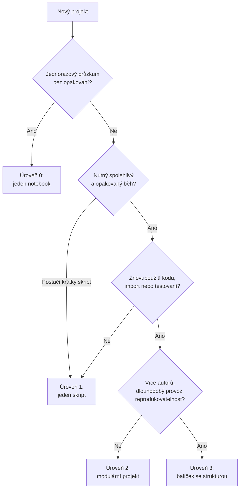
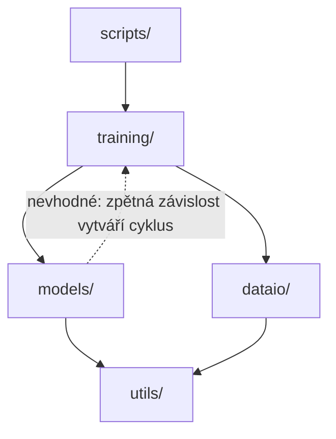

# Struktura projektu

*Výukový materiál — organizace kódu od notebooku k balíčku*

Programový projekt začíná často jediným souborem, s postupujícím vývojem však roste a bez uspořádání se stává nepřehledným. Tento materiál ukazuje, jak strukturu volit **podle skutečné potřeby projektu** — od jediného notebooku po plnohodnotný balíček — a jak jednotlivé části (moduly, balíčky, složky) uspořádat.

## 1. Proč na struktuře záleží

Neuspořádaný projekt se typicky projevuje dvěma způsoby: buď jako **jediný neúměrně rozsáhlý notebook**, v němž nelze nic dohledat, testovat ani verzovat, nebo jako **jediný soubor `main.py`**, který postupně naroste do nepřehledného rozsahu. Vhodná struktura řeší tři potřeby:

- **spustitelnost** — projekt lze spolehlivě a opakovaně spustit,
- **znovupoužitelnost a testovatelnost** — kód rozdělený do modulů lze importovat, testovat a upravovat po částech,
- **sdílení a reprodukovatelnost** — uspořádaný projekt může převzít, spustit a rozšířit další osoba.

Platí přitom zásada, kterou je vhodné zdůraznit: **struktura má odpovídat potřebě projektu, ani více, ani méně.** Vytvoření plnohodnotného balíčku z jednorázového skriptu je zbytečnou zátěží; ponechání sdíleného, dlouhodobého projektu v jediném notebooku je naopak nedostatečné. Následující kapitola pomáhá určit správnou míru.

## 2. Rozhodovací strom: jakou strukturu zvolit

Volba struktury závisí na třech otázkách, které odpovídají třem osám — **funkčnosti** (je nutný spolehlivý a opakovaný běh?), **replikovatelnosti** (spustí projekt i další osoba, případně tentýž autor později?) a **složitosti** (bude se kód znovu používat, importovat, testovat?).



Totéž v textové podobě, kdyby se diagram nezobrazil:

1. **Jednorázový průzkum bez opakování?** → Ano: **Úroveň 0** (jeden notebook). Ne: pokračovat.
2. **Nutný spolehlivý a opakovaný běh?** → Postačí-li krátký skript: **Úroveň 1** (jeden skript). Jinak pokračovat.
3. **Znovupoužití kódu, import nebo testování?** → Ne: zůstává **Úroveň 1**. Ano: pokračovat.
4. **Více autorů, dlouhodobý provoz, reprodukovatelnost?** → Ne: **Úroveň 2** (modulární projekt). Ano: **Úroveň 3** (balíček se strukturou).

## 3. Úrovně struktury

### Úroveň 0 — jeden notebook

Vhodná pro průzkum dat a jednorázové výpočty, které se nebudou opakovat ani sdílet.

```text
analyza.ipynb
```

*Přínos:* rychlost a bezprostřední zpětná vazba. *Omezení:* obtížné testování, verzování a opětovné spuštění (viz kapitola 10).

### Úroveň 1 — jeden skript

Vhodná pro malou, avšak opakovatelnou úlohu.

```text
projekt/
├── main.py
├── requirements.txt
└── README.md
```

*Přínos:* spustitelnost z příkazové řádky a záznam závislostí. *Omezení:* s růstem se soubor `main.py` stává nepřehledným.

### Úroveň 2 — modulární projekt

Vhodná, jakmile se logika rozdělí do více souborů a je žádoucí ji testovat.

```text
projekt/
├── main.py            # vstupní bod
├── data.py            # načítání dat
├── model.py           # definice modelu
├── train.py           # tréninková smyčka
├── config.yaml        # konfigurace
├── tests/
│   └── test_model.py
├── requirements.txt
└── README.md
```

*Přínos:* rozdělení odpovědností, testovatelnost, přehlednost. *Omezení:* bez instalace balíčku mohou nastat potíže s importy (viz kapitola 6).

### Úroveň 3 — balíček se strukturou

Vhodná pro sdílený, dlouhodobý a reprodukovatelný projekt. Vlastní kód je umístěn do balíčku ve složce `src/`, doplněného o konfigurace, testy a metadata projektu (`pyproject.toml`). Plné rozvržení rozsáhlého projektu je uvedeno v kapitole 7; postup, jak z balíčku vytvořit samostatně instalovatelnou knihovnu, popisuje kapitola 9.

## 4. Moduly a balíčky

Dva základní pojmy:

- **Modul** je jediný soubor `.py`. Importuje se podle jména bez přípony: soubor `model.py` se importuje zápisem `import model`.
- **Balíček** je složka obsahující moduly. Aby ji bylo možné importovat jako balíček, obsahuje soubor `__init__.py`.

### Soubor `__init__.py`

Přítomnost souboru `__init__.py` označuje složku za (regulérní) balíček. Kód v tomto souboru se provede při importu balíčku. K jeho obsahu:

- **Prázdný soubor je zcela v pořádku** a je nejběžnějším případem — pouze označuje složku za balíček.
- **Volitelně** může zpřístupnit vybrané názvy, čímž zpřehlední rozhraní balíčku. Obsahuje-li soubor `src/projekt/dataio/__init__.py` řádek `from .dataset import MujDataset`, lze poté psát `from projekt.dataio import MujDataset` namísto delšího `from projekt.dataio.dataset import MujDataset`.
- **Může obsahovat** údaj o verzi balíčku (`__version__`) či seznam veřejných názvů (`__all__`).

```python
# src/projekt/dataio/__init__.py
from .dataset import MujDataset
from .loaders import vytvor_loader

__all__ = ["MujDataset", "vytvor_loader"]
```

> **Upozornění:** Do souboru `__init__.py` nepatří náročný kód ani operace s vedlejšími účinky (načítání velkých souborů, připojení k síti), neboť se provedou při každém importu balíčku. Novější Python sice umožňuje i tzv. namespace balíčky bez souboru `__init__.py` (PEP 420), avšak pro běžný projekt je výslovný `__init__.py` přehlednější a doporučený.

### Konvence pojmenování

Moduly a balíčky se pojmenovávají **malými písmeny**, krátce a bez pomlček (namísto pomlčky se používá podtržítko); název nesmí obsahovat mezery.

> **Upozornění:** Modul nesmí být pojmenován shodně s modulem standardní knihovny (například `random.py`, `email.py`, `json.py`). Takový soubor by při importu zastínil knihovnu a způsobil obtížně odhalitelné chyby.

## 5. Vstupní bod: `if __name__ == "__main__"`

Soubor v Pythonu lze **importovat** (jeho kód na nejvyšší úrovni se provede při importu), nebo **spustit přímo**. Konstrukce `if __name__ == "__main__":` odděluje kód, který se má provést **pouze při přímém spuštění** souboru, nikoli při jeho importu.

```python
def trenuj():
    ...

if __name__ == "__main__":     # provede se jen při `python train.py`,
    trenuj()                   # nikoli při `import train`
```

Bez tohoto oddělení by se funkce `trenuj()` spustila i tehdy, kdyby jiný soubor pouze importoval funkci z tohoto modulu.

> **Upozornění (souvislost s PyTorchem):** Konstrukce je nezbytná při paralelním zpracování. Na systémech, které nové procesy vytvářejí metodou *spawn* (Windows, macOS), `DataLoader` s `num_workers > 0` znovu importuje hlavní modul v každém podprocesu (viz [materiál o infrastruktuře PyTorche](../04-strojove-uceni/pytorch-infrastruktura.md), kapitola 1.2). Není-li tréninkový kód uzavřen ve `if __name__ == "__main__"`, provede se v každém podprocesu znovu, což vede k chybě, případně k nekonečnému vytváření procesů.

### Vzor vstupního bodu

Vstupní body ve složce `scripts/` mají být úsporné: jejich úkolem je pouze načíst nastavení a předat řízení kódu z balíčku, nikoli obsahovat vlastní logiku. Obvyklou podobou je funkce `main()`, která zpracuje argumenty příkazové řádky (modulem `argparse`) a zavolá kód balíčku:

```python
# scripts/train.py
import argparse
from projekt.training.trainer import trenuj

def main() -> None:
    parser = argparse.ArgumentParser()
    parser.add_argument("--config", required=True, help="cesta ke konfiguraci")
    parser.add_argument("--epochs", type=int, default=10)
    args = parser.parse_args()
    trenuj(config=args.config, epochs=args.epochs)

if __name__ == "__main__":
    main()
```

Funkce `main()` je zároveň předpokladem pro spustitelné příkazy definované v části `[project.scripts]` (kapitola 9), které na ni odkazují. Argumenty z příkazové řádky přitom představují nejvyšší vrstvu priority konfigurace (viz [materiál o konfiguraci](konfiguracni-soubory.md), kapitola 4).

## 6. Importy

**Absolutní import** uvádí úplnou cestu balíčkem a je doporučený pro svou jednoznačnost:

```python
from projekt.models import cnn
```

**Relativní import** odkazuje na umístění vůči aktuálnímu modulu (tečka značí týž balíček, dvě tečky nadřazený) a používá se pouze uvnitř balíčku:

```python
from ..models import cnn      # z nadřazeného balíčku
```

**Spuštění jako modul.** Skript, který je součástí balíčku, se spouští zápisem `python -m`, při němž se importy uvnitř balíčku vyřeší správně:

```bash
python -m projekt.scripts.train      # správně, importy fungují
python src/projekt/scripts/train.py  # může selhat na importech
```

**Chyba `ModuleNotFoundError`.** Nejčastější příčinou je, že interpret vlastní balíček nenalezne. Spolehlivým řešením je učinit projekt **instalovatelným** a nainstalovat jej v **editovatelném režimu**:

```bash
pip install -e .
```

Po této instalaci je balíček dostupný pro import odkudkoli (z testů, skriptů i notebooků) a změny ve zdrojovém kódu se projeví okamžitě, bez opětovné instalace. To je hlavní důvod, proč rozsáhlejší projekt používá rozvržení se složkou `src/` a souborem `pyproject.toml` (kapitola 7).

> **Upozornění (rozvržení `src/` a testy):** Používá-li projekt rozvržení se složkou `src/`, nenalezne nástroj `pytest` vlastní balíček, dokud není nainstalován v editovatelném režimu (`pip install -e .`); bez toho testy selžou chybou `ModuleNotFoundError`. Instalace balíčku je proto prvním krokem před spuštěním testů (viz [materiál o testování](../02-overovani-a-ladeni/testovani.md), kapitola 8).

### Cyklické importy

Rozdělí-li se projekt do více modulů, může vzniknout **cyklický import**: modul `a` importuje modul `b`, který současně importuje modul `a`. Při načtení pak jeden z modulů dosud není úplně inicializován a import selže (`ImportError`, případně `AttributeError` u částečně načteného modulu).

```python
# a.py
from b import funkce_b        # b.py přitom importuje a.py → vzniká cyklus

# b.py
from a import funkce_a
```

Náprava spočívá v úpravě závislostí mezi moduly, nikoli v obcházení chyby:

- **Přesunout sdílený kód** do třetího modulu, na němž oba závisí (například `common.py`), čímž se cyklus rozpojí.
- **Udržovat jednosměrný tok závislostí** — vyšší vrstvy (například `training`) závisejí na nižších (`models`, `dataio`), nikoli naopak. Obousměrná závislost je známkou nevhodného rozdělení.
- Krajní možností je **odložený import** uvnitř funkce (namísto na začátku modulu), což však řeší pouze příznak, nikoli příčinu.



Textový popis schématu:

- Plné šipky vyjadřují směr importu: vstupní body ve `scripts/` importují `training/`, ten importuje `models/` a `dataio/` a ty využívají `utils/`.
- Všechny plné šipky směřují od vyšší vrstvy k nižší, takže cyklus vzniknout nemůže.
- Tečkovaná šipka znázorňuje nevhodnou zpětnou závislost: importuje-li `models/` z `training/`, vzniká cyklus `training → models → training`.

## 7. Kam co patří: rozvržení rozsáhlého projektu

Následující rozvržení ukazuje, kam až může struktura výzkumného projektu strojového učení vést. Nejde o povinný vzor — menší projekty použijí jen část —, nýbrž o přehled možných složek a jejich účelu.

```text
projekt/
├── pyproject.toml          # metadata projektu, závislosti, nastavení nástrojů
├── README.md               # popis projektu a návod ke spuštění
├── .gitignore              # výčet souborů vyřazených z verzování
├── .env                    # tajné údaje, mimo verzování (viz konfigurace)
│
├── src/
│   └── projekt/            # vlastní balíček (importovatelný)
│       ├── __init__.py
│       ├── config.py       # načtení a validace konfigurace (viz konfigurace)
│       ├── paths.py        # cesty odvozené od kořene projektu (viz kapitola 8)
│       ├── dataio/         # načítání a ukládání dat
│       │   ├── __init__.py
│       │   ├── dataset.py  # třídy Dataset (viz infrastruktura PyTorche)
│       │   ├── loaders.py  # DataLoader, collate_fn
│       │   └── transforms.py
│       ├── models/         # definice modelů (nn.Module)
│       │   ├── __init__.py
│       │   ├── base.py
│       │   └── cnn.py
│       ├── training/       # tréninková smyčka, ztrátové funkce, schedulery
│       │   ├── __init__.py
│       │   ├── trainer.py
│       │   └── losses.py
│       ├── evaluation/     # metriky a vyhodnocení
│       │   └── metrics.py
│       └── utils/          # pomocné funkce
│           ├── seed.py     # ustálení zárodku (viz reprodukovatelnost)
│           └── logging.py  # nastavení logování (viz logování)
│
├── configs/                # konfigurační soubory (viz konfigurace)
│   ├── default.yaml
│   └── experiment_01.yaml
├── scripts/                # spustitelné vstupní body (příkazová řádka)
│   ├── train.py
│   └── evaluate.py
├── notebooks/              # průzkum a reporty (viz kapitola 10)
│   └── exploration.ipynb
├── tests/                  # testy (viz testování)
│   ├── test_dataset.py
│   └── test_models.py
│
├── data/                   # data, mimo verzování
│   ├── raw/                # původní, neměnná data
│   ├── interim/            # dílčí mezistupně zpracování
│   └── processed/          # zpracovaná data připravená k použití
├── artifacts/              # natrénované modely a checkpointy, mimo verzování
├── logs/                   # záznamy běhů, mimo verzování (viz logování)
├── outputs/                # výsledky, grafy, reporty
└── docs/                   # dokumentace projektu
```

Účel jednotlivých částí:

| Složka / soubor | Účel |
|---|---|
| `pyproject.toml` | metadata, závislosti a nastavení nástrojů; umožňuje `pip install -e .` |
| `src/projekt/` | vlastní importovatelný kód, rozdělený podle odpovědností |
| `dataio/` | vše kolem načítání, ukládání a transformace dat |
| `models/` | definice modelů (architektury) |
| `training/` | tréninková logika, ztrátové funkce, schedulery |
| `evaluation/` | metriky a vyhodnocení výsledků |
| `utils/` | průřezové pomůcky (seedy, nastavení logování) |
| `configs/` | konfigurační soubory oddělené od kódu |
| `scripts/` | úsporné vstupní body volající kód z balíčku |
| `notebooks/` | průzkum a reporty, nikoli trvalá logika |
| `tests/` | automatizované testy |
| `data/` | data členěná na `raw`, `interim`, `processed`; mimo verzování |
| `artifacts/` | natrénované modely a checkpointy; mimo verzování |
| `logs/` | záznamy běhů; mimo verzování |
| `outputs/` | výstupní výsledky a grafy |
| `docs/` | dokumentace |

> **Upozornění (kolize názvů):** Složka `src/projekt/models/` (zdrojový kód modelů) a kořenová složka pro **natrénované** modely by neměly nést týž název. Kořenová složka s uloženými modely se proto obvykle pojmenovává `artifacts/` nebo `checkpoints/`, aby nedošlo k záměně se zdrojovým balíčkem `models`.

> **Zásada oddělení kódu, konfigurace a dat:** Kód patří do `src/`, nastavení do `configs/` (a tajné údaje do `.env`), data a výstupy do vlastních složek mimo verzování (viz [materiál o gitu](../00-git/git-github-pripomenuti.md), kapitola 12). Toto oddělení je společným vláknem několika materiálů této řady ([konfigurace](konfiguracni-soubory.md), [logování](../02-overovani-a-ladeni/logovani.md)) a rozvržení projektu je místem, kde se fyzicky uskutečňuje. Členění výstupů jednotlivých běhů ve složce `outputs/` popisuje [materiál o správě experimentů](sprava-experimentu.md), kapitola 3.

### Obsah souboru README

Soubor `README.md` v kořeni projektu je vstupním bodem pro každého, kdo projekt přebírá, a je proto součástí reprodukovatelnosti. Měl by obsahovat alespoň:

- **co projekt řeší** — stručný popis účelu,
- **jak jej nainstalovat** — potřebné kroky a závislosti,
- **jak jej spustit** — příkaz pro trénink či vyhodnocení,
- **jak zreprodukovat výsledek** — potřebná data, konfiguraci a očekávaný výstup.

Uspořádaná struktura umožňuje projekt spustit, README vysvětluje jak; obojí je nezbytné, má-li projekt převzít další osoba.

Uvedené rozvržení vychází z rozšířené konvence pro projekty datové vědy; podrobnější referenční šablonou je *Cookiecutter Data Science*.

## 8. Cesty k souborům

Častou příčinou selhání při přechodu od notebooku ke strukturovanému projektu jsou **cesty k souborům**. Notebook se spouští ze své složky, takže relativní cesta `data/raw/x.csv` funguje. Skript v balíčku se však může spustit z libovolné složky (nebo zápisem `python -m`) a táž relativní cesta pak selže chybou `FileNotFoundError`, neboť se vyhodnocuje vůči **aktuálnímu pracovnímu adresáři**, nikoli vůči umístění souboru.

Řešením nejsou pevně zapsané absolutní cesty (`C:\Users\...`), které nefungují na jiném stroji. Doporučené postupy jsou dva.

**Cesty odvozené od kořene projektu.** Pomocí modulu `pathlib` a atributu `__file__` (cesta k aktuálnímu souboru) se odvodí kořen projektu a od něj se sestaví ostatní cesty. Vhodné je soustředit je do jediného modulu:

```python
# src/projekt/paths.py — cesty na jednom místě
from pathlib import Path

# tento soubor je v src/projekt/, kořen projektu je o dvě úrovně výše
KOREN = Path(__file__).resolve().parents[2]
DATA = KOREN / "data"
ARTIFACTS = KOREN / "artifacts"
```

Číslo v `parents[2]` odpovídá hloubce souboru: pro `src/projekt/paths.py` vede o dvě úrovně výše (`projekt` → `src` → kořen). Zápis cest operátorem `/` v modulu `pathlib` je navíc přenositelný mezi operačními systémy, na rozdíl od ručního skládání řetězců se znaky `/` či `\`.

**Cesty v konfiguraci.** Ještě vhodnější je cesty do kódu vůbec nezapisovat, nýbrž je uvést v konfiguračním souboru (viz [materiál o konfiguraci](konfiguracni-soubory.md)) a z kódu je pouze načíst. Změna umístění dat pak nevyžaduje zásah do kódu.

> **Upozornění:** Pevně zapsaná relativní cesta (`"data/raw/x.csv"`) je jednou z nejčastějších příčin, proč projekt funguje autorovi, avšak selže na jiném stroji či při spuštění z jiné složky. Cesty je vhodné odvozovat od kořene projektu, nebo je načítat z konfigurace.

## 9. Samostatně instalovatelná knihovna (nad rámec kurzu)

Tato kapitola přesahuje rozsah kurzu. Uvádí se však proto, že zadání bakalářských prací někdy vyžaduje odevzdat výsledek jako **samostatně instalovatelnou knihovnu** — tedy balíček, který lze na cizím stroji nainstalovat příkazem `pip install`. Postup navazuje na balíček se strukturou (úroveň 3): k němu se doplní metadata popisující, jak se má sestavit a nainstalovat.

### 9.1 Co obnáší instalovatelná knihovna

Instalovatelná knihovna je balíček doplněný o soubor `pyproject.toml`, který popisuje **metadata** (název, verzi, autora), **závislosti** a **sestavovací nástroj** (build backend). Na základě těchto údajů lze knihovnu **sestavit** do přenositelného tvaru a poté **nainstalovat** na libovolném stroji, aniž by bylo nutné kopírovat zdrojové soubory ručně.

### 9.2 Soubor `pyproject.toml`

Soubor `pyproject.toml` je ústředním popisem knihovny. Následuje úplný minimální příklad:

```toml
[build-system]
requires = ["setuptools>=61"]
build-backend = "setuptools.build_meta"

[project]
name = "muj-projekt"
version = "0.1.0"
description = "Krátký popis knihovny"
readme = "README.md"
requires-python = ">=3.10"
license = { text = "MIT" }
authors = [{ name = "Jméno Příjmení", email = "jmeno@example.com" }]
dependencies = [
    "numpy>=1.24",
    "torch>=2.0",
]

[project.optional-dependencies]
dev = ["pytest", "mypy"]

[project.scripts]
trenuj = "projekt.scripts.train:main"
```

Význam jednotlivých částí:

- **`[build-system]`** určuje nástroj, který knihovnu sestaví (zde `setuptools`); tato část je povinná.
- **`[project]`** obsahuje metadata. Pole `name` je název, pod nímž se knihovna instaluje, `version` je verze (viz 9.3), `dependencies` vyjmenovává závislosti, které se při instalaci automaticky doinstalují, a `requires-python` udává nejnižší podporovanou verzi jazyka.
- **`[project.optional-dependencies]`** definuje nepovinné skupiny závislostí; skupina `dev` (nástroje pro vývoj) se nainstaluje zápisem `pip install -e ".[dev]"`.
- **`[project.scripts]`** vytvoří spustitelný příkaz: po instalaci bude v příkazové řádce dostupný příkaz `trenuj`, který zavolá funkci `main` z modulu `projekt.scripts.train` (viz vzor vstupního bodu, kapitola 5).

### 9.3 Verzování

Verze se řídí konvencí **sémantického verzování** ve tvaru `HLAVNÍ.VEDLEJŠÍ.OPRAVNÁ` (například `1.4.2`):

- **oprava (patch)** — opravy chyb bez změny chování rozhraní,
- **vedlejší (minor)** — nová funkčnost zpětně slučitelná se stávající,
- **hlavní (major)** — změna, která ruší zpětnou slučitelnost.

Verze musí být uvedena na jednom místě (v `pyproject.toml`) a při každém vydání zvýšena.

### 9.4 Sestavení a instalace

Při vývoji se knihovna instaluje v **editovatelném režimu** (kapitola 6), v němž se změny ve zdrojovém kódu projeví okamžitě:

```bash
pip install -e .
```

Pro předání jiné osobě se knihovna **sestaví** do přenositelných souborů. K tomu slouží nástroj `build`:

```bash
python -m build
```

Ve vzniklé složce `dist/` jsou dva soubory: **zdrojová distribuce** (`.tar.gz`) a **wheel** (`.whl`, předsestavený tvar, který se instaluje rychleji). Výsledek lze nainstalovat na libovolném stroji:

```bash
pip install dist/muj_projekt-0.1.0-py3-none-any.whl
```

### 9.5 Zveřejnění (volitelné)

Má-li být knihovna veřejně dostupná, nahraje se do úložiště **PyPI** nástrojem `twine`. Před zveřejněním na ostrém PyPI je vhodné postup vyzkoušet na zkušebním úložišti **TestPyPI**:

```bash
twine upload --repository testpypi dist/*   # nejprve nanečisto
twine upload dist/*                          # poté na ostré PyPI
```

### 9.6 Na co si dát pozor

- **Neošetřené závislosti.** Všechny knihovny, které projekt používá, musí být uvedeny v poli `dependencies`. Závislost pouze lokálně nainstalovaná, avšak neuvedená, způsobí selhání instalace na cizím stroji.
- **Nezvýšená verze.** Úložiště PyPI nedovoluje nahrát dvakrát tutéž verzi. Každé vydání proto vyžaduje zvýšení čísla verze.
- **Kolize názvu.** Název knihovny na PyPI musí být jedinečný; před volbou názvu je vhodné ověřit, že dosud není obsazen.
- **Chybějící licence.** Bez uvedení licence není zřejmé, za jakých podmínek smí být knihovna používána; pro šíření je licence nezbytná.
- **Nevhodný obsah balíčku.** Do knihovny nepatří data, tajné údaje ani rozsáhlé soubory; balíček obsahuje pouze kód.
- **Neověřená instalace.** Před odevzdáním je vhodné instalaci vyzkoušet v čistém virtuálním prostředí, čímž se ověří, že knihovna funguje i mimo vývojové prostředí autora.

## 10. Notebooky: místo a disciplína

Notebooky mají v projektu své místo — **průzkum dat a tvorbu reportů** —, avšak nejsou vhodné pro trvalou logiku. Vyplývá to z jejich vlastností:

- **Skrytý stav.** Proměnná může v paměti existovat, přestože buňka, která ji vytvořila, byla mezitím smazána nebo změněna. Výsledek pak nelze zopakovat.
- **Nezávislost na pořadí buněk.** Buňky lze spouštět v libovolném pořadí, takže notebook se může jevit jako funkční ve stavu, který po restartu nelze obnovit.
- **Obtížné verzování.** Notebook je vnitřně objemný soubor (formát JSON včetně výstupů), takže porovnání jeho verzí je nepřehledné.

Doporučená disciplína:

- Před dokončením ověřit notebook příkazem **„Restart & Run All"** — spuštěním od čistého stavu se odhalí skrytá závislost na pořadí buněk.
- **Stabilní kód přesunout do modulů** ve složce `src/` a do notebooku jej importovat. Notebook tak obsahuje jen průzkum a volání, nikoli definice, které mají být součástí balíčku.

## 11. Časté nástrahy

- **Předimenzovaná struktura.** Zakládat balíček se složkou `src/` a souborem `pyproject.toml` pro jednorázový skript je zbytečné (viz rozhodovací strom, kapitola 2).
- **Poddimenzovaná struktura.** Ponechávat sdílený, dlouhodobý projekt v jediném notebooku či souboru znemožňuje testování a spolupráci.
- **Data ve verzování.** Rozsáhlá data ani natrénované modely nepatří do repozitáře, nýbrž do složek mimo verzování (viz [materiál o gitu](../00-git/git-github-pripomenuti.md), kapitola 12).
- **Pevně zapsané cesty.** Relativní cesta vůči pracovnímu adresáři selže při spuštění z jiné složky; cesty je vhodné odvozovat od kořene projektu nebo je načítat z konfigurace (viz kapitola 8).
- **Modul zastiňující standardní knihovnu.** Soubor pojmenovaný jako modul standardní knihovny (`random.py`) způsobí obtížně odhalitelné chyby (viz kapitola 4).
- **Cyklický import.** Vzájemná závislost dvou modulů vede k chybě při importu; řeší se úpravou závislostí, nikoli obcházením (viz kapitola 6).
- **Náročný kód v `__init__.py`.** Operace s vedlejšími účinky v tomto souboru se provedou při každém importu balíčku.

## 12. Shrnutí

Struktura projektu má odpovídat jeho potřebě: jednorázový průzkum patří do notebooku, malá úloha do jediného skriptu, znovupoužitelný a testovaný kód do modulárního projektu, sdílený a reprodukovatelný projekt do balíčku se složkou `src/`. Modul je soubor, balíček je složka se souborem `__init__.py`, jenž může být prázdný. Konstrukce `if __name__ == "__main__"` odděluje kód spouštěný přímo od kódu importovaného a je nezbytná pro paralelní zpracování; vstupní body se udržují úsporné a řízení předávají kódu balíčku. Potíže s importy řeší instalace v editovatelném režimu (`pip install -e .`); vzájemné závislosti modulů je třeba udržovat jednosměrné. Cesty k souborům se odvozují od kořene projektu nebo načítají z konfigurace, nikoli zapisují natvrdo. Rozsáhlý projekt odděluje kód (`src/`), konfigurace (`configs/`), data a výstupy do samostatných složek, přičemž data, modely a logy zůstávají mimo verzování. Doplněním souboru `pyproject.toml` s metadaty a závislostmi lze z balíčku vytvořit samostatně instalovatelnou knihovnu. Notebooky slouží k průzkumu, nikoli k trvalé logice.

> **Další čtení:** dokumentace k balíčkování jazyka Python [Python Packaging User Guide](https://packaging.python.org/); referenční šablona projektu [Cookiecutter Data Science](https://cookiecutter-data-science.drivendata.org/).
