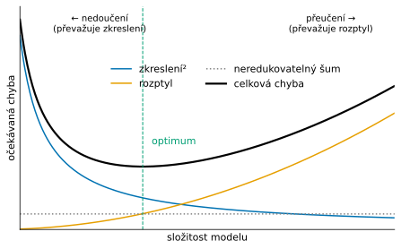

# Kompromis mezi zkreslením a rozptylem

*Výukový materiál — bias-variance tradeoff v praxi strojového učení*

Tento text vykládá kompromis mezi zkreslením a rozptylem se zaměřením na jeho praktickou stránku: jak se projevuje v kódu a jak jej lze rozpoznat a ovlivnit. Předpokládá základní znalost trénování modelů; příklady vycházejí z knihovny scikit-learn.

## 1. Cílem je zobecnění

Model se trénuje na dostupných (trénovacích) datech, jeho účelem je však správně předpovídat na datech **neviděných**. Rozhodující veličinou proto není chyba na trénovacích datech, nýbrž **schopnost zobecnit** — výkon na nových datech. Model, který dosahuje nulové chyby na trénovacích datech tím, že se přizpůsobí i jejich náhodným zvláštnostem, může na nových datech selhávat.

Veškeré následující úvahy směřují k jediné otázce: jak dosáhnout nízké chyby na neviděných datech.

## 2. Dva zdroje chyby: zkreslení a rozptyl

Celkovou chybu předpovědi lze rozložit na tři složky:

- **Zkreslení (bias)** je systematická chyba plynoucí z toho, že zvolený model je příliš jednoduchý, než aby zachytil skutečnou zákonitost v datech. Projevuje se špatným výkonem již na trénovacích datech.
- **Rozptyl (variance)** vyjadřuje, nakolik by se předpovědi modelu lišily, kdyby byl natrénován na jiné trénovací množině téže velikosti. Vysoký rozptyl znamená, že se model přizpůsobuje i náhodnému šumu konkrétní množiny.
- **Neredukovatelný šum** je náhodná složka obsažená v datech samotných, kterou nelze odstranit žádným modelem.

U regrese s kvadratickou ztrátovou funkcí lze očekávanou chybu v daném bodě zapsat jako součet druhé mocniny zkreslení, rozptylu a neredukovatelného šumu:

$$\text{očekávaná chyba} = \text{zkreslení}^2 + \text{rozptyl} + \text{neredukovatelný šum}$$

Zkreslení i rozptyl lze ovlivnit volbou modelu; neredukovatelný šum nikoli.

Rozdíl mezi oběma složkami znázorňuje terč. Každý bod představuje předpověď téhož druhu modelu, natrénovaného pokaždé na jiné trénovací množině; střed terče je skutečná hodnota. Zkreslení odpovídá tomu, jak daleko od středu leží průměr bodů, rozptyl tomu, jak daleko jsou body rozptýleny kolem svého průměru.


*Obrázek vytváří skript [scripts/bias_variance.py](../scripts/bias_variance.py).*

## 3. Nedoučení a přeučení

Oba krajní stavy odpovídají převaze jedné ze složek chyby:

- **Nedoučení (underfitting)** nastává při **vysokém zkreslení**: model je příliš jednoduchý a dosahuje špatného výkonu na trénovacích i testovacích datech.
- **Přeučení (overfitting)** nastává při **vysokém rozptylu**: model je příliš složitý, na trénovacích datech dosahuje výborného výsledku, na testovacích však selhává.

Charakteristickým příznakem je **rozdíl mezi trénovací a testovací chybou**. Malý rozdíl při vysoké chybě obou ukazuje na nedoučení; velký rozdíl (nízká trénovací, vysoká testovací chyba) ukazuje na přeučení.

## 4. Podstata kompromisu

Zkreslení a rozptyl nelze zpravidla snižovat současně. S **rostoucí složitostí modelu** klesá zkreslení (model dokáže zachytit složitější zákonitosti), avšak roste rozptyl (model se více přizpůsobuje konkrétní množině). Celková chyba jako funkce složitosti má proto tvar písmene U: nejprve klesá, dosáhne minima a poté opět roste.



*Obrázek vytváří skript [scripts/bias_variance.py](../scripts/bias_variance.py). Průběhy jsou schematické, nikoli naměřené.*

Cílem je nalézt složitost odpovídající **minimu celkové chyby**, nikoli minimu chyby trénovací.

## 5. Složitost modelu

Složitostí se rozumí schopnost modelu zachytit rozmanité zákonitosti. Vyšší složitost obvykle souvisí s větší pružností modelu a s vyšším počtem hodnot, které se z dat určují. Příkladem rostoucí složitosti je vyšší stupeň polynomu při regresi, větší hloubka rozhodovacího stromu nebo menší hodnota parametru *k* u metody *k* nejbližších sousedů.

Řízení složitosti je rozhodující pro nalezení optima z předchozí kapitoly — a děje se především prostřednictvím hyperparametrů (kapitola 6).

## 6. Parametry versus hyperparametry

Toto rozlišení je pro řízení složitosti zásadní:

- **Parametry** jsou hodnoty, které se **určují z dat během trénování** — například váhy modelu, dělicí body rozhodovacího stromu nebo těžiště shluků.
- **Hyperparametry** jsou hodnoty **nastavené předem**, které řídí průběh trénování a složitost modelu — například učicí krok, hloubka stromu, hodnota *k* u *k* nejbližších sousedů, síla regularizace nebo počet shluků.

Podstatné propojení s tímto materiálem: **hyperparametr často přímo řídí rovnováhu mezi zkreslením a rozptylem**. Větší hloubka stromu snižuje zkreslení a zvyšuje rozptyl; menší hodnota *k* rovněž snižuje zkreslení a zvyšuje rozptyl; silnější regularizace působí opačně. Volba hyperparametrů proto přímo určuje polohu na U-křivce.

> **Rozcestník:** Hyperparametry jsou typickými konfiguračními parametry projektu; jejich správě se věnuje samostatný [materiál o konfiguraci](../03-projekt-a-prostredi/konfiguracni-soubory.md).

## 7. Jak kompromis rozpoznat v praxi

**Rozdělení dat.** Data se dělí na tři části: trénovací (pro určení parametrů), validační (pro volbu hyperparametrů) a testovací (pro závěrečný odhad výkonu). Tři části, nikoli dvě, jsou nutné proto, že testovací množina musí zůstat **až do konce nedotčená** — jakmile se použije k ladění, přestává poskytovat nezkreslený odhad.

```python
from sklearn.model_selection import train_test_split

# nejprve oddělíme testovací množinu, které se až do závěru nedotýkáme
X_zbytek, X_test, y_zbytek, y_test = train_test_split(
    X, y, test_size=0.2, random_state=42
)
# ze zbytku oddělíme validační množinu pro ladění hyperparametrů
X_train, X_val, y_train, y_val = train_test_split(
    X_zbytek, y_zbytek, test_size=0.25, random_state=42
)
```

**Křížová validace.** Spolehlivější odhad, zejména u menších dat, poskytuje křížová validace: data se rozdělí na několik částí a model se opakovaně trénuje a ověřuje tak, že se v roli validační množiny vystřídá každá část. Výsledkem je průměr a rozptyl skóre.

```python
from sklearn.model_selection import cross_val_score

skore = cross_val_score(model, X_train, y_train, cv=5)
print(skore.mean(), skore.std())
```

**Validační křivka** znázorňuje trénovací a validační chybu v závislosti na hodnotě hyperparametru a umožňuje nalézt složitost odpovídající minimu validační chyby:

```python
import numpy as np
from sklearn.model_selection import validation_curve
from sklearn.tree import DecisionTreeClassifier

hloubky = np.arange(1, 15)
train_skore, val_skore = validation_curve(
    DecisionTreeClassifier(random_state=42),
    X_train, y_train,
    param_name="max_depth", param_range=hloubky, cv=5,
)

import matplotlib.pyplot as plt
plt.plot(hloubky, train_skore.mean(axis=1), label="trénovací")
plt.plot(hloubky, val_skore.mean(axis=1), label="validační")
plt.xlabel("hloubka stromu"); plt.ylabel("skóre"); plt.legend()
```

**Učicí křivka** znázorňuje chybu v závislosti na velikosti trénovací množiny a slouží k rozlišení, zda převažuje zkreslení, nebo rozptyl. Jsou-li trénovací i validační chyba vysoké a blízké sobě, převažuje zkreslení (nedoučení) a přidání dat mnoho nezmění. Zůstává-li mezi nimi velká mezera, převažuje rozptyl (přeučení) a přidání dat obvykle pomůže.

> **Rozcestník:** Rozdělení dat i křížová validace využívají náhody; pro reprodukovatelnost výsledků je nutné ustálit zárodek (viz `random_state` v příkladech). Této problematice se věnuje samostatný [materiál o reprodukovatelnosti](../03-projekt-a-prostredi/reprodukovatelnost-seedy.md).

## 8. Jak kompromis ovlivnit

Podle toho, která složka chyby převažuje, se volí opačný zásah:

**Při přeučení (vysoký rozptyl)** se rozptyl snižuje: získáním více dat, regularizací (kapitola 9), volbou jednoduššího modelu, omezením počtu příznaků, včasným zastavením trénování nebo kombinováním více modelů.

**Při nedoučení (vysoké zkreslení)** se zkreslení snižuje: volbou složitějšího modelu, doplněním či zlepšením příznaků, oslabením regularizace nebo delším trénováním.

Diagnostika z kapitoly 7 určuje, který z těchto směrů je namístě; opačný zásah situaci zhoršuje.

## 9. Regularizace

Regularizace je prostředek, který k účelové funkci připojuje penalizaci za složitost modelu (typicky za velké hodnoty parametrů). Tím jsou upřednostněna jednodušší řešení, čímž se **sníží rozptyl za cenu mírného zvýšení zkreslení**. Síla regularizace je hyperparametr, a je tedy sama předmětem ladění popsaného v kapitole 7 — příliš slabá regularizace přeučení nezabrání, příliš silná vede k nedoučení.

## 10. Časté omyly a nástrahy

- **Nízká trénovací chyba není známkou dobrého modelu.** Jde o nejčastější omyl; vypovídací hodnotu má až chyba na neviděných datech.
- **Ladění hyperparametrů na testovací množině** představuje únik informace: testovací množina tím ztrácí schopnost poskytnout nezkreslený odhad. K ladění slouží výhradně validační množina či křížová validace, testovací množina se použije jedenkrát na závěr.
- **Záměna parametrů a hyperparametrů** vede k nedorozuměním o tom, co se určuje z dat a co se nastavuje předem.
- **Předpoklad, že složitější model je vždy lepší,** pomíjí rostoucí rozptyl a vede k přeučení.

## 11. Závěrečné varování: dvojitý sestup

Dosavadní výklad předpokládá jedinou U-křivku: za bodem optima testovací chyba trvale roste. Tento klasický obraz je důležitý, avšak nikoli úplný. U velmi silně **přeparametrizovaných** modelů (například hlubokých neuronových sítí) se pozoruje jev zvaný **dvojitý sestup** (double descent): po překročení tzv. interpolačního prahu — bodu, v němž model dokáže dokonale proložit trénovací data — testovací chyba nejprve vzroste, poté však opět klesá a může dosáhnout i nižších hodnot než v klasickém optimu.

Praktický důsledek: klasickou U-křivku nelze bez výhrad vztahovat na moderní přeparametrizované modely. Pro modely s omezenou složitostí, které jsou předmětem tohoto materiálu, zůstává klasický obraz platným vodítkem; u modelů s velmi vysokým počtem parametrů je však třeba počítat s tím, že se chování liší.

## 12. Shrnutí a odkazy

Cílem není nízká chyba na trénovacích datech, nýbrž schopnost zobecnit. Celková chyba se skládá ze zkreslení, rozptylu a neredukovatelného šumu; s rostoucí složitostí modelu zkreslení klesá a rozptyl roste, což vede k U-křivce celkové chyby a k hledání jejího optima. Nedoučení odpovídá vysokému zkreslení, přeučení vysokému rozptylu; oba stavy se rozliší podle rozdílu mezi trénovací a testovací chybou a podle učicích a validačních křivek. Složitost se řídí hyperparametry, jež se ladí na validační množině, zatímco testovací množina zůstává až do závěru nedotčená. Klasická U-křivka platí pro modely s omezenou složitostí; u silně přeparametrizovaných modelů je třeba počítat s dvojitým sestupem.

> **Další čtení:** dokumentace scikit-learn, [křížová validace](https://scikit-learn.org/stable/modules/cross_validation.html) a [učicí a validační křivky](https://scikit-learn.org/stable/modules/learning_curve.html). Klasickým souborným zdrojem je učebnice *The Elements of Statistical Learning* (Hastie, Tibshirani, Friedman).
