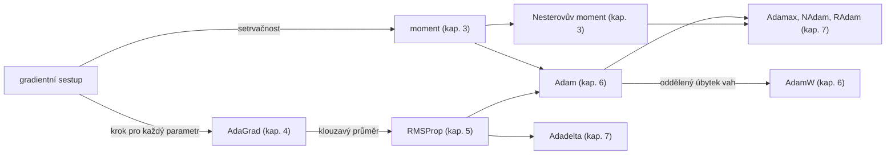

# Optimalizátory neuronových sítí

*Rozšiřující výukový materiál — za hranicí základního gradientního sestupu*

Základní kurz představuje gradientní sestup jako jediný způsob úpravy parametrů. Tento rozšiřující materiál ukazuje, že jde o počátek širší rodiny **optimalizátorů**, z nichž každý s gradientem nakládá jinak. Cílem není úplnost ani teorie konvergence, nýbrž porozumění: u každého optimalizátoru je uveden **předpis aktualizace** (tj. jak se z gradientu vypočítá úprava parametru), jeho myšlenka, přednosti a omezení. Kapitola 9 se věnuje optimalizátorům z výzkumné literatury a kapitola 10 okrajově i učení bez gradientu.

## 1. Optimalizátor jako transformace gradientu

Každý optimalizátor lze zapsat společným rámcem: parametr se v každém kroku upraví o hodnotu odvozenou z gradientu ztrátové funkce.

$$\theta \leftarrow \theta - \operatorname{úprava}(g)$$

U základního gradientního sestupu je úprava pouhým vynásobením gradientu učicím krokem. Jednotlivé optimalizátory se liší právě tím, jak funkci `úprava` sestavují. Základní sestup má tři konkrétní omezení, jejichž postupné odstraňování tvoří dějovou linii tohoto materiálu:

1. **Jediný učicí krok pro všechny parametry** — táž hodnota se použije bez ohledu na to, že různé parametry mohou vyžadovat různě velké úpravy.
2. **Oscilace v protáhlých údolích** — v místech, kde je ztrátová funkce v jednom směru strmá a v jiném plochá, postup kolísá napříč údolím namísto plynulého pohybu podél něj.
3. **Citlivost na měřítko a na volbu učicího kroku** — nevhodná volba jediného kroku vede k pomalé konvergenci, nebo k rozkmitání.

Každý z následujících optimalizátorů přidává jednu myšlenku, která některé z těchto omezení zmírňuje.



Textový popis schématu:

- Gradientní sestup se rozvíjí dvěma směry: moment přidává setrvačnost (omezení 2), AdaGrad zavádí vlastní učicí krok pro každý parametr (omezení 1).
- Z momentu vychází Nesterovova varianta, z AdaGradu RMSProp, který prostý součet nahrazuje klouzavým průměrem.
- Adam spojuje moment s adaptivním krokem RMSPropu; AdamW k němu přidává oddělený úbytek vah.
- Z Adamu vycházejí varianty Adamax, NAdam (s Nesterovovým momentem) a RAdam; Adadelta je obdobou RMSPropu.

## 2. Jednotná notace

Aby byly předpisy srovnatelné, používá se v celém materiálu jednotné značení:

| Symbol | Význam |
|---|---|
| $\theta$ | parametry modelu |
| $g_t = \nabla_\theta L(\theta_t)$ | gradient ztrátové funkce v kroku $t$ |
| $\eta$ | učicí krok |
| $m_t$ | akumulátor prvního momentu (klouzavý průměr gradientu) |
| $v_t$ | akumulátor druhého momentu (klouzavý průměr čtverce gradientu) |
| $\beta,\ \beta_1,\ \beta_2$ | koeficienty útlumu klouzavých průměrů (mezi 0 a 1) |
| $\varepsilon$ | malá konstanta zabraňující dělení nulou |
| $\lambda$ | koeficient úbytku vah (weight decay) |
| $t$ | pořadové číslo kroku |

Operace nad vektory se rozumějí po složkách (mocnina, odmocnina i dělení). Základní gradientní sestup má v této notaci předpis:

$$\theta_{t+1} = \theta_t - \eta\, g_t$$

## 3. Moment a Nesterovův moment

**Myšlenka.** Moment (momentum) zavádí setrvačnost: namísto samotného aktuálního gradientu se použije jeho klouzavý průměr, který tlumí kolísání a udržuje směr postupu.

$$m_t = \beta\, m_{t-1} + g_t, \qquad \theta_{t+1} = \theta_t - \eta\, m_t$$

**Nesterovova varianta** vyhodnocuje gradient nikoli v aktuálním bodě, nýbrž v bodě, kam by setrvačnost parametr posunula (v „bodě pohledu dopředu"), a dosahuje tak přesnějšího kroku:

$$m_t = \beta\, m_{t-1} + \nabla_\theta L\big(\theta_t - \eta\beta\, m_{t-1}\big), \qquad \theta_{t+1} = \theta_t - \eta\, m_t$$

**Přednosti:** Tlumí oscilace v protáhlých údolích (omezení 2) a urychluje postup v souvisle klesajících směrech. **Omezení:** Zavádí další koeficient (β) a při jeho nevhodné volbě může postup přestřelovat.

> **Implementace:** dokumentace PyTorche, [`torch.optim.SGD`](https://docs.pytorch.org/docs/2.14/generated/torch.optim.SGD.html) (moment i Nesterovova varianta se zapínají parametry `momentum` a `nesterov`).

## 4. AdaGrad

**Myšlenka.** AdaGrad přiřazuje **každému parametru vlastní učicí krok** podle toho, jak velké gradienty u něj dosud nastávaly. Parametry s dosud velkými gradienty se upravují méně, parametry se vzácnými gradienty více.

$$G_t = G_{t-1} + g_t^2, \qquad \theta_{t+1} = \theta_t - \frac{\eta}{\sqrt{G_t} + \varepsilon}\, g_t$$

Člen $\eta / (\sqrt{G_t} + \varepsilon)$ zde hraje roli **efektivního učicího kroku**, který se pro každý parametr liší.

**Přednosti:** Odstraňuje omezení 1 (jediný krok pro všechny parametry) a je vhodný pro řídká data. **Omezení:** Součet $G_t$ monotónně roste, takže efektivní krok postupně klesá k nule a učení se předčasně zastavuje. Referenční práce: Duchi, Hazan, Singer, *Journal of Machine Learning Research* 12 (2011), s. 2121–2159.

> **Implementace:** dokumentace PyTorche, [`torch.optim.Adagrad`](https://docs.pytorch.org/docs/2.14/generated/torch.optim.Adagrad.html).

## 5. RMSProp

**Myšlenka.** RMSProp odstraňuje hlavní vadu AdaGradu tím, že prostý součet čtverců nahrazuje **klouzavým průměrem** — starší gradienty tak postupně ztrácejí vliv a efektivní krok neklesá k nule.

$$v_t = \beta\, v_{t-1} + (1 - \beta)\, g_t^2, \qquad \theta_{t+1} = \theta_t - \frac{\eta}{\sqrt{v_t} + \varepsilon}\, g_t$$

**Přednosti:** Zachovává adaptivní krok po parametrech, aniž by se učení zastavovalo. **Omezení:** Postrádá moment (setrvačnost). Metoda byla představena v přednášce (Tieleman, Hinton, 2012) a nemá samostatnou článkovou publikaci.

> **Implementace:** dokumentace PyTorche, [`torch.optim.RMSprop`](https://docs.pytorch.org/docs/2.14/generated/torch.optim.RMSprop.html).

## 6. Adam a AdamW

**Myšlenka.** Adam spojuje moment (kapitola 3) a adaptivní krok RMSPropu (kapitola 5) a doplňuje **korekci vychýlení**, která napravuje podhodnocení akumulátorů v počátečních krocích.

$$m_t = \beta_1\, m_{t-1} + (1 - \beta_1)\, g_t$$

$$v_t = \beta_2\, v_{t-1} + (1 - \beta_2)\, g_t^2$$

$$\hat{m}_t = \frac{m_t}{1 - \beta_1^{\,t}}, \qquad \hat{v}_t = \frac{v_t}{1 - \beta_2^{\,t}}$$

$$\theta_{t+1} = \theta_t - \eta\,\frac{\hat{m}_t}{\sqrt{\hat{v}_t} + \varepsilon}$$

Korekce vychýlení má jednoduché zdůvodnění: akumulátory se inicializují nulou, takže v počátečních krocích jsou vychýlené směrem k nule. Konkrétně platí $\mathbb{E}[m_t] = (1 - \beta_1^{\,t})\,\mathbb{E}[g_t]$ (za předpokladu přibližně ustáleného gradientu), a dělení činitelem $1 - \beta_1^{\,t}$ toto vychýlení odstraňuje; s rostoucím $t$ se činitel blíží jedné a korekce přestává být znatelná.

**AdamW** upravuje způsob, jímž se uplatňuje úbytek vah (weight decay). U původního Adamu byl úbytek zahrnut do gradientu, čímž se mísil s adaptivním členem; AdamW jej **odděluje** a uplatňuje samostatně:

$$\theta_{t+1} = \theta_t - \eta\,\frac{\hat{m}_t}{\sqrt{\hat{v}_t} + \varepsilon} - \eta\lambda\,\theta_t$$

**Přednosti:** Adam je robustní a málo citlivý na volbu učicího kroku, což z něj činí obvyklou výchozí volbu. AdamW navíc dosahuje lepší zobecňovací schopnosti díky správně oddělenému úbytku vah; úbytek vah je přitom formou regularizace (viz [materiál o kompromisu mezi zkreslením a rozptylem](bias-variance.md), kapitola 9). **Omezení:** Udržuje dva akumulátory (vyšší paměťová náročnost) a v některých úlohách dosahuje horší zobecňovací schopnosti než dobře vyladěný gradientní sestup s momentem. Referenční práce: Kingma, Ba, arXiv:1412.6980, DOI 10.48550/arXiv.1412.6980 (Adam); Loshchilov, Hutter, arXiv:1711.05101, DOI 10.48550/arXiv.1711.05101 (AdamW).

> **Implementace:** dokumentace PyTorche, [`torch.optim.Adam`](https://docs.pytorch.org/docs/2.14/generated/torch.optim.Adam.html) a [`torch.optim.AdamW`](https://docs.pytorch.org/docs/2.14/generated/torch.optim.AdamW.html).

## 7. Další varianty v torch.optim

Knihovna PyTorch obsahuje řadu dalších variant, které vycházejí z výše uvedených myšlenek:

- **Adamax** — varianta Adamu, v níž je druhý moment nahrazen maximem (normou ∞) místo průměru čtverců; je odolnější vůči ojedinělým velkým gradientům. [`torch.optim.Adamax`](https://docs.pytorch.org/docs/2.14/generated/torch.optim.Adamax.html)
- **NAdam** — Adam doplněný o Nesterovův moment. [`torch.optim.NAdam`](https://docs.pytorch.org/docs/2.14/generated/torch.optim.NAdam.html)
- **RAdam** — Adam s opravou nadměrného rozptylu adaptivního kroku v počátečních krocích, čímž odpadá potřeba zahřívací fáze (warmup). [`torch.optim.RAdam`](https://docs.pytorch.org/docs/2.14/generated/torch.optim.RAdam.html)
- **Adadelta** — obdoba RMSPropu, která nepotřebuje globální učicí krok, neboť jej odvozuje z poměru velikostí předchozích úprav (Zeiler, arXiv:1212.5701). [`torch.optim.Adadelta`](https://docs.pytorch.org/docs/2.14/generated/torch.optim.Adadelta.html)

Tyto varianty se hodí ve zvláštních situacích, avšak pro většinu úloh postačují AdamW nebo gradientní sestup s momentem.

## 8. Metody druhého řádu

Dosud uvedené optimalizátory využívají pouze gradient (první derivaci). **Metody druhého řádu** využívají i zakřivení ztrátové funkce (druhou derivaci, Hessovu matici), a mohou tak volit přesnější směr i velikost kroku. Zástupcem dostupným v PyTorchi je **LBFGS**, který úplnou Hessovu matici neukládá, nýbrž ji přibližuje z historie posledních gradientů a kroků.

**Přednosti:** Rychlá konvergence na hladkých úlohách s dávkou dat zpracovávanou vcelku. **Omezení:** V hlubokém učení se používá zřídka — špatně snáší šum plynoucí z trénování po malých dávkách, je paměťově a výpočetně náročný a v PyTorchi vyžaduje zvláštní zápis tréninkového kroku (předání tzv. uzávěru, closure). Hodí se spíše pro menší úlohy zpracovávané v úplných dávkách.

> **Implementace:** dokumentace PyTorche, [`torch.optim.LBFGS`](https://docs.pytorch.org/docs/2.14/generated/torch.optim.LBFGS.html).

## 9. Optimalizátory z výzkumné literatury

Následující optimalizátory reprezentují novější vývoj. Některé jsou dostupné v samostatných knihovnách, jiné existují převážně v podobě článku či implementace autorů. U každého je uvedeno ověřené DOI.

**Lion (EvoLved Sign Momentum).** Udržuje pouze moment a úpravu určuje **znaménkem** interpolace momentu a gradientu, takže velikost kroku je pro všechny parametry stejná:

$$c_t = \beta_1\, m_{t-1} + (1 - \beta_1)\, g_t, \qquad \theta_{t+1} = \theta_t - \eta\big(\operatorname{sign}(c_t) + \lambda\,\theta_t\big), \qquad m_t = \beta_2\, m_{t-1} + (1 - \beta_2)\, g_t$$

*Přednosti:* nižší paměťová náročnost (jediný akumulátor, žádný druhý moment) a v některých úlohách lepší zobecnění. *Omezení:* znaménko zahazuje informaci o velikosti gradientu, vyžaduje menší učicí krok a silnější úbytek vah a je citlivější na jejich volbu. Chen a kol., arXiv:2302.06675, DOI 10.48550/arXiv.2302.06675.

**Sophia.** Odhaduje diagonálu Hessovy matice $h_t$ a používá ji jako předpodmínění (dělitele) kroku, s následným ořezáním na práh $\rho$. Jde o odlehčenou metodu druhého řádu:

$$m_t = \beta_1\, m_{t-1} + (1 - \beta_1)\, g_t, \qquad \theta_{t+1} = \theta_t - \eta\,\operatorname{clip}\!\left(\frac{m_t}{\max(h_t,\ \varepsilon)},\ \rho\right)$$

*Přednosti:* využívá zakřivení a při předtrénování jazykových modelů dosahuje výrazného urychlení oproti Adamu. *Omezení:* odhad zakřivení přináší dodatečnou režii a přínos je ověřen převážně na jazykových modelech. Liu a kol., arXiv:2305.14342, DOI 10.48550/arXiv.2305.14342.

**Shampoo.** Uplatňuje předpodmínění zohledňující strukturu parametrů (po jednotlivých rozměrech tenzoru, prostřednictvím Kroneckerova součinu), a zachycuje tak i vztahy mezi parametry, jež diagonální metody pomíjejí. *Přednosti:* silné předpodmínění a rychlejší konvergence. *Omezení:* vysoká výpočetní a paměťová náročnost (výpočet odmocnin a inverzí matic). Gupta, Koren, Singer, arXiv:1802.09568, DOI 10.48550/arXiv.1802.09568.

**Adafactor.** Snižuje paměťovou náročnost druhého momentu tím, že jej neukládá celý, nýbrž jej rozkládá na součin řádkových a sloupcových statistik (podlineární paměť), a doplňuje ořezání úpravy. *Přednosti:* umožňuje trénovat velmi rozsáhlé modely na paměťově omezeném vybavení. *Omezení:* použitá aproximace může v některých úlohách zaostávat za Adamem. Shazeer, Stern, arXiv:1804.04235, DOI 10.48550/arXiv.1804.04235.

**AdEMAMix.** Kombinuje dva klouzavé průměry gradientu — jeden rychlý a jeden velmi pomalý — a využívá tak i starší gradienty, které obvyklý jediný průměr rychle zapomíná. *Přednosti:* lepší využití historie gradientů. *Omezení:* další akumulátor a další koeficienty k nastavení. Pagliardini, Ablin, Grangier, arXiv:2409.03137, DOI 10.48550/arXiv.2409.03137.

**Schedule-Free (The Road Less Scheduled).** Odstraňuje potřebu plánu učicího kroku (viz [materiál o infrastruktuře PyTorche](pytorch-infrastruktura.md), kapitola 3.2) tím, že jej nahrazuje průměrováním iterací; nevyžaduje předem zadanou délku trénování. *Přednosti:* odpadá ladění plánu a metoda podává dobrý výsledek při zastavení v libovolném okamžiku. *Omezení:* jde o novější přístup, jehož chování v některých režimech se dosud zkoumá. Defazio a kol., arXiv:2405.15682, DOI 10.48550/arXiv.2405.15682.

**Muon.** Optimalizátor pro maticové (skryté) vrstvy, který moment před použitím **ortogonalizuje** (Newtonovou–Schulzovou iterací), a upravuje tak geometrii kroku. Je příkladem metody, která vznikla mimo obvyklou článkovou publikaci — původně jako veřejný technický zápis autorů — a do standardní knihovny `torch.optim` není zařazena. *Přednosti:* silné empirické výsledky při trénování rozsáhlých modelů. *Omezení:* použitelný jen pro maticové parametry (ostatní vyžadují jiný optimalizátor), ortogonalizace přináší dodatečný výpočet a metoda dosud dozrává. Jordan a kol., 2024, https://kellerjordan.github.io/posts/muon/; navazující vyhodnocení Liu a kol., arXiv:2502.16982, DOI 10.48550/arXiv.2502.16982.

## 10. Učení bez gradientu

Všechny předchozí metody vyžadují gradient, tedy diferencovatelnou ztrátovou funkci. Existují však postupy, které síť učí **bez gradientu** — pro úplnost je vhodné vědět, že tato možnost existuje.

**Evoluční strategie** pracují s populací náhodně poupravených kopií parametrů: každou variantu ohodnotí (podle ztráty či odměny) a parametry posunou směrem k lépe hodnoceným variantám. Směr postupu se odhaduje z výsledků ohodnocení, nikoli z derivace:

$$\theta \leftarrow \theta + \frac{\eta}{\sigma N}\sum_{i=1}^{N} F(\theta + \sigma\,\varepsilon_i)\,\varepsilon_i$$

kde $\varepsilon_i$ jsou náhodné poruchy, $\sigma$ jejich velikost, $F$ hodnoticí funkce a $N$ počet variant. Příbuzným směrem je **neuroevoluce**, která obdobně vyvíjí i strukturu sítě.

**Kde to má smysl:** u nediferencovatelných cílů a u úloh s řídkou nebo opožděnou odměnou (posilované učení). **Omezení:** vysoká vzorková náročnost (potřeba mnoha ohodnocení). Tyto metody nejsou součástí `torch.optim` a používají se prostřednictvím samostatných knihoven. Referenční práce: Salimans a kol., arXiv:1703.03864, DOI 10.48550/arXiv.1703.03864 (evoluční strategie); Such a kol., arXiv:1712.06567 (neuroevoluce).

## 11. Praktické porovnání

Následující příklad natrénuje týž model třemi optimalizátory a vykreslí průběhy ztráty vedle sebe. Ustálení zárodku před každým během zajišťuje shodnou počáteční inicializaci, a tedy poctivé porovnání.

```python
import torch
import torch.nn as nn
import matplotlib.pyplot as plt

torch.manual_seed(0)
X = torch.randn(512, 20)
y = (X.sum(dim=1, keepdim=True) > 0).float()

def natrenuj(vyrob_optimalizator, kroky=200):
    torch.manual_seed(0)                       # shodná inicializace pro všechny varianty
    model = nn.Sequential(nn.Linear(20, 64), nn.ReLU(), nn.Linear(64, 1))
    kriterium = nn.BCEWithLogitsLoss()
    optimalizator = vyrob_optimalizator(model.parameters())
    ztraty = []
    for _ in range(kroky):
        optimalizator.zero_grad()
        ztrata = kriterium(model(X), y)
        ztrata.backward()
        optimalizator.step()
        ztraty.append(ztrata.item())
    return ztraty

varianty = {
    "SGD":          lambda p: torch.optim.SGD(p, lr=0.1),
    "SGD + moment": lambda p: torch.optim.SGD(p, lr=0.1, momentum=0.9),
    "Adam":         lambda p: torch.optim.Adam(p, lr=0.01),
}

for nazev, vyrob in varianty.items():
    plt.plot(natrenuj(vyrob), label=nazev)

plt.xlabel("krok"); plt.ylabel("ztráta")
plt.yscale("log"); plt.legend()
plt.show()
```

Na výsledném grafu je zpravidla patrné, že gradientní sestup s momentem konverguje rychleji než sestup prostý a že Adam dosahuje rychlého poklesu již v počátečních krocích. Přesné pořadí závisí na úloze a na volbě učicího kroku; příklad slouží k tomu, aby si student rozdíly ověřil sám. Srovnání na jediném seedu je přitom jen orientační; poctivě se výsledky vykazují přes více seedů (viz [materiál o reprodukovatelnosti](../03-projekt-a-prostredi/reprodukovatelnost-seedy.md), kapitola 7).

## 12. Praktické shrnutí a výběr

Pro většinu úloh je vhodnou výchozí volbou **AdamW** (robustní, málo citlivý na učicí krok) nebo **gradientní sestup s momentem** (často lepší zobecnění, je-li dobře vyladěn). Adaptivní metody (AdaGrad, RMSProp, Adam) odstraňují potřebu jediného učicího kroku pro všechny parametry; moment tlumí oscilace. Metody druhého řádu a optimalizátory z výzkumné literatury přinášejí přednosti ve zvláštních situacích (rozsáhlé jazykové modely, paměťová omezení), avšak za cenu vyšší složitosti. Ve všech případech zůstává **učicí krok nejdůležitějším hyperparametrem**, jehož vliv převažuje nad volbou samotného optimalizátoru (k ladění hyperparametrů viz [materiál o kompromisu mezi zkreslením a rozptylem](bias-variance.md), kapitola 7).

## Zdroje

- Duchi, J., Hazan, E., Singer, Y.: Adaptive Subgradient Methods for Online Learning and Stochastic Optimization. *JMLR* 12 (2011), 2121–2159. (AdaGrad)
- Kingma, D. P., Ba, J.: Adam: A Method for Stochastic Optimization. arXiv:1412.6980. DOI 10.48550/arXiv.1412.6980.
- Loshchilov, I., Hutter, F.: Decoupled Weight Decay Regularization. arXiv:1711.05101. DOI 10.48550/arXiv.1711.05101. (AdamW)
- Zeiler, M. D.: ADADELTA: An Adaptive Learning Rate Method. arXiv:1212.5701. DOI 10.48550/arXiv.1212.5701.
- Gupta, V., Koren, T., Singer, Y.: Shampoo: Preconditioned Stochastic Tensor Optimization. arXiv:1802.09568. DOI 10.48550/arXiv.1802.09568.
- Shazeer, N., Stern, M.: Adafactor: Adaptive Learning Rates with Sublinear Memory Cost. arXiv:1804.04235. DOI 10.48550/arXiv.1804.04235.
- Chen, X. a kol.: Symbolic Discovery of Optimization Algorithms. arXiv:2302.06675. DOI 10.48550/arXiv.2302.06675. (Lion)
- Liu, H. a kol.: Sophia: A Scalable Stochastic Second-order Optimizer for Language Model Pre-training. arXiv:2305.14342. DOI 10.48550/arXiv.2305.14342.
- Defazio, A. a kol.: The Road Less Scheduled. arXiv:2405.15682. DOI 10.48550/arXiv.2405.15682. (Schedule-Free)
- Pagliardini, M., Ablin, P., Grangier, D.: The AdEMAMix Optimizer: Better, Faster, Older. arXiv:2409.03137. DOI 10.48550/arXiv.2409.03137.
- Jordan, K. a kol.: Muon: An Optimizer for Hidden Layers in Neural Networks (2024), https://kellerjordan.github.io/posts/muon/; Liu, J. a kol.: Muon is Scalable for LLM Training. arXiv:2502.16982. DOI 10.48550/arXiv.2502.16982.
- Salimans, T. a kol.: Evolution Strategies as a Scalable Alternative to Reinforcement Learning. arXiv:1703.03864. DOI 10.48550/arXiv.1703.03864.
- Such, F. P. a kol.: Deep Neuroevolution: Genetic Algorithms Are a Competitive Alternative for Training Deep Neural Networks for Reinforcement Learning. arXiv:1712.06567.
