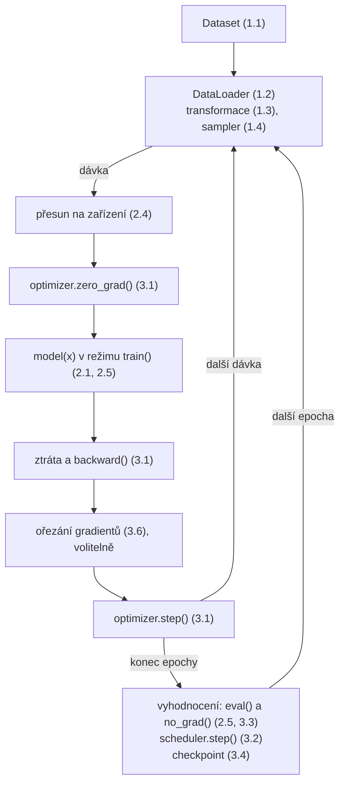

# Infrastruktura PyTorche kolem dat a modelů

*Výukový materiál — prostředky pro práci s daty, modely a tréninkem v knihovně PyTorch*

Základní práce s PyTorchem — převod dat na tenzor a jeho průchod vrstvou — je zvládnutelná záhy. Skutečný tréninkový kód však stojí na infrastruktuře kolem toho: na správně sestaveném načítání dat, správě modelu a řízeném průběhu tréninku. Tento materiál tyto prostředky představuje po jednotlivých částech, u každé uvádí účel, přínos a příklad. Na rozdíl od předchozích materiálů je vázán na konkrétní knihovnu (PyTorch), a není tedy přenositelný do jiných rámců.

Text je členěn do tří okruhů: infrastruktura kolem dat, kolem modelu a kolem tréninku.



Textový popis schématu (čísla v závorkách odkazují na kapitoly tohoto materiálu):

- `Dataset` poskytuje jednotlivé vzorky, `DataLoader` z nich skládá dávky.
- Každá dávka se přesune na výpočetní zařízení a proběhne tréninkový krok: vynulování gradientů, průchod modelem v trénovacím režimu, výpočet ztráty a zpětný průchod, volitelné ořezání gradientů a úprava parametrů.
- Po zpracování všech dávek epochy následuje vyhodnocení v režimu `eval()` s vypnutým sledováním gradientů, posun učicího kroku a uložení checkpointu; poté začíná další epocha.

---

## Část 1 — Infrastruktura kolem dat

### 1.1 Dataset

Třída `Dataset` představuje abstrakci zdroje dat. Vlastní datová sada se vytváří poděděním a implementací dvou metod: `__len__` (počet vzorků) a `__getitem__` (přístup k jednomu vzorku podle indexu).

```python
from torch.utils.data import Dataset

class MujDataset(Dataset):
    def __init__(self, vzorky, popisky):
        self.vzorky = vzorky
        self.popisky = popisky

    def __len__(self):
        return len(self.vzorky)

    def __getitem__(self, idx):
        return self.vzorky[idx], self.popisky[idx]
```

**Přínos:** Datová sada odděluje způsob přístupu k datům od tréninkové smyčky a poskytuje jednotné rozhraní, které využívá `DataLoader` (kapitola 1.2). Metody `__len__` a `__getitem__` jsou tytéž speciální metody, jež jsou popsány v [materiálu o objektech](../01-psani-kodu/zaklady-oop.md), kapitola 4.

> **Přesah:** Načítá-li se vzorek až v `__getitem__` (například obrázek ze souboru podle indexu), nemusí se celá sada držet v paměti — lze tak pracovat s datovými sadami většími než operační paměť. Naopak: veškerá práce v `__getitem__` se provádí opakovaně pro každý vzorek a při paralelním načítání (kapitola 1.2) i souběžně, proto do ní nepatří zbytečně nákladné operace.

### 1.2 DataLoader

`DataLoader` obaluje datovou sadu a řeší, jak z ní vzorky vycházejí: v dávkách, v náhodném pořadí a případně paralelně.

```python
from torch.utils.data import DataLoader

loader = DataLoader(
    dataset,
    batch_size=32,       # velikost dávky
    shuffle=True,        # náhodné pořadí (jen u trénovacích dat)
    num_workers=4,       # počet paralelních načítacích procesů
    pin_memory=True,     # rychlejší přenos na GPU
    drop_last=True,      # zahodí neúplnou poslední dávku
)

for vzorky, popisky in loader:
    ...
```

**Přínos:** Dávkování, míchání a paralelní načítání jsou nezbytné pro efektivní trénink; `DataLoader` je poskytuje deklarativně, bez ruční implementace. Parametr `num_workers` zrychluje načítání souběžným během více procesů, `pin_memory` urychluje přenos na GPU.

> **Přesah:** Míchání (`shuffle=True`) náleží pouze trénovacím datům; u validačních a testovacích dat se nepoužívá, aby bylo pořadí stálé. Parametr `drop_last=True` je vhodný tam, kde by neúplná poslední dávka činila potíže (například u vrstvy batch normalization). Paralelní načítání (`num_workers > 0`) spouští samostatné procesy, z nichž každý má vlastní generátor náhody — pro reprodukovatelnost je nutné je zvlášť seedovat (kapitola 3.8).

### 1.3 Transformace a augmentace

Transformace provádějí předzpracování a rozšiřování (augmentaci) dat po jednotlivých vzorcích; řetězí se pomocí `Compose`.

```python
from torchvision import transforms

prevod = transforms.Compose([
    transforms.RandomHorizontalFlip(),          # augmentace
    transforms.ToTensor(),                       # převod na tenzor
    transforms.Normalize(mean=[0.5], std=[0.5]), # normalizace
])
```

**Přínos:** Předzpracování se soustředí na jedno místo a snadno se skládá. Augmentace zvyšuje rozmanitost dat, a působí tak jako prostředek regularizace snižující rozptyl (viz [materiál o kompromisu mezi zkreslením a rozptylem](bias-variance.md)).

> **Přesah:** Augmentace náleží výhradně trénovacím datům. Použití náhodné augmentace na validační či testovací data je častou chybou — vede k nestálému a nesrovnatelnému hodnocení.

### 1.4 Samplery

Sampler řídí výběr a pořadí vzorků. `WeightedRandomSampler` umožňuje vzorky vybírat s různou pravděpodobností, což se využívá u nevyvážených tříd.

```python
from torch.utils.data import WeightedRandomSampler

sampler = WeightedRandomSampler(vahy, num_samples=len(vahy), replacement=True)
loader = DataLoader(dataset, batch_size=32, sampler=sampler)
```

**Přínos:** U nevyvážené datové sady lze méně zastoupené třídy vybírat častěji, čímž se model netrénuje převážně na většinové třídě.

> **Přesah:** Parametry `sampler` a `shuffle=True` se vzájemně vylučují — sampler již pořadí určuje sám. Pro data s proměnnou délkou (například sekvence různé délky) slouží parametr `collate_fn`, jímž lze určit vlastní způsob skládání dávky (typicky zarovnání na společnou délku).

---

## Část 2 — Infrastruktura kolem modelu

### 2.1 nn.Module

`nn.Module` je bázová třída modelu. V konstruktoru se registrují vrstvy a parametry, metoda `forward` definuje výpočet.

```python
import torch
import torch.nn as nn

class MujModel(nn.Module):
    def __init__(self):
        super().__init__()
        self.vrstva1 = nn.Linear(10, 20)
        self.vrstva2 = nn.Linear(20, 1)

    def forward(self, x):
        x = torch.relu(self.vrstva1(x))
        return self.vrstva2(x)

model = MujModel()
vystup = model(vstup)         # volá forward prostřednictvím __call__
```

**Přínos:** `nn.Module` automaticky spravuje parametry, jejich přesun mezi zařízeními i ukládání stavu. Zápis `model(vstup)` volá metodu `forward` prostřednictvím metody `__call__` — tedy mechanismem popsaným v [materiálu o objektech](../01-psani-kodu/zaklady-oop.md), kapitola 4.

> **Přesah:** Metoda `forward` se nikdy nevolá přímo (`model.forward(x)`); vždy se použije `model(x)`. Přímé volání obchází pomocné operace, které `__call__` provádí (mimo jiné přepínání režimů z kapitoly 2.5), a vede k obtížně odhalitelným chybám.

### 2.2 Kontejnery vrstev

Kontejnery organizují více vrstev do celku: `Sequential` pro lineární posloupnost, `ModuleList` a `ModuleDict` pro proměnný počet vrstev.

```python
self.blok = nn.Sequential(
    nn.Linear(10, 20), nn.ReLU(), nn.Linear(20, 1),
)
self.vrstvy = nn.ModuleList([nn.Linear(10, 10) for _ in range(3)])
```

**Přínos:** Vrstvy lze seskupit přehledně a v případě `ModuleList` i programově vytvořit v proměnném počtu.

> **Přesah:** Vrstvy uložené v obyčejném seznamu Pythonu (`self.vrstvy = [...]`) **nejsou** registrovány jako parametry modelu — optimizer je neuvidí a netrénují se. Pro tento účel je nutné použít `ModuleList` nebo `ModuleDict`. Jde o častou a obtížně odhalitelnou chybu.

### 2.3 Správa parametrů a zmrazení vrstev

Parametry jsou přístupné metodami `parameters()` a `named_parameters()`. Nastavením `requires_grad = False` lze vrstvu zmrazit (vyřadit z trénování), což se využívá při přenosovém učení.

```python
for p in model.vrstva1.parameters():
    p.requires_grad = False        # zmrazení první vrstvy

optimizer = torch.optim.Adam([     # parametrové skupiny s různým učicím krokem
    {"params": model.vrstva1.parameters(), "lr": 1e-4},
    {"params": model.vrstva2.parameters(), "lr": 1e-3},
])
```

**Přínos:** Zmrazení umožňuje ponechat část modelu beze změny (například předtrénované vrstvy) a trénovat jen zbytek. Parametrové skupiny dovolují různým částem modelu přiřadit různý učicí krok.

### 2.4 Správa zařízení

Model i data musí být na témže výpočetním zařízení (procesor, nebo grafická karta). Přesun zajišťuje metoda `.to()`.

```python
zarizeni = "cuda" if torch.cuda.is_available() else "cpu"
model = model.to(zarizeni)

for vzorky, popisky in loader:
    vzorky = vzorky.to(zarizeni)
    popisky = popisky.to(zarizeni)
    ...
```

**Přínos:** Přesun na grafickou kartu výrazně urychluje trénink. Uvedený zápis navíc funguje i tam, kde karta není k dispozici, neboť se zvolí procesor.

> **Přesah:** Nachází-li se model a data na různých zařízeních, výpočet skončí chybou; jde o jednu z nejčastějších počátečních chyb. Pozor též na rozdíl v chování metody `.to()`: u modelu je přesun proveden na místě, kdežto u tenzoru vrací **nový** tenzor, který je nutné přiřadit zpět (`vzorky = vzorky.to(zarizeni)`).

### 2.5 Režimy train a eval

Model se přepíná mezi trénovacím a vyhodnocovacím režimem metodami `train()` a `eval()`. Režim ovlivňuje chování některých vrstev, zejména dropoutu a batch normalization.

```python
model.train()          # trénink: dropout aktivní, batchnorm aktualizuje statistiky
...
model.eval()           # vyhodnocení: dropout vypnutý, batchnorm používá uložené statistiky
with torch.no_grad():
    predikce = model(X_test)
```

**Přínos:** Správné přepnutí zajišťuje, že se model při vyhodnocení chová deterministicky a používá naučené statistiky.

> **Přesah:** Opomenutí `model.eval()` při vyhodnocení je jednou z nejčastějších tichých chyb — dropout ponechá náhodnost a batch normalization použije statistiky aktuální dávky, takže předpovědi jsou nesprávné a nestálé. Režim `eval()` přitom **nevypíná** sledování gradientů; to je úlohou `torch.no_grad()` (kapitola 3.3). Při vyhodnocení jsou proto zpravidla potřeba obě věci.

---

## Část 3 — Infrastruktura kolem tréninku

### 3.1 Optimizer a tréninkový krok

Optimizer (`torch.optim`) upravuje parametry modelu podle gradientů. Tréninkový krok má pevné pořadí: vynulování gradientů, výpočet výstupu a ztráty, zpětný průchod, úprava parametrů.

```python
optimizer = torch.optim.Adam(model.parameters(), lr=1e-3)
kriterium = nn.MSELoss()

for vzorky, popisky in loader:
    optimizer.zero_grad()          # vynulování gradientů z předchozího kroku
    vystup = model(vzorky)
    ztrata = kriterium(vystup, popisky)
    ztrata.backward()              # výpočet gradientů
    optimizer.step()               # úprava parametrů
```

**Přínos:** Optimizer sjednocuje úpravu parametrů; změna optimalizační metody (například z `SGD` na `Adam`) je otázkou jediného řádku.

> **Přesah:** Opomenutí `optimizer.zero_grad()` způsobí, že se gradienty **sčítají** napříč kroky, což zpravidla vede k nesprávnému trénování. (Toto sčítání se ve zvláštních případech využívá záměrně — při hromadění gradientů přes více dávek — nejde tedy o chybu jazyka, nýbrž o snadno přehlédnutelný důsledek pořadí operací.)

### 3.2 Scheduler učicího kroku

Scheduler (`lr_scheduler`) upravuje učicí krok v průběhu trénování — typicky vyšší na počátku pro rychlý postup a nižší později pro jemné doladění.

```python
from torch.optim.lr_scheduler import StepLR

scheduler = StepLR(optimizer, step_size=10, gamma=0.1)  # každých 10 epoch krok ×0,1

for epocha in range(pocet_epoch):
    trenuj_jednu_epochu()
    scheduler.step()               # posun učicího kroku po epoše
```

**Přínos:** Postupné snižování učicího kroku zpravidla zlepšuje konvergenci. Kromě `StepLR` jsou k dispozici mimo jiné `CosineAnnealingLR` a `ReduceLROnPlateau` (snížení kroku při zastavení zlepšování).

> **Přesah:** Umístění volání `scheduler.step()` je zdrojem chyb. Většina schedulerů se posouvá jednou za epochu, některé však po každé dávce (například `OneCycleLR`) a `ReduceLROnPlateau` vyžaduje jako argument sledovanou metriku (`scheduler.step(val_loss)`). Nesprávné umístění či argument vede k tichému selhání úpravy kroku.

### 3.3 Vypnutí sledování gradientů

Při vyhodnocení a inferenci není třeba sledovat gradienty. Jejich vypnutím se šetří paměť a čas.

```python
with torch.no_grad():
    predikce = model(X_test)
```

**Přínos:** Kontext `torch.no_grad()` vypne sledování gradientů pro celý svůj blok; přísnější a rychlejší variantou je `torch.inference_mode()`. `torch.no_grad()` je zároveň kontextovým manažerem i dekorátorem (`@torch.no_grad()`).

> **Přesah:** Vypnutí gradientů (`no_grad`) a přepnutí režimu (`eval`) jsou dvě různé věci a při vyhodnocení jsou zpravidla potřeba obě: první ovlivňuje paměť a výpočet, druhá chování vrstev.

### 3.4 Ukládání a obnovení tréninku (checkpointing)

Checkpoint uchovává stav tréninku, aby jej bylo možné obnovit — po přerušení nebo pro pozdější použití nejlepšího modelu. Ukládá se **stav** (`state_dict`), nikoli celý objekt modelu.

```python
# uložení
torch.save({
    "epocha": epocha,
    "model": model.state_dict(),
    "optimizer": optimizer.state_dict(),
    "scheduler": scheduler.state_dict(),
}, "checkpoint.pt")

# obnovení
stav = torch.load("checkpoint.pt")
model.load_state_dict(stav["model"])
optimizer.load_state_dict(stav["optimizer"])
scheduler.load_state_dict(stav["scheduler"])
zacatek = stav["epocha"] + 1
```

**Přínos:** Dlouhý trénink lze po přerušení obnovit, aniž by se počítal znovu od začátku. Uložení nejlepšího modelu přitom souvisí s včasným zastavením trénování (viz [materiál o kompromisu mezi zkreslením a rozptylem](bias-variance.md), kapitola 8).

> **Přesah:** Ukládá se `state_dict`, nikoli celý objekt modelu (`torch.save(model)`) — uložení celého objektu váže soubor na uspořádání kódu a při jeho úpravě přestane fungovat. Pro skutečné obnovení tréninku je navíc nutné uložit i stav optimizeru a scheduleru; jejich opomenutí sice obnoví váhy, avšak nikoli rozpracovaný učicí krok a hybnost, takže trénink nepokračuje plynule.

### 3.5 Smíšená přesnost (AMP)

Automatická smíšená přesnost provádí část výpočtu v nižší přesnosti, čímž na grafické kartě zrychluje trénink a snižuje spotřebu paměti.

```python
from torch.cuda.amp import autocast, GradScaler

scaler = GradScaler()
for vzorky, popisky in loader:
    optimizer.zero_grad()
    with autocast():
        vystup = model(vzorky)
        ztrata = kriterium(vystup, popisky)
    scaler.scale(ztrata).backward()
    scaler.step(optimizer)
    scaler.update()
```

**Přínos:** Nižší přesnost zmenšuje paměťové nároky a urychluje výpočet, obvykle bez znatelné ztráty kvality. `GradScaler` přitom zabraňuje podtečení gradientů v nižší přesnosti.

> **Přesah:** Jde o pokročilejší prostředek určený pro grafické karty. Pojmenování rozhraní se mezi verzemi PyTorche mírně liší (novější verze nabízejí souhrnný jmenný prostor `torch.amp`), proto je vhodné ověřit tvar volání pro konkrétní verzi.

### 3.6 Ořezávání gradientů

Ořezání omezí velikost gradientů, a zabrání tak jejich přílišnému narůstání, které destabilizuje trénink (typicky u rekurentních sítí).

```python
ztrata.backward()
torch.nn.utils.clip_grad_norm_(model.parameters(), max_norm=1.0)
optimizer.step()
```

**Přínos:** Stabilizuje trénink v situacích, kdy gradienty jinak rostou nade všechny meze.

> **Přesah:** Ořezání se provádí **po** zpětném průchodu (`backward`) a **před** úpravou parametrů (`step`); jiné umístění je neúčinné.

### 3.7 Sledování experimentu

Průběh tréninku (ztráta, metriky) je vhodné zaznamenávat pro pozdější porovnání. Prostředek `SummaryWriter` zapisuje hodnoty pro nástroj TensorBoard.

```python
from torch.utils.tensorboard import SummaryWriter

writer = SummaryWriter("runs/experiment1")
for epocha in range(pocet_epoch):
    writer.add_scalar("ztrata/train", train_loss, epocha)
    writer.add_scalar("ztrata/val", val_loss, epocha)
writer.close()
```

**Přínos:** Zaznamenané průběhy umožňují porovnávat experimenty a rozpoznat například přeučení podle rozevírající se mezery mezi trénovací a validační ztrátou. Jde o obdobu zásad z [materiálu o logování](../02-overovani-a-ladeni/logovani.md), uzpůsobenou číselným metrikám.

### 3.8 Reprodukovatelnost tréninku

Trénink obsahuje náhodu (inicializace vah, míchání, augmentace). Pro reprodukovatelnost je nutné ustálit zárodek u všech generátorů — a u paralelního načítání i u pracovních procesů `DataLoaderu`.

Funkci, která zárodek ustálí u všech generátorů, uvádí [materiál o reprodukovatelnosti](../03-projekt-a-prostredi/reprodukovatelnost-seedy.md), kapitola 4.

**Přínos:** Ustálení zárodku umožňuje trénink zopakovat se shodným výsledkem, což je podmínkou ověřitelnosti.

> **Přesah:** Pracovní procesy `DataLoaderu` (`num_workers > 0`) mají vlastní generátory; bez jejich seedování (parametrem `worker_init_fn`) zůstává augmentace mezi běhy odlišná. Ustálení zárodku navíc nezaručuje plný determinismus — tato problematika má vlastní [materiál o reprodukovatelnosti](../03-projekt-a-prostredi/reprodukovatelnost-seedy.md), kapitola 6.

---

## Shrnutí

Skutečný tréninkový kód se opírá o infrastrukturu, kterou PyTorch poskytuje ve třech okruzích. Kolem dat je to `Dataset` (zdroj dat přes `__len__`/`__getitem__`), `DataLoader` (dávkování, míchání, paralelní načítání), transformace a samplery. Kolem modelu `nn.Module` (výpočet přes `forward` a `__call__`), kontejnery vrstev, správa parametrů, správa zařízení a režimy `train`/`eval`. Kolem tréninku optimizer a tréninkový krok, scheduler, vypnutí gradientů, checkpointing, smíšená přesnost, ořezávání gradientů, sledování experimentu a reprodukovatelnost. Páteří reálného tréninku je posloupnost `Dataset` + `DataLoader` → `nn.Module` + zařízení + `train`/`eval` → optimizer + scheduler + checkpointing; ostatní prostředky ji doplňují podle potřeby.

> **Další čtení:** oficiální dokumentace PyTorche, [práce s daty](https://pytorch.org/docs/stable/data.html) a [optimalizace a schedulery](https://pytorch.org/docs/stable/optim.html).
